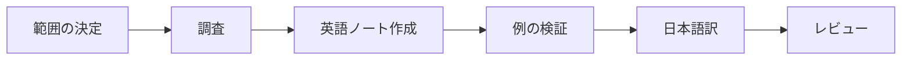

# Learning Note

[English](SKILL.md)

## 利用する場面

- 特定のテーマについて学習ノートの作成や更新を依頼された場合に使います。
- リポジトリの `AGENTS.md` に従ってください。
- この手順は、コミット、push、公開、依存関係のインストール、影響の大きい外部操作の許可を与えるものではありません。

- ノートはMarkdownだけで完結させ、GitHub向けの図は本文内のMermaid、ディレクトリ構成はASCIIツリーで記述します。他の描画環境や明示的に依頼された書き出しは `AGENTS.md` に従います。
- 全体像の図と説明を先に示し、その後に各コンポーネントを説明します。該当する箇所では、役割、実体、実行環境、入出力、読み込み・呼び出しの関係を明示します。構成と意味を日英で揃えます。



## 手順

1. **確認と範囲の決定。** リポジトリの指示と関連ノートを読み、テーマ、読者、学習目標を確認します。指定がなければ初学者向けの妥当な範囲を選び、不足情報が作業を妨げる場合のみ質問します。既存の作業を保護します。
2. **配置先の決定。** 英小文字の `snake_case` で `learning/<topic>/<subject>.md` と `<subject>_jp.md` を使います。適切な既存ディレクトリやノートを再利用し、内容を追加するときだけディレクトリを作成します。
3. **根拠の収集。** 公式ドキュメントや一次資料を優先します。資料名、URL、関連バージョンを記録し、事実、解釈、仮定を区別します。ブラウジングできない場合は参考資料が未確認であることを示し、出典を捏造したり、最新情報を確認したと報告したりしません。
4. **英語版の作成。** [テンプレート](templates/learning_note.md) をもとに、テーマに合わせて調整し、不要な項目とプレースホルダーを削除します。目的を短く述べ、全体像の図と説明、その後に各コンポーネントを記載します。具体例や関連する制約は、そのコンポーネントの説明に含めます。依頼がある場合やテーマ自体に必要な場合を除き、ファクトチェック、次に学ぶこと、検証の章は追加しません。
5. **例の検証。** 実行可能な例には前提条件、コマンド、期待する結果を記載します。環境が対応していれば、安全で関連する例を実行します。破壊的な操作や不要な依存関係を避けます。観測した結果と期待する結果を分け、失敗や未実行を正確に報告します。概念的なテーマでは、形式的な実行手順を増やさず、例が説明を裏付けるか確認します。
6. **翻訳。** [日本語テンプレート](templates/learning_note_jp.md) を使って日本語版を作ります。意味、章の順序、例、注意事項、コード、コマンド、パス、識別子を維持し、説明文を翻訳します。相互の相対リンクを付けます。
7. **レビュー。** 事実の裏付け、翻訳の整合性、相対リンク先、コードフェンス、空白の問題を確認します。追跡済みの変更には `git diff --check` を使い、このコマンドだけでは対象にならない新規ファイルも確認します。完成したノートにテンプレートのプレースホルダーを残しません。
8. **報告。** 作成・更新したファイル、主な出典、実施した検証、制約を完了報告に記載します。資料作成時の確認結果を残すためだけの章は追加しません。コミットや push はユーザーが許可した範囲のみで行い、コミットメッセージと PR のタイトル・説明は英語にします。

## 完了条件

- 英語のノートと対応する `_jp.md` が存在し、相互リンクがある。
- 説明に具体例と適切な参考資料がある。
- 未使用のプレースホルダーがなく、検証に関する記述が実際の結果と一致する。
- 既存の作業が保護され、無関係な変更がない。

## 依頼例

```text
learning_note を使って、Linux のプロセスとスレッドを初学者向けに説明してください。
ローカルで安全に実行できる例と、公式ドキュメントの参考資料を含めてください。
```
