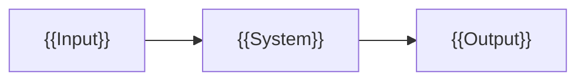

# {{Title}}

[日本語]({{subject}}_jp.md)

{{Briefly state the purpose, audience, and scope.}}

## Overall structure

{{Replace the example diagram with the actual structure. Explain how to read it, the relationships, boundaries, and the overall flow before detailing individual components. Keep the diagram inside this Markdown file.}}

## Components

### {{Component name}}

- **Responsibility:** {{What this component does.}}
- **Implementation form:** {{File, library, program, process, or other concrete form.}}
- **Execution environment:** {{Where it runs, or where stored data is loaded.}}
- **Input / output:** {{What it receives and produces.}}
- **Loading / invocation:** {{Who reads or invokes it and what happens next.}}

{{Add a concrete example and relevant limitations here. Repeat for the components that need explanation and omit fields that do not apply.}}

## References

- {{Relevant source title, URL, and version when needed.}}
