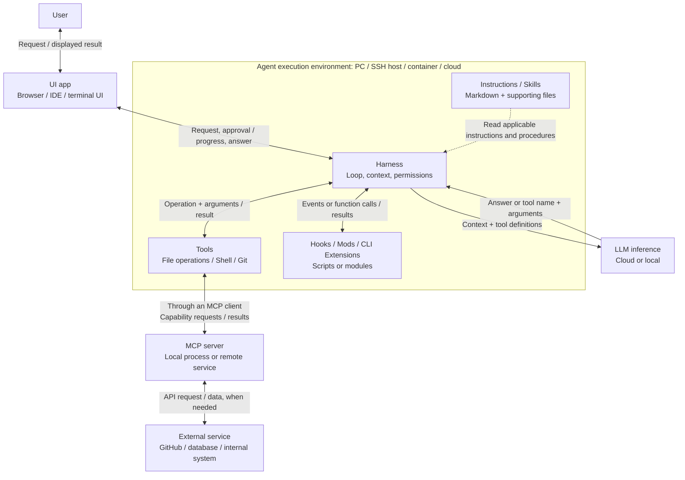
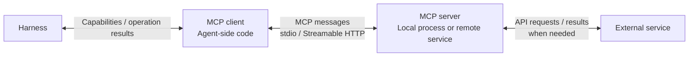
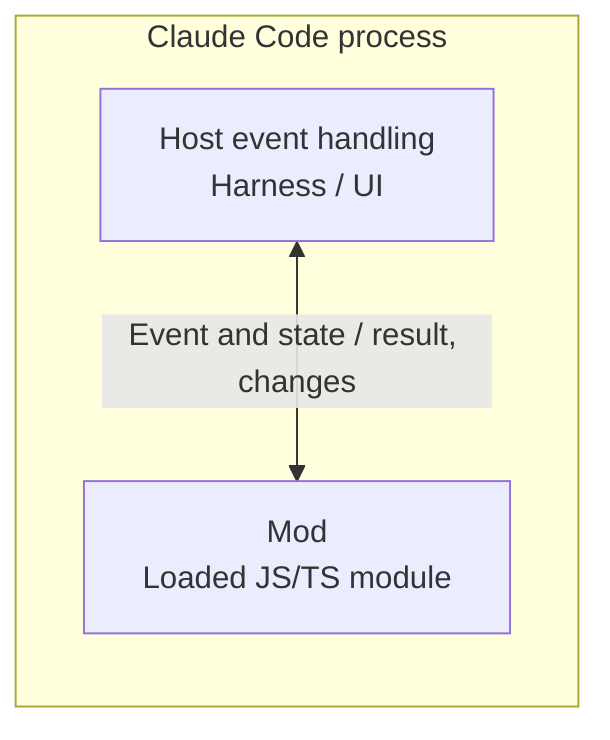
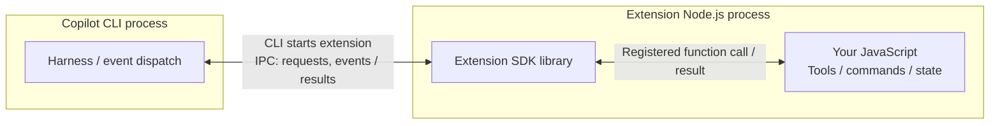
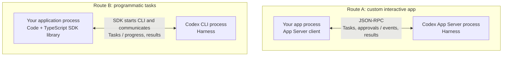

# AI Agent Architecture

[日本語](agent_architecture_jp.md)

Understand what runs where, what information moves between components, and where to customize Claude Code, Codex, and GitHub Copilot CLI. The diagrams are Mermaid blocks embedded in this Markdown file and can be viewed directly on GitHub.

## 1. Overall architecture

**The LLM generates an answer or an operation request; the harness manages the work; tools perform operations.** An AI agent is the software system combining these roles to pursue a task. The harness is its execution-control layer.

- The box marks an execution environment, not one OS process. A UI can share the agent process, while a hook or extension can run in a separate process. The details follow below.
- “Local” means the environment running the agent: your PC, an SSH host, or a development container. A browser UI can control either a local agent or a cloud agent. Model inference is configured separately.
- Instructions and Skills supply information. Hooks, Mods, and Extensions provide executable behavior. The diagram groups extension mechanisms by purpose; each product supports its own mechanisms and APIs.
- MCP connects a client and server. The server can perform work itself or call another service. Tools can also call external services directly without MCP.

For **“Fix this C++ bug and run the tests”**, the exchange is:

1. The UI passes the task to the harness.
2. The harness assembles the prompt, applicable instructions, selected Skill content, conversation, and tool definitions into model input: the **context**.
3. The LLM returns an answer or a tool request, such as reading a source file or running CTest.
4. The harness checks the requested operation, dispatches the tool, and collects its result. Configured hooks run at their matching events.
5. The tool result becomes input to a subsequent model call. The loop continues as needed, and the UI displays progress and the final answer.

## 2. Components

### 2.1 User and UI app

| Component | What it is / where it runs | Input | Output |
| --- | --- | --- | --- |
| User | The person requesting and reviewing work | Answers, progress, diffs, approval requests | Goals, constraints, feedback, approvals |
| UI app | Browser, IDE integration, desktop app, or terminal interface; CLI UI code runs on the CLI host | User actions and agent events | Requests to the agent; displayed answers, logs, and diffs |

A **CLI** is a command-line program such as `codex`, `claude`, or `copilot`. The terminal application displays that program's interface. CLI and terminal are different programs, and a CLI's UI and harness may share a process. Over SSH, the terminal can run on your PC while CLI UI processing and the harness run on the remote host.

### 2.2 AI agent and harness

| Aspect | Description |
| --- | --- |
| What it is | Software implemented in languages such as Rust, TypeScript, Python, or C++; running as one or more processes or services |
| Execution environment | The machine, container, or cloud workspace running the agent |
| Input | User requests, instructions, selected resources, model outputs, tool results, and extension events |
| Output | Model API calls, permitted tool operations, extension invocations, progress, and final results |

The harness maintains the **agent loop**, context, permissions, session state, and completion conditions. It selects or retrieves information for model calls and routes operation requests to the appropriate executor. These responsibilities can be distributed across the application and supporting services.

Customization also includes model selection, tool permissions, and **custom agents / sub-agents**. A custom agent defines a role and available tools; a sub-agent receives a delegated task and returns findings or artifacts. A separate agent context does not necessarily imply a separate OS process.

For example, delegate a code review with a limited context and tool set, then return its findings to the main agent. Actual process and workspace isolation depend on the implementation.

### 2.3 LLM

| Aspect | Description |
| --- | --- |
| What it is | Learned model parameters used by an inference program or service |
| Execution environment | Usually a provider's cloud service; supported configurations can use local inference |
| Input | Context: prompts, relevant instructions, conversation, retrieved content, tool results, and tool definitions |
| Output | Generated text or structured requests such as a tool name and arguments |

A tool request does not itself edit a file or start a shell. The harness and executor perform that operation. Reading Instructions or Skills changes the input for inference; it does not normally retrain the model.

The context has a size limit. The harness may select, retrieve, or summarize information. A file existing in the workspace does not mean its contents have reached the model.

### 2.4 Tools and execution environment

A **tool** is a callable operation with a name, input format, and implementation. The harness dispatches an allowed request to that implementation.

| Tool | Implementation / execution location | Input → output |
| --- | --- | --- |
| File operations | Code in the agent or an execution service, using that environment's filesystem | Path and edit data → file contents or a modification result |
| Shell | A shell and command processes on the execution host | Command, arguments, working directory → stdout, stderr, exit code |
| Git | The Git executable or a library; network access for remote operations | Repository and operation → diff, commit information, or result |
| External API | API client in the agent, tool service, or MCP server | Operation and arguments → service data or result |

The execution environment determines filesystem paths, installed dependencies, network access, and available credentials. The harness and OS/infrastructure enforce applicable permissions; natural-language instructions alone do not enforce them.

For example, a cloud workspace runs `ctest` against files in that workspace. It does not run against your PC's checkout merely because you opened the UI on your PC.

### 2.5 Prompt, Instructions, and Skills

| Mechanism | What you write | Who reads it / when | Input → effect |
| --- | --- | --- | --- |
| Prompt | Text and attachments in the UI or API request | Harness receives the current request and builds model input | Task and constraints → guidance for this task |
| Instructions | Markdown files or configured text | Host loads applicable rules according to product scope | Project or personal rules → relevant model guidance |
| Skill | `SKILL.md`, optional references, templates, and helper scripts | Host and model participate in discovery/selection; required content is loaded through the host or file tools | Task and procedure → guided work; scripts produce results when executed through tools |

Instructions and Skills are stored on a filesystem or another resource accessible to the host. Their relevant text becomes context; the entire contents of every Skill need not be loaded at once. Selecting a Skill does not automatically execute all its scripts.

| Product | Typical project instructions | Reusable procedure |
| --- | --- | --- |
| Claude Code | `CLAUDE.md` | Skills |
| Codex | `AGENTS.md` | Skills |
| GitHub Copilot CLI | `.github/copilot-instructions.md`, `AGENTS.md` | Skills |

For the C++ task, Instructions can specify CMake/CTest conventions. A Skill can describe reproduction, diagnosis, editing, and verification, and include a helper script that is run when needed. File discovery and scope rules are product-specific. See the [Claude Code overview](https://code.claude.com/docs/en/how-claude-code-works), [Codex customization](https://learn.chatgpt.com/docs/customization/overview), and [Copilot customization comparison](https://docs.github.com/en/copilot/concepts/customizations/comparing-customizations).

### 2.6 Hooks

A **Hook** connects a product-defined event to a configured handler. The host invokes a matching enabled handler when the event occurs.

| Aspect | Command-hook example |
| --- | --- |
| What you write | Event/filter configuration plus a Shell, Python, or other executable handler |
| Who invokes it | The host's event dispatcher, part of the harness/runtime |
| Execution environment | Usually a separate command process in the agent's execution environment |
| Input | Event information, such as the operation, arguments, and result; format depends on the product |
| Output | Exit status and supported output, such as logs, added context, or an allow/block decision |

For example, a hook after a successful file edit can run a script to format the relevant C++ files. Its activation follows the configured event; the LLM does not have to generate a separate request to run that hook. A post-operation error does not by itself undo the operation.

Command hooks are one type. Depending on the product, handlers can also use HTTP, MCP tools, or model calls. Available events and return formats differ: [Claude Code Hooks](https://code.claude.com/docs/en/hooks), [Codex Hooks](https://learn.chatgpt.com/docs/hooks), [Copilot Hooks](https://docs.github.com/en/copilot/reference/hooks-reference).

### 2.7 MCP client and server

**MCP is a communication protocol.** The running components are its client and server; MCP itself is not a text file supplied to the model.

| Component | What it is / execution location | Input → output |
| --- | --- | --- |
| Connection configuration | Settings naming a server command or endpoint; read by the host | Configuration → server startup or connection |
| MCP client | Protocol implementation on the agent/host side | Capability queries and operation requests → definitions, content, results, errors |
| MCP server | Executable or service on the agent host or another host | Protocol requests → supported tools, resources, prompts, or operation results |

The host discovers supported capabilities and makes relevant definitions available to the model. If the model requests a tool, the harness dispatches it through the client and returns the result to the model. For example, an internal issue-search server receives a query and returns matching issues.

Local child servers commonly use stdio; services can use Streamable HTTP. The server and any downstream external service can run on different machines. See [MCP architecture](https://modelcontextprotocol.io/docs/learn/architecture).

### 2.8 Mods, CLI Extensions, and SDK integration

These mechanisms differ in **which program invokes your code and which process contains it**. An SDK is a library used by a program; the SDK is not necessarily a standalone process.

**Claude Code Mods: code inside Claude Code**

Claude Code loads the module and calls its registered functions in its own process. Inputs are exposed events and state; outputs can modify supported behavior, commands, tools, or UI. For example, a Mod can add a panel showing test state. The public API determines what is customizable. See [Claude Code Mods](https://code.claude.com/docs/en/plugins/mods/overview).

**Copilot CLI Extensions: code in a separate process**

The CLI starts the extension process. The SDK inside it connects to the session and routes calls/events to your functions. The extension can keep session state and expose tools or commands. This CLI feature is experimental; it is distinct from an IDE extension and the retired GitHub App-based Copilot Extensions. See [Copilot CLI Extensions](https://docs.github.com/en/copilot/concepts/customizations/extensions).

**Codex SDK / App Server: drive the agent from your program**

These are separate entry points. App Server accepts requests from an app and exchanges events and results. The TypeScript SDK wraps the CLI for programmatic work, such as a CI task. Your application and the Codex runtime run on the hosts where they are launched. Codex also supports Instructions, Skills, Hooks, and MCP; SDK integration is an additional way to use the runtime.

See [Codex App Server](https://learn.chatgpt.com/docs/app-server) and the [Codex TypeScript SDK](https://github.com/openai/codex/blob/main/sdk/typescript/README.md). Claude Code and Copilot also have application-integration SDKs: [Claude Agent SDK](https://platform.claude.com/docs/en/agent-sdk/overview), [GitHub Copilot SDK](https://github.com/github/copilot-sdk).
