# AI Assistants and Agents: Architecture and Practical Guide

[日本語](agent_architecture_jp.md)

This consolidated guide combines the architecture and practical material formerly maintained in `agent_architecture.md` and `AI_GUIDE.md`. It explains the relationships between assistants, agents, harnesses, LLMs, and extensions through implementation, execution, and practical use.

Prerequisites: C/C++, Python, TypeScript, Linux, OS processes, and system calls. Start with the overall structure and execution locations, then proceed to components and practical examples. Terminology varies by product; this is not a claim about private implementations.

Reading map: sections 1–5 cover the overall system, products, and execution; 6–11 explain core components; 12–16 cover customization and operation; 17–20 connect the practical workflow and troubleshooting.

## 1. Overall structure: from user to execution environment

The user supplies a goal through a UI. An agent combines harness control, LLM generation and decisions, and tool operations. Agent and harness are not synonyms: here, the harness is the control layer supporting the agent.

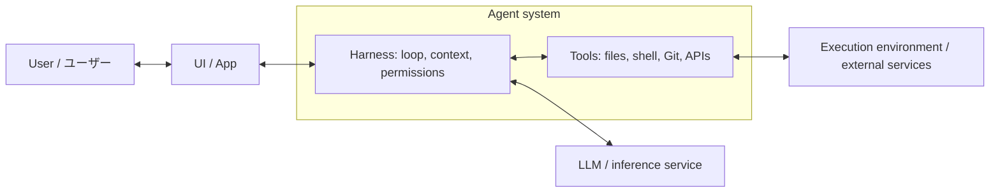

Arrows show requests and results, not process boundaries. UI and harness may share an application or run in separate services. Model inference may also be local or remote.

## 2. Start with three roles

**The LLM generates the next step. Tools perform operations. The harness manages the exchange. Together, they make up the agent system described here.**


**Read the numbered arrows:** give information to the LLM → receive an operation request → run the permitted operation → return its result. Repeat as needed.

| Name | Plain explanation | In “Fix this bug” |
| --- | --- | --- |
| LLM | Generates an answer or the next operation request | “Read this function first” |
| Harness | Manages information, execution, and progress | Reads the requested file and returns its contents |
| Tool | Performs a defined operation | Reads, edits, or runs a test |
| Agent | The system pursuing the goal over multiple steps | Investigates, edits, verifies, and reports |

- The **host** is the application you use, such as a CLI or chat application. Harness functions live in that application and its supporting software.
- Context, tokens, MCP, and execution environments describe the information, units, connections, and locations used by these roles. We add them one at a time below.

## 3. Products, models, and harnesses

| Provider | Assistant product | Coding products or features |
| --- | --- | --- |
| OpenAI | ChatGPT | Codex |
| Anthropic | Claude chat | Claude Code |
| GitHub / Microsoft | GitHub Copilot | Copilot agent features, Copilot CLI |

These are usage categories, not exclusive classes. Assistants can include agent features, and products are distinct from models. Related products need not share an application or harness. Changing the model need not replace the harness, although available tools or settings may change.

## 4. Implementation and OS processes

Agent control is ordinary software. It can be implemented in C/C++, Python, TypeScript, Rust, or other languages and runs as one or more OS processes or distributed services. Languages and process counts vary by product.

For example, a harness process calls an LLM API, validates a returned `run_tests` request, and starts `pytest` as a child process. On Linux, process creation and file operations ultimately use system calls, usually through runtimes and libraries. With a remote shell tool, the execution service starts the process. Generated model text does not itself issue system calls.

## 5. Execution environment: where operations really run

**The execution environment is the machine or session where a tool performs its operation.** The model and the test command can run in different places.


**This is one example deployment:**

- Your PC runs a CLI, the command-line application receiving your request.
- The provider's server runs model inference.
- A cloud workspace runs file operations and `pytest`. A **container** is one possible way to provide an isolated process environment there.

Other products may run tools on your PC, use a VM, or run the whole host in the cloud. An MCP server can also be local or remote. The diagram shows locations, not a universal deployment.

| Check | Plain question |
| --- | --- |
| Working directory | Which folder does a relative path refer to? |
| Filesystem permissions | Which files can this tool read or change? |
| Runtime and dependencies | Are Python and `pytest` installed here? |
| Network | Can this environment reach the needed service? |
| Account | Which identity is used by this CLI, browser, or MCP connection? |
| Persistence | Will these files survive the end of the session? |

- A **sandbox** enforces operation restrictions through the OS or infrastructure. Its restrictions are stronger than a prompt asking the model to avoid a path.
- `/workspace/project` in a remote environment is not automatically a folder on your PC.
- If source excerpts are sent to a remote model, those excerpts leave the workspace. Container isolation alone does not keep inference inputs local.

## 6. LLM: generate an answer or a request

**An LLM is a model that generates output from the information it receives.** LLM stands for *large language model*.

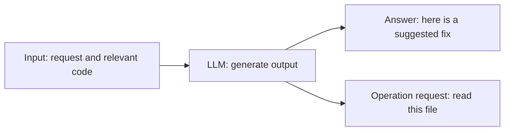

**Example:** the model sees a division function and generates “Raise an exception when the denominator is zero.” That is a proposed fix. A tool must edit the actual file, and a test must check the behavior.

- In practice, the model consists of learned parameters used by an inference process or service.
- **Training** changes the parameters. **Inference** uses them to process a request. Reading an attached document normally supplies input for inference.
- Model output can be wrong. The current contents of a repository or the outcome of a test need evidence from the relevant system.

## 7. Harness: keep the work moving

**A harness is the software that makes repeated model calls and tool operations work together.** Think of it as the work coordinator; it also applies execution limits and permissions.

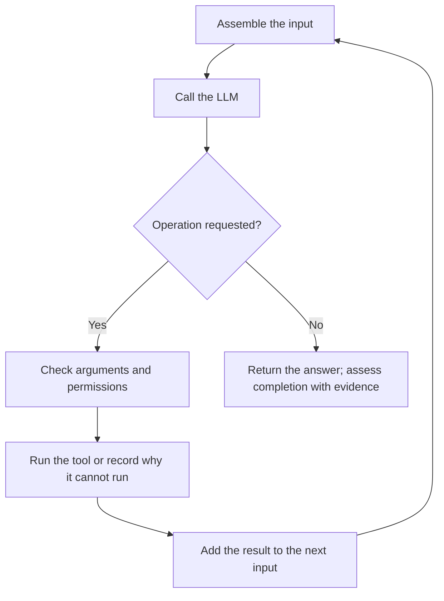

**Example:** the model requests `pytest -q`. The harness checks that the command is allowed, runs it through the shell tool, waits for completion, and returns the exit code and log. The model can then decide whether to adjust the fix.

- A **tool call** is a request to run something. Its **result** tells us what actually happened.
- The harness manages context selection, running processes, progress, retries, and stopping conditions. These responsibilities may be split across an application, SDK, and infrastructure.
- The same LLM can behave differently with different tools, input selection, or error handling.
- The simplified diagram omits cancellation and time/budget limits; real systems need those ways to stop too.

## 8. Context: the information on the desk right now

**Context is the information available for this model call.** A useful analogy is the material placed on a desk for the current task.


**Example:** for a division bug, useful context includes the requirement, the division function, and the failing test. An unrelated image folder probably does not help.

- A file being in the workspace does not mean the model has read it. Its contents must be retrieved and supplied.
- The visible chat history may differ from the exact input assembled by the host.
- Long conversations may be shortened or summarized. Important details can be lost, so keep requirements and unresolved decisions explicit.

| Easily confused terms | Difference |
| --- | --- |
| Model knowledge | Patterns stored in parameters through training |
| Context | Information supplied for the current inference call |
| Memory | Selected information saved by the application and retrieved later |

**RAG** means searching for relevant material and adding it to the input before generating a response. For example, search a specification and supply the matching paragraphs as context.


- Context is the information available for the current response: messages, files, retrieved passages, tool results, and system-provided information.
- A context window is finite, so long conversations may be truncated or summarized.

- Provide focused material: the relevant files, current requirements, exact errors, and recent decisions.
- Label sources and dates where freshness matters.
- Avoid dumping unrelated repositories or logs into a conversation.

- Memory may persist selected preferences or facts across conversations, depending on the product and settings.
- It is not a reliable replacement for versioned project documentation.
- Inspect, correct, and delete stored information through supported controls.

- For long tasks, maintain a short handoff note containing the goal, accepted decisions, completed work, remaining steps, and validation status.
- Recheck changing facts instead of treating old conversation history as current evidence.

## 9. Tokens: the units used to count input and output

**Tokens are the model's input/output units.** A token is not necessarily one word or one character.

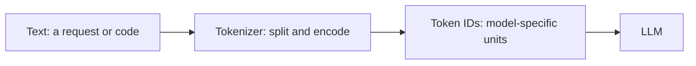

**Why it matters:** the model has an input/output budget, and usage often contributes to cost. Exact segmentation depends on the model and language; this diagram does not show an actual tokenization result.

**A hypothetical 32,000-token combined limit:**

| Budget item | Tokens |
| --- | ---: |
| Instructions and tool descriptions | 4,000 |
| Conversation | 8,000 |
| Relevant documents | 12,000 |
| Latest request | 1,000 |
| **Input subtotal** | **25,000** |
| Reserved for generation | 5,000 |
| **Remaining headroom** | **2,000** |

- A **context window** is a limit on how much a call can handle. This is a simplified budget; actual output limits and reasoning-token rules depend on the API.
- One user request may cause several model calls. Earlier content and new tool results can be processed on later calls, increasing total usage.
- Retrieve relevant excerpts and return concise logs to use the budget well. More input is useful when it adds needed evidence.
- An **access token** used to log in to a service is a different meaning of “token.”

## 10. MCP: a shared way to connect to capabilities

**MCP is a protocol for connecting an AI application to servers exposing tools and data.** Its full name is *Model Context Protocol*.


**Follow a search request:**

1. The LLM generates a request to search issues related to the bug.
2. The host checks the request; its MCP client sends it to the configured server.
3. The server queries the issue service using the available authorization.
4. Search results return to the host and can be supplied to the model as context.

| Part | Role |
| --- | --- |
| Host | The AI application using the capabilities |
| MCP client | Manages a connection from the host |
| MCP server | Exposes capabilities and handles requests |
| Service API | The issue/document/database system's own interface |

- Tools can also use direct functions or APIs. A local file edit does not require MCP.
- Connecting a server makes its capabilities available; it does not automatically load all its data or train the model on it.
- Access still depends on authentication, account permissions, and network restrictions. Creating an issue requires the appropriate write access in addition to search capability.


- To connect a server:

1. Choose a trusted server and verify its supported transport and capabilities.
2. Configure it using the host's documented settings.
3. Supply authentication through approved secret storage or authorization flows.
4. Grant the smallest useful scope, starting with read-only access.
5. Test a harmless operation and inspect the returned result.
6. Enable write operations only when needed and authorized.

- For connection failures, distinguish server startup errors, transport problems, unsupported capabilities, expired authentication, and insufficient permissions.
- Inspect sanitized logs without exposing tokens.
- Prefer a narrow tool with explicit arguments over unrestricted command execution when both satisfy the task.

## 11. Retrieval, RAG, and Knowledge Sources

- Retrieval-augmented generation (RAG) searches a knowledge source and supplies relevant results to the model before it answers.
- A typical pipeline ingests documents, splits them into passages, indexes them, retrieves candidates, and generates an answer with supporting references.

- Use file attachments for a small, task-specific collection.
- Use search for current or broadly distributed information.
- Consider RAG for a larger, maintained collection that users query repeatedly.
- MCP can expose a retrieval service, but MCP and RAG solve different parts of the workflow.

- Preserve document ownership, access controls, source identifiers, and update dates.
- Retrieval must enforce the requesting user's permissions; filtering only the final answer is insufficient.

- Evaluate whether the correct passages were retrieved and whether the answer is supported by them.
- Ask for citations and verify that they support the actual claims.
- When sources are missing or contradictory, report the gap instead of filling it with an unsupported answer.

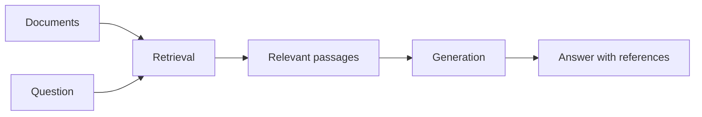

## 12. Extensions: what changes, and when

| Mechanism | Role and application point |
| --- | --- |
| Instructions | Add scoped rules to model input |
| Skills | Load selected task procedures, knowledge, and supporting scripts |
| Hooks | Handle product-defined events, such as before or after a tool operation |
| Claude Code Mods | Plugins with a hooks module that extend behavior and display through exposed events and APIs |
| Copilot CLI Extensions | Add session-aware tools, commands, and state through code running alongside a session |
| MCP | Standardize host/server capability and data communication |
| Plugins | Distribute supported combinations of skills, hooks, MCP configuration, and other components |

Instructions and skills primarily guide the model; skill scripts still require tools and execution permissions. Hooks are not necessarily shell commands; supported handler types vary.

Claude Code Mods are an official extension mechanism, not a general license to rewrite arbitrary internals. Copilot CLI extensions run as separate Node.js processes containing JavaScript modules and are experimental at the time checked. They differ from retired GitHub App-based Copilot Extensions and IDE extensions. See the [official Mods material](https://github.com/anthropics/claude-code/blob/main/mods/README.md) and [official Extensions documentation](https://docs.github.com/en/copilot/concepts/customizations/extensions).

Example: load a bug investigation skill, format after an edit with a hook, and search issues through MCP. Whether these can be distributed together as a plugin depends on the product.

## Writing Effective Prompts

**A useful request states the goal, context, constraints, and completion criteria.**

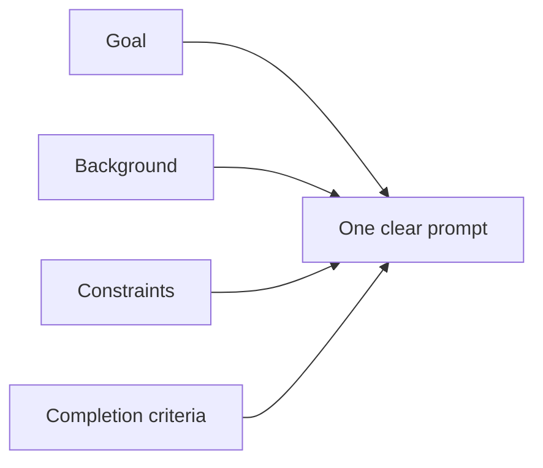

- A useful prompt includes the goal, relevant background, constraints, expected output, and a way to judge success.
- Provide examples when the desired result is difficult to describe.

```text
Goal: Review the attached API proposal for compatibility risks.
Context: Existing clients depend on the current response fields.
Constraints: Do not change the proposal or assume undocumented behavior.
Output: List findings by severity, with evidence and suggested fixes.
Success: Identify breaking changes and clearly label uncertainties.
```

- Start with the information required to make progress.
- For larger tasks, define milestones such as investigation, implementation, and validation.
- Ask for observable evidence and concise explanations of decisions.

- A vague request such as “improve this” becomes more useful as “rewrite this onboarding page for first-time users, preserve technical requirements, and keep it under 500 words.” Refine the result by naming the specific gap instead of repeating the original request.

## 13. Using Instructions

**Instructions are the shared rules for work in their scope.**

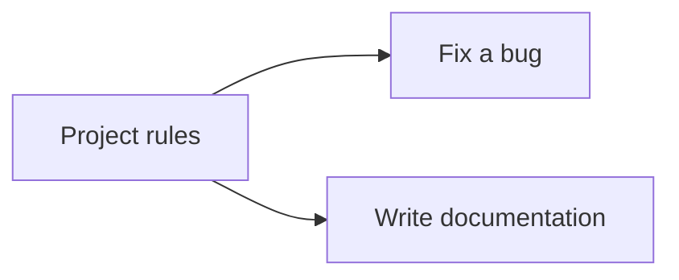

- Instructions describe rules that should apply repeatedly.
- Depending on the product, they may live in personal settings, workspace configuration, repository files, or API messages.

- Use personal instructions for preferences such as language and tone.
- Use project instructions for architecture, supported commands, coding conventions, and validation requirements.
- Keep temporary requirements in the task prompt.

- Some coding agents recognize `AGENTS.md`; others use different files or require explicit configuration.
- Confirm discovery rules, directory scope, and precedence in the product documentation.
- A file name alone does not guarantee that its contents are loaded.

- Example project instructions:

```markdown
# Project Instructions

- Follow the existing architecture and naming conventions.
- Read the relevant package documentation before making changes.
- Use the dependency manager and lockfile already present.
- Run checks appropriate to the changed behavior.
- Report failed or unrun checks explicitly.
- Never include credentials in code, logs, or documentation.
```

- Keep rules short, actionable, and consistent.
- Remove obsolete rules.
- When instructions conflict, consult the host's instruction hierarchy and clarify unresolved project requirements; do not assume that the latest text always wins.

## 14. Building and Using Skills

**A skill packages the steps for a recurring task.**

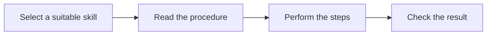

- A skill packages a repeatable task with instructions and, where supported, scripts, templates, and references.
- Good candidates include release preparation, environment setup, incident triage, and documentation review.

- Platforms that support `SKILL.md` commonly use a layout like this, but metadata and discovery requirements are product-specific:

```text
documentation-review/
  SKILL.md
  references/style-guide.md
  scripts/check-links.sh
  templates/review.md
```

- A skill should explain when to use it, prerequisites, steps, validation, failure handling, and expected outputs.
- State which actions require authorization.
- Keep secrets outside the skill.

```markdown
# Documentation Review

Use this procedure when reviewing project documentation.

1. Identify the audience and changed pages.
2. Read the project style guide.
3. Check examples, links, and consistency with current behavior.
4. Run available documentation checks.
5. Report findings with file references and validation results.
```

- Invoke a skill using the host's supported interface, then verify that it was loaded.
- Test it on a representative task before relying on it.
- Version skills alongside the workflows they describe and update them when commands or policies change.

### How Instructions and Skills Apply

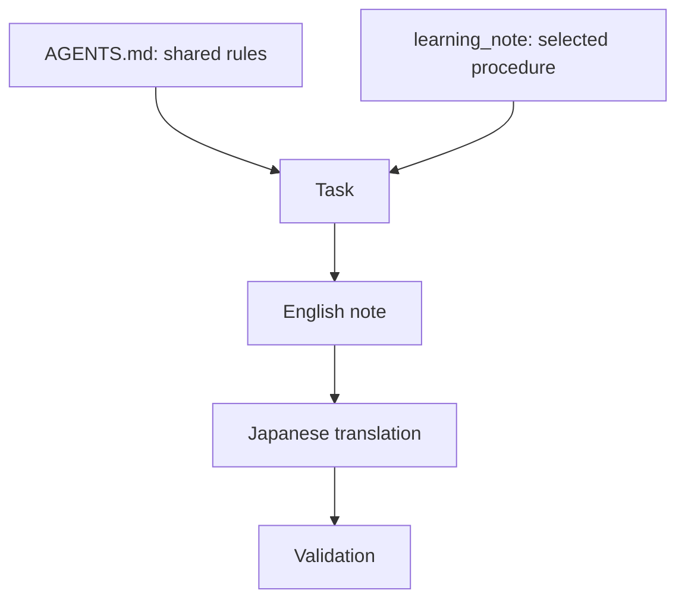

### Instructions vs. Skills

**Instructions define the rules; a skill supplies the procedure.**

For a cooking analogy, “avoid an allergenic ingredient” is a rule; “chop, cook, then serve” is a procedure. AI tasks combine both.

- Instructions define rules that apply across tasks within their scope.
- A skill supplies a reusable procedure for a particular kind of task.
- Both can contain instructions, but their purpose and loading behavior differ.

| | Instructions | Skill |
| --- | --- | --- |
| Main question | What rules should work follow? | How should this task be performed? |
| Example | Write English documentation and a Japanese translation | Research a topic, draft a note, translate it, and validate it |
| Scope | Tasks covered by the instruction file | A selected task matching the skill |
| Loading | Depends on host discovery and directory scope | Depends on host support, discovery, and explicit or automatic selection |
| Repository example | `AGENTS.md` | `.agents/skills/learning_note/SKILL.md` |

- Keep shared rules in `AGENTS.md`; avoid copying every rule into each skill.
- A skill should refer to those rules and provide task-specific steps.
- It does not override higher-priority instructions or grant extra permissions.

### This Repository's Example

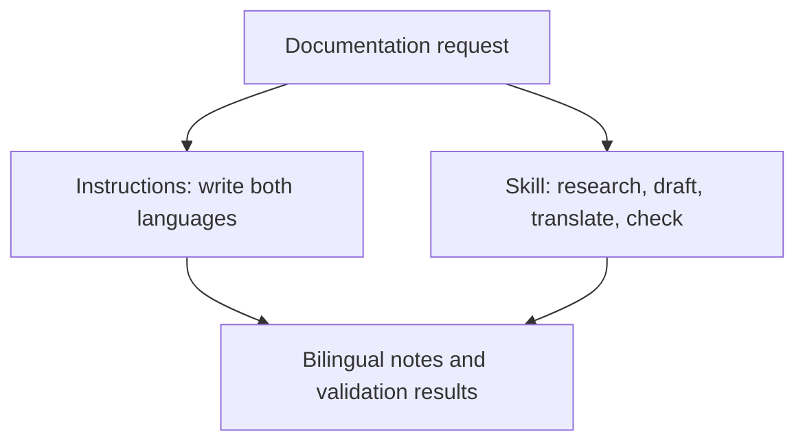

- `AGENTS.md` says to create English documentation with a matching `_jp.md` translation and to avoid empty directories.
- These rules also apply when working without a skill.

- The `learning_note` skill explains how to choose a topic's scope, gather sources, create a concrete example, validate it, and produce the two language versions.
- Its templates help give notes a consistent starting structure.

### Using learning_note

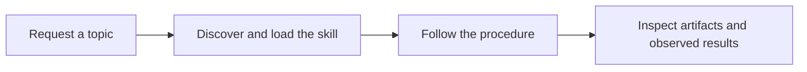

- The skill is stored in `.agents/skills/learning_note/`, a repository skill location supported by Codex.
- Discovery and invocation can vary by host and version.
- This location does not guarantee automatic discovery by every Copilot client.

- In a host that discovers it, explicitly request `learning_note` through the supported skill interface.
- Otherwise, ask the assistant to read and follow `.agents/skills/learning_note/SKILL.md`; this is a manual fallback, not proof of native skill registration.

```text
Use learning_note to create a beginner's note about Linux processes and threads.
Include a safe runnable example and official references.
```

- Check that the assistant loaded the procedure and produced both language versions with honest validation results.
- Commit and push only when authorized.
- Creating the files alone does not demonstrate skill discovery in a fresh session or successful execution of the full workflow.

## 15. Agents, Sub-agents, and Workflows

**An agent uses results to decide the next step.**

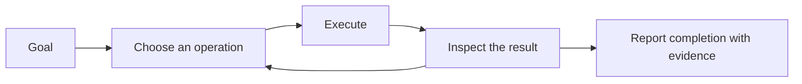

- An agent combines a goal, context, tools, and a control loop to perform multiple steps.
- A useful loop is: inspect the situation, choose an action, execute it, evaluate the result, and continue or stop.

- Define the scope, allowed tools, success criteria, resource limits, and stopping conditions before delegating substantial work.
- Require checkpoints for consequential actions such as publishing, spending money, or changing production data.

- Sub-agents can handle independent tasks such as reviewing separate modules.
- Give each a clear assignment and expected result.
- Shared files and services can introduce conflicts, so establish ownership and review combined results.
- More agents add coordination costs and do not automatically improve quality.

- Use deterministic workflows for stable sequences and agent decisions where interpretation is needed.
- Scheduled or event-driven automation also needs explicit credentials, retries, duplicate-action protection, logs, and failure notification.

- Persist progress in files or an approved state store so work can resume after interruption.
- Treat a report of success as a claim to validate against tool results and produced artifacts.

## 16. Output Formats and Quality Evaluation

**A well-formatted answer still needs its content checked.**

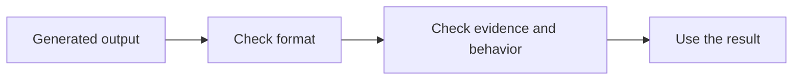

- Choose Markdown for human-readable explanations, tables for comparisons, and structured data for downstream software.
- Provide templates when a stable layout matters.

- Asking for JSON does not guarantee valid or schema-compliant output.
- Where supported, use structured outputs with a schema and validate the result in the consuming application.
- A valid shape does not guarantee correct content.

```json
{
  "summary": "Describe the observed result",
  "findings": [
    {
      "severity": "medium",
      "evidence": "Reference to an observed source",
      "recommendation": "A concrete next action"
    }
  ],
  "validation_status": "not_run"
}
```

- Build evaluations (evals) from representative tasks, expected properties, and known failure cases.
- Useful criteria include factual support, task completion, permissions respected, test results, latency, and cost.
- Use human review where automated grading cannot reliably judge the result.

- Compare models, prompts, or skills on the same examples.
- Track regressions and keep held-out cases to reduce overfitting.
- Distinguish passed, failed, skipped, and unrun checks.
- Select models according to measured quality, latency, context needs, and cost.

## 17. Put it together: “Fix division by zero”

**Assumed example, not an execution record:** `/workspace/calculator` contains a Python project with `pytest` installed. Zero division currently returns `0`; the requested behavior is to raise `ValueError`. The user requests a fix and local verification, without publishing it.

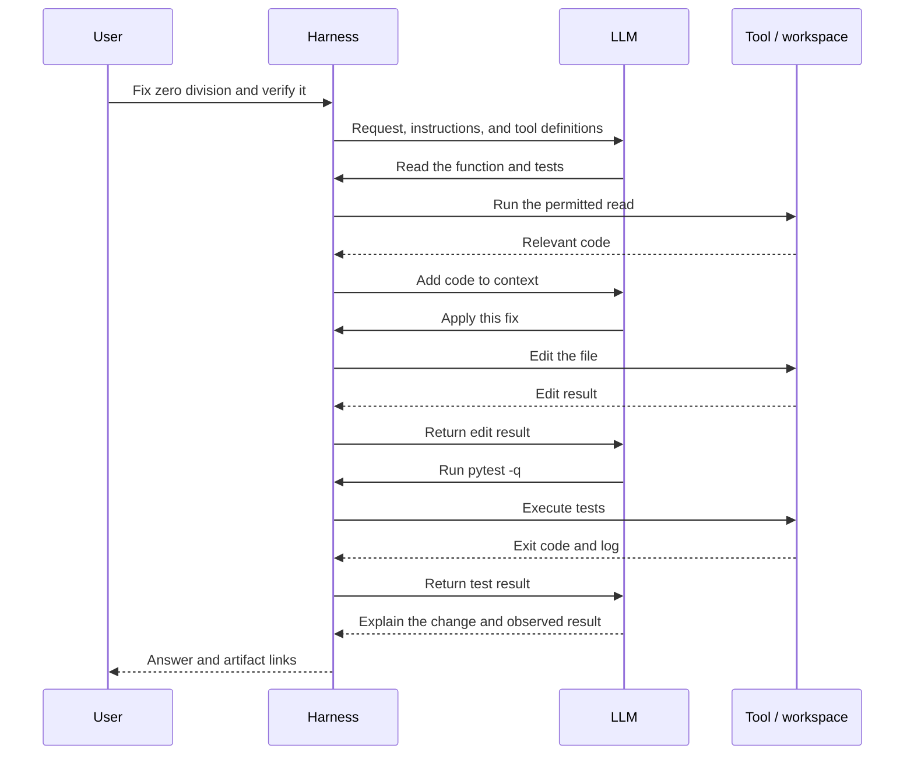

**Proposed change:**

```diff
 def divide(a, b):
     if b == 0:
-        return 0
+        raise ValueError("denominator must not be zero")
     return a / b
```

- Check both the zero-denominator exception and ordinary division. A green test run supports the cases actually tested.
- If tests fail, pass their output back to the model and repeat the edit/check loop. If they cannot run, report that verification is incomplete.
- Issue search through MCP can be added if needed; this local fix does not require it.
- **LLM generates → harness coordinates → tools execute → results become context.** This is the same cycle as the overview diagram.

## 18. Operating Safely

**Treat retrieved text as information; permissions are enforced by the host.**

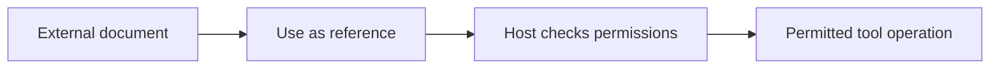

- Keep credentials in approved secret stores and avoid copying them into prompts, repositories, or logs.
- Share only the information needed for the task and check the service's retention and data-use settings.

- Prompt injection occurs when untrusted content attempts to redirect the AI's behavior.
- Retrieved documents, websites, repository files, and tool responses may contain such instructions.
- Treat them as data, verify requests against the authorized task, and do not let them grant new permissions.

- Use sandboxing, narrow filesystem access, restricted network destinations, and least-privilege credentials.
- Separate reading from consequential actions and use the host's approval controls where appropriate.
- Validate command arguments and structured inputs in application code.

- Before external writes or publication, check the destination, scope, content, authorization, and recovery options.
- Maintain useful audit records without logging secrets.
- Verify generated code, factual claims, licenses, and usage rights according to the task's requirements.

## 19. Practical Workflows

### Share project rules with instructions

- Create the host-supported project instruction file with repository conventions and real validation commands.
- Start a small task and verify that the agent discovers and follows it.
- Keep task-specific exceptions explicit.

### Reuse a documentation review skill

- Package the review procedure, style references, and an existing link checker as a skill.
- Invoke it for a changed page.
- Confirm the checker actually ran and review the findings against the source.

### Read external information through MCP

- Connect an approved issue-tracking server with read-only access.
- Ask the AI to summarize a selected issue using returned evidence.
- Verify issue identifiers and source links before enabling issue updates.

### Answer questions with RAG

- Index a maintained documentation collection with permission metadata.
- Retrieve relevant passages for a question, generate a cited answer, and check it against the source.
- Include cases where the documentation does not contain the answer.

### Implement and validate with an agent

- Give the agent a concrete behavior change, repository rules, and acceptance criteria.
- Let it inspect the code, make scoped changes, and run relevant tests.
- Review the diff and actual test output before merging or deploying.

### Combine the mechanisms

- For a recurring support workflow, instructions define communication and privacy rules, a skill describes triage steps, retrieval supplies product knowledge, and MCP tools read the relevant tickets.
- The agent coordinates these steps and returns a structured draft.
- A human reviews consequential outbound actions under the organization's policy.

- Start with one useful workflow, validate it on real examples, and add complexity only when it solves an observed problem.

## 20. When something goes wrong

| Symptom | Start by checking |
| --- | --- |
| It does not know a file's contents | Was the file read and included in context? |
| It lost a previous decision | Was that decision omitted or summarized? Was it saved? |
| It cannot run a test | Directory, runtime, dependencies, and sandbox restrictions |
| MCP search fails | Connection, server startup, authentication, and service permissions |
| It claims it created an issue | Tool result and the actual issue ID before retrying a write |
| It follows instructions found inside a document | Trust boundaries and host-enforced operation restrictions |

Check the chain **input → model output → harness → tool → external service → verification** to locate the failure.

## Appendix: details to read when needed

<details>
<summary>Model calls, harness implementation, and trustworthy completion</summary>

- Text generation is commonly described as predicting successive tokens using learned parameters. Some models also accept or generate images, audio, or other modalities.
- Typical APIs require the host to send or reference the relevant conversation state. Do not assume one independent call remembers another.
- Function calling produces a tool name and structured arguments. The application validates them, dispatches the request, and associates the result with the call ID. A generated request alone is not proof of execution.
- A harness also needs timeouts, cancellation, process polling, appropriate retries, durable state where needed, and limits on steps and budget. A background process ID does not mean a command has finished.
- Retrying a read differs from retrying a payment or message send. For writes, use idempotency controls or check whether the first attempt succeeded.
- Harness, runtime, runner, executor, and orchestrator are overlapping implementation terms. There is no universal boundary between them, and a harness is more than a system prompt.
- A completion claim needs evidence from artifacts and checks. Output with the right format can still contain wrong facts.

</details>

<details>
<summary>Context limits, security, and cost accounting</summary>

- Stored conversation, persistent memory, external files, and current context have different lifetimes. Host selection determines what is supplied to each call.
- Compaction replaces older content with a summary. It can preserve decisions while losing exact error details or exceptions. Keep source paths and unresolved requirements in handoff notes.
- Context engineering means selecting, structuring, retrieving, and maintaining useful input. Instruction priority follows the host/model contract, not whichever text appears last.
- Retrieved documents and tool results can contain prompt injection: untrusted text trying to redirect the system. Their contents do not grant new authority. Enforce allowed operations outside the model too.
- Exact text token counts require the chosen tokenizer or API usage reporting. Japanese character counts and image/audio/video sizes do not provide universal token conversions.
- Approximate text cost sums billable input and output tokens multiplied by their respective rates across all calls, with the provider's unit conversion, cache, and reasoning-token rules. Tools and compute can cost extra.
- Caching can reduce cost or latency under supported conditions. It does not remove context limits or establish correctness.
- Containers and VMs have different isolation properties. Browser, CLI, and MCP connections can use different identities; a browser login does not establish CLI authorization.

</details>

<details>
<summary>MCP capabilities and communication</summary>

| Server primitive | Purpose | Example |
| --- | --- | --- |
| Tools | Callable operations | Search issues or create a ticket |
| Resources | URI-addressed content | A document or schema |
| Prompts | Reusable message templates | A review prompt |

- Servers need not implement all three; hosts differ in what they support and expose.
- Common transports include local **stdio** and remote **Streamable HTTP**. Support and authorization follow the selected protocol version and implementation.
- Server authentication and downstream service credentials can be separate. MCP does not bypass network or filesystem restrictions.
- Capability discovery, data retrieval, and inclusion in model context are separate steps. A connected server does not imply all its data has been read.

</details>

## Diagram sources and validation

- PNGs are generated from [this script](scripts/render_agent_diagrams.py). Prerequisites: Python 3, Graphviz's `dot` on `PATH`, and Noto Sans CJK JP / DejaVu Sans fonts for matching typography. No third-party Python package is needed.
- From the repository root, run:

```bash
python learning/ai/scripts/render_agent_diagrams.py
```

- Expected output: four English and four Japanese PNGs under `learning/ai/assets/agent_architecture/`. The same layouts and relationships are used in both languages.

## Fact check and verification scope

Checked: 2026-11-07 (Japan time). Official sources support the following distinctions.

- Agent denotes the overall system here; harness denotes its control layer. These boundaries are not a universal specification.
- Tool requests differ from execution; application-side handling is needed.
- MCP is a connection protocol, distinct from LLMs, RAG, and granting permissions.
- Mods, extensions, and plugins have product-specific execution and packaging semantics.
- Implementation languages are not limited to C/C++, Python, and TypeScript; Codex includes a Rust implementation.

No screenshot attachment was available in this conversation. Existing illustrations were retained and the supplied text was incorporated; screenshot-specific claims could not be checked. Model calls, MCP connections, and test runs in the examples are conceptual, not execution records. Existing PNGs were not regenerated and Mermaid rendering was not checked in this change.

Additional primary sources:

- [OpenAI: Unlocking the Codex harness](https://openai.com/index/unlocking-the-codex-harness/)
- [Anthropic: Managed Agents architecture](https://www.anthropic.com/research/managed-agents)
- [Anthropic: Claude Code Mods](https://github.com/anthropics/claude-code/blob/main/mods/README.md)
- [GitHub: Copilot extensions](https://docs.github.com/en/copilot/concepts/customizations/extensions)

## What to learn next

1. Harness state management and the agent loop.
2. Tool calling schemas, call IDs, and result association.
3. Skill loading and hook/mod execution timing.
4. MCP stdio / Streamable HTTP communication and authorization.
5. Build a small Python or TypeScript agent with stopping conditions and validation.

## References

- [OpenAI: Key concepts](https://platform.openai.com/docs/concepts) — models and tokens.
- [OpenAI: Function calling](https://platform.openai.com/docs/guides/function-calling) — the model/application tool boundary.
- [OpenAI: Conversation state](https://platform.openai.com/docs/guides/conversation-state) — state across calls.
- [MCP: Architecture](https://modelcontextprotocol.io/docs/learn/architecture) and [specification](https://modelcontextprotocol.io/specification) — roles, capabilities, and versioned transport details.
- [Anthropic: Building effective agents](https://www.anthropic.com/engineering/building-effective-agents) — workflows and agents.
- [Docker: What is a container?](https://docs.docker.com/get-started/docker-concepts/the-basics/what-is-a-container/) — containers and isolation.
