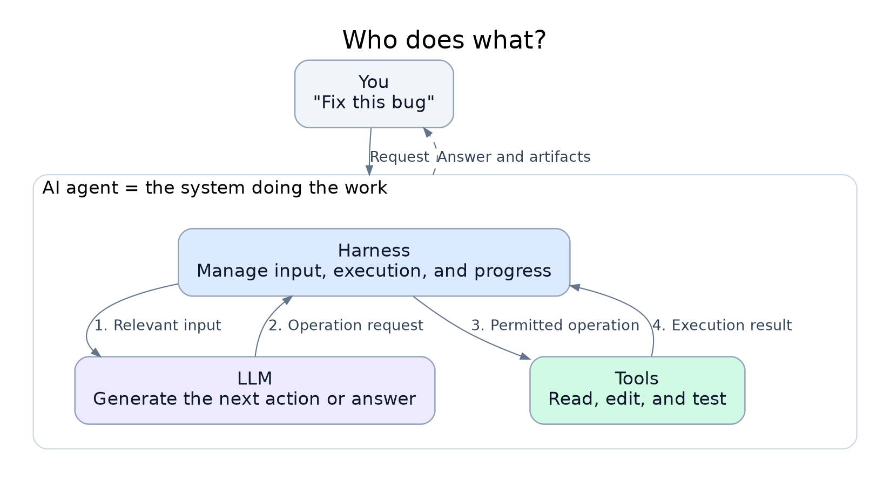
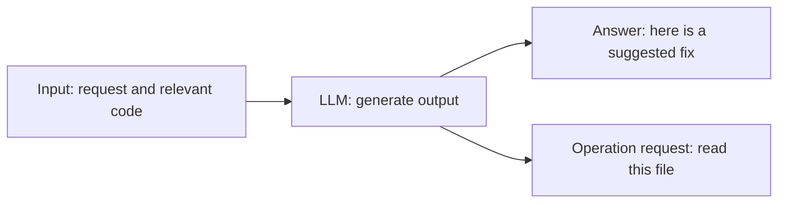
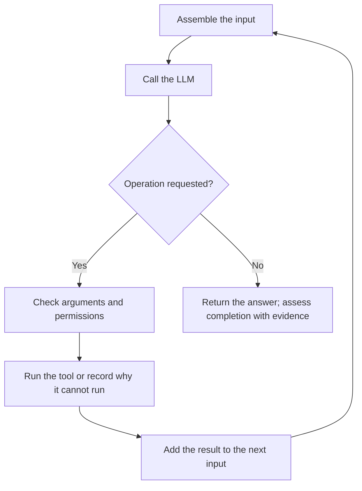
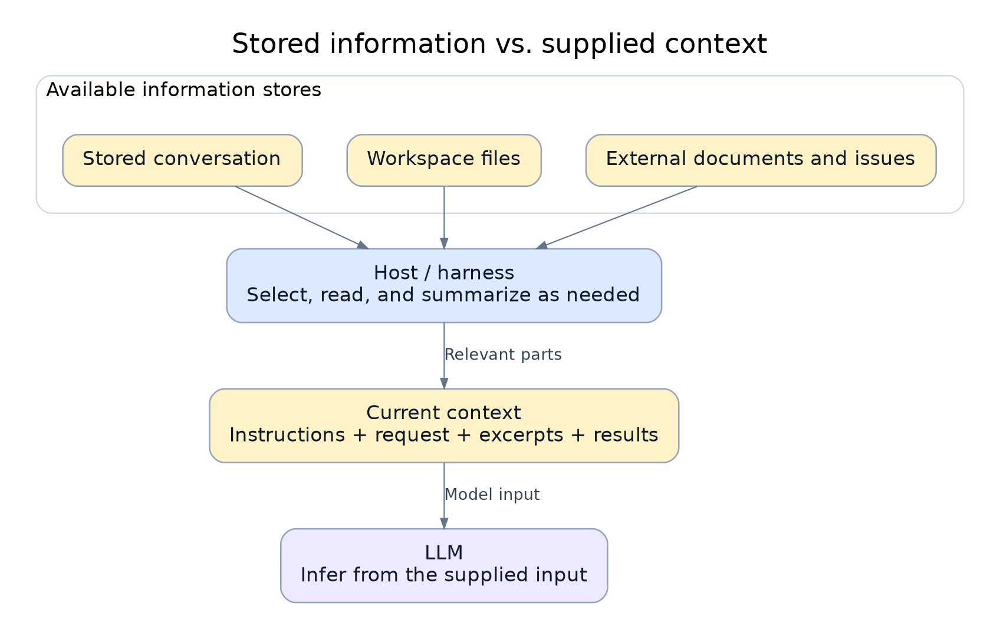
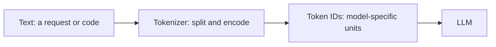
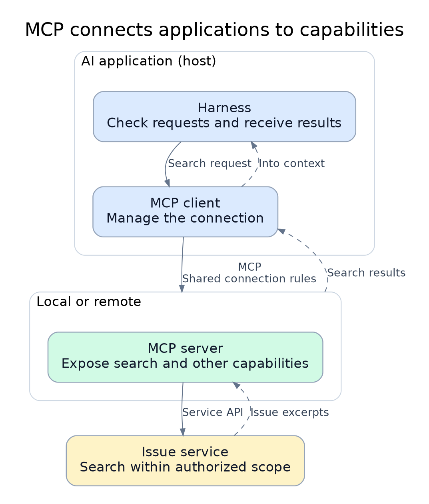
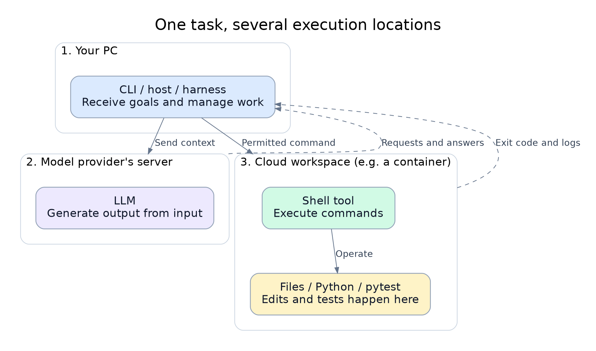
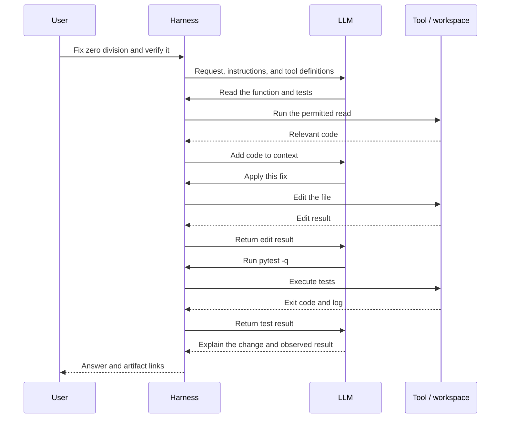

# A Visual Guide to AI Agents

[日本語](agent_architecture_jp.md)

**Follow one request — “Fix this bug” — to understand who does what, what information they use, and where the work runs.**

- Start with sections 1–3 for the main idea. Continue through section 8 to follow the whole task.
- Each section starts with a short explanation and a diagram. Implementation details are folded into the appendix.
- There are eight diagrams: four PNG illustrations and four Mermaid diagrams. Click a PNG to inspect it at full size.
- This is a common architecture, not a description of any product's private implementation. The boundaries of “agent” and “harness” vary by product.

## 1. Start with three roles

**The LLM generates the next step. Tools perform operations. The harness manages the exchange. Together, they make up the agent system described here.**



**Read the numbered arrows:** give information to the LLM → receive an operation request → run the permitted operation → return its result. Repeat as needed.

| Name | Plain explanation | In “Fix this bug” |
| --- | --- | --- |
| LLM | Generates an answer or the next operation request | “Read this function first” |
| Harness | Manages information, execution, and progress | Reads the requested file and returns its contents |
| Tool | Performs a defined operation | Reads, edits, or runs a test |
| Agent | The system pursuing the goal over multiple steps | Investigates, edits, verifies, and reports |

- The **host** is the application you use, such as a CLI or chat application. Harness functions live in that application and its supporting software.
- Context, tokens, MCP, and execution environments describe the information, units, connections, and locations used by these roles. We add them one at a time below.

## 2. LLM: generate an answer or a request

**An LLM is a model that generates output from the information it receives.** LLM stands for *large language model*.



**Example:** the model sees a division function and generates “Raise an exception when the denominator is zero.” That is a proposed fix. A tool must edit the actual file, and a test must check the behavior.

- In practice, the model consists of learned parameters used by an inference process or service.
- **Training** changes the parameters. **Inference** uses them to process a request. Reading an attached document normally supplies input for inference.
- Model output can be wrong. The current contents of a repository or the outcome of a test need evidence from the relevant system.

## 3. Harness: keep the work moving

**A harness is the software that makes repeated model calls and tool operations work together.** Think of it as the work coordinator; it also applies execution limits and permissions.



**Example:** the model requests `pytest -q`. The harness checks that the command is allowed, runs it through the shell tool, waits for completion, and returns the exit code and log. The model can then decide whether to adjust the fix.

- A **tool call** is a request to run something. Its **result** tells us what actually happened.
- The harness manages context selection, running processes, progress, retries, and stopping conditions. These responsibilities may be split across an application, SDK, and infrastructure.
- The same LLM can behave differently with different tools, input selection, or error handling.
- The simplified diagram omits cancellation and time/budget limits; real systems need those ways to stop too.

## 4. Context: the information on the desk right now

**Context is the information available for this model call.** A useful analogy is the material placed on a desk for the current task.



**Example:** for a division bug, useful context includes the requirement, the division function, and the failing test. An unrelated image folder probably does not help.

- A file being in the workspace does not mean the model has read it. Its contents must be retrieved and supplied.
- The visible chat history may differ from the exact input assembled by the host.
- Long conversations may be shortened or summarized. Important details can be lost, so keep requirements and unresolved decisions explicit.

| Easily confused terms | Difference |
| --- | --- |
| Model knowledge | Patterns stored in parameters through training |
| Context | Information supplied for the current inference call |
| Memory | Selected information saved by the application and retrieved later |

**RAG** means searching for relevant material and adding it to the input before generating a response. For example, search a specification and supply the matching paragraphs as context.

## 5. Tokens: the units used to count input and output

**Tokens are the model's input/output units.** A token is not necessarily one word or one character.



**Why it matters:** the model has an input/output budget, and usage often contributes to cost. Exact segmentation depends on the model and language; this diagram does not show an actual tokenization result.

**A hypothetical 32,000-token combined limit:**

| Budget item | Tokens |
| --- | ---: |
| Instructions and tool descriptions | 4,000 |
| Conversation | 8,000 |
| Relevant documents | 12,000 |
| Latest request | 1,000 |
| **Input subtotal** | **25,000** |
| Reserved for generation | 5,000 |
| **Remaining headroom** | **2,000** |

- A **context window** is a limit on how much a call can handle. This is a simplified budget; actual output limits and reasoning-token rules depend on the API.
- One user request may cause several model calls. Earlier content and new tool results can be processed on later calls, increasing total usage.
- Retrieve relevant excerpts and return concise logs to use the budget well. More input is useful when it adds needed evidence.
- An **access token** used to log in to a service is a different meaning of “token.”

## 6. MCP: a shared way to connect to capabilities

**MCP is a protocol for connecting an AI application to servers exposing tools and data.** Its full name is *Model Context Protocol*.



**Follow a search request:**

1. The LLM generates a request to search issues related to the bug.
2. The host checks the request; its MCP client sends it to the configured server.
3. The server queries the issue service using the available authorization.
4. Search results return to the host and can be supplied to the model as context.

| Part | Role |
| --- | --- |
| Host | The AI application using the capabilities |
| MCP client | Manages a connection from the host |
| MCP server | Exposes capabilities and handles requests |
| Service API | The issue/document/database system's own interface |

- Tools can also use direct functions or APIs. A local file edit does not require MCP.
- Connecting a server makes its capabilities available; it does not automatically load all its data or train the model on it.
- Access still depends on authentication, account permissions, and network restrictions. Creating an issue requires the appropriate write access in addition to search capability.

## 7. Execution environment: where operations really run

**The execution environment is the machine or session where a tool performs its operation.** The model and the test command can run in different places.



**This is one example deployment:**

- Your PC runs a CLI, the command-line application receiving your request.
- The provider's server runs model inference.
- A cloud workspace runs file operations and `pytest`. A **container** is one possible way to provide an isolated process environment there.

Other products may run tools on your PC, use a VM, or run the whole host in the cloud. An MCP server can also be local or remote. The diagram shows locations, not a universal deployment.

| Check | Plain question |
| --- | --- |
| Working directory | Which folder does a relative path refer to? |
| Filesystem permissions | Which files can this tool read or change? |
| Runtime and dependencies | Are Python and `pytest` installed here? |
| Network | Can this environment reach the needed service? |
| Account | Which identity is used by this CLI, browser, or MCP connection? |
| Persistence | Will these files survive the end of the session? |

- A **sandbox** enforces operation restrictions through the OS or infrastructure. Its restrictions are stronger than a prompt asking the model to avoid a path.
- `/workspace/project` in a remote environment is not automatically a folder on your PC.
- If source excerpts are sent to a remote model, those excerpts leave the workspace. Container isolation alone does not keep inference inputs local.

## 8. Put it together: “Fix division by zero”

**Assumed example, not an execution record:** `/workspace/calculator` contains a Python project with `pytest` installed. Zero division currently returns `0`; the requested behavior is to raise `ValueError`. The user requests a fix and local verification, without publishing it.



**Proposed change:**

```diff
 def divide(a, b):
     if b == 0:
-        return 0
+        raise ValueError("denominator must not be zero")
     return a / b
```

- Check both the zero-denominator exception and ordinary division. A green test run supports the cases actually tested.
- If tests fail, pass their output back to the model and repeat the edit/check loop. If they cannot run, report that verification is incomplete.
- Issue search through MCP can be added if needed; this local fix does not require it.
- **LLM generates → harness coordinates → tools execute → results become context.** This is the same cycle as Figure 1.

## 9. Related terms at a glance

| Term | Plain explanation | Example |
| --- | --- | --- |
| Prompt | The current request | “Fix division by zero” |
| Instructions | Rules applying within a defined scope | Follow the project style and run relevant checks |
| Skill | A reusable procedure and supporting files | A bug investigation checklist |
| RAG | Retrieve relevant material for generation | Supply matching specification paragraphs |
| Memory | Save and retrieve selected information | A saved project decision |
| Workflow | A predefined order or branching of operations | Run lint, then tests, then report |
| Sub-agent | Another model-driven work loop given a subtask | Review a separate module |
| Framework | A toolkit for building the system | Libraries implementing tool dispatch and state |
| Evals | Representative tasks used to assess behavior | Measure successful fixes and regressions |

- RAG describes how information is retrieved and used; MCP describes a connection protocol. RAG search can be exposed through MCP or a direct API.
- Skills are instructions and resources, not model parameters. A host must discover and load a suitable skill for it to help.
- A sub-agent's context, tools, and files may be shared or isolated. More agents add coordination and usage costs; they do not automatically improve quality.
- For usage, see the [practical guide](AI_GUIDE.md) and [instructions and skills](instructions_and_skills.md).

## 10. When something goes wrong

| Symptom | Start by checking |
| --- | --- |
| It does not know a file's contents | Was the file read and included in context? |
| It lost a previous decision | Was that decision omitted or summarized? Was it saved? |
| It cannot run a test | Directory, runtime, dependencies, and sandbox restrictions |
| MCP search fails | Connection, server startup, authentication, and service permissions |
| It claims it created an issue | Tool result and the actual issue ID before retrying a write |
| It follows instructions found inside a document | Trust boundaries and host-enforced operation restrictions |

Check the chain **input → model output → harness → tool → external service → verification** to locate the failure.

## Appendix: details to read when needed

<details>
<summary>Model calls, harness implementation, and trustworthy completion</summary>

- Text generation is commonly described as predicting successive tokens using learned parameters. Some models also accept or generate images, audio, or other modalities.
- Typical APIs require the host to send or reference the relevant conversation state. Do not assume one independent call remembers another.
- Function calling produces a tool name and structured arguments. The application validates them, dispatches the request, and associates the result with the call ID. A generated request alone is not proof of execution.
- A harness also needs timeouts, cancellation, process polling, appropriate retries, durable state where needed, and limits on steps and budget. A background process ID does not mean a command has finished.
- Retrying a read differs from retrying a payment or message send. For writes, use idempotency controls or check whether the first attempt succeeded.
- Harness, runtime, runner, executor, and orchestrator are overlapping implementation terms. There is no universal boundary between them, and a harness is more than a system prompt.
- A completion claim needs evidence from artifacts and checks. Output with the right format can still contain wrong facts.

</details>

<details>
<summary>Context limits, security, and cost accounting</summary>

- Stored conversation, persistent memory, external files, and current context have different lifetimes. Host selection determines what is supplied to each call.
- Compaction replaces older content with a summary. It can preserve decisions while losing exact error details or exceptions. Keep source paths and unresolved requirements in handoff notes.
- Context engineering means selecting, structuring, retrieving, and maintaining useful input. Instruction priority follows the host/model contract, not whichever text appears last.
- Retrieved documents and tool results can contain prompt injection: untrusted text trying to redirect the system. Their contents do not grant new authority. Enforce allowed operations outside the model too.
- Exact text token counts require the chosen tokenizer or API usage reporting. Japanese character counts and image/audio/video sizes do not provide universal token conversions.
- Approximate text cost sums billable input and output tokens multiplied by their respective rates across all calls, with the provider's unit conversion, cache, and reasoning-token rules. Tools and compute can cost extra.
- Caching can reduce cost or latency under supported conditions. It does not remove context limits or establish correctness.
- Containers and VMs have different isolation properties. Browser, CLI, and MCP connections can use different identities; a browser login does not establish CLI authorization.

</details>

<details>
<summary>MCP capabilities and communication</summary>

| Server primitive | Purpose | Example |
| --- | --- | --- |
| Tools | Callable operations | Search issues or create a ticket |
| Resources | URI-addressed content | A document or schema |
| Prompts | Reusable message templates | A review prompt |

- Servers need not implement all three; hosts differ in what they support and expose.
- Common transports include local **stdio** and remote **Streamable HTTP**. Support and authorization follow the selected protocol version and implementation.
- Server authentication and downstream service credentials can be separate. MCP does not bypass network or filesystem restrictions.
- Capability discovery, data retrieval, and inclusion in model context are separate steps. A connected server does not imply all its data has been read.

</details>

## Diagram sources and validation

- PNGs are generated from [this script](scripts/render_agent_diagrams.py). Prerequisites: Python 3, Graphviz's `dot` on `PATH`, and Noto Sans CJK JP / DejaVu Sans fonts for matching typography. No third-party Python package is needed.
- From the repository root, run:

```bash
python learning/ai/scripts/render_agent_diagrams.py
```

- Expected output: four English and four Japanese PNGs under `learning/ai/assets/agent_architecture/`. The same layouts and relationships are used in both languages.
- The PNG generation command was run. Other code, the budget, and the conversation are conceptual examples, not an execution against a model, MCP server, or calculator project.
- Documentation checks cover local links, code fences, and matching bilingual diagram structures. PNGs were visually inspected; Mermaid rendering was not run in this environment.
- Provider limits, prices, permissions, and transport support must be checked for the chosen product/version. The live reference contents and latest versions below were not checked during drafting.

## References

- [OpenAI: Key concepts](https://platform.openai.com/docs/concepts) — models and tokens.
- [OpenAI: Function calling](https://platform.openai.com/docs/guides/function-calling) — the model/application tool boundary.
- [OpenAI: Conversation state](https://platform.openai.com/docs/guides/conversation-state) — state across calls.
- [MCP: Architecture](https://modelcontextprotocol.io/docs/learn/architecture) and [specification](https://modelcontextprotocol.io/specification) — roles, capabilities, and versioned transport details.
- [Anthropic: Building effective agents](https://www.anthropic.com/engineering/building-effective-agents) — workflows and agents.
- [Docker: What is a container?](https://docs.docker.com/get-started/docker-concepts/the-basics/what-is-a-container/) — containers and isolation.
