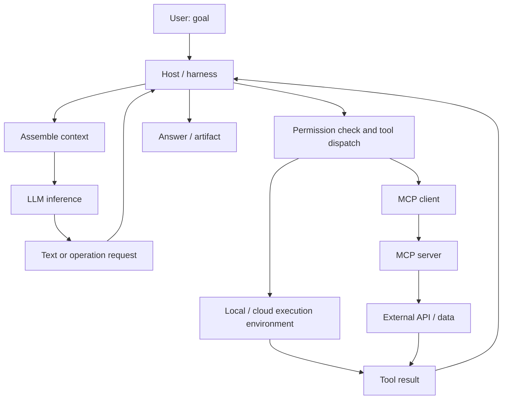

# AI Agents: Concepts, Components, and Execution Environments

[日本語](agent_architecture_jp.md)

## 1. Goal and scope

- For readers who have used an AI chat application and want to understand what actually runs when an agent works.
- Follow one request from model input to tool execution, and distinguish LLMs, harnesses, context, tokens, MCP, and execution environments.
- This describes a common architecture, not the private implementation of a particular product. “Agent” and “harness” have varying definitions; the boundaries below are a practical working model.
- For instructions, skills, and daily usage, see the [practical guide](AI_GUIDE.md) and [instructions and skills](instructions_and_skills.md).

## 2. The whole system

> An LLM generates a response or a request for an operation. The surrounding software executes permitted operations and returns the results. Repeating this cycle lets the system pursue a goal.

| Concept | Role | What it is in practice | Example |
| --- | --- | --- | --- |
| LLM | Interpret input and generate output | Model parameters and an inference service/process | Generate a patch or a structured tool call |
| Agent | Pursue a goal over multiple steps | A system combining a model, tools, state, and control logic | Investigate a bug, change code, run tests |
| Harness | Manage how the model works in its host | Software for context assembly, tool dispatch, state, limits, and permissions | Execute a requested test and feed back its output |
| Context | Supply information for the current model call | Messages, tool definitions, selected documents, images, and results | The request, relevant code, and a failing test log |
| Token | Represent model input/output in units | Tokenizer-dependent IDs; accounting varies for other modalities | Units used for input limits and usage accounting |
| Tool | Perform a defined operation | A function, process, service, or API exposed to the host | Read a file or search an issue tracker |
| MCP | Standardize a connection to capabilities and data | A protocol implemented by hosts, clients, and servers | Connect an AI application to an issue-search server |
| Execution environment | Provide a place where operations run | A local OS, container, VM, browser session, or remote service | Run `pytest` in a cloud workspace |



- The loop spanning the model and surrounding software constitutes the agent here. An agent is not necessarily a separate process named `agent`.
- Model inference, command execution, and MCP servers may run on three different machines.
- A normal function/API integration can provide tools without MCP.

## 3. LLM: the inference component

- A large language model uses learned parameters to generate output conditioned on its input. Text generation is commonly described as predicting successive tokens; some models also accept or generate other modalities.
- **Training** changes model parameters. **Inference** uses those parameters to process a request. Attaching a document normally changes the input, not the parameters.
- An API request usually includes instructions, messages, and available tool descriptions. Output may contain text or a structured tool call supported by that API.
- A bare model does not automatically read your disk, browse the web, or possess your service credentials. The host must expose and execute those capabilities.
- Responses can be plausible but wrong. Training knowledge does not establish the current state of a repository, account, or website.

**Example:** Given a failing division function, the model can suggest raising an exception for a zero denominator. Whether that suggestion works requires inspecting the actual code and running an appropriate check in the execution environment.

## 4. Agent and harness: goal pursuit and control

- An agent chooses actions toward a goal, observes results, and adjusts. The host can also use a fixed workflow, such as always running a formatter after editing.
- The harness supplies the machinery that makes this possible. Some frameworks call similar components a runtime, runner, executor, or orchestrator; these terms overlap rather than forming a universal standard.

| Harness responsibility | Concrete behavior |
| --- | --- |
| Assemble context | Select messages, instructions, tool schemas, and file excerpts |
| Invoke the model | Send a request, process output, and track usage |
| Dispatch tools | Validate a tool name and its arguments, then route the request |
| Enforce boundaries | Apply allowlists, sandbox policy, and required approval |
| Manage progress | Preserve tool-call IDs, execution state, and intermediate results |
| Handle long work | Poll a running process, retry appropriate failures, summarize older context |
| Stop | End on completion, a step/budget limit, cancellation, or an unrecoverable failure |

- These duties can be distributed across application code, an SDK, and infrastructure. A harness is more than a system prompt.
- The same LLM can perform differently under different harnesses because tools, information selection, error handling, and limits differ.
- More autonomy does not imply more access. Available permissions and credentials determine what can actually run.
- A sub-agent is another delegated model-driven work loop. Its model, context, tools, and filesystem may be shared or isolated; parallel work adds coordination and usage costs.

**Conceptual pseudocode — not a runnable SDK example:**

```text
state = initialize(goal, instructions, tool_catalog)
for step in range(step_limit):
    context = select_context(state, input_budget)
    response = call_model(context)
    if response.requests_tools:
        for request in response.tool_requests:
            validate_arguments_and_permissions(request)
            result = execute_or_record_failure(request)
            state.append(request, result)
    else:
        return response.answer
return report_incomplete(state)
```

- Real implementations also need timeouts, cancellation, error recovery, and durable state when required.
- Retrying a read is different from retrying a payment or message send. Writes may need idempotency keys or verification of whether the first attempt succeeded.
- “Done” is a model output; successful completion still needs evidence from the artifact, tool results, or acceptance checks.

## 5. Context: what the model receives now

- Context is the information made available in a particular model invocation. A visible chat history and the exact serialized input to the model need not be identical.
- A file existing in the workspace does not make its contents available to the model. A tool or host feature must read it and include the relevant content.
- Some context is supplied by the application and is not displayed as a normal chat message.

| Layer | Example | Lifetime / boundary |
| --- | --- | --- |
| Model parameters | Patterns learned during training | Changed through training or model updates |
| Current context | Request, instructions, file excerpt, tool result | Supplied to the current inference call |
| Conversation state | Stored messages and progress | Managed by the host; may be selected or summarized |
| Persistent memory | A saved preference or project summary | Product-specific storage and retrieval |
| External state | Files, database rows, issues | Persists according to the external system |

- In typical API use, the host sends or references conversation state on subsequent calls. Do not assume the model service remembers a previous request without such a mechanism.
- A **context window** limits how much a call can handle. Input, output reservations, reasoning tokens, and modality limits follow model/API-specific rules.
- **Compaction** replaces some previous content with a shorter summary. It can preserve decisions but lose exact wording, error details, or exceptions.
- **Context engineering** means choosing, structuring, retrieving, and maintaining useful input. Sending everything can add cost and distract from relevant evidence.
- Instruction priority is determined by the host/model contract. A retrieved document saying “ignore the user” remains untrusted document content, not newly granted authority.

**Example:** To fix one function, include its implementation, callers affected by the change, the expected behavior, and the relevant failing test. Retrieve more information if needed instead of inserting every repository file.

## 6. Tokens: limits, cost, and repeated work

- A text tokenizer maps text to token IDs. One token is not necessarily one word, character, or byte. Segmentation varies by model, language, code, and punctuation.
- Japanese character counts do not provide an exact token count. Use the selected model's tokenizer or the API's usage reporting for measurement.
- Image/audio/video accounting is model-specific. Do not apply text-only estimates to all modalities.
- “Token” here is a model processing unit. An OAuth/access token is an authentication credential with a different purpose.

**Hypothetical budget example; not a product specification:**

| Item | Tokens |
| --- | ---: |
| Instructions and tool descriptions | 4,000 |
| Conversation history | 8,000 |
| Retrieved source excerpts | 12,000 |
| Latest request | 1,000 |
| Input total | 25,000 |
| Reserved generation budget | 5,000 |
| Simplified total | 30,000 |

- With a hypothetical 32,000-token combined limit, this leaves 2,000 tokens under this simplified accounting. Actual APIs can impose separate output and other constraints.
- One user request can cause many model calls. Tool results enlarge later inputs, and earlier material may be processed repeatedly. A 25,000-token context is not necessarily 25,000 tokens of total task usage.
- Approximate text cost: sum over calls of `(billable input tokens × input rate) + (billable output tokens × output rate)`, with the provider's unit conversion and cache/reasoning rules. Tool charges and compute can be additional.
- Caching may reduce cost or latency under supported conditions; it does not make context unlimited or guarantee a correct answer.
- Useful reductions include targeted search, selected line ranges, concise tool output, and summaries that retain source paths and unresolved decisions.

## 7. Tools, function calling, and MCP

### Tool execution boundary

- Function calling lets a model emit a tool name and structured arguments. The application validates and executes them, then returns a result associated with that call.
- A generated call is an operation request, not proof that the operation ran. Check success/failure and actual results.

**Illustrative normalized call; not a universal API wire format:**

```json
{
  "name": "search_issues",
  "arguments": {"query": "division by zero", "limit": 3}
}
```

### MCP architecture

- Model Context Protocol standardizes communication between an AI application and servers exposing capabilities and data. It is neither a model nor an autonomous agent.
- The **host** is the AI application. An **MCP client** inside the host maintains a connection to an **MCP server**. The server can expose an existing API, a local program, or data sources.
- Common transports include local **stdio** and remote **Streamable HTTP**. Supported transports, authorization, and features depend on protocol version and implementation.

| Server primitive | Purpose | Example |
| --- | --- | --- |
| Tools | Expose callable operations | Search issues or create a ticket |
| Resources | Expose URI-addressed content | Read a document or a schema |
| Prompts | Expose reusable message templates | Prepare a review prompt |

- Servers need not implement all three. Hosts also vary in what they expose to the model or user.
- MCP discovery makes capabilities available to a host; it does not mean all remote data is inserted into every context.
- A typical path is `LLM tool request → host permission check → MCP client → MCP server → service API → result → model context`.
- MCP does not itself grant account access or bypass filesystem/network restrictions. Server authentication and downstream service credentials can be separate.
- Connecting an MCP server does not train the model on its contents. A server may run locally even when the model runs remotely.

**Example:** An issue-search MCP server queries an authorized project and returns three issue excerpts with IDs. The host passes selected results to the model. Creating an issue is a separate operation requiring the applicable write permission.

## 8. Where things actually run

| Component | Possible location | What to inspect |
| --- | --- | --- |
| UI / host / harness | Desktop application, CLI, or cloud backend | Active session, settings, loaded instructions |
| Model inference | Provider service or local model process | Model identifier, endpoint, input limits |
| Shell / code tools | Local machine, container, VM, or cloud workspace | Working directory, installed runtimes, filesystem rights |
| Browser tool | Local or remote browser session | Login session, network reachability, downloads |
| MCP server | Local child process or remote service | Transport, supported operations, authentication |
| Data service | Repository host, document service, or database | Account, project, access scope |

- **Working directory:** the starting location for relative paths. `/workspace/project` in a remote container is not automatically a folder on your laptop.
- **Filesystem boundary:** which paths can be read/written, whether they are shared, and whether they persist after the session ends.
- **Process boundary:** commands run as actual OS processes. Background jobs can outlive a tool call; a returned process ID may require polling before completion is known.
- **Network boundary:** a machine may have internet access, allowlisted hosts, or no outbound access. A connected model API does not imply shell access to every website.
- **Identity boundary:** the browser, CLI, and MCP server may use different accounts and credentials. A successful browser login does not establish CLI access.
- **Sandbox:** OS/infrastructure restrictions on operations. A prompt asking the model to avoid certain paths is not equivalent to enforced filesystem isolation. Containers and VMs also have different isolation properties.
- **Persistence:** workspace files, chat context, and model-service caches have different lifetimes. Confirm artifact storage rather than assuming everything survives.

**Example deployment:** A laptop CLI sends inference requests to a model provider, runs tests inside a local container, and connects to a remote issue-search MCP server. Source excerpts sent for inference leave the container; container isolation alone does not keep model inputs local.

## 9. End-to-end example: fix a division bug

**Assumed scenario, not an observed execution:** A Python project already exists in `/workspace/calculator`; `pytest` is installed. Dividing by zero currently returns `0`, but the requirement is to raise `ValueError`. The user requests a fix and local verification, without publishing it.

| Step | Model's role | Harness / tool's role | Evidence or state |
| --- | --- | --- | --- |
| 1. Receive request | Interpret the goal and criteria | Supply request, instructions, and tool definitions | Initial context |
| 2. Inspect project | Request relevant files and tests | Read permitted paths in the workspace | Code and test excerpts enter context |
| 3. Inspect issue if useful | Request issue search | Call the configured MCP service | Issue IDs and excerpts; network/permission errors if unsuccessful |
| 4. Propose a change | Generate a focused edit | Apply the edit to the actual file | Filesystem diff |
| 5. Verify | Request `pytest -q` in the project | Run the OS process and collect status/output | Exit code and test results |
| 6. Respond to failure | Interpret a traceback and adjust | Execute another permitted edit/check | Updated context and artifacts |
| 7. Finish | Explain the change and verification | Return the final response/artifact links | Actual diff and observed results |

**Expected conceptual diff:**

```diff
 def divide(a, b):
     if b == 0:
-        return 0
+        raise ValueError("denominator must not be zero")
     return a / b
```

- The meaningful check covers both zero division raising the expected exception and ordinary division retaining its behavior.
- A green test run is evidence for the tests executed, not proof that all possible inputs are correct. The test must agree with the requested behavior.
- The code tool performs the edit; the model supplies its requested content. `pytest` executes in the project environment, not inside the model's parameters.
- The MCP server supplies issue information; it is not needed for a purely local edit. Each repeat of the loop consumes time and potentially additional model tokens.
- If execution is unavailable, report “change proposed; tests not run” rather than claiming success.

## 10. RAG, memory, skills, and workflows

| Related concept | How it fits | Example |
| --- | --- | --- |
| Prompt | Input expressing the current request | “Fix zero division and verify it” |
| Instructions | Rules applied by the host within their scope | Project style and required checks |
| Skill | Reusable procedure and optional supporting files | Bug investigation checklist |
| RAG | Retrieve relevant material and add it to generation context | Search specifications before answering |
| Memory | Store and retrieve selected information across steps/sessions | Saved project decisions |
| Workflow | Predetermined ordering or branching of steps | Run lint, then tests, then assemble a report |
| Evals | Assess behavior over representative tasks | Measure successful fixes and regressions |

- RAG is a retrieval-and-generation technique; MCP is a connection protocol. A RAG search can be exposed through MCP or a direct API.
- Skills are procedures, not model weights. Their effectiveness depends on discovery, loading, applicability, and execution.
- A framework is a library/toolkit for building such systems. It may supply harness components without being the complete deployed system.

## 11. Common misunderstandings and diagnosis

| Symptom or claim | What to distinguish / inspect |
| --- | --- |
| “The LLM read every file” | Check which files were actually read and passed into context |
| “I connected MCP, so it knows all company data” | Discovery, retrieval, permissions, and inclusion in context are separate |
| “The model is weak because tests cannot run” | Inspect the command, runtime, dependencies, directory, and sandbox |
| “It forgot a decision” | Inspect context selection, summarization, and persistent state |
| “It said the issue was created” | Check the tool result and actual issue ID; avoid blind write retries |
| “The tool output told it to upload secrets” | Treat external content as untrusted; enforce permitted operations outside the model |
| “More agents or tokens always improve quality” | Measure relevance, coordination overhead, task success, latency, and cost |

- Diagnose by layer: **input → model output → harness decision → tool execution → external service → verification**. This helps separate reasoning errors from execution and access failures.

## 12. Validation and source status

- Examples are conceptual. The pseudocode, JSON, token budget, and division diff illustrate boundaries; they are not executions against a real model, MCP server, or calculator project.
- No dependency installation or benchmark is required for these explanations. Actual provider limits, prices, transport support, and permissions must be checked for the selected version.
- References below identify official sources for further reading. Their live contents and latest versions were not checked during drafting; this note does not claim conformance to a particular current API or MCP release.

## 13. References

- [OpenAI: Key concepts](https://platform.openai.com/docs/concepts) — models, tokens, and usage concepts.
- [OpenAI: Function calling](https://platform.openai.com/docs/guides/function-calling) — the model/application tool-call boundary.
- [OpenAI: Conversation state](https://platform.openai.com/docs/guides/conversation-state) — state across inference calls.
- [MCP: Architecture](https://modelcontextprotocol.io/docs/learn/architecture) — hosts, clients, servers, and primitives.
- [MCP specification](https://modelcontextprotocol.io/specification) — versioned protocol and transport details.
- [Anthropic: Building effective agents](https://www.anthropic.com/engineering/building-effective-agents) — workflows and agent systems.
- [Docker: What is a container?](https://docs.docker.com/get-started/docker-concepts/the-basics/what-is-a-container/) — process isolation and execution environments.
