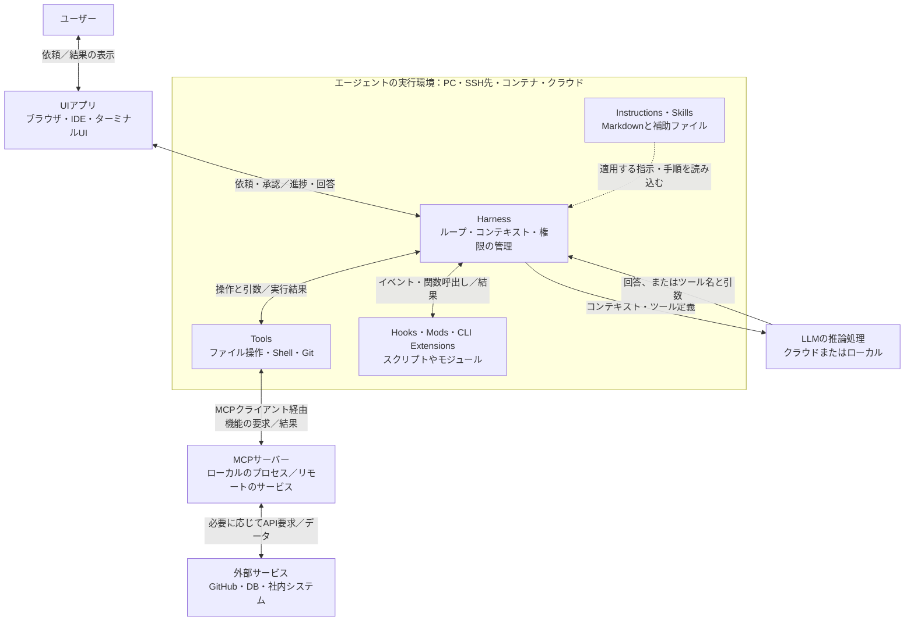
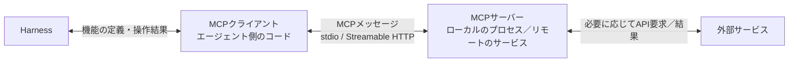
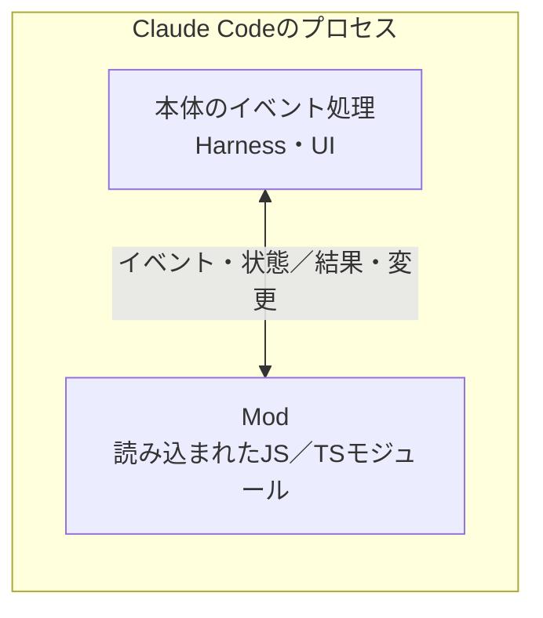
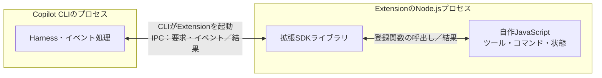
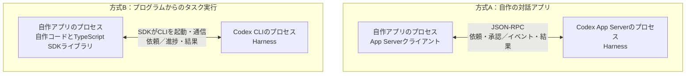

# AIエージェントのアーキテクチャ

[English](agent_architecture.md)

Claude Code、Codex、GitHub Copilot CLIを活用するために、何がどこで動き、どんな情報を渡し、どこをカスタマイズできるかを整理します。図はこのMarkdown内のMermaidで記述し、GitHubでそのまま表示できます。

## 1. 全体像

**LLMが回答や操作要求を生成し、Harnessが進行を管理し、Toolsが操作を実行します。** AIエージェントは、これらを組み合わせてタスクを進めるソフトウェアシステムです。Harnessはその実行制御を担う層です。

- 大きな枠は実行環境を表し、1つのOSプロセスを意味しません。UIがエージェントと同じプロセスに含まれる場合も、HookやExtensionが別プロセスで動く場合もあります。詳細は後述します。
- 「ローカル」はエージェントを動かす場所で、手元PC、SSH先、開発コンテナなどを指します。ブラウザからローカルのエージェントもクラウドのエージェントも操作できます。モデルの推論場所は別に設定されます。
- Instructions・Skillsは情報を与え、Hooks・Mods・Extensionsは実行する処理を追加します。図では目的ごとにまとめていますが、対応する仕組みやAPIは製品ごとに異なります。
- MCPはクライアントとサーバーをつなぎます。サーバー自身で処理する場合も、外部サービスを呼ぶ場合もあります。ToolsからMCPを使わず直接外部APIを呼ぶ構成もあります。

**「このC++のバグを直して、テストして」**という依頼では、次のように動きます。

1. UIが依頼をHarnessへ渡す。
2. HarnessがPrompt、適用するInstructions、選択したSkillの内容、会話、ツール定義をまとめ、モデルの入力である**コンテキスト**を作る。
3. LLMが回答、またはソースファイルの読み取り・CTest実行などのツール要求を返す。
4. Harnessが要求された操作を確認し、ツールを実行して結果を受け取る。設定されたHookは、対応するイベントが発生したときに動く。
5. ツールの結果を次のモデル呼び出しへ渡す。必要に応じて繰り返し、UIが進捗と最終回答を表示する。

## 2. 各コンポーネント

### 2.1 ユーザーとUIアプリ

| 登場人物 | 実体・実行場所 | input | output |
| --- | --- | --- | --- |
| ユーザー | 作業を依頼し、結果を確認する人 | 回答、進捗、差分、承認要求 | 目的、制約、フィードバック、承認 |
| UIアプリ | ブラウザ、IDE連携、デスクトップアプリ、ターミナルの画面。CLIのUI処理はCLIの実行先で動く | ユーザー操作、エージェントからのイベント | エージェントへの依頼、回答・ログ・差分の表示 |

**CLI**は`codex`、`claude`、`copilot`などのコマンドラインのプログラムです。ターミナルアプリはその画面を表示します。CLIとターミナルは別のプログラムで、CLIのUIとHarnessは同じプロセスに含まれる場合があります。SSHで使う場合、ターミナルは手元PCでも、CLIのUI処理とHarnessは接続先で動きます。

### 2.2 AIエージェントとHarness

| 観点 | 内容 |
| --- | --- |
| 実体 | Rust、TypeScript、Python、C/C++などで実装され、1つ以上のプロセスやサービスとして動くソフトウェア |
| 実行環境 | エージェントを起動したマシン、コンテナ、クラウドの作業環境 |
| input | ユーザーの依頼、指示、選択した資料、モデルの出力、ツール結果、拡張機能のイベント |
| output | モデルAPIへの要求、許可されたツール操作、拡張機能の呼出し、進捗、最終結果 |

Harnessは、**Agent Loop**、コンテキスト、権限、セッション状態、終了条件を管理します。モデルに渡す情報を選択・取得し、操作要求を適切な実行先へ渡します。これらの処理は、アプリと周辺サービスに分かれて実装される場合もあります。

カスタマイズ対象には、モデル選択、ツール権限、**カスタムエージェント・サブエージェント**もあります。カスタムエージェントは役割や使えるツールを定義し、サブエージェントは委任された作業を行って調査結果や成果物を返します。エージェントのコンテキストが別でも、OSプロセスまで別とは限りません。

例えば、限定した情報とツールでコードレビューを委任し、その結果を主エージェントへ返します。プロセスや作業領域がどこまで分離されるかは実装によります。

### 2.3 LLM

| 観点 | 内容 |
| --- | --- |
| 実体 | 学習済みのモデルパラメータと、それを使う推論プログラム・サービス |
| 実行環境 | 主に提供元のクラウド。対応する構成ではローカル推論も可能 |
| input | Prompt、関連する指示、会話、取得した資料、ツール結果、ツール定義などのコンテキスト |
| output | 生成した文章、またはツール名と引数などの構造化された要求 |

ツール要求を生成しただけでは、ファイルの編集やShellの起動は行われません。実際の操作はHarnessと実行側の処理が行います。InstructionsやSkillsを読むことで変わるのは推論時の入力であり、通常はモデルを再学習する処理ではありません。

コンテキストには容量の上限があります。Harnessは情報を選択・取得・要約して入力を調整します。作業環境にファイルが存在するだけでは、その内容がモデルに伝わったことにはなりません。

### 2.4 Toolsと実行環境

**Tool**は、名前・入力形式・実装を持つ呼出し可能な操作です。Harnessが許可された要求を、その実装へ渡します。

| Tool | 実装・実行場所 | input → output |
| --- | --- | --- |
| ファイル操作 | エージェントまたは実行サービスのコード。その環境のファイルシステムを使う | パス・編集内容 → ファイル内容・変更結果 |
| Shell | 実行先ホスト上のShellとコマンドのプロセス | コマンド・引数・作業ディレクトリ → 標準出力・標準エラー・終了コード |
| Git | Gitの実行ファイルやライブラリ。リモート操作では通信も行う | リポジトリ・操作 → 差分・コミット情報・実行結果 |
| 外部API | エージェント、ツール用サービス、MCPサーバーなどにあるAPIクライアント | 操作・引数 → サービスのデータ・実行結果 |

実行環境によって、ファイルのパス、インストール済みの依存関係、ネットワーク接続、使える認証情報が決まります。操作の権限はHarnessやOS・インフラが管理し、自然言語の指示だけで強制するものではありません。

例えば、クラウドの作業環境で`ctest`を実行すると、その環境のファイルを使います。手元PCでUIを開いていても、PC上の作業コピーが自動的にテスト対象になるわけではありません。

### 2.5 Prompt・Instructions・Skills

| 機能 | 自分が用意する実体 | 誰が、いつ読み込むか | input → 効果 |
| --- | --- | --- | --- |
| Prompt | UIやAPIで渡す文章・添付資料 | Harnessが今回の依頼を受け取り、モデル入力に組み込む | 依頼・制約 → 今回の作業への指示 |
| Instructions | Markdownファイルや設定内の文章 | ホストが製品ごとの適用範囲に従って読む | プロジェクト・個人のルール → 関連するモデルへの指示 |
| Skill | `SKILL.md`、必要に応じて参考資料・テンプレート・補助スクリプト | ホストやモデルが検出・選択に関わり、ホストやファイル操作ツールが必要な内容を読む | 依頼・手順 → 手順に沿った作業。スクリプトはToolsで実行したときに結果を返す |

InstructionsやSkillsは、ファイルシステムなどホストがアクセスできる場所に保存されます。必要な文章がコンテキストになり、すべてのSkillの全文を一度に読み込むとは限りません。Skillを選んだだけで、中のスクリプトがすべて実行されることもありません。

| 製品 | 代表的なプロジェクト指示 | 再利用する作業手順 |
| --- | --- | --- |
| Claude Code | `CLAUDE.md` | Skills |
| Codex | `AGENTS.md` | Skills |
| GitHub Copilot CLI | `.github/copilot-instructions.md`、`AGENTS.md` | Skills |

C++の作業なら、InstructionsにCMake／CTestの規約を書き、Skillに再現・調査・修正・検証の手順をまとめます。必要なときに実行する補助スクリプトも含められます。ファイルの探索方法や適用範囲は製品ごとに異なります。[Claude Codeの構造](https://code.claude.com/docs/en/how-claude-code-works)、[Codexのカスタマイズ](https://learn.chatgpt.com/docs/customization/overview)、[Copilotのカスタマイズ比較](https://docs.github.com/en/copilot/concepts/customizations/comparing-customizations)を参照してください。

### 2.6 Hooks

**Hook**は、製品が定義したイベントと設定済みの処理を結びつける仕組みです。イベントが発生すると、ホストが条件に一致する有効な処理を呼び出します。

| 観点 | コマンド型Hookの例 |
| --- | --- |
| 自分が用意する実体 | イベント・対象条件の設定と、Shell・Pythonなどの実行する処理 |
| 呼び出す主体 | Harness・ランタイム内のイベント処理 |
| 実行環境 | 通常はエージェントの実行環境に起動される別のコマンドプロセス |
| input | 操作・引数・結果などのイベント情報。形式は製品による |
| output | 終了コードと対応する出力。ログ、追加コンテキスト、許可・拒否の判断など |

例えば、ファイル編集に成功した後のHookで、対象のC++ファイルを整形するスクリプトを実行できます。設定したイベントによって動くため、LLMがそのHookを呼ぶ要求を別途生成する必要はありません。操作後にエラーを返しても、それだけで実行済みの操作が取り消されるわけではありません。

コマンド型は一例です。製品によってはHTTP、MCPツール、モデル呼び出しなどを使う処理もあります。対応イベントと戻り値の形式は、[Claude Code Hooks](https://code.claude.com/docs/en/hooks)、[Codex Hooks](https://learn.chatgpt.com/docs/hooks)、[Copilot Hooks](https://docs.github.com/en/copilot/reference/hooks-reference)で異なります。

### 2.7 MCPクライアント・サーバー

**MCPは通信プロトコルです。** 実行される部品はクライアントとサーバーであり、MCP自体がモデルに渡す文章ファイルではありません。

| 部品 | 実体・実行場所 | input → output |
| --- | --- | --- |
| 接続設定 | サーバーの起動コマンドや接続先などの設定。ホストが読む | 設定 → サーバーの起動・接続 |
| MCPクライアント | エージェント・ホスト側のプロトコル実装 | 機能の問い合わせ・操作要求 → 定義・内容・結果・エラー |
| MCPサーバー | エージェントと同じホストや別ホストで動く実行ファイル・サービス | プロトコルの要求 → 対応するTools・Resources・Promptsや操作結果 |

ホストは提供されている機能を取得し、関連する定義をモデルへ渡します。モデルがツールを要求すると、Harnessがクライアント経由で呼び出し、その結果をモデルへ返します。例えば、社内Issue検索サーバーは検索条件を受け取り、一致したIssueを返します。

ローカルの子プロセス型サーバーではstdio、サービス型ではStreamable HTTPなどを使います。MCPサーバーと、その先の外部サービスは別のマシンでも構いません。[MCPのアーキテクチャ](https://modelcontextprotocol.io/docs/learn/architecture)を参照してください。

### 2.8 Mods・CLI Extensions・SDK連携

これらの違いは、**どのプログラムが自作コードを呼び、そのコードがどのプロセス内にあるか**です。SDKはプログラムから使うライブラリであり、SDK自体が独立したプロセスとは限りません。

**Claude Code Mods：Claude Code内のコードを追加する**

Claude Code本体がモジュールを読み込み、登録された関数を自身のプロセス内で呼びます。inputは公開されたイベントや状態、outputは対応する動作・コマンド・ツール・UIの変更などです。例えば、テスト状況を表示するパネルを追加できます。変更できる範囲は公開APIで決まります。[Claude Code Mods](https://code.claude.com/docs/en/plugins/mods/overview)を参照してください。

**Copilot CLI Extensions：別プロセスでコードを動かす**

CLIがExtensionのプロセスを起動します。その中のSDKがセッションに接続し、呼出しやイベントを自作の関数へ渡します。Extensionはセッション中の状態を保持し、ツールやコマンドを追加できます。このCLI機能は実験的で、IDE拡張や廃止されたGitHub App方式のCopilot Extensionsとは別の仕組みです。[Copilot CLI Extensions](https://docs.github.com/en/copilot/concepts/customizations/extensions)を参照してください。

**Codex SDK／App Server：自作プログラムからエージェントを使う**

この2つは別の入口です。App Serverはアプリからの要求を受け、イベントや結果をやり取りします。TypeScript SDKはCLIを包むライブラリで、CIなどからタスクを実行できます。自作アプリとCodexのランタイムは、それぞれを起動したホストで動きます。CodexにもInstructions、Skills、Hooks、MCPがあり、SDK連携はランタイムを利用する追加の方法です。

[Codex App Server](https://learn.chatgpt.com/docs/app-server)、[Codex TypeScript SDK](https://github.com/openai/codex/blob/main/sdk/typescript/README.md)を参照してください。Claude CodeとCopilotにもアプリ連携用SDKがあります：[Claude Agent SDK](https://platform.claude.com/docs/en/agent-sdk/overview)、[GitHub Copilot SDK](https://github.com/github/copilot-sdk)。
