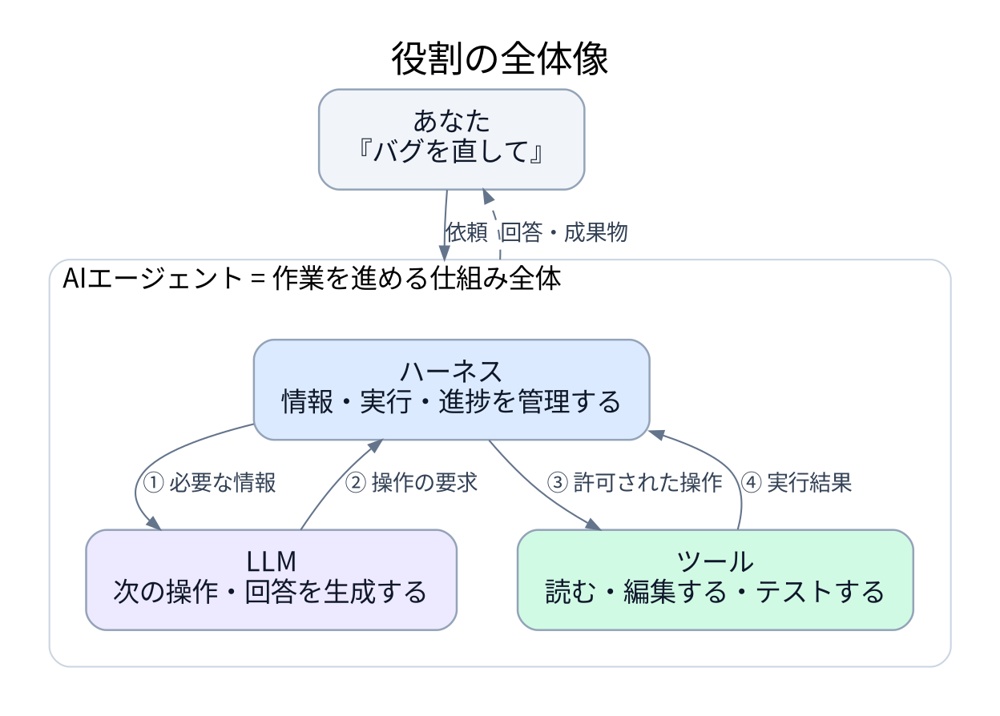
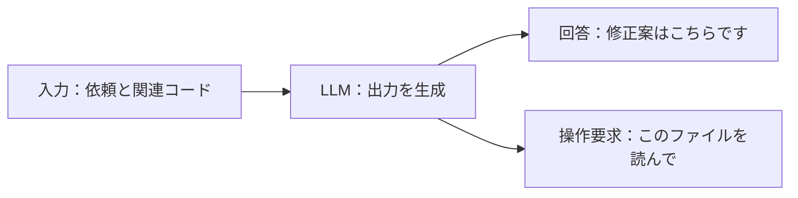
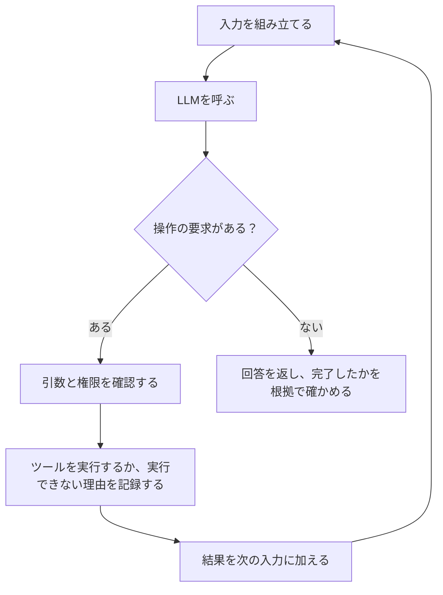
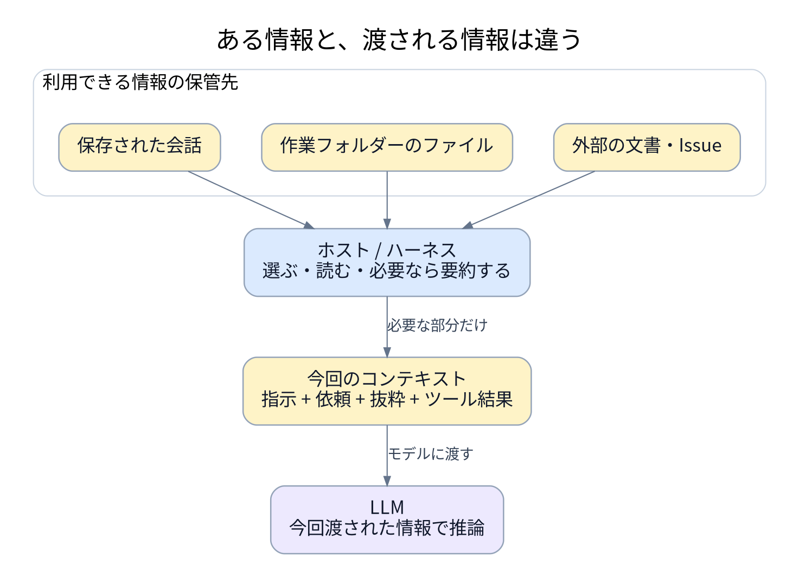
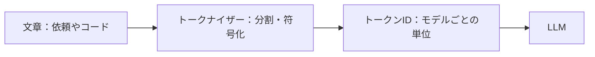
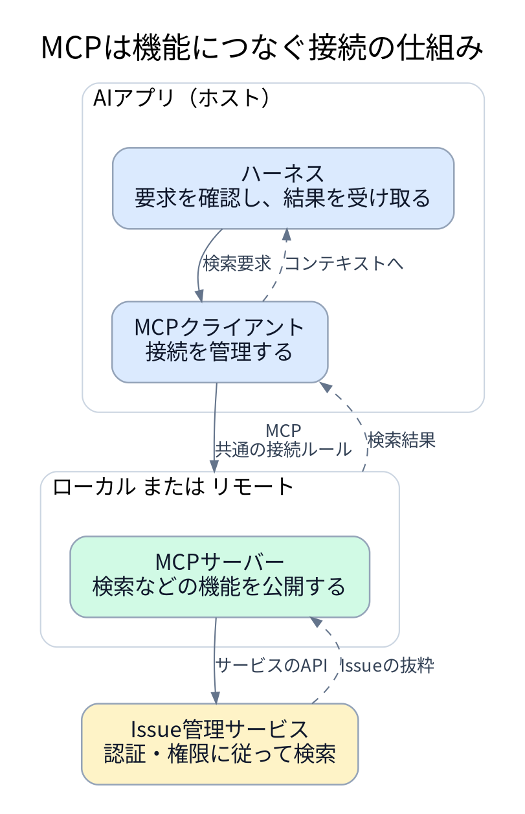
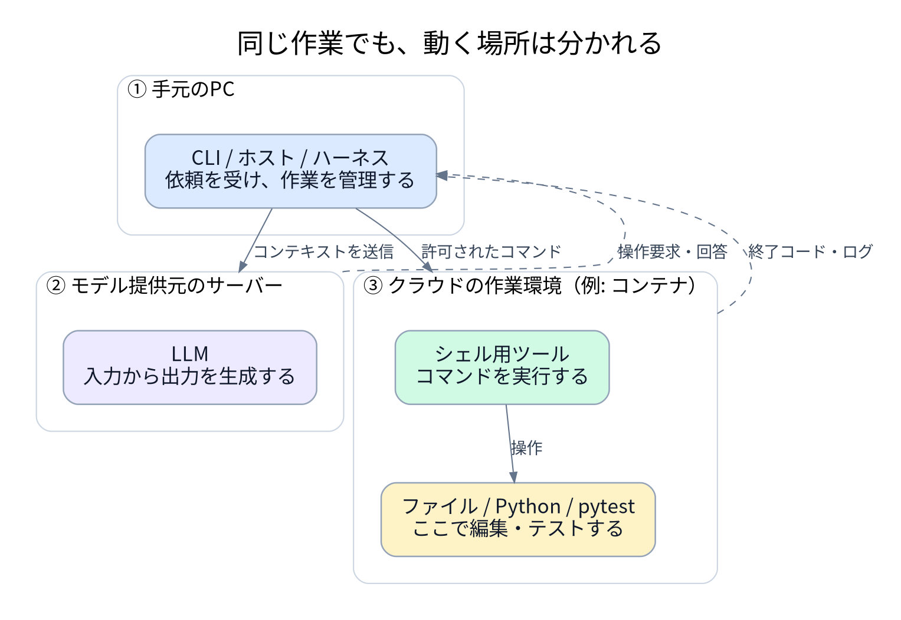
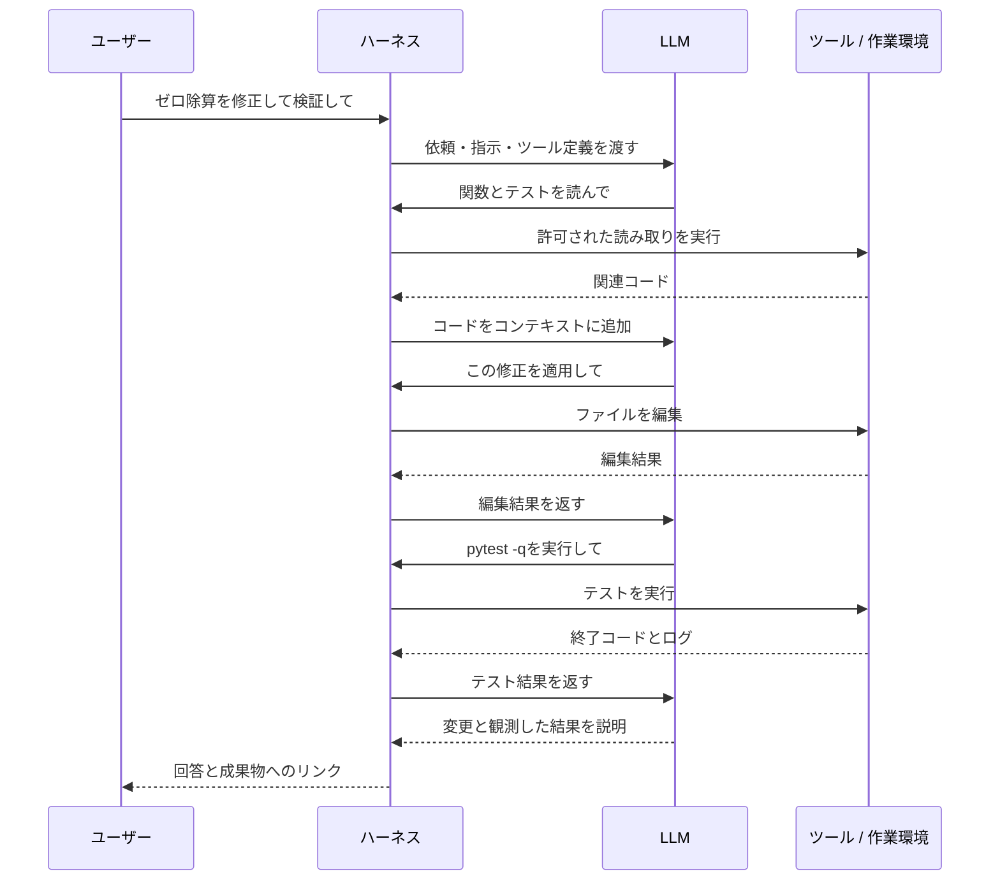

# 図でわかるAIエージェントの仕組み

[English](agent_architecture.md)

**「このバグを直して」という一つの依頼を追いながら、誰が何をして、どんな情報を使い、どこで動くのかを理解する資料です。**

- まずは1〜3節で大枠をつかみ、8節まで進むと一連の作業がつながります。
- 各節は短い説明と図から始まります。実装上の細かい話は、末尾の折りたたみ式の補足にまとめています。
- 図は全8点です。PNGが4点、Mermaidが4点あり、PNGはクリックすると大きく確認できます。
- 一般的な構成の説明であり、特定製品の非公開実装の解説ではありません。「エージェント」「ハーネス」が指す範囲には製品差があります。

## 1. まずは三つの役割で考える

**LLMが次の一手を生成し、ツールが操作を実行し、ハーネスが両者のやり取りを管理します。ここでは、この仕組み全体をエージェントと捉えます。**



**番号順に見ると：** LLMに情報を渡す → 操作の要求を受け取る → 許可された操作を実行する → 結果を返す。必要に応じて繰り返します。

| 名前 | ひとことでいうと | 「バグを直して」の場合 |
| --- | --- | --- |
| LLM | 回答や次の操作要求を生成する役 | 「まずこの関数を読もう」 |
| ハーネス | 情報・実行・進捗を管理する役 | 指定ファイルを読ませ、内容をLLMへ返す |
| ツール | 決まった操作を実行する役 | 読む、編集する、テストする |
| エージェント | 複数の手順で目標に向かう仕組み全体 | 調査・修正・検証・報告を進める |

- **ホスト**は、CLIやチャットアプリなど、利用者が使うアプリケーションです。ハーネスの機能は、そのアプリや周辺ソフトウェアに実装されます。
- コンテキスト、トークン、MCP、実行環境は、それぞれが使う「情報」「単位」「接続」「場所」に関する言葉です。以下で一つずつ足していきます。

## 2. LLM：回答や「こう操作して」を生成する

**LLMは、受け取った情報をもとに出力を生成するモデルです。** *Large Language Model*の略で、日本語では「大規模言語モデル」と呼びます。



**例：** 除算の関数を見て、モデルが「分母がゼロなら例外を発生させよう」と生成します。これは修正案です。実ファイルの編集にはツールが、動作確認にはテストが必要です。

- 実態は、学習済みのパラメータと、それを使って計算する推論プロセスやサービスです。
- **学習**はパラメータを変更すること、**推論**はそのパラメータを使って依頼を処理することです。添付文書を読む場合は、通常、その文書を推論の入力として渡します。
- モデルの出力は間違うことがあります。リポジトリの現在の内容やテスト結果は、対応するシステムで確認する必要があります。

## 3. ハーネス：作業の進行を支える

**ハーネスは、モデルの呼び出しとツール操作を繰り返し、連携させるソフトウェアです。** 作業の進行役と考えると分かりやすく、実行の上限や権限も管理します。



**例：** モデルが`pytest -q`を要求します。ハーネスは実行可能かを確認し、シェル用ツールで動かし、終了を待ち、終了コードとログを返します。モデルはその結果から、追加修正が必要か判断できます。

- **ツール呼び出し**は「実行してほしい」という要求で、**ツール結果**が実際に何が起きたかを伝えます。
- ハーネスは、入力情報の選択、実行中の処理、進捗、再試行、停止条件などを管理します。アプリ、SDK、インフラに分かれて実装される場合があります。
- 同じLLMでも、使えるツール、渡す情報、エラーへの対応が変わると、結果も変わり得ます。
- 図では簡略化していますが、実際にはキャンセルや時間・予算の上限でも停止できる必要があります。

## 4. コンテキスト：今、机の上に置かれた情報

**コンテキストは、今回のモデル呼び出しで使える情報です。** 今の作業のために、机の上に置いた資料をイメージすると分かりやすくなります。



**例：** 除算のバグなら、要件、除算の関数、失敗しているテストが役立ちます。関係のない画像フォルダーは、おそらく必要ありません。

- 作業フォルダーにファイルがあっても、モデルが読んだとは限りません。内容を取得して、入力に含める必要があります。
- 画面の会話履歴と、ホストが組み立てる実際の入力が異なる場合があります。
- 長い会話は一部が省略・要約される場合があります。大事な条件が失われることもあるため、要件や未決事項を明確に残します。

| 混同しやすい言葉 | 違い |
| --- | --- |
| モデルの知識 | 学習によってパラメータに蓄えられたパターン |
| コンテキスト | 今回の推論で渡される情報 |
| メモリ | アプリが保存し、あとから取り出す情報 |

**RAG**は、関連資料を検索してから、その内容を入力に加えて回答を生成する方法です。たとえば、仕様書を検索し、一致する段落をコンテキストとして渡します。

## 5. トークン：入力と出力を数える単位

**トークンは、モデルが入出力を扱うときの単位です。** 1トークンが1単語や1文字に対応するとは限りません。



**なぜ気にするのか：** 扱える入出力の量に上限があり、使用量が料金にも関わることが多いためです。正確な分割はモデルや言語によって変わり、この図は実際の分割結果を示すものではありません。

**入出力の合計上限が32,000トークンだと仮定した例：**

| 予算の内訳 | トークン数 |
| --- | ---: |
| 指示とツールの説明 | 4,000 |
| 会話 | 8,000 |
| 関連する文書 | 12,000 |
| 最新の依頼 | 1,000 |
| **入力の小計** | **25,000** |
| 生成用に確保する量 | 5,000 |
| **残りの余裕** | **2,000** |

- **コンテキストウィンドウ**は、一回の呼び出しで扱える量の上限です。上の計算は単純化しており、実際の出力上限や推論トークンの扱いはAPIによって異なります。
- 一回のユーザー依頼で、モデルを何度も呼ぶことがあります。前の内容や新しいツール結果を後続の呼び出しで処理するため、作業全体の使用量は増えます。
- 関連する抜粋を取得し、必要なログを簡潔に返すと、予算を使いやすくなります。必要な根拠を増やす入力には意味があります。
- サービスにログインするための**アクセストークン**は、別の意味の「トークン」です。

## 6. MCP：機能につなぐための共通ルール

**MCPは、AIアプリと、ツールやデータを公開するサーバーをつなぐプロトコルです。** 正式名称は*Model Context Protocol*です。



**検索の要求を追うと：**

1. LLMが「このバグに関連するIssueを検索して」と要求します。
2. ホストが要求を確認し、MCPクライアントが設定済みのサーバーへ送ります。
3. サーバーが、利用可能な認可の範囲でIssue管理サービスを検索します。
4. 検索結果がホストに戻り、コンテキストとしてモデルに渡せるようになります。

| 部品 | 役割 |
| --- | --- |
| ホスト | 機能を使う側のAIアプリ |
| MCPクライアント | ホストからの接続を管理する |
| MCPサーバー | 機能を公開し、要求を処理する |
| サービスAPI | Issue・文書・DBなどのサービス固有の窓口 |

- ツールは通常の関数やAPIでも実装できます。ローカルのファイル編集にMCPが必須というわけではありません。
- 接続すると機能が利用可能になりますが、全データを自動的に読み込んだり、モデルがその内容を学習したりするわけではありません。
- 認証、アカウント権限、ネットワーク制限は別途適用されます。検索に加えてIssueを作成するなら、対応する書き込み権限が必要です。

## 7. 実行環境：操作が本当に動く場所

**実行環境は、ツールが実際に操作を行うマシンやセッションです。** モデルが動く場所と、テストコマンドが動く場所が分かれることもあります。



**この図の構成例では：**

- 手元のPCで、依頼を受け付けるCLI（コマンドラインのアプリ）が動きます。
- モデル提供元のサーバーで、モデルの推論が動きます。
- クラウドの作業環境で、ファイル操作や`pytest`が動きます。**コンテナ**は、その場所にプロセスを分離した環境を用意する方法の一つです。

製品によっては、ツールが手元のPCで動く場合、VMを使う場合、ホスト全体がクラウドで動く場合もあります。MCPサーバーもローカル・リモートの両方があり、この図は一つの配置例です。

| 確認すること | やさしくいうと |
| --- | --- |
| 作業ディレクトリ | 相対パスは、どのフォルダーを基準にする？ |
| ファイル権限 | このツールは、どのファイルを読んだり変えたりできる？ |
| ランタイム・依存関係 | ここにPythonや`pytest`は入っている？ |
| ネットワーク | この環境から必要なサービスにつながる？ |
| アカウント | CLI・ブラウザー・MCP接続は、誰の権限で動く？ |
| 保存期間 | セッションが終わっても、このファイルは残る？ |

- **サンドボックス**は、OSやインフラで操作制限を強制する仕組みです。「このパスに触らないで」という指示文よりも強い制限を設けられます。
- リモート環境の`/workspace/project`は、自分のPCのフォルダーと自動的に同じになるわけではありません。
- コードの抜粋をリモートのモデルに送れば、その抜粋は作業環境の外に出ます。コンテナで分離するだけでは、推論の入力をローカルに留められません。

## 8. つなげてみる：「ゼロ除算を直して」

**実行記録ではなく、仮定した例です。** `/workspace/calculator`にPythonプロジェクトがあり、`pytest`が導入済みとします。現在はゼロ除算で`0`を返しますが、依頼された動作は`ValueError`の送出です。ユーザーは修正とローカルでの検証を依頼し、公開は依頼していません。



**修正案：**

```diff
 def divide(a, b):
     if b == 0:
-        return 0
+        raise ValueError("denominator must not be zero")
     return a / b
```

- 分母ゼロで例外が出ることと、通常の除算が動くことを確認します。テスト成功が裏付けるのは、実際にテストした範囲です。
- テストが失敗したら、その出力をモデルへ返して修正・確認を繰り返します。実行できなければ、検証が未完了であることを伝えます。
- 必要ならMCPによるIssue検索を加えられますが、このローカル修正に必須ではありません。
- **LLMが生成 → ハーネスが調整 → ツールが実行 → 結果がコンテキストへ。** 図1と同じ繰り返しです。

## 9. 関連する言葉を整理する

| 言葉 | ひとことでいうと | 例 |
| --- | --- | --- |
| Prompt | 今回の依頼 | 「ゼロ除算を直して」 |
| Instructions | 適用範囲内で守るルール | プロジェクトの書き方に従い、関連する検証を行う |
| Skill | 再利用する手順と補助ファイル | バグ調査のチェックリスト |
| RAG | 生成のために関連資料を検索する方法 | 一致する仕様書の段落を渡す |
| Memory | 必要な情報を保存して取り出す仕組み | 保存したプロジェクトの決定事項 |
| Workflow | 決められた処理順や分岐 | lint、テスト、報告の順に行う |
| Sub-agent | 分担した仕事を進める別のモデル駆動ループ | 別モジュールのレビューを担当する |
| Framework | システムを作るためのツール群 | ツールの振り分けや状態管理のライブラリ |
| Evals | 代表的な課題で動作を評価する仕組み | 修正の成功率や品質の後退を測る |

- RAGは情報を検索して使う方法で、MCPは接続のルールです。RAGの検索をMCP経由でも、直接API経由でも提供できます。
- スキルは指示や資料であり、モデルのパラメータではありません。ホストが適切なスキルを検出し、読み込む必要があります。
- サブエージェントのコンテキスト、ツール、ファイルを共有するか分離するかは実装次第です。増やすと調整と使用量のコストが増え、品質が自動的に上がるわけではありません。
- 使い方は、[実践ガイド](AI_GUIDE_jp.md)と[InstructionsとSkills](instructions_and_skills_jp.md)も参照してください。

## 10. うまく動かないときの見方

| 症状 | 最初に確認すること |
| --- | --- |
| ファイルの内容を知らない | 実際に読み取り、コンテキストに入れた？ |
| 前に決めたことを忘れた | 省略・要約された？ 保存していた？ |
| テストを実行できない | 作業フォルダー、ランタイム、依存関係、サンドボックスの制限 |
| MCP検索が失敗する | 接続、サーバーの起動、認証、サービスの権限 |
| Issueを作ったと言っている | 再送する前に、ツール結果と実際のIssue ID |
| 文書の中の指示に従ってしまう | 情報の信頼範囲と、ホストが強制する操作制限 |

**入力 → モデル出力 → ハーネス → ツール → 外部サービス → 検証**の順に確認すると、どこで問題が起きたか切り分けやすくなります。

## 補足：必要になったら読む詳しい話

<details>
<summary>モデル呼び出し・ハーネスの実装・完了の確認</summary>

- テキスト生成は一般に、学習済みパラメータで次のトークンを順に予測する処理として説明されます。画像や音声などの入出力に対応するモデルもあります。
- 一般的なAPIでは、ホストが関連する会話の状態を送るか、参照させます。独立した呼び出し同士で、前回の情報を覚えているとは想定できません。
- Function Callingでは、ツール名と構造化された引数を生成します。アプリが検証して実行先へ送り、呼び出しIDに対応づけた結果を返します。要求の生成だけでは、実行された証拠にはなりません。
- ハーネスには、タイムアウト、キャンセル、実行状態の確認、適切な再試行、必要に応じた状態の永続化、手順数・予算の上限も必要です。バックグラウンド処理のIDが返っても、完了したとは限りません。
- 読み取りの再試行と、決済やメッセージ送信の再試行では影響が異なります。書き込みでは、重複実行を防ぐ制御や、初回の処理が成功したかの確認を行います。
- harness、runtime、runner、executor、orchestratorは重なり合う実装上の用語で、統一された境界はありません。また、ハーネスはシステムプロンプトだけを指すものではありません。
- 完了の報告は、成果物や検証で裏付ける必要があります。出力形式が正しくても、内容が正しいとは限りません。

</details>

<details>
<summary>コンテキストの上限・セキュリティ・費用計算</summary>

- 保存された会話、永続メモリ、外部ファイル、現在のコンテキストは、寿命が異なります。各呼び出しに何を渡すかは、ホストの選択によります。
- コンパクションは古い内容を要約に置き換えます。決定事項を残せても、正確なエラーや例外条件が失われる場合があります。引き継ぎメモには、参照パスや未解決の要件も残します。
- コンテキストエンジニアリングは、有用な入力を選び、構造化し、検索し、維持する工夫です。指示の優先順位は、最後に現れた文章ではなく、ホストやモデルの仕様に従います。
- 検索した文書やツール結果には、動作を誘導するプロンプトインジェクションが含まれる場合があります。信頼できない内容に新しい権限を与えず、モデルの外でも操作を制限します。
- 正確なテキストのトークン数は、対象のトークナイザーかAPIの使用量レポートで測ります。日本語の文字数や画像・音声・動画のサイズから、共通の換算式では求められません。
- テキストの概算費用は、課金対象の入力・出力トークン数に各単価を掛け、全呼び出しで合計します。単位換算、キャッシュ、推論トークンの扱いは提供元のルールに従い、ツールや計算環境の料金が加わる場合もあります。
- キャッシュで費用や待ち時間が減ることがありますが、コンテキスト上限がなくなったり、正しさが確認されたりするわけではありません。
- コンテナとVMでは分離の性質が異なります。ブラウザー、CLI、MCP接続の認証主体も別の場合があり、ブラウザーのログイン成功はCLIの権限を保証しません。

</details>

<details>
<summary>MCPが公開する機能と通信方式</summary>

| サーバーが提供する基本機能 | 目的 | 例 |
| --- | --- | --- |
| Tools | 呼び出し可能な操作 | Issueの検索、チケットの作成 |
| Resources | URIで識別できる内容 | 文書、スキーマ |
| Prompts | 再利用するメッセージのテンプレート | レビュー用プロンプト |

- サーバーがすべて実装する必要はなく、ホストが対応・公開する範囲も異なります。
- 代表的な通信方式には、ローカルの**stdio**とリモートの**Streamable HTTP**があります。対応と認可は、採用するプロトコルのバージョンや実装に従います。
- サーバーへの認証と、その先のサービスの認証情報は別の場合があります。MCPがネットワークやファイルの制限を回避するわけではありません。
- 機能の検出、データの取得、モデルのコンテキストへの取り込みは別の処理です。接続済みでも、全データを読んだことにはなりません。

</details>

## 図のソースと検証

- PNGは[生成スクリプト](scripts/render_agent_diagrams.py)から作成します。前提条件は、Python 3、`PATH`上のGraphvizの`dot`、同じ書体で描画するためのNoto Sans CJK JP／DejaVu Sansフォントです。外部のPythonパッケージは不要です。
- リポジトリのルートで実行します。

```bash
python learning/ai/scripts/render_agent_diagrams.py
```

- 期待する出力は、`learning/ai/assets/agent_architecture/`配下の英語4点・日本語4点のPNGです。両言語で同じ配置・関係を使います。
- PNGの生成コマンドは実行済みです。それ以外のコード、予算、会話は概念説明用であり、モデル、MCPサーバー、電卓プロジェクトに対する実行結果ではありません。
- 文書内の相対リンク、コードブロック、日英の図の構造の一致を確認しています。PNGは目視確認済みで、Mermaidの描画はこの環境では実行していません。
- 上限、料金、権限、通信方式の対応は、採用する製品・バージョンで確認してください。以下の参考資料のライブの内容や最新版は、執筆時に確認していません。

## 参考資料

- [OpenAI: Key concepts](https://platform.openai.com/docs/concepts) — モデルとトークン。
- [OpenAI: Function calling](https://platform.openai.com/docs/guides/function-calling) — モデルとアプリのツール実行の境界。
- [OpenAI: Conversation state](https://platform.openai.com/docs/guides/conversation-state) — 呼び出しをまたぐ状態。
- [MCP: Architecture](https://modelcontextprotocol.io/docs/learn/architecture)と[仕様](https://modelcontextprotocol.io/specification) — 役割、機能、バージョン別の通信方式。
- [Anthropic: Building effective agents](https://www.anthropic.com/engineering/building-effective-agents) — ワークフローとエージェント。
- [Docker: What is a container?](https://docs.docker.com/get-started/docker-concepts/the-basics/what-is-a-container/) — コンテナと分離。
