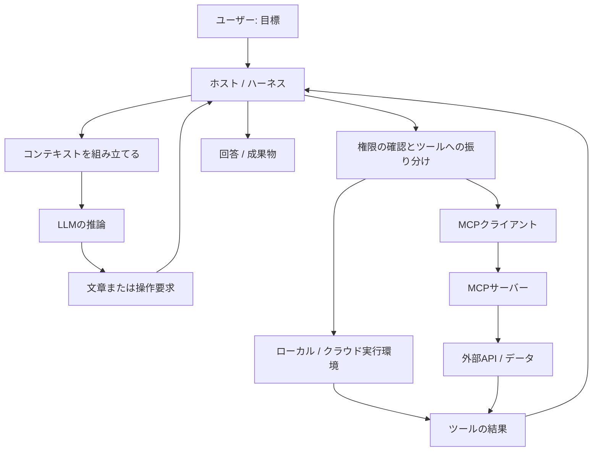

# AIエージェントの概念・構成要素・実行環境

[English](agent_architecture.md)

## 1. 学習目標と対象範囲

- AIチャットを使ったことがあり、エージェントが作業するときに「実際に何が動いているのか」を知りたい人向けの資料です。
- 一つの依頼がモデルへの入力からツール実行につながる流れを追い、LLM、ハーネス、コンテキスト、トークン、MCP、実行環境の役割を区別します。
- 一般的な構成を説明するもので、特定製品の非公開実装の解説ではありません。「エージェント」「ハーネス」の定義には幅があるため、以下では理解のための整理として境界を置きます。
- 指示やスキルの使い方は、[実践ガイド](AI_GUIDE_jp.md)と[InstructionsとSkills](instructions_and_skills_jp.md)も参照してください。

## 2. システムの全体像

> LLMが回答や操作の要求を生成し、周辺のソフトウェアが許可された操作を実行して結果を返します。この繰り返しによって、システムが目標に向けて作業します。

| 概念 | 役割 | 実態 | 例 |
| --- | --- | --- | --- |
| LLM | 入力を解釈し、出力を生成する | モデルのパラメータと推論サービス／プロセス | 修正案や構造化されたツール呼び出しを生成する |
| Agent（エージェント） | 複数の手順で目標を達成する | モデル、ツール、状態、制御ロジックを組み合わせたシステム | バグを調査し、コードを変更してテストする |
| Harness（ハーネス） | ホスト内でのモデルの動作を管理する | 入力の組み立て、ツール実行、状態・上限・権限を管理するソフトウェア | 要求されたテストを実行して結果をモデルへ返す |
| Context（コンテキスト） | 今回のモデル呼び出しに情報を供給する | メッセージ、ツール定義、選んだ文書、画像、実行結果など | 依頼、関連コード、失敗したテストのログ |
| Token（トークン） | モデルの入出力を単位に分ける | トークナイザーに依存するID。テキスト以外の計数方法は異なる | 入力上限や使用量の計数単位 |
| Tool（ツール） | 定義された操作を行う | ホストに公開された関数、プロセス、サービス、API | ファイルの読み取り、Issue検索 |
| MCP | 機能やデータへの接続方法を標準化する | ホスト、クライアント、サーバーが実装するプロトコル | AIアプリをIssue検索サーバーに接続する |
| 実行環境 | 操作が動く場所を提供する | ローカルOS、コンテナ、VM、ブラウザーセッション、リモートサービスなど | クラウドの作業環境で`pytest`を実行する |



- ここでは、モデルと周辺ソフトウェアにまたがるループをエージェントと捉えます。必ずしも`agent`という名前の独立したプロセスがあるわけではありません。
- モデルの推論、コマンド実行、MCPサーバーは、それぞれ別のマシンで動く場合があります。
- MCPを使わず、通常の関数やAPIの連携でツールを提供することもできます。

## 3. LLM：推論を担う構成要素

- LLM（大規模言語モデル）は、学習済みのパラメータを使い、入力に応じた出力を生成します。テキスト生成は一般に、次のトークンを順に予測する処理として説明されます。テキスト以外の入出力に対応するモデルもあります。
- **学習（training）**はモデルのパラメータを変更します。**推論（inference）**は、そのパラメータを使って依頼を処理します。文書の添付は通常、パラメータではなく入力を変えます。
- APIへの入力には通常、指示、メッセージ、利用可能なツールの説明などが含まれます。出力には文章や、そのAPIに対応した構造化ツール呼び出しが含まれます。
- モデル単体で、ディスクの読み取り、Web閲覧、サービスの認証情報が自動的に利用できるわけではありません。ホストが機能を公開し、実行する必要があります。
- もっともらしく誤った回答を生成する場合があります。学習済みの知識だけでは、現在のリポジトリ、アカウント、Webサイトの状態は確認できません。

**例：** ゼロ除算で問題が起きる関数を見せると、モデルは分母がゼロの場合に例外を送出する案を生成できます。その案が動くかどうかは、実際のコードを確認し、実行環境で適切に検証する必要があります。

## 4. エージェントとハーネス：目標に向けた判断と制御

- エージェントは目標に向けて操作を選び、結果を観測し、次の行動を調整します。ホスト側で「編集後は必ずフォーマッターを実行する」といった固定のワークフローを組み合わせることもあります。
- ハーネスは、それを可能にする実行の仕組みを提供します。フレームワークによっては、近い構成要素をruntime、runner、executor、orchestratorなどと呼びます。名称は重なり合い、統一された分類ではありません。

| ハーネスの責務 | 具体的な処理 |
| --- | --- |
| コンテキストの組み立て | メッセージ、指示、ツールのスキーマ、ファイルの抜粋を選ぶ |
| モデルの呼び出し | リクエストの送信、出力の処理、使用量の記録を行う |
| ツールへの振り分け | ツール名と引数を検証し、実行先へ送る |
| 境界の適用 | 許可リスト、サンドボックス、必要な承認を適用する |
| 進捗の管理 | ツール呼び出しID、実行状態、中間結果を保持する |
| 長い作業への対応 | 実行中プロセスの確認、適切な再試行、古い情報の要約を行う |
| 停止の判断 | 完了、手順数・予算の上限、キャンセル、回復不能な失敗で終了する |

- これらの責務は、アプリのコード、SDK、インフラに分かれて実装されることがあります。ハーネスはシステムプロンプトだけを指すものではありません。
- 同じLLMでも、ハーネスが変わると、ツール、情報の選び方、エラー処理、上限が変わるため、結果も変わり得ます。
- 自律性が高くても、アクセス範囲が広いとは限りません。実際に動かせる操作は、権限と認証情報によって決まります。
- サブエージェントは、委任された作業を行う別のモデル駆動ループです。モデル、コンテキスト、ツール、ファイルシステムを共有するか分離するかは実装次第で、並列化には調整と使用量のコストが伴います。

**概念を示す擬似コードです。実行可能なSDKの例ではありません。**

```text
state = initialize(goal, instructions, tool_catalog)
for step in range(step_limit):
    context = select_context(state, input_budget)
    response = call_model(context)
    if response.requests_tools:
        for request in response.tool_requests:
            validate_arguments_and_permissions(request)
            result = execute_or_record_failure(request)
            state.append(request, result)
    else:
        return response.answer
return report_incomplete(state)
```

- 実際の実装では、タイムアウト、キャンセル、エラーからの復旧、必要に応じた状態の永続化なども必要です。
- 読み取りの再試行と、決済やメッセージ送信の再試行では影響が違います。書き込みには、冪等性キーや初回の処理が成功したかどうかの確認が必要になる場合があります。
- 「完了しました」もモデルの出力です。成功したかどうかは、成果物、ツールの結果、受け入れ条件の確認によって裏付ける必要があります。

## 5. コンテキスト：モデルが今受け取る情報

- コンテキストは、特定のモデル呼び出しで利用できる情報です。画面に見えている会話履歴と、モデルに渡される実際の入力は、完全には一致しない場合があります。
- 作業環境にファイルが存在するだけでは、その内容がモデルに渡るとは限りません。ツールやホストの機能が読み取り、関連内容を入力に含める必要があります。
- アプリから供給される情報の一部は、通常のチャットメッセージとしては表示されません。

| 層 | 例 | 保存期間・境界 |
| --- | --- | --- |
| モデルのパラメータ | 学習したパターン | 学習やモデル更新で変わる |
| 現在のコンテキスト | 依頼、指示、コードの抜粋、ツール結果 | 今回の推論に渡される |
| 会話の状態 | 保存されたメッセージや進捗 | ホストが管理し、一部の選択や要約が行われる |
| 永続メモリ | 保存した好み、プロジェクトの要約 | 保存・取り出しの仕組みは製品次第 |
| 外部の状態 | ファイル、DBの行、Issue | 外部システムのルールに従って保存される |

- 一般的なAPI利用では、ホストが後続の呼び出しに会話の状態を送るか、参照させます。その仕組みなしに、モデルサービスが前回の依頼を覚えているとは想定できません。
- **コンテキストウィンドウ**は、一回の呼び出しで扱える量の上限です。入力、出力の予約、推論トークン、各モダリティの制限には、モデルやAPIごとのルールがあります。
- **コンパクション（圧縮・要約）**は、過去の内容の一部を短い要約に置き換える処理です。決定事項を残せても、正確な文言、エラーの詳細、例外条件などが失われる可能性があります。
- **コンテキストエンジニアリング**は、有用な入力を選び、構造化し、検索し、維持する工夫です。すべてを投入するとコストが増え、関連する根拠に注意が向きにくくなる場合があります。
- 指示の優先順位は、ホストやモデルの仕様で決まります。検索した文書に「ユーザーの指示を無視せよ」とあっても、それは信頼できない文書の内容であり、新しい権限を与える根拠にはなりません。

**例：** 一つの関数の修正なら、その実装、変更の影響を受ける呼び出し元、期待動作、関連する失敗テストを渡します。全ファイルを投入する代わりに、不足した情報を追加で取得します。

## 6. トークン：上限・コスト・繰り返し処理

- テキストのトークナイザーは、文章をトークンIDの列に変換します。1トークンが1単語、1文字、1バイトとは限りません。分割はモデル、言語、コード、記号などによって変わります。
- 日本語の文字数から正確なトークン数は求められません。測定には、対象モデルのトークナイザーやAPIの使用量レポートを使います。
- 画像・音声・動画の計数方法はモデルごとに異なります。テキストだけの概算をすべての入力形式に適用しないでください。
- ここでいうトークンはモデルの処理単位です。OAuthトークンやアクセストークンは認証情報であり、別の意味の用語です。

**仮の予算計算です。特定製品の仕様ではありません。**

| 項目 | トークン数 |
| --- | ---: |
| 指示とツールの説明 | 4,000 |
| 会話履歴 | 8,000 |
| 取得した資料の抜粋 | 12,000 |
| 最新の依頼 | 1,000 |
| 入力合計 | 25,000 |
| 生成用に確保する予算 | 5,000 |
| 単純化した合計 | 30,000 |

- 仮に入出力の合計上限が32,000トークンなら、この単純化した計算では残り2,000です。実際のAPIには、出力の個別上限など、別の制約がある場合があります。
- 一回のユーザー依頼でも、モデルは何度も呼ばれます。ツール結果で後続の入力が増え、以前の情報を繰り返し処理する場合もあります。25,000トークンのコンテキストを使う作業の総使用量が、25,000とは限りません。
- テキストの概算費用は、各呼び出しの`（課金対象の入力トークン数 × 入力単価）＋（課金対象の出力トークン数 × 出力単価）`の合計です。単位換算、キャッシュ、推論トークンの扱いは提供元のルールに従い、ツールや計算環境の料金が加わる場合もあります。
- 対応条件では、キャッシュによって費用や待ち時間が減ることがあります。ただし、コンテキストが無制限になったり、回答の正しさが保証されたりするわけではありません。
- 対象を絞った検索、必要な行だけの取得、簡潔なツール結果、参照パスと未決事項を残した要約が有効です。

## 7. ツール・Function Calling・MCP

### ツール実行の境界

- Function Callingでは、モデルがツール名と構造化された引数を出力します。アプリが検証・実行し、その呼び出しに対応する結果を返します。
- 呼び出しの生成は操作の要求であり、実行された証拠ではありません。成功・失敗と実際の結果を確認します。

**説明用に整理した呼び出し例です。すべてのAPIに共通の通信形式ではありません。**

```json
{
  "name": "search_issues",
  "arguments": {"query": "division by zero", "limit": 3}
}
```

### MCPの構成

- Model Context Protocolは、AIアプリケーションと、機能やデータを公開するサーバーの通信を標準化します。MCP自体はモデルでも自律エージェントでもありません。
- **ホスト**はAIアプリケーションです。その内部の**MCPクライアント**が**MCPサーバー**との接続を管理します。サーバーは既存API、ローカルプログラム、データソースなどを公開できます。
- 代表的な通信方式には、ローカルの**stdio**と、リモートの**Streamable HTTP**があります。対応する通信方式、認可、機能は、プロトコルのバージョンと実装によって異なります。

| サーバーが提供する基本機能 | 目的 | 例 |
| --- | --- | --- |
| Tools | 呼び出し可能な操作を公開する | Issueの検索、チケットの作成 |
| Resources | URIで識別できる内容を公開する | 文書やスキーマの読み取り |
| Prompts | 再利用可能なメッセージのテンプレートを公開する | レビュー用プロンプトの準備 |

- サーバーが三つすべてを実装する必要はありません。モデルやユーザーに何を提供するかもホストによって異なります。
- MCPによる機能の検出は、ホストが機能を使えるようにする処理です。リモートの全データが、毎回のコンテキストに入るという意味ではありません。
- 一般的な流れは、`LLMのツール要求 → ホストの権限確認 → MCPクライアント → MCPサーバー → サービスAPI → 結果 → モデルのコンテキスト`です。
- MCP自体がアカウントのアクセス権を与えたり、ファイルやネットワークの制限を回避したりするわけではありません。サーバーへの認証と、接続先サービスの認証情報は別の場合があります。
- MCPサーバーを接続しても、その内容をモデルが学習するわけではありません。モデルがリモートで動き、MCPサーバーがローカルで動く構成もあります。

**例：** Issue検索MCPサーバーが、アクセスを許可されたプロジェクトを検索し、ID付きの抜粋を3件返します。ホストが選んだ結果をモデルへ渡します。Issueの作成は別の操作であり、対応する書き込み権限が必要です。

## 8. 実際にどこで動くのか

| 構成要素 | 動く場所の例 | 確認すること |
| --- | --- | --- |
| UI・ホスト・ハーネス | デスクトップアプリ、CLI、クラウドのバックエンド | 現在のセッション、設定、読み込まれた指示 |
| モデルの推論 | 提供元のサービス、ローカルのモデルプロセス | モデル識別子、エンドポイント、入力上限 |
| シェル・コード用ツール | ローカルPC、コンテナ、VM、クラウド作業環境 | 作業ディレクトリ、ランタイム、ファイル権限 |
| ブラウザーツール | ローカルまたはリモートのブラウザーセッション | ログイン状態、接続先への到達性、ダウンロード |
| MCPサーバー | ローカルの子プロセス、リモートサービス | 通信方式、対応操作、認証 |
| データサービス | リポジトリサービス、文書サービス、DB | アカウント、プロジェクト、アクセス範囲 |

- **作業ディレクトリ：** 相対パスの基準です。リモートコンテナ内の`/workspace/project`は、自分のPCのフォルダーと自動的に同じになるわけではありません。
- **ファイルシステムの境界：** 読み書きできるパス、共有の有無、セッション終了後に残るかどうかを確認します。
- **プロセスの境界：** コマンドは実際のOSプロセスとして動きます。バックグラウンド処理はツール呼び出しより長く続く場合があり、プロセスIDが返された段階では、完了まで状態確認が必要なこともあります。
- **ネットワークの境界：** インターネット接続、接続先の許可リスト、外向き通信の禁止などがあります。モデルAPIに接続できても、シェルからすべてのWebサイトにアクセスできるとは限りません。
- **認証主体の境界：** ブラウザー、CLI、MCPサーバーは別のアカウントや認証情報を使う場合があります。ブラウザーでログインできても、CLIのアクセス権の証拠にはなりません。
- **サンドボックス：** OSやインフラが操作を制限する仕組みです。「このパスに触らないで」というプロンプトと、強制されるファイル分離は異なります。コンテナとVMも、分離の性質が異なります。
- **永続性：** 作業ファイル、会話のコンテキスト、モデルサービスのキャッシュには別々の寿命があります。すべて残ると想定せず、成果物の保存先を確認します。

**構成例：** PC上のCLIがモデル提供元へ推論リクエストを送り、ローカルコンテナ内でテストし、リモートのIssue検索MCPサーバーに接続します。推論用に送るコードの抜粋はコンテナの外に出るため、コンテナによる分離だけでは、モデル入力をローカルに留められません。

## 9. 一連の具体例：ゼロ除算のバグを修正する

**仮定したシナリオであり、実際の実行記録ではありません。** `/workspace/calculator`にPythonプロジェクトがあり、`pytest`が導入済みとします。現在はゼロ除算で`0`を返しますが、要件は`ValueError`の送出です。ユーザーは修正とローカルでの検証を依頼し、公開は依頼していません。

| 手順 | モデルの役割 | ハーネス・ツールの役割 | 根拠・状態 |
| --- | --- | --- | --- |
| 1. 依頼を受ける | 目的と判断基準を解釈する | 依頼、指示、ツール定義を渡す | 初期コンテキスト |
| 2. プロジェクトを調べる | 関連ファイルとテストの取得を要求する | 許可された作業環境のパスを読む | コードとテストの抜粋がコンテキストに入る |
| 3. 必要ならIssueを調べる | Issue検索を要求する | 設定されたMCPサービスを呼ぶ | IssueのIDと抜粋。失敗時は通信・権限エラー |
| 4. 変更を提案する | 対象を絞った編集内容を生成する | 実ファイルに編集を適用する | ファイルシステム上の差分 |
| 5. 検証する | プロジェクト内での`pytest -q`を要求する | OSプロセスを実行し、終了状態と出力を取得する | 終了コードとテスト結果 |
| 6. 失敗に対応する | トレースバックを解釈し、修正する | 許可された追加の編集・検証を実行する | 更新されたコンテキストと成果物 |
| 7. 完了を伝える | 変更と検証結果を説明する | 最終回答や成果物へのリンクを返す | 実際の差分と観測された結果 |

**概念上の期待する差分：**

```diff
 def divide(a, b):
     if b == 0:
-        return 0
+        raise ValueError("denominator must not be zero")
     return a / b
```

- 意味のある検証では、ゼロ除算で期待する例外が発生することと、通常の除算が従来どおり動くことを確認します。
- テスト成功は、実行したテストの範囲の根拠です。すべての入力に対する正しさの証明ではありません。また、テスト自体が依頼された動作と一致している必要があります。
- 編集はコード用ツールが実行し、モデルは要求する編集内容を生成します。`pytest`はモデルのパラメータ内部ではなく、プロジェクトの実行環境で動きます。
- MCPサーバーはIssue情報を提供し、ローカルだけで完結する編集には必須ではありません。ループを繰り返すたびに時間がかかり、モデルのトークン使用量が増える場合があります。
- 実行環境が利用できなければ、成功したとせず「変更案を作成。テストは未実行」と報告します。

## 10. RAG・メモリ・スキル・ワークフローとの関係

| 関連概念 | 位置づけ | 例 |
| --- | --- | --- |
| Prompt | 今回の依頼を伝える入力 | 「ゼロ除算を修正して検証して」 |
| Instructions | ホストが適用範囲内で使うルール | プロジェクトの規約、必須の検証 |
| Skill | 再利用可能な手順と、必要に応じた補助ファイル | バグ調査のチェックリスト |
| RAG | 関連資料を検索して生成のコンテキストに追加する手法 | 回答前に仕様書を検索する |
| Memory | 手順やセッションをまたいで情報を保存・取得する仕組み | 保存されたプロジェクトの決定事項 |
| Workflow | 事前に定めた処理順や分岐 | lint、テスト、レポート作成の順で実行する |
| Evals | 代表的な課題を使って動作を評価する仕組み | 修正の成功率や品質の後退を測る |

- RAGは検索と生成の手法で、MCPは接続のプロトコルです。RAGの検索をMCP経由でも直接API経由でも提供できます。
- スキルは手順であり、モデルの重みではありません。検出、読み込み、適用条件、実行によって効果が変わります。
- フレームワークは、このようなシステムを作るためのライブラリやツール群です。ハーネスの部品を提供していても、稼働中のシステム全体と同じとは限りません。

## 11. よくある誤解と切り分け

| 症状・主張 | 区別・確認すること |
| --- | --- |
| 「LLMは全ファイルを読んだ」 | 実際に読み取り、コンテキストに渡したファイルを確認する |
| 「MCPを接続したので社内情報を全部知っている」 | 機能の検出、検索、権限、コンテキストへの取り込みは別の処理 |
| 「テストが動かないのはモデルの能力が低いから」 | コマンド、ランタイム、依存関係、ディレクトリ、サンドボックスを確認する |
| 「前の決定を忘れた」 | コンテキストの選択、要約、永続状態を確認する |
| 「Issueを作ったと言っている」 | ツール結果と実際のIssue IDを確認し、書き込みを無条件に再試行しない |
| 「ツール結果に秘密情報をアップロードせよとあった」 | 外部コンテンツは信頼できないデータとして扱い、モデルの外でも操作を制限する |
| 「エージェントやトークンを増やせば必ず良くなる」 | 関連性、調整の負担、作業成功率、待ち時間、コストを測る |

- **入力 → モデル出力 → ハーネスの判断 → ツール実行 → 外部サービス → 検証**の層ごとに調べると、推論の誤りと、実行・アクセスの失敗を切り分けやすくなります。

## 12. 検証と出典の状態

- 例は概念説明用です。擬似コード、JSON、トークン予算、除算の差分は境界を説明するもので、実際のモデル、MCPサーバー、電卓プロジェクトに対する実行結果ではありません。
- この説明のために依存関係の導入やベンチマークは不要です。実際の上限、料金、通信方式の対応、権限は、採用するバージョンで確認してください。
- 以下は追加学習のための公式資料です。執筆時にライブの内容や最新版は確認しておらず、特定の最新APIやMCPリリースへの適合を主張する資料ではありません。

## 13. 参考資料

- [OpenAI: Key concepts](https://platform.openai.com/docs/concepts) — モデル、トークン、使用量の概念。
- [OpenAI: Function calling](https://platform.openai.com/docs/guides/function-calling) — モデルとアプリによるツール呼び出しの境界。
- [OpenAI: Conversation state](https://platform.openai.com/docs/guides/conversation-state) — 推論呼び出しをまたぐ状態の管理。
- [MCP: Architecture](https://modelcontextprotocol.io/docs/learn/architecture) — ホスト、クライアント、サーバー、基本機能。
- [MCP specification](https://modelcontextprotocol.io/specification) — バージョン別のプロトコルや通信方式の詳細。
- [Anthropic: Building effective agents](https://www.anthropic.com/engineering/building-effective-agents) — ワークフローとエージェントシステム。
- [Docker: What is a container?](https://docs.docker.com/get-started/docker-concepts/the-basics/what-is-a-container/) — プロセスの分離と実行環境。
