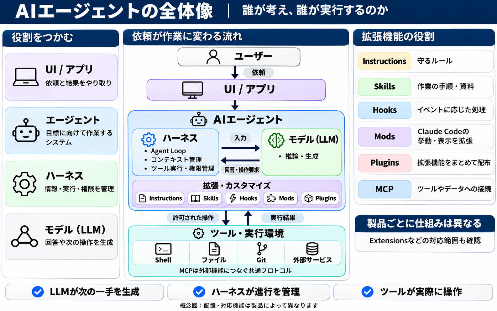
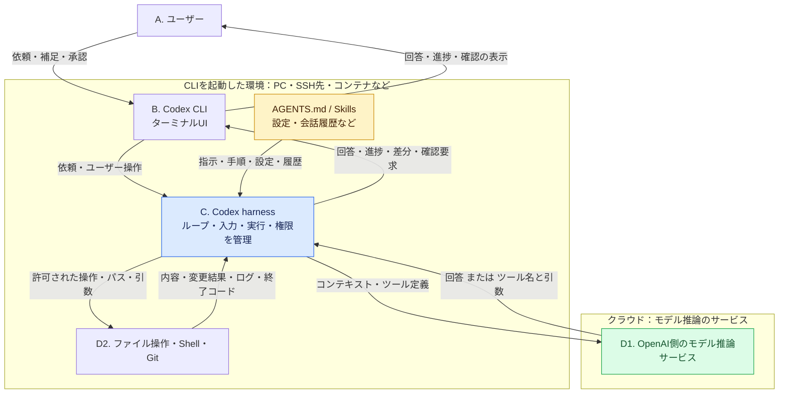
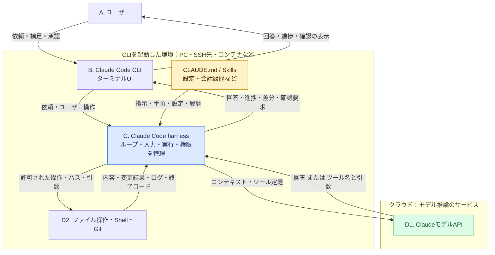
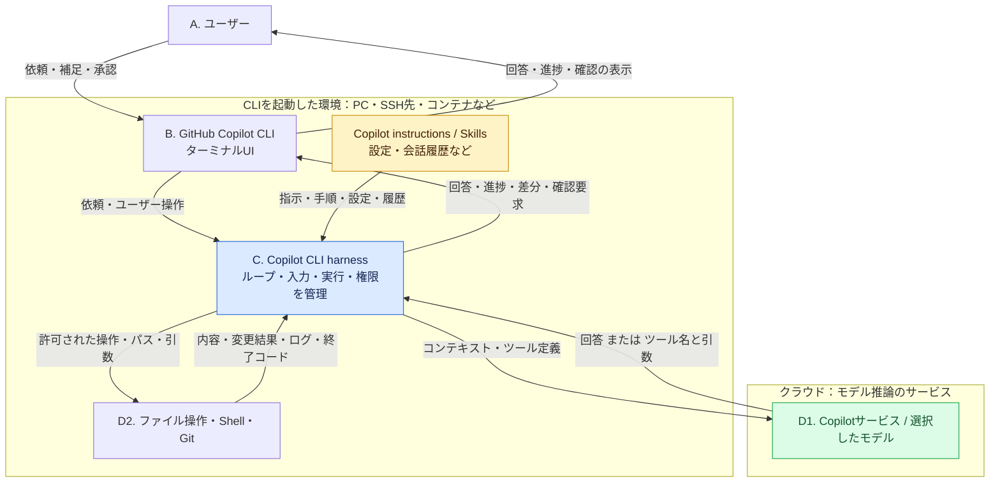
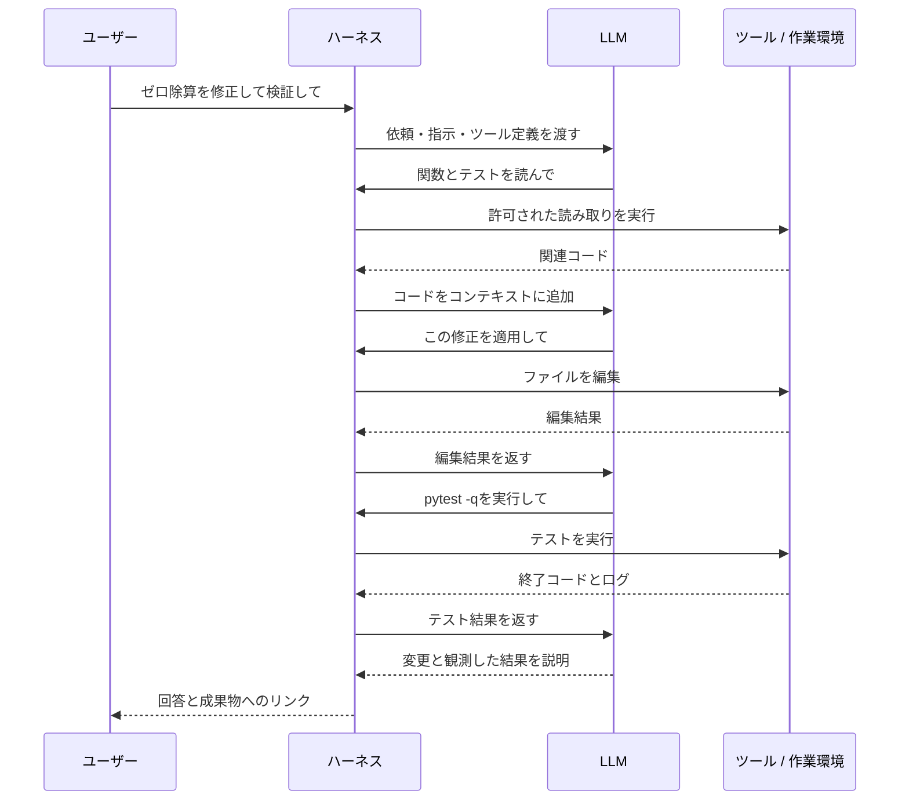

# AIアシスタント・エージェントの全体構造と実践ガイド

[English](agent_architecture.md)

AIアシスタント、エージェント、Harness、LLM、拡張機能の関係を、実装・実行構造と使い方の両面から理解するための統合資料です。`agent_architecture.md`と`AI_GUIDE.md`の内容を整理・統合しました。

前提知識：C/C++、Python、TypeScript、Linux、OSプロセス、システムコール。まず全体像と実行場所を確認し、その後に各部品と実践例へ進みます。用語の境界には製品差があり、非公開実装を推測して断定するものではありません。

読み進め方：1〜5節で全体像・製品・実行構造、6〜11節で基本コンポーネント、12〜16節で拡張と運用、17〜20節で一連の実践とトラブル対応を説明します。



**図の見方：** 中央を上から下へ読むと、依頼がUIを経由してエージェントへ届きます。青いハーネスと緑のLLMが情報をやり取りし、下段のツールが操作して結果を返します。左右のカードは用語の早見表です。色と枠は役割を表し、プロセスや配置場所の境界ではありません。

## 1. 全体構造：ユーザーから実行環境まで

ユーザーはUIに目標を伝えます。エージェントはHarnessによる実行制御、LLMによる生成・判断、Toolsによる操作を組み合わせて作業します。AgentとHarnessは同義ではなく、ここではHarnessをエージェントを支える制御層と呼びます。

UIとHarnessは同じアプリ内にも、別々のサービスにも配置できます。LLMの推論もローカル・リモートのどちらもあり得ます。

## 2. まずは三つの役割で考える

**LLMが次の一手を生成し、ツールが操作を実行し、ハーネスが両者のやり取りを管理します。ここでは、この仕組み全体をエージェントと捉えます。**

**処理の流れ：** LLMに情報を渡す → 操作要求を受け取る → 許可された操作を実行する → 結果を返す。

| 名前 | ひとことでいうと | 「バグを直して」の場合 |
| --- | --- | --- |
| LLM | 回答や次の操作要求を生成する役 | 「まずこの関数を読もう」 |
| ハーネス | 情報・実行・進捗を管理する役 | 指定ファイルを読ませ、内容をLLMへ返す |
| ツール | 決まった操作を実行する役 | 読む、編集する、テストする |
| エージェント | 複数の手順で目標に向かう仕組み全体 | 調査・修正・検証・報告を進める |

- **ホスト**は、CLIやチャットアプリなど、利用者が使うアプリケーションです。ハーネスの機能は、そのアプリや周辺ソフトウェアに実装されます。
- コンテキスト、トークン、MCP、実行環境は、それぞれが使う「情報」「単位」「接続」「場所」に関する言葉です。以下で一つずつ足していきます。

## 3. 製品・モデル・Harnessの関係

| 提供元 | アシスタント製品 | コーディング用途の製品・機能 |
| --- | --- | --- |
| OpenAI | ChatGPT | Codex |
| Anthropic | Claude（チャット） | Claude Code |
| GitHub / Microsoft | GitHub Copilot | Copilotのエージェント機能、Copilot CLI |

これは用途の整理であり、排他的な分類ではありません。アシスタントにもエージェント機能があり、製品とモデルは別です。関連する製品同士でも同一のアプリ・Harnessとは限りません。モデルを切り替えてもHarness自体が変わるとは限りません。ただし、対応ツールや設定が変わることはあります。

### 3.1 製品別の見方：登場人物・実行環境・入出力

以下は、**Codex CLI・Claude Code CLI・GitHub Copilot CLIを起動し、クラウドのモデルを利用する構成例**です。ClaudeはClaude Code、CopilotはGitHub Copilotを指します。ブラウザ・IDE・クラウド実行との違いは3.7節で示します。

- **A：ユーザー、B：UI、C：エージェントの実行制御（Harness）、D1：モデル推論、D2：操作を実行するTools**。3製品で同じ記号を使います。
- 図の大きな枠は実行環境、矢印はデータの流れです。UIとHarnessは役割の区分で、別プロセスとは限りません。
- 「CLIを起動した環境」は手元PCとは限りません。SSH先や開発コンテナで起動した場合、通常のファイル操作・Shell実行もその環境で行われます。
- **コンテキスト**は、Prompt、適用されるInstructions、選択したSkillの内容、会話、取得したファイル・検索結果、過去のツール結果など、今回のモデル呼び出しへ渡す情報です。ツール定義では操作名・説明・引数の形式を伝えます。
- InstructionsやSkillsは保存された情報です。図にあるだけで、独立したプログラムとして実行されるわけではありません。

### 3.2 Codex CLI

Codex CLIのUI、Harness、通常のファイル・Shell操作はCLIの実行環境側にあります。図ではOpenAIのモデルを利用します。`AGENTS.md`やSkillsの必要な内容はHarnessがモデル入力に組み込みます。ローカルモデルの設定も可能ですが、その場合はD1の場所が変わります。[O1][O2][O3]



### 3.3 Claude Code CLI

Claude CodeのUI、Harness、通常のファイル・Shell操作は`claude`を起動した環境側にあります。モデルの推論は図ではClaudeモデルAPI側です。`CLAUDE.md`や選択したSkillの内容を入力に加えます。図はターミナル利用を示し、通常のClaudeチャットとは区別します。[A1][A2]



### 3.4 GitHub Copilot CLI

Copilot CLIのUI、実行制御、通常のファイル・Shell操作はCLIの実行環境側にあります。図ではGitHub Copilotのサービスを経由して選択したモデルを使います。LLMは単一の固定モデルではなく、利用可能なモデル・設定に依存します。BYOKやローカルモデルを使う構成もあります。[G1][G2]



### 3.5 各登場人物のinput / output

3製品の基本構造は共通です。各製品のUIとHarnessの実装、読込規則、利用できるツールは異なります。

| 登場人物 | 動く環境 | input | output |
| --- | --- | --- | --- |
| A. ユーザー | UIを使う側 | 表示された回答・進捗・確認 | 依頼、補足、承認・拒否、中断 |
| B. UI | 上図ではCLIの実行環境 | ユーザー入力、Harnessからのイベント | Harnessへの依頼・操作、ユーザーへの表示 |
| C. Harness | 上図ではCLIの実行環境 | 依頼、指示・設定・履歴、LLM出力、ツール結果 | LLMへの入力、許可されたツール実行、UI向けイベント |
| D1. モデル推論サービス | 上図ではクラウド | コンテキスト、ツール定義など | 回答、ツール名と引数などの操作要求 |
| D2. ファイル操作ツール | 作業用ファイルシステムへアクセスできる実行環境 | パス、読取範囲、編集内容 | ファイル内容、変更結果、エラー |
| D2. Shell・Git等 | 上図ではCLIの実行環境 | コマンド、引数、作業ディレクトリ | 標準出力・標準エラー、終了コード、生成物 |
| 外部サービス | サービス提供者の環境・社内サーバー等 | 認証付きAPI要求と引数 | データ、操作結果、エラー |

ファイルはデータ、ファイル操作ツールはそのデータを読み書きする処理です。GitはShell経由などで起動するプログラムで、ローカル操作に加え、pushやfetchではリモートサーバーと通信します。

例：`テストを実行して` → UI → Harness → LLM → `Shellでpytest -qを実行`という要求 → Harness → Shell → ログ・終了コード → Harness → LLM → 結果説明 → UI → ユーザー。必要ならこの途中のループが繰り返されます。

### 3.6 MCPと拡張機能はどこに入るか

MCPは通信方式です。実際に動く部品は**MCPクライアントとMCPサーバー**です。接続を設定すると、3製品とも基本図のHarnessから次の経路を利用できます。[M1]

```text
Harness → MCPクライアント［エージェント側］
        → MCPサーバー［CLIの実行環境、またはリモート］
        → 必要に応じて外部サービス［そのサービスの環境］

行き：機能一覧の要求、またはツール名と引数など
戻り：機能定義、データ、操作結果・エラーなど
```

代表例として、ローカルの子プロセスとはstdio、リモートサーバーとはStreamable HTTPで接続します。ローカルでHTTPサーバーを動かす構成もあります。MCPサーバーが自分でファイルを操作する場合は、外部サービスへの通信は不要です。取得した結果のうち必要な内容が、Harnessを通じてLLMの入力に加わります。

| 対象 | 保存先／実行環境 | input → output |
| --- | --- | --- |
| Instructions・Skills | エージェントから読めるファイルや設定 | 読込・選択 → 指示、手順、参考資料。スクリプトを実行する場合はToolsへ |
| Hooks | コマンド型は通常エージェントの実行環境。HTTP型などは設定先 | イベント・引数 → 終了状態、ログ、対応形式の制御情報など |
| Claude Code Mods | Claude Code内部の拡張機構 | 公開イベント・設定 → 対応する挙動変更やUI表示など |
| Copilot CLI Extensions | CLIと並行する別のNode.jsプロセス | イベント、ツール／コマンド呼出し → ツール結果やセッション動作など |
| Plugins | 配布・導入の単位。実行場所は含まれる機能による | 導入・読込 → Skills、Hooks、MCP設定などを登録 |

この表は全製品がすべての拡張に対応するという意味ではありません。ModsはここではClaude Code、CLI ExtensionsはGitHub Copilot CLI固有の例です。[A3][G3]

### 3.7 ブラウザ・IDE・クラウドで使う場合

**UIの場所だけでは、Harness・Toolsの場所は決まりません。** 上の3図はCLIの構成例であり、製品名だけで次の利用形態を混同しないようにします。

| 利用形態 | UIの場所 | Harness・通常の作業用Toolsの場所 |
| --- | --- | --- |
| CodexのローカルCLI／IDEセッション | ターミナル／IDE | 選択したローカル・開発環境 |
| Codex Cloudのタスク | ブラウザ、デスクトップなど | OpenAI側の管理された環境。作業用ファイルはクラウドのワークスペース |
| Claude CodeのローカルCLI／IDEセッション | ターミナル／IDE | Claude Codeを起動した環境 |
| Claude Code cloud session | ブラウザなど | Anthropic側のクラウド作業環境 |
| Claude Code Remote Control | ブラウザ／スマホなど | 元のClaude Code実行マシンで動き続ける |
| Copilot CLI／IDEのローカルセッション | ターミナル／IDE | CLIまたは選択したIDEエージェントの実行環境 |
| Copilot cloud agent | GitHubなど | 設定されたクラウド環境／runner |

IDEのリモート開発やクラウドへの委譲では、実行場所が変わります。LLMの推論サービスはこの表とは別に選ばれ、エージェントと同じマシンとは限りません。通常のChatGPT／Claudeチャットの内部構造に、このCLI図をそのまま当てはめることもできません。[O4][A4][A5][G4][G5]

## 4. 実装とOSプロセスの関係

エージェントの制御部分は通常のソフトウェアです。C/C++、Python、TypeScript、Rustなどで実装でき、実行時には一つ以上のOSプロセスや分散サービスとして動作します。言語やプロセス数は製品ごとに異なります。

例：HarnessのプロセスがLLM APIを呼び、返された`run_tests`要求を検証し、子プロセスで`pytest`を起動します。Linuxではプロセス生成やファイル操作が最終的にシステムコールを利用しますが、通常はランタイムやライブラリを介します。リモートShellツールなら、子プロセスを起動するのは実行先のサービスです。LLMが生成した文字列そのものがシステムコールを発行するわけではありません。

## 5. 実行環境：操作が本当に動く場所

**実行環境は、ツールが実際に操作を行うマシンやセッションです。** モデルが動く場所と、テストコマンドが動く場所が分かれることもあります。

**配置例：**

- 手元のPCで、依頼を受け付けるCLI（コマンドラインのアプリ）が動きます。
- モデル提供元のサーバーで、モデルの推論が動きます。
- クラウドの作業環境で、ファイル操作や`pytest`が動きます。**コンテナ**は、その場所にプロセスを分離した環境を用意する方法の一つです。

製品によっては、ツールが手元のPCで動く場合、VMを使う場合、ホスト全体がクラウドで動く場合もあります。MCPサーバーもローカル・リモートの両方があり、ここでは一つの配置例を説明しています。

| 確認すること | やさしくいうと |
| --- | --- |
| 作業ディレクトリ | 相対パスは、どのフォルダーを基準にする？ |
| ファイル権限 | このツールは、どのファイルを読んだり変えたりできる？ |
| ランタイム・依存関係 | ここにPythonや`pytest`は入っている？ |
| ネットワーク | この環境から必要なサービスにつながる？ |
| アカウント | CLI・ブラウザー・MCP接続は、誰の権限で動く？ |
| 保存期間 | セッションが終わっても、このファイルは残る？ |

- **サンドボックス**は、OSやインフラで操作制限を強制する仕組みです。「このパスに触らないで」という指示文よりも強い制限を設けられます。
- リモート環境の`/workspace/project`は、自分のPCのフォルダーと自動的に同じになるわけではありません。
- コードの抜粋をリモートのモデルに送れば、その抜粋は作業環境の外に出ます。コンテナで分離するだけでは、推論の入力をローカルに留められません。

## 6. LLM：回答や「こう操作して」を生成する

**LLMは、受け取った情報をもとに出力を生成するモデルです。** *Large Language Model*の略で、日本語では「大規模言語モデル」と呼びます。

**例：** 除算の関数を見て、モデルが「分母がゼロなら例外を発生させよう」と生成します。これは修正案です。実ファイルの編集にはツールが、動作確認にはテストが必要です。

- 実態は、学習済みのパラメータと、それを使って計算する推論プロセスやサービスです。
- **学習**はパラメータを変更すること、**推論**はそのパラメータを使って依頼を処理することです。添付文書を読む場合は、通常、その文書を推論の入力として渡します。
- モデルの出力は間違うことがあります。リポジトリの現在の内容やテスト結果は、対応するシステムで確認する必要があります。

## 7. ハーネス：作業の進行を支える

**ハーネスは、モデルの呼び出しとツール操作を繰り返し、連携させるソフトウェアです。** 作業の進行役と考えると分かりやすく、実行の上限や権限も管理します。

**例：** モデルが`pytest -q`を要求します。ハーネスは実行可能かを確認し、シェル用ツールで動かし、終了を待ち、終了コードとログを返します。モデルはその結果から、追加修正が必要か判断できます。

- **ツール呼び出し**は「実行してほしい」という要求で、**ツール結果**が実際に何が起きたかを伝えます。
- ハーネスは、入力情報の選択、実行中の処理、進捗、再試行、停止条件などを管理します。アプリ、SDK、インフラに分かれて実装される場合があります。
- 同じLLMでも、使えるツール、渡す情報、エラーへの対応が変わると、結果も変わり得ます。
- 実際にはキャンセルや時間・予算の上限でも停止できる必要があります。

## 8. コンテキスト：今、机の上に置かれた情報

**コンテキストは、今回のモデル呼び出しで使える情報です。** 今の作業のために、机の上に置いた資料をイメージすると分かりやすくなります。

**例：** 除算のバグなら、要件、除算の関数、失敗しているテストが役立ちます。関係のない画像フォルダーは、おそらく必要ありません。

- 作業フォルダーにファイルがあっても、モデルが読んだとは限りません。内容を取得して、入力に含める必要があります。
- 画面の会話履歴と、ホストが組み立てる実際の入力が異なる場合があります。
- 長い会話は一部が省略・要約される場合があります。大事な条件が失われることもあるため、要件や未決事項を明確に残します。

| 混同しやすい言葉 | 違い |
| --- | --- |
| モデルの知識 | 学習によってパラメータに蓄えられたパターン |
| コンテキスト | 今回の推論で渡される情報 |
| メモリ | アプリが保存し、あとから取り出す情報 |

**RAG**は、関連資料を検索してから、その内容を入力に加えて回答を生成する方法です。たとえば、仕様書を検索し、一致する段落をコンテキストとして渡します。

- Context は、現在の回答に利用できる情報です。
- メッセージ、ファイル、検索された文章、ツールの結果、システムから提供された情報などが含まれます。
- コンテキストウィンドウには上限があるため、長い会話は一部が省略されたり、要約されたりする場合があります。

- 関連ファイル、現在の要件、正確なエラー、最近の決定事項など、必要な資料を絞って渡します。
- 鮮度が重要な情報には、出典と日付を付けます。
- 無関係なリポジトリやログを大量に会話へ投入することは避けます。

- Memory は、製品と設定に応じて、選んだ好みや事実を会話をまたいで保持することがあります。
- バージョン管理されたプロジェクト文書の代わりとして頼ることはできません。
- 対応する管理機能で、保存情報を確認、修正、削除してください。

- 長い作業では、目的、合意した決定事項、完了した作業、残りの手順、検証状況を短い引き継ぎメモにまとめます。
- 変化する事実は再確認し、古い会話履歴を現在の証拠として扱わないようにします。

## 9. トークン：入力と出力を数える単位

**トークンは、モデルが入出力を扱うときの単位です。** 1トークンが1単語や1文字に対応するとは限りません。

**なぜ気にするのか：** 扱える入出力の量に上限があり、使用量が料金にも関わることが多いためです。正確な分割はモデルや言語によって変わり、ここでは実際の分割結果を示していません。

**入出力の合計上限が32,000トークンだと仮定した例：**

| 予算の内訳 | トークン数 |
| --- | ---: |
| 指示とツールの説明 | 4,000 |
| 会話 | 8,000 |
| 関連する文書 | 12,000 |
| 最新の依頼 | 1,000 |
| **入力の小計** | **25,000** |
| 生成用に確保する量 | 5,000 |
| **残りの余裕** | **2,000** |

- **コンテキストウィンドウ**は、一回の呼び出しで扱える量の上限です。上の計算は単純化しており、実際の出力上限や推論トークンの扱いはAPIによって異なります。
- 一回のユーザー依頼で、モデルを何度も呼ぶことがあります。前の内容や新しいツール結果を後続の呼び出しで処理するため、作業全体の使用量は増えます。
- 関連する抜粋を取得し、必要なログを簡潔に返すと、予算を使いやすくなります。必要な根拠を増やす入力には意味があります。
- サービスにログインするための**アクセストークン**は、別の意味の「トークン」です。

## 10. MCP：機能につなぐための共通ルール

**MCPは、AIアプリと、ツールやデータを公開するサーバーをつなぐプロトコルです。** 正式名称は*Model Context Protocol*です。

**検索の要求を追うと：**

1. LLMが「このバグに関連するIssueを検索して」と要求します。
2. ホストが要求を確認し、MCPクライアントが設定済みのサーバーへ送ります。
3. サーバーが、利用可能な認可の範囲でIssue管理サービスを検索します。
4. 検索結果がホストに戻り、コンテキストとしてモデルに渡せるようになります。

| 部品 | 役割 |
| --- | --- |
| ホスト | 機能を使う側のAIアプリ |
| MCPクライアント | ホストからの接続を管理する |
| MCPサーバー | 機能を公開し、要求を処理する |
| サービスAPI | Issue・文書・DBなどのサービス固有の窓口 |

- ツールは通常の関数やAPIでも実装できます。ローカルのファイル編集にMCPが必須というわけではありません。
- 接続すると機能が利用可能になりますが、全データを自動的に読み込んだり、モデルがその内容を学習したりするわけではありません。
- 認証、アカウント権限、ネットワーク制限は別途適用されます。検索に加えてIssueを作成するなら、対応する書き込み権限が必要です。

- サーバーへの接続手順:

1. 信頼できるサーバーを選び、対応する通信方式と機能を確認する。
2. ホストのドキュメントに従って設定する。
3. 承認されたシークレット保管機能や認可フローで認証する。
4. 読み取り専用から始め、必要最小限の権限を付与する。
5. 影響のない操作を試し、返された結果を確認する。
6. 必要性と権限が確認できた場合にのみ、書き込み操作を有効にする。

- 接続に失敗したときは、サーバーの起動エラー、通信の問題、未対応の機能、認証の期限切れ、権限不足を区別します。
- トークンを露出させず、機密情報を除いたログを調べてください。
- 同じ目的を達成できるなら、無制限のコマンド実行よりも、引数が明確で機能が限定されたツールを優先します。

## 11. 検索・RAG・ナレッジソース

- Retrieval-Augmented Generation（RAG、検索拡張生成）は、知識ソースを検索し、関連する結果をモデルに渡してから回答を生成する方法です。
- 一般的には、文書の取り込み、文章の分割、インデックス作成、候補の検索、根拠への参照を含む回答の生成という流れになります。

- 作業に必要な少量の資料にはファイル添付を使います。
- 最新情報や広く分散した情報には検索を使います。
- 継続的に管理され、多くの質問に繰り返し使う資料群には RAG を検討します。
- MCP で検索サービスを公開することもできますが、MCP と RAG はワークフローの異なる部分を担います。

- 文書の所有者、アクセス制御、出典の識別情報、更新日を維持します。
- 検索時点で、質問するユーザーのアクセス権を適用する必要があります。
- 最終回答だけをフィルタリングしても十分ではありません。

- 正しい文章が検索されたか、回答がその文章に裏付けられているかを評価します。
- 出典の提示を求め、実際の主張を支えているか確認してください。
- 情報が不足していたり、資料同士が矛盾していたりする場合は、根拠のない回答で埋めずに、その不足を報告します。

## 12. 拡張機能：何を、いつ拡張するか

| 仕組み | 役割・適用時点 |
| --- | --- |
| Instructions | 適用範囲のルールをモデル入力へ組み込む |
| Skills | 選択された作業の手順・知識・補助スクリプトを読み込む |
| Hooks | ツール実行前後など、製品が定義するイベントで処理する |
| Claude Code Mods | hooks moduleを持つPluginとして、公開されたイベントやAPIで挙動・表示を拡張する |
| Copilot CLI Extensions | セッションと並行するコードでツール・コマンド・状態を扱う |
| MCP | ホストとサーバー間の機能・データ連携を標準化する |
| Plugins | Skills、Hooks、MCP設定などを、製品が対応する単位で配布する |

InstructionsとSkillsは主にモデルへの指示ですが、Skillsに含まれるスクリプトの実行にはツールと権限が必要です。Hookも常にShellとは限らず、対応するハンドラー形式は製品ごとに異なります。

Claude Code Modsは任意の内部コードを書き換える総称ではなく、公式の拡張方式です。Copilot CLI Extensionsは別のNode.jsプロセスで動くJavaScriptモジュールで、確認時点では実験的機能です。廃止されたGitHub AppベースのCopilot Extensionsや、IDE拡張とは区別してください。[公式Mods資料](https://github.com/anthropics/claude-code/blob/main/mods/README.md)、[公式Extensions資料](https://docs.github.com/en/copilot/concepts/customizations/extensions)。

例：バグ調査Skillを読み、ファイル編集後のHookで整形し、MCPでIssueを検索できます。これらをPluginとして配布できるかは製品の仕様に依存します。

## 効果的な Prompt の書き方

**依頼には「目的・背景・制約・完了条件」を書きます。**

- 役立つプロンプトには、目的、関連する背景、制約、期待する出力、成功の判断基準を含めます。
- 望む結果を言葉だけで説明しにくい場合は、例を示します。

```text
目的: 添付した API 案について、互換性のリスクをレビューしてください。
背景: 既存のクライアントは、現在のレスポンスのフィールドに依存しています。
制約: 提案を変更せず、文書化されていない動作を仮定しないでください。
出力: 指摘を重要度順に並べ、根拠と修正案を添えてください。
成功基準: 破壊的変更を特定し、不確かな点を明示すること。
```

- 作業を進めるために必要な情報から伝えます。
- 大きな作業では、調査、実装、検証などの区切りを定めます。
- 確認可能な根拠と、判断理由の簡潔な説明を求めましょう。

- 「これを改善して」という曖昧な依頼は、「この導入ページを初めて使う人向けに書き直し、技術的な要件を維持して、英語で 500 語以内にまとめてください」と具体化できます。
- 修正を依頼するときは、元の依頼を繰り返すよりも、何が不足しているかを明示します。

## 13. Instructions の使い方

**Instructionsは、対象となる作業で共通して守るルールです。**

- Instructions は、繰り返し適用するルールを記述したものです。
- 製品によって、個人設定、ワークスペース設定、リポジトリ内のファイル、API メッセージなどに保存します。

- 言語や文体の好みは個人向けの指示に、アーキテクチャ、利用できるコマンド、コーディング規約、検証要件はプロジェクト向けの指示に記載します。
- 一時的な要件は、その作業のプロンプトに含めます。

- `AGENTS.md` を認識するコーディングエージェントもありますが、別のファイルを使ったり、明示的な設定を必要としたりする製品もあります。
- 読み込みの規則、適用されるディレクトリの範囲、優先順位を製品のドキュメントで確認してください。
- ファイル名だけでは、内容が読み込まれる保証はありません。

- プロジェクト向けの指示の例:

```markdown
# プロジェクトの指示

- 既存のアーキテクチャと命名規則に従う。
- 変更前に、関連するパッケージのドキュメントを読む。
- 既存の依存関係管理ツールとロックファイルを使う。
- 変更した動作に適した検証を実行する。
- 失敗した検証と未実行の検証を明示する。
- コード、ログ、ドキュメントに認証情報を含めない。
```

- ルールは短く、実行可能で、互いに矛盾しない内容にします。
- 古くなったルールは削除します。
- 指示が競合した場合は、利用するホストの指示階層を確認し、未解決のプロジェクト要件を明確にします。
- 最後に書かれた文章が常に優先されるとは限りません。

## 14. Skills の作り方と使い方

**Skillは、繰り返す作業の進め方をまとめたものです。**

- Skill は、繰り返す作業の指示と、対応している場合はスクリプト、テンプレート、参考資料をまとめたものです。
- リリース準備、環境構築、インシデントの初期調査、ドキュメントレビューなどに向いています。

- `SKILL.md` に対応するプラットフォームでは、次のような構成が使われます。
- ただし、メタデータや読み込みの要件は製品ごとに異なります。

```text
documentation-review/
  SKILL.md
  references/style-guide.md
  scripts/check-links.sh
  templates/review.md
```

- Skill には、利用する場面、前提条件、手順、検証方法、失敗時の対応、期待する出力を記載します。
- どの操作に承認が必要かも明示します。
- シークレットは Skill の外で管理してください。

```markdown
# ドキュメントレビュー

プロジェクトのドキュメントをレビューするときに使用する。

1. 読者と変更されたページを確認する。
2. プロジェクトのスタイルガイドを読む。
3. 例、リンク、現在の動作との整合性を確認する。
4. 利用可能なドキュメントの検証を実行する。
5. ファイルへの参照と検証結果を添えて指摘を報告する。
```

- ホストが対応する方法で Skill を呼び出し、読み込まれたことを確認します。
- 運用に使う前に、代表的な作業で試してください。
- 対象のワークフローとともにバージョン管理し、コマンドや方針が変わったら更新します。

### Instructions と Skills の適用

### Instructions と Skills の違い

**Instructionsは「守るルール」、Skillは「進める手順」です。**

たとえば、料理なら「アレルギーのある食材を使わない」がルール、「材料を切る→加熱する→盛り付ける」が手順です。AIの作業でも両方を組み合わせます。

- Instructions は、適用範囲内の作業に共通するルールを定めます。
- Skill は、特定の種類の作業を進めるための再利用可能な手順です。
- どちらも指示を含められますが、目的と読み込みの仕組みが異なります。

| | Instructions | Skill |
| --- | --- | --- |
| 主に答える問い | どのルールを守って作業するか | この作業をどの手順で進めるか |
| 例 | 英語の文書と日本語訳を作る | テーマを調べ、ノートを書き、翻訳・検証する |
| 適用範囲 | 指示ファイルの対象となる作業 | Skill が選択された、対象の作業 |
| 読み込み | ホストの検出方法とディレクトリの適用範囲による | ホストの対応、検出、明示的または自動的な選択による |
| このリポジトリの例 | `AGENTS.md` | `.agents/skills/learning_note/SKILL.md` |

- 共通ルールは `AGENTS.md` に置き、すべてのルールを各 Skill にコピーすることは避けます。
- Skill は共通ルールを参照し、作業固有の手順を記載します。
- 上位の指示を上書きしたり、追加の権限を与えたりするものではありません。

### このリポジトリの例

- `AGENTS.md` は、英語のドキュメントと対応する `_jp.md` の翻訳を作り、空ディレクトリを作らないよう定めています。
- Skill を使わない作業にも、このルールは適用されます。

- `learning_note` Skill は、テーマの範囲を決め、出典を集め、具体例を作り、検証して、二つの言語のノートを作成する方法を説明します。
- テンプレートは、ノートの構成を揃えるための出発点になります。

### learning_note の使い方

- Skill は、Codex が対応するリポジトリ内の配置先 `.agents/skills/learning_note/` に保存しています。
- 検出と呼び出しはホストやバージョンで異なる場合があります。
- この場所に置いただけで、すべての Copilot クライアントが自動検出する保証はありません。

- 検出に対応するホストでは、対応する Skill のインターフェースから `learning_note` を明示的に指定します。
- それ以外では、`.agents/skills/learning_note/SKILL.md` を読んで従うよう依頼します。
- これは手動での代替手段であり、Skill として標準登録された証拠ではありません。

```text
learning_note を使って、Linux のプロセスとスレッドの初学者向けノートを作ってください。
安全に実行できる例と公式の参考資料を含めてください。
```

- 手順が読み込まれ、両言語のノートと正確な検証結果が作られたことを確認します。
- コミットや push は許可された場合のみ行います。
- ファイルの作成だけでは、新しいセッションでの Skill 検出や、ワークフロー全体の実行成功を示したことにはなりません。

## 15. Agent・Sub-agent・Workflow

**エージェントは、結果を見て次の操作を選びます。**

- Agent は、目標、コンテキスト、ツール、制御ループを組み合わせて複数の手順を実行します。
- 基本的な流れは、状況を調べ、操作を選び、実行し、結果を評価して、継続するか終了するかを決めることです。

- 大きな作業を任せる前に、範囲、利用できるツール、成功基準、リソースの上限、停止条件を定めます。
- 公開、支出、本番データの変更など、影響の大きい操作には確認の段階を設けます。

- Sub-agent は、別々のモジュールのレビューなど、独立した作業を担当できます。
- それぞれに明確な担当と期待する結果を伝えます。
- ファイルやサービスの共有は競合を生むことがあるため、担当範囲を定め、統合した結果を確認してください。
- エージェントを増やすと調整コストも増え、品質が自動的に上がるわけではありません。

- 安定した処理順序には決められたワークフローを使い、解釈が必要な部分にエージェントの判断を使います。
- 定期実行やイベントを起点とする自動化にも、明確な認証設定、再試行、重複操作の防止、ログ、失敗通知が必要です。

- 中断後に再開できるよう、進捗をファイルや承認された状態保存先に記録します。
- 成功の報告は、ツールの結果や生成物と照合して検証する対象として扱います。

## 16. 出力形式と品質評価

**形式が整っていても、内容の確認は必要です。**

- 人が読む説明には Markdown、比較には表、後続のソフトウェアが処理する情報には構造化データを選びます。
- 一定のレイアウトが重要な場合は、テンプレートを提供します。

- JSON を求めるだけでは、構文が正しい出力やスキーマへの適合は保証されません。
- 対応している場合は、スキーマを指定した構造化出力を使い、利用側のアプリケーションで結果を検証します。
- 形式が正しくても、内容まで正しいとは限りません。

```json
{
  "summary": "確認した結果を記載する",
  "findings": [
    {
      "severity": "medium",
      "evidence": "確認した出典への参照",
      "recommendation": "具体的な次の操作"
    }
  ],
  "validation_status": "not_run"
}
```

- 評価（Evals）は、代表的な作業、期待する性質、既知の失敗例をもとに作ります。
- 事実の裏付け、作業の完了、権限の順守、テスト結果、応答時間、コストなどが評価基準になります。
- 自動採点では信頼できる判断ができない部分には、人によるレビューを使います。

- モデル、プロンプト、Skill は同じ例で比較します。
- 品質の後退を追跡し、過度な最適化を防ぐため、調整には使わない評価用の事例も確保します。
- 成功、失敗、スキップ、未実行を区別してください。
- 実測した品質、応答時間、必要なコンテキスト量、コストに基づいてモデルを選びます。

## 17. つなげてみる：「ゼロ除算を直して」

**実行記録ではなく、仮定した例です。** `/workspace/calculator`にPythonプロジェクトがあり、`pytest`が導入済みとします。現在はゼロ除算で`0`を返しますが、依頼された動作は`ValueError`の送出です。ユーザーは修正とローカルでの検証を依頼し、公開は依頼していません。

<details>
<summary>処理の順序を詳しく見る</summary>



</details>

**修正案：**

```diff
 def divide(a, b):
     if b == 0:
-        return 0
+        raise ValueError("denominator must not be zero")
     return a / b
```

- 分母ゼロで例外が出ることと、通常の除算が動くことを確認します。テスト成功が裏付けるのは、実際にテストした範囲です。
- テストが失敗したら、その出力をモデルへ返して修正・確認を繰り返します。実行できなければ、検証が未完了であることを伝えます。
- 必要ならMCPによるIssue検索を加えられますが、このローカル修正に必須ではありません。
- **LLMが生成 → ハーネスが調整 → ツールが実行 → 結果がコンテキストへ。** 冒頭の画像と同じ繰り返しです。

## 18. 安全な運用

**取得した文章は情報として扱い、権限はホスト側で制限します。**

- 認証情報は承認されたシークレット保管先で管理し、プロンプト、リポジトリ、ログにコピーしないようにします。
- 作業に必要な情報だけを共有し、サービスの保存期間やデータ利用の設定を確認してください。

- プロンプトインジェクションは、信頼できないコンテンツが AI の動作を変更しようとする攻撃です。
- 検索された文書、Web サイト、リポジトリ内のファイル、ツールの応答に、そのような指示が含まれる場合があります。
- それらをデータとして扱い、要求が許可された作業に合致するか確認し、新たな権限を与える根拠にしないでください。

- サンドボックス、限定されたファイルアクセス、接続先の制限、最小権限の認証情報を使います。
- 読み取りと影響の大きい操作を分け、必要に応じてホストの承認機能を利用します。
- コマンドの引数や構造化された入力は、アプリケーションのコードでも検証します。

- 外部への書き込みや公開の前には、操作先、範囲、内容、権限、復旧方法を確認します。
- シークレットを記録せず、役立つ監査記録を残してください。
- 生成コード、事実に関する主張、ライセンス、利用権は、作業の要件に応じて確認します。

## 19. 実践的なワークフロー

### Instructions でプロジェクトのルールを共有する

- ホストが対応するプロジェクト指示ファイルを作り、リポジトリの規約と実際に使う検証コマンドを記載します。
- 小さな作業を依頼し、エージェントがそのファイルを読み込んで従うことを確認します。
- 作業固有の例外は明示します。

### ドキュメントレビューの Skill を再利用する

- レビュー手順、スタイルの参考資料、既存のリンクチェッカーを Skill にまとめます。
- 変更されたページに対して呼び出し、チェッカーが実際に実行されたことを確認して、指摘を元の文書と照合します。

### MCP で外部の情報を読む

- 承認された課題管理サーバーに読み取り専用で接続します。
- 返された根拠を使って、指定した Issue の要約を AI に依頼します。
- Issue の更新を有効にする前に、識別子と出典のリンクを確認します。

### RAG で質問に答える

- 管理されている文書群を、権限のメタデータとともにインデックス化します。
- 質問に関連する文章を検索し、出典付きの回答を生成して、元の資料と照合します。
- 資料に答えが含まれていないケースも評価に含めます。

### Agent で実装と検証を進める

- 具体的な動作の変更、リポジトリのルール、受け入れ基準をエージェントに渡します。
- コードを調査し、範囲を絞った変更を行い、関連するテストを実行させます。
- マージやデプロイの前に、差分と実際のテスト出力をレビューします。

### 仕組みを組み合わせる

- 繰り返し行うサポート業務では、Instructions が対話とプライバシーのルールを定め、Skill が初期調査の手順を示し、検索が製品知識を提供し、MCP ツールが関連チケットを読み取ります。
- エージェントがそれらの手順を調整し、構造化された下書きを返します。
- 影響の大きい外部への操作は、組織の方針に従って人がレビューします。

- まず一つの役立つワークフローから始め、実際の例で検証し、確認できた課題の解決に必要な場合にだけ仕組みを追加します。

## 20. うまく動かないときの見方

| 症状 | 最初に確認すること |
| --- | --- |
| ファイルの内容を知らない | 実際に読み取り、コンテキストに入れた？ |
| 前に決めたことを忘れた | 省略・要約された？ 保存していた？ |
| テストを実行できない | 作業フォルダー、ランタイム、依存関係、サンドボックスの制限 |
| MCP検索が失敗する | 接続、サーバーの起動、認証、サービスの権限 |
| Issueを作ったと言っている | 再送する前に、ツール結果と実際のIssue ID |
| 文書の中の指示に従ってしまう | 情報の信頼範囲と、ホストが強制する操作制限 |

**入力 → モデル出力 → ハーネス → ツール → 外部サービス → 検証**の順に確認すると、どこで問題が起きたか切り分けやすくなります。

## 補足：必要になったら読む詳しい話

<details>
<summary>モデル呼び出し・ハーネスの実装・完了の確認</summary>

- テキスト生成は一般に、学習済みパラメータで次のトークンを順に予測する処理として説明されます。画像や音声などの入出力に対応するモデルもあります。
- 一般的なAPIでは、ホストが関連する会話の状態を送るか、参照させます。独立した呼び出し同士で、前回の情報を覚えているとは想定できません。
- Function Callingでは、ツール名と構造化された引数を生成します。アプリが検証して実行先へ送り、呼び出しIDに対応づけた結果を返します。要求の生成だけでは、実行された証拠にはなりません。
- ハーネスには、タイムアウト、キャンセル、実行状態の確認、適切な再試行、必要に応じた状態の永続化、手順数・予算の上限も必要です。バックグラウンド処理のIDが返っても、完了したとは限りません。
- 読み取りの再試行と、決済やメッセージ送信の再試行では影響が異なります。書き込みでは、重複実行を防ぐ制御や、初回の処理が成功したかの確認を行います。
- harness、runtime、runner、executor、orchestratorは重なり合う実装上の用語で、統一された境界はありません。また、ハーネスはシステムプロンプトだけを指すものではありません。
- 完了の報告は、成果物や検証で裏付ける必要があります。出力形式が正しくても、内容が正しいとは限りません。

</details>

<details>
<summary>コンテキストの上限・セキュリティ・費用計算</summary>

- 保存された会話、永続メモリ、外部ファイル、現在のコンテキストは、寿命が異なります。各呼び出しに何を渡すかは、ホストの選択によります。
- コンパクションは古い内容を要約に置き換えます。決定事項を残せても、正確なエラーや例外条件が失われる場合があります。引き継ぎメモには、参照パスや未解決の要件も残します。
- コンテキストエンジニアリングは、有用な入力を選び、構造化し、検索し、維持する工夫です。指示の優先順位は、最後に現れた文章ではなく、ホストやモデルの仕様に従います。
- 検索した文書やツール結果には、動作を誘導するプロンプトインジェクションが含まれる場合があります。信頼できない内容に新しい権限を与えず、モデルの外でも操作を制限します。
- 正確なテキストのトークン数は、対象のトークナイザーかAPIの使用量レポートで測ります。日本語の文字数や画像・音声・動画のサイズから、共通の換算式では求められません。
- テキストの概算費用は、課金対象の入力・出力トークン数に各単価を掛け、全呼び出しで合計します。単位換算、キャッシュ、推論トークンの扱いは提供元のルールに従い、ツールや計算環境の料金が加わる場合もあります。
- キャッシュで費用や待ち時間が減ることがありますが、コンテキスト上限がなくなったり、正しさが確認されたりするわけではありません。
- コンテナとVMでは分離の性質が異なります。ブラウザー、CLI、MCP接続の認証主体も別の場合があり、ブラウザーのログイン成功はCLIの権限を保証しません。

</details>

<details>
<summary>MCPが公開する機能と通信方式</summary>

| サーバーが提供する基本機能 | 目的 | 例 |
| --- | --- | --- |
| Tools | 呼び出し可能な操作 | Issueの検索、チケットの作成 |
| Resources | URIで識別できる内容 | 文書、スキーマ |
| Prompts | 再利用するメッセージのテンプレート | レビュー用プロンプト |

- サーバーがすべて実装する必要はなく、ホストが対応・公開する範囲も異なります。
- 代表的な通信方式には、ローカルの**stdio**とリモートの**Streamable HTTP**があります。対応と認可は、採用するプロトコルのバージョンや実装に従います。
- サーバーへの認証と、その先のサービスの認証情報は別の場合があります。MCPがネットワークやファイルの制限を回避するわけではありません。
- 機能の検出、データの取得、モデルのコンテキストへの取り込みは別の処理です。接続済みでも、全データを読んだことにはなりません。

</details>

## 図について

- 冒頭の画像は、提供された参考画像の構成を踏まえて新しく生成した概念図です。英語版と日本語版で配置と関係を揃えています。
- 大きく確認する場合は[画像を開いてください](assets/agent_architecture/overview_infographic_jp.png)。
- 図の設計情報は[JSON](assets/agent_architecture/infographic_design.json)に保存しています。画像生成のため、同じ指示でも完全に同一の画像を再現できるとは限りません。
- 既存のGraphviz生成スクリプトは旧図版用として保持しています。冒頭の画像の生成には使いません。
- 処理順序のMermaidは詳細表示内に残しています。今回レンダリング確認はしていません。

## 参考資料

- [OpenAI: Key concepts](https://platform.openai.com/docs/concepts) — モデルとトークン。
- [OpenAI: Function calling](https://platform.openai.com/docs/guides/function-calling) — モデルとアプリのツール実行の境界。
- [OpenAI: Conversation state](https://platform.openai.com/docs/guides/conversation-state) — 呼び出しをまたぐ状態。
- [MCP: Architecture](https://modelcontextprotocol.io/docs/learn/architecture)と[仕様](https://modelcontextprotocol.io/specification) — 役割、機能、バージョン別の通信方式。
- [Anthropic: Building effective agents](https://www.anthropic.com/engineering/building-effective-agents) — ワークフローとエージェント。
- [Docker: What is a container?](https://docs.docker.com/get-started/docker-concepts/the-basics/what-is-a-container/) — コンテナと分離。

- [O1] [OpenAI: Codex CLI](https://github.com/openai/codex)
- [O2] [OpenAI: Codex harness / App Server](https://openai.com/index/unlocking-the-codex-harness/)
- [O3] [OpenAI: Advanced configuration](https://learn.chatgpt.com/docs/config-file/config-advanced)
- [O4] [OpenAI: Using Codex Cloud](https://help.openai.com/en/articles/20001545-using-codex-cloud)
- [A1] [Anthropic: How Claude Code works](https://code.claude.com/docs/en/how-claude-code-works)
- [A2] [Anthropic: Claude Code](https://claude.com/product/claude-code)
- [A3] [Anthropic: Claude Code Mods](https://code.claude.com/docs/en/plugins/mods/overview)
- [A4] [Anthropic: Remote Control](https://code.claude.com/docs/en/remote-control)
- [A5] [Anthropic: Claude Code in the cloud](https://support.claude.com/en/articles/12618689-use-claude-code-in-the-cloud)
- [G1] [GitHub: Copilot customization](https://docs.github.com/en/copilot/concepts/customizations/comparing-customizations)
- [G2] [GitHub: CLI BYOK and local models](https://github.blog/changelog/2026-04-07-copilot-cli-now-supports-byok-and-local-models/)
- [G3] [GitHub: Copilot extensions](https://docs.github.com/en/copilot/concepts/customizations/extensions)
- [G4] [GitHub: Copilot cloud agent](https://docs.github.com/en/copilot/how-tos/use-copilot-agents/cloud-agent/use-cloud-agent-on-github)
- [G5] [VS Code: Agent harnesses](https://code.visualstudio.com/docs/agents/run/agent-harnesses)
- [M1] [MCP: Architecture](https://modelcontextprotocol.io/docs/learn/architecture)
