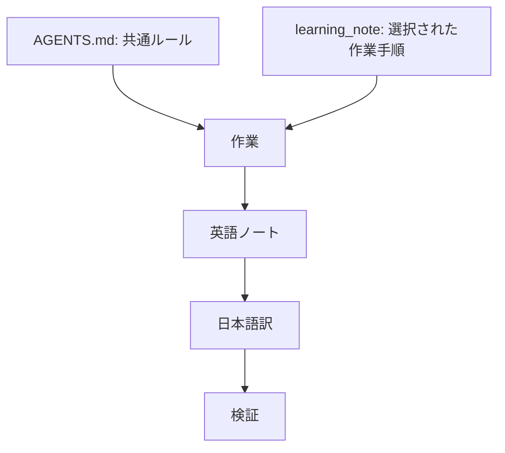
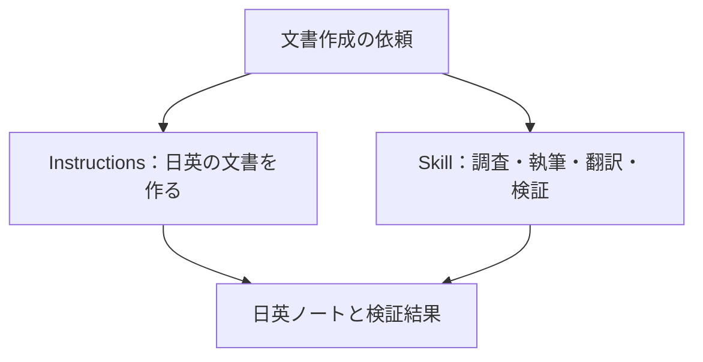
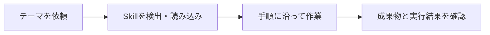

# Instructions と Skills

[English](instructions_and_skills.md)

## 適用のイメージ



## 違い

**Instructionsは「守るルール」、Skillは「進める手順」です。**

たとえば、料理なら「アレルギーのある食材を使わない」がルール、「材料を切る→加熱する→盛り付ける」が手順です。AIの作業でも両方を組み合わせます。

- Instructions は、適用範囲内の作業に共通するルールを定めます。
- Skill は、特定の種類の作業を進めるための再利用可能な手順です。
- どちらも指示を含められますが、目的と読み込みの仕組みが異なります。

| | Instructions | Skill |
| --- | --- | --- |
| 主に答える問い | どのルールを守って作業するか | この作業をどの手順で進めるか |
| 例 | 英語の文書と日本語訳を作る | テーマを調べ、ノートを書き、翻訳・検証する |
| 適用範囲 | 指示ファイルの対象となる作業 | Skill が選択された、対象の作業 |
| 読み込み | ホストの検出方法とディレクトリの適用範囲による | ホストの対応、検出、明示的または自動的な選択による |
| このリポジトリの例 | `AGENTS.md` | `.agents/skills/learning_note/SKILL.md` |

- 共通ルールは `AGENTS.md` に置き、すべてのルールを各 Skill にコピーすることは避けます。
- Skill は共通ルールを参照し、作業固有の手順を記載します。
- 上位の指示を上書きしたり、追加の権限を与えたりするものではありません。

## このリポジトリの例



- `AGENTS.md` は、英語のドキュメントと対応する `_jp.md` の翻訳を作り、空ディレクトリを作らないよう定めています。
- Skill を使わない作業にも、このルールは適用されます。

- `learning_note` Skill は、テーマの範囲を決め、出典を集め、具体例を作り、検証して、二つの言語のノートを作成する方法を説明します。
- テンプレートは、ノートの構成を揃えるための出発点になります。

## learning_note の使い方



- Skill は、Codex が対応するリポジトリ内の配置先 `.agents/skills/learning_note/` に保存しています。
- 検出と呼び出しはホストやバージョンで異なる場合があります。
- この場所に置いただけで、すべての Copilot クライアントが自動検出する保証はありません。

- 検出に対応するホストでは、対応する Skill のインターフェースから `learning_note` を明示的に指定します。
- それ以外では、`.agents/skills/learning_note/SKILL.md` を読んで従うよう依頼します。
- これは手動での代替手段であり、Skill として標準登録された証拠ではありません。

```text
learning_note を使って、Linux のプロセスとスレッドの初学者向けノートを作ってください。
安全に実行できる例と公式の参考資料を含めてください。
```

- 手順が読み込まれ、両言語のノートと正確な検証結果が作られたことを確認します。
- コミットや push は許可された場合のみ行います。
- ファイルの作成だけでは、新しいセッションでの Skill 検出や、ワークフロー全体の実行成功を示したことにはなりません。
