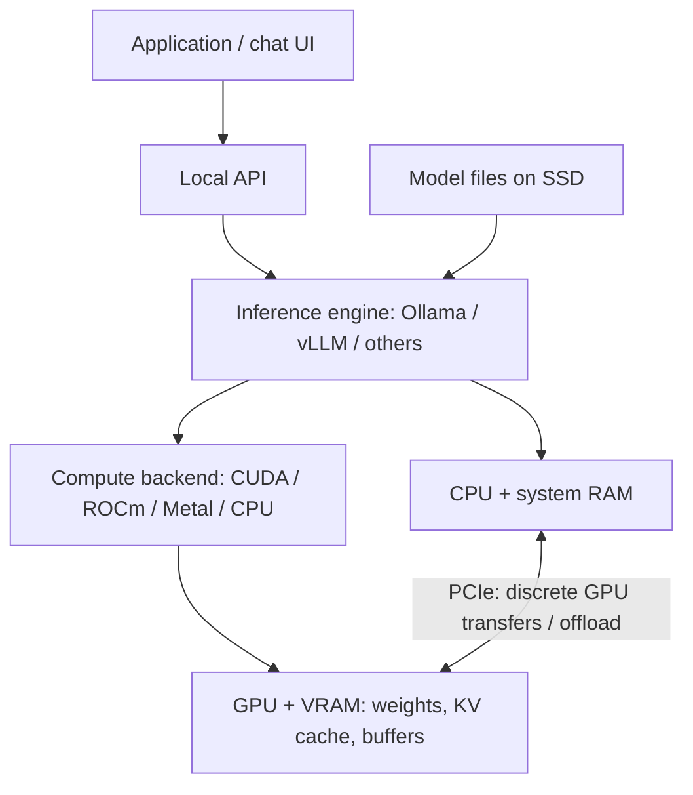

# Local LLM Inference Environment Guide

[日本語](local_llm_environment_jp.md)

- **Purpose:** choose hardware, software, and open-weight models for inference on a personal computer, workstation, or on-premises server.
- **Documentation date:** 2026-11-05. **Source snapshot:** official materials checked on 2026-11-04 during the research for this note.
- This is a selection guide with representative examples, not a complete product catalog or a report of GPU benchmarks performed in this repository.
- Product specifications are vendor claims; memory calculations and configuration suggestions are estimates. Model evaluation scores are attributed to their publishers.
- Training and fine-tuning require a separate memory estimate; inference requirements do not cover gradients, optimizer states, or training activations.

## 1. Selection Workflow

1. Define the task: Japanese conversation, summarization, coding, image understanding, or document retrieval.
2. Choose candidate models and an acceptable quantization level.
3. Budget memory for weights, KV cache, and execution buffers at the required context length and concurrency.
4. Evaluate memory bandwidth, compute throughput, and interconnects against the workload.
5. Choose an engine and measure quality, latency, and throughput with representative inputs.

- For a first personal setup, consider a 12–16GB GPU, an 8B–14B quantized model, and Ollama.
- For 24B–32B models, consider 24–32GB of VRAM.
- For a shared API, consider vLLM or SGLang and size the KV cache for concurrent requests.
- These are starting recommendations, not minimum requirements or speed guarantees.

## 2. System Overview and Terminology



- The PCIe path describes discrete GPU systems. Unified-memory systems, such as Apple Silicon and DGX Spark, have a different memory topology.

| Term | Meaning | Selection impact |
| --- | --- | --- |
| Parameter count | Number of learned weights; 8B means approximately eight billion | Weight storage and computation |
| VRAM | Memory attached to a GPU | Model, cache, and buffer capacity on the GPU |
| System RAM | CPU-side memory | Loading, CPU inference, and offloading |
| Memory bandwidth | Data transferred per second between processors and memory | Often important for low-concurrency decoding |
| Context length | Tokens available for input, history, and generated output | Cache capacity and processing cost |
| Token | Model-specific text unit, not a fixed number of characters | Japanese text must be measured with the model's tokenizer |
| KV cache | Cached attention keys and values for preceding tokens | Grows with stored context and concurrent sequences |
| Quantization | Lower-bit representation of weights or other tensors | Reduces memory; quality and speed depend on the implementation |
| Dense | Most model weights participate in each token's computation | Total size is closely related to computation |
| Mixture of Experts (MoE) | Only selected expert networks participate for each token | Active parameters can be small while total weight storage is large |

## 3. Memory Sizing

### 3.1 Weight Storage

```text
Weight bytes = parameter count × bits per parameter / 8
Runtime memory = weights + KV cache + execution buffers + other overhead
```

| Nominal size | BF16 / FP16: 16-bit | 8-bit | Ideal 4-bit |
| --- | ---: | ---: | ---: |
| 8B | 16GB | 8GB | 4GB |
| 14B | 28GB | 14GB | 7GB |
| 32B | 64GB | 32GB | 16GB |
| 70B | 140GB | 70GB | 35GB |
| 120B | 240GB | 120GB | 60GB |
| 671B | 1,342GB | 671GB | 335.5GB |

- Calculations use decimal GB. One GiB is approximately 1.074GB; check the units shown by files and monitoring tools.
- Ideal 4-bit storage excludes scales, metadata, higher-precision tensors, vision encoders, KV cache, and workspaces.
- For example, Ollama's `qwen3:8b` Q4_K_M download is approximately 5.2GB, rather than the idealized 4GB for a nominal 8B model. Runtime memory is larger. [Ollama Qwen3 8B][m01]
- Quantizing weights does not automatically quantize the KV cache.

### 3.2 KV Cache

For a conventional attention model, a useful estimate is:

```text
KV bytes ≈ 2 [keys and values]
           × layer count
           × KV head count
           × head dimension
           × bytes per element
           × stored tokens
           × concurrent sequences
```

- Example assumptions: 32 layers, eight KV heads, head dimension 128, and BF16 storage at two bytes per element.
- The resulting cache is 131,072 bytes, or 128KiB, per token per sequence.

| Stored tokens | KV cache for one sequence |
| --- | ---: |
| 8,192 | 1GiB |
| 32,768 | 4GiB |
| 131,072 | 16GiB |

- This is an illustrative calculation, not a universal model specification.
- Sliding-window attention, hybrid architectures, compressed KV, cache quantization, and parallel placement change the result.
- A model supporting 128K context does not imply that 128K fits or runs comfortably on the selected GPU. [Hugging Face cache strategies][s01]

### 3.3 Capacity Recommendations

- Assumptions: roughly 4-bit weights, one user, and approximately 8K context.
- The following values favor headroom; verify the actual model file, cache implementation, and engine allocation.

| Model size | Candidate VRAM | Candidate system RAM | Typical starting use |
| --- | ---: | ---: | --- |
| 3B–8B | 8–12GB | 16–32GB | Personal chat and simple summaries |
| 12B–14B | 12–16GB | 32–64GB | Text processing and development assistance |
| 24B–32B | 24–32GB | 64–128GB | Higher-quality personal or business evaluation |
| 70B | Prefer 80–96GB | 128GB or more | Larger models with useful headroom |
| Large MoE | Multiple large-memory GPUs as required | Potentially hundreds of GB | Full-model serving |

- A 70B Q4 model can sometimes run on 48GB, but weights around 40GB or more leave limited space for long contexts and buffers.
- For MoE, use the **total parameter count** to budget fully resident weights, not only active parameters.
- CPU-only inference is possible with enough RAM; CPU compute and memory bandwidth determine its practicality.
- Offloading allows larger models to run but introduces CPU-side work or transfers that can limit speed.

## 4. Performance and Bandwidth

### 4.1 Prefill, Decode, and Concurrency

| Stage | Work | Important factors |
| --- | --- | --- |
| Prefill | Process the input prompt | Compute throughput, input length, attention implementation |
| Decode | Generate successive tokens | Weight and KV bandwidth, quantization kernels, compute |
| Concurrent serving | Process multiple requests | VRAM, batching, compute utilization, scheduling |

- Low-concurrency decode is often bandwidth-sensitive.
- Batching increases weight reuse and can make compute throughput more important.
- Long contexts also increase attention and KV-cache costs.

### 4.2 Distinguish Bandwidth Types

| Bandwidth | Connection | Main relevance |
| --- | --- | --- |
| GDDR / HBM bandwidth | GPU and its local memory | Weight and KV access |
| PCIe bandwidth | CPU, GPUs, and other devices | Transfers, offloading, some GPU-to-GPU paths |
| NVLink bandwidth | Supported GPUs or CPU–GPU pairs | Model parallelism and coherent access on supported systems |
| Ethernet / InfiniBand | Servers | Multi-node execution |

- A GPU with 1TB/s VRAM bandwidth cannot necessarily read CPU RAM at that rate.
- An 800Gb/s network link is 100GB/s by simple bit-to-byte conversion, before protocol overhead.
- Compare one-way, bidirectional, per-GPU, and aggregate figures consistently.

### 4.3 A Bandwidth-Only Illustration

```text
Illustrative dense decode rate ≈ memory bandwidth [GB/s]
                                / weight bytes read per token [GB]
```

- For nominal 32B weights at ideal 4-bit storage, use 16GB:
  - RTX 4090: 1,008 / 16 ≈ 63 token/s.
  - RTX 5090: 1,792 / 16 ≈ 112 token/s.
- These are **not measured speeds or reliable predictions**. They omit quantization overhead, KV traffic, arithmetic, kernel efficiency, and communication.
- GPU specifications alone cannot determine application token/s.
- Do not compare FP4, FP8, BF16, INT8, sparse, dense, single-GPU, and multi-GPU peak figures as if they were the same metric.

## 5. GPU Examples

- Memory bandwidth and power figures below are vendor specifications, not measured LLM results.
- Power means a GPU-level reference or maximum value; it is not whole-system consumption.
- Desktop and laptop GPUs with similar names, OEM cards, and different editions can have different specifications.

### 5.1 GeForce RTX and Workstation GPUs

| GPU | VRAM | Memory bandwidth | GPU power | Local inference considerations |
| --- | ---: | ---: | ---: | --- |
| [RTX 3060, 12GB version][g01] | 12GB GDDR6 | 360GB/s | 170W | Starting point for quantized 8B models; distinguish the 8GB version |
| [RTX 3090][g02] | 24GB GDDR6X | 936GB/s | 350W | 24GB option, including used hardware; NVLink available |
| [RTX 4090][g03] | 24GB GDDR6X | 1,008GB/s | 450W | Quantized 24B–32B candidates; no NVLink |
| [RTX 5070 Ti][g04] | 16GB GDDR7 | 896GB/s | 300W | Candidate for 8B–14B workloads |
| [RTX 5080][g05] | 16GB GDDR7 | 960GB/s | 360W | High bandwidth, but still 16GB capacity |
| [RTX 5090][g06] | 32GB GDDR7 | 1,792GB/s | 575W | More headroom for 27B–32B; no NVLink |
| [RTX PRO 6000 Blackwell Workstation Edition][g07] | 96GB GDDR7 ECC | 1,792GB/s | 600W | Single-GPU candidate for 70B and larger memory budgets |

- Supplemental board-vendor specifications support the [4090][g08], [5090][g09], and [5070 Ti bandwidth][g10] entries.
- A 5090's 32GB generally does not hold a conventional 70B Q4 model entirely in VRAM.
- Two 3090s do not automatically become one 48GB GPU; the engine must distribute the model and communicate between devices.
- Check card dimensions, slot spacing, PCIe lanes, PSU capacity, cooling, and sustained-load behavior.
- Check applicable driver/software terms for server deployment, including NVIDIA's GeForce data-center deployment clause. [NVIDIA software license][s02]

### 5.2 Data-Center GPUs

| GPU / form factor | Memory per GPU | Memory bandwidth per GPU | Power example | Characteristics |
| --- | ---: | ---: | ---: | --- |
| [NVIDIA L4 / PCIe][g11] | 24GB GDDR6 | 300GB/s | 72W | Low-power, low-profile server card |
| [NVIDIA L40S / PCIe][g12] | 48GB GDDR6 | 864GB/s | 350W | 48GB capacity; no NVLink |
| [A100 80GB / PCIe][g13] | 80GB HBM2e | 1,935GB/s | 300W | Large HBM capacity; MIG support |
| [A100 80GB / SXM][g13] | 80GB HBM2e | 2,039GB/s | 400W | NVLink 600GB/s |
| [H100 / SXM][g14] | 80GB HBM3 | 3.35TB/s | Up to 700W | NVLink 900GB/s |
| [H100 NVL / PCIe][g14] | 94GB | 3.9TB/s | 350–400W | A two-GPU configuration has 188GB |
| [H200 / SXM][g15] | 141GB HBM3e | 4.8TB/s | Up to 700W | Larger models and long contexts |
| [B200 / SXM][g16] | 180GB HBM3e | Up to 8TB/s | 1,000W configuration | Blackwell server accelerator |
| [B300 / SXM][g17] | 288GB configuration* | Up to 8TB/s* | 1,100W [configuration][g22] | Blackwell Ultra |
| [AMD Instinct MI300X][g18] | 192GB HBM3 | About 5.3TB/s | 750W | Large-memory ROCm accelerator |
| [AMD Instinct MI355X][g19] | 288GB HBM3E | 8TB/s | Up to 1,400W | Large-scale inference; cooling depends on the system |

- *B300 has differences across official documents: the implementation reference describes 288GB / up to 8TB/s, while the [Blackwell Ultra datasheet][g20] lists 270GB / 7.7TB/s for HGX B300. Confirm the ordered SKU and usable memory rather than assuming every deployment exposes 288GB.*
- Data-center products emphasize memory capacity, HBM bandwidth, interconnects, reliability, and operational features; the category alone does not imply faster execution of every workload.
- L4, for example, prioritizes a low-power form factor.
- SXM modules require a compatible server platform; they are not ordinary desktop PCIe cards.
- Passive server cards need the airflow specified for their chassis.

## 6. DGX Systems

- DGX names identify systems containing CPUs, GPUs, memory, networking, and software, not standalone GPU cards.

| System | GPU / memory configuration | Bandwidth example | Deployment considerations |
| --- | --- | --- | --- |
| [DGX Spark, standard 128GB version][d01] | GB10, 128GB CPU/GPU shared LPDDR5X | Shared memory: 273GB/s | Compact Arm development system |
| [DGX Station, GB300 generation][d02] | Up to 748GB coherent memory: 252GB GPU HBM + 496GB CPU RAM | GPU HBM: up to 7.1TB/s | Desk-side large-memory development; Grace Arm CPU |
| [DGX H100][d03] | Eight H100s, 640GB total GPU memory | Aggregate HBM: 26.8TB/s | 8U, up to 10.2kW |
| [DGX H200][d03] | Eight H200s, 1,128GB total | Aggregate HBM: 38.4TB/s | 8U, up to 10.2kW |
| [DGX B200][d04] | Eight B200s, 1,440GB total | Aggregate HBM: 64TB/s | 10U, approximately 14.3kW maximum |
| [DGX B300][d05] | Eight B300s; about 2.3TB in the User Guide* | Aggregate HBM: up to 64TB/s | 10U, 14.5kW physical specification |
| [GB200 NVL72, rack-scale reference][d06] | 72 GPUs + 36 Grace CPUs; 13.4TB aggregate GPU HBM | Aggregate HBM: 576TB/s | Liquid-cooled rack-scale system |

- *The [DGX B300 product page][d07] also lists about 2.1TB / 14kW. This table follows the User Guide; verify the actual configuration.*
- The Station values follow the development guide updated on 2026-10-30; the older 784GB announcement is not used here.
- Spark's 128GB is shared memory; its bandwidth differs substantially from H100-class HBM.
- The [Spark product page][d08] also describes OEM 64GB versions; distinguish these from the standard 128GB system.
- Station's entire 748GB is not HBM. CPU RAM and GPU HBM have different access costs.
- Aggregate GPU memory and bandwidth do not give one GPU direct access to the full aggregate at that rate.
- Spark's 1PFLOP figure is an FP4 sparse peak, not a BF16 comparison or an LLM token/s measurement.
- Rack systems require appropriate power, cooling, floor loading, noise planning, and maintenance arrangements.

## 7. Host Hardware and Operating System

| Component | Personal starting point | Server considerations |
| --- | --- | --- |
| CPU | A current 8–16-core class CPU is a candidate when inference is mostly on GPU | CPU inference, preprocessing, NUMA, and PCIe topology |
| RAM | Start around 32–64GB; consider 128GB or more for larger models | Loading, offloading, concurrent processes |
| SSD | NVMe, 1TB or more is convenient | Multiple models and precisions, caches, logs, loading bandwidth |
| GPU connection | Check physical fit, electrical lanes, and power | Actual lanes per GPU, P2P support, communication paths |
| Power and cooling | Size for the whole system | Sustained operation, redundancy, rack cooling |
| OS | Ollama and similar tools support Windows, macOS, and Linux | Use an engine-supported Linux distribution for server deployments |

- Ubuntu 24.04 LTS is one Linux candidate; follow the selected engine's supported OS and package matrix.
- For AMD, check the exact GPU and ROCm/OS combination rather than assuming all Radeon cards are supported.
- Apple Silicon is another option: Mac Studio M3 Ultra specifications include 819GB/s memory bandwidth. GPU and OS share unified memory, so total installed RAM is not all available to the model. Check currently orderable configurations. [Apple technical specifications][g21]
- Do not infer LLM speed from Apple's Neural Engine TOPS; the selected inference backend determines the hardware used.

## 8. Inference Engines

### 8.1 Main Options

| Software | Main use | Important properties |
| --- | --- | --- |
| [Ollama][e01] | Quick personal setup | Model management, CLI, local API; CPU and supported NVIDIA/AMD/Metal backends |
| [llama.cpp][e02] | Lightweight inference and CPU/GPU placement | Mainly GGUF; CUDA, HIP, Metal, Vulkan, and other backends |
| [vLLM][e03] | Shared APIs and throughput | Continuous batching, paged KV, multiple GPUs, supported quantization |
| [SGLang][e04] | Concurrent serving and prefix reuse | Prefix caching, structured output, large MoE serving |
| [TensorRT-LLM][e05] | NVIDIA-specific optimization | Model-, GPU-, and precision-specific execution |
| [Transformers][e06] | Python integration and new-model evaluation | Broad model coverage; serving optimizations are also available |
| [MLX LM][e07] | Apple Silicon | Generation, quantization, and fine-tuning using unified memory |
| [LM Studio][e08] | GUI-based exploration | Local chat/API; GGUF and supported MLX models |

- Personal exploration: start with Ollama or LM Studio.
- Detailed GGUF and offload control: consider llama.cpp.
- Shared API: consider vLLM or SGLang.
- NVIDIA-specific performance work: consider TensorRT-LLM.
- Model prototyping in Python: consider Transformers.
- Mac-focused inference: consider MLX LM.
- vLLM normally runs on Linux; Windows users need an alternative such as WSL. Apple Silicon support follows a separate plugin path. Check model, quantization, GPU-generation, and backend compatibility together. [vLLM GPU installation][e09]

### 8.2 Serving Features

| Feature | Purpose |
| --- | --- |
| Continuous / in-flight batching | Replace completed requests with new ones to improve utilization |
| Paged KV cache | Manage cache in small blocks to reduce wasted memory |
| Prefix caching | Reuse computations for identical prompt prefixes |
| Tensor parallelism (TP) | Split a layer's tensor computation across GPUs |
| Pipeline parallelism (PP) | Assign model layers to different GPUs |
| Expert parallelism (EP) | Distribute MoE experts across GPUs |
| Data parallelism (DP) | Run model replicas and distribute requests |

- If a model fits on one GPU, replicas can be a useful way to serve more requests.
- Splitting one model across GPUs makes interconnect bandwidth and topology important. [vLLM parallelism][e10]

### 8.3 NVIDIA Software Layers

1. Install a compatible NVIDIA driver on the host and confirm recognition with `nvidia-smi`.
2. Use compatible CUDA runtime libraries and kernels, often supplied by a wheel or container.
3. Install the full CUDA Toolkit when needed for compilation; it is not mandatory on the host for every binary-based setup.
4. Keep the engine, PyTorch, runtime, and GPU architecture compatible; use a dedicated environment or supported container.
5. For Docker, expose the GPU using NVIDIA Container Toolkit; the host still supplies the driver.

- Follow individual package requirements and NVIDIA's compatibility documentation rather than assuming any newer driver makes every combination work. [CUDA compatibility][s03], [Container Toolkit installation][s04]

## 9. Quantization and File Formats

| Name | Category | Main use / limitation |
| --- | --- | --- |
| Safetensors | File format | Common with Transformers/vLLM; the format alone does not specify precision |
| GGUF | File format | Model metadata and tensors for llama.cpp and related tools |
| Q4_K_M / Q5_K_M | GGUF quantization variants | Different memory/quality tradeoffs |
| AWQ | Weight quantization method | Often low-bit weights; requires supported kernels |
| GPTQ | Post-training weight quantization | Different layouts and execution paths from other 4-bit methods |
| FP8 | Floating-point representation | Weight, activation, and KV quantization have different effects |
| MXFP4 | Block-scaled 4-bit floating point | Used for gpt-oss expert weights, among other uses |
| NVFP4 | NVIDIA 4-bit floating point | Requires compatible hardware and implementation |

- Equal bit widths do not imply equal file compatibility, quality, or speed.
- A 4-bit model is not automatically four times faster than a 16-bit model.
- Dequantization, kernel support, batch size, and prompt length affect the result. [GGUF][s05], [vLLM quantization compatibility][s06]

## 10. Open-Weight Models

### 10.1 Meaning and Licensing

- Open-weight models publish trained weights for local execution.
- Weight availability does not imply unrestricted use or that all training data and code are public.
- Check the exact model's commercial-use, modification, redistribution, attribution, and service-provision terms.
- Engine and model licenses are separate; quantization does not remove upstream obligations.

### 10.2 Sizes and Weight Estimates

- The table uses representative models, not a complete ranking.
- BF16 and ideal 4-bit columns are decimal-GB calculations from the listed scale, not download sizes or runtime VRAM requirements.
- Multimodal models may have additional encoders; Qwen entries use the advertised language-model scale.
- Context limits are model limits, not capacity guarantees for the suggested hardware.

| Model | Total / active scale | Context | Input | BF16 / ideal 4-bit |
| --- | --- | --- | --- | ---: |
| [Qwen3-8B][m02] | 8.2B / Dense | Native 32,768 | Text | About 16.4 / 4.1GB |
| [Qwen3.5-9B][m03] | 9B class / Dense | Native 262,144 | Text, image, video | About 18 / 4.5GB |
| [Phi-4][m04] | 14B / Dense | 16K | Text | About 28 / 7GB |
| [Mistral Small 3.1 24B][m05] | 24B / Dense | 128K | Text, image | About 48 / 12GB |
| [Qwen3.6-27B][m06] | 27B class / Dense | Native 262,144 | Text, image, video | About 54 / 13.5GB |
| [Qwen3.6-35B-A3B][m07] | 35B / 3B | Native 262,144 | Text, image, video | About 70 / 17.5GB |
| [Gemma 4 26B A4B][m08] | 25.2B / 3.8B | 256K | Text, image | About 50.4 / 12.6GB |
| [Gemma 4 31B][m08] | 30.7B / Dense | 256K | Text, image | About 61.4 / 15.4GB |
| [gpt-oss-20b][m09] | 21B / 3.6B | 128K | Text | About 42 / 10.5GB |
| [gpt-oss-120b][m09] | 117B / 5.1B | 128K | Text | About 234 / 58.5GB |
| [Llama 3.3 70B Instruct][m10] | 70B / Dense | 128K | Text | About 140 / 35GB |
| [DeepSeek-R1-0528][m11] | 671B / 37B | 128K class* | Text | About 1,342 / 335.5GB |
| [Llama 3.1 Swallow 8B Instruct v0.5][m12] | 8B class / Dense | Config: 131,072 | Japanese / English text | About 16 / 4GB |

- *DeepSeek-R1-0528's [distributed config][m16] contains 163,840; distinguish extension settings from the advertised 128K-class context.*
- Swallow's 131,072 value is recorded in its [distributed config][m17].
- gpt-oss distributes mixed-precision weights including MXFP4 experts. OpenAI describes configurations with 16GB memory for 20b and an 80GB GPU for 120b; these do not guarantee maximum context or high concurrency. [Official announcement][m13]
- DeepSeek-R1-0528 distributes an FP8 checkpoint; the BF16 figure above is a comparison conversion.
- [DeepSeek-R1-Distill-Qwen-32B][m14] is a separate, smaller dense model, not the 671B model running with a 32B storage budget.

### 10.3 Published Quality Evaluations

- Evaluate answer quality separately from hardware generation speed.
- The following percentages come from the same comparison table in the Qwen3.6-27B model card. They are publisher-reported, not reproduced here; individual harness settings are not fully specified for every entry.

| Model | MMLU-Pro | GPQA Diamond | LiveCodeBench v6 |
| --- | ---: | ---: | ---: |
| Qwen3.5-27B | 86.1 | 85.5 | 80.7 |
| Gemma 4 31B | 85.2 | 84.3 | 80.0 |
| Qwen3.6-35B-A3B | 85.2 | 86.0 | 80.4 |
| Qwen3.6-27B | 86.2 | 87.8 | 83.9 |

- MMLU-Pro covers broad knowledge and reasoning; GPQA Diamond uses difficult science questions; LiveCodeBench evaluates coding.
- Higher is better, but these values do not establish an absolute ranking or guarantee quantized-model quality. [Qwen comparison source][m06]

The gpt-oss model card reports the following **high reasoning, no tools, pass@1** results:

| Model | AIME 2025 | GPQA Diamond |
| --- | ---: | ---: |
| gpt-oss-20b | 91.7% | 71.5% |
| gpt-oss-120b | 92.5% | 80.1% |

- Reasoning effort changes both quality and latency; do not mix tool-assisted scores with these results or treat the two publishers' tables as a controlled cross-model experiment. [gpt-oss model card, Table 3][m15]

For Japanese conversation, the Swallow card reports:

| Model | Japanese MT-Bench |
| --- | ---: |
| Llama 3.1 8B Instruct | 0.519 |
| Qwen2.5 7B Instruct | 0.665 |
| Swallow 8B Instruct v0.5 | 0.719 |

- Conditions: judge `gpt-4o-2024-08-06`, normalized to 0–1, average of five runs.
- A judge-based conversation score is not a universal measure of Japanese business performance. [Swallow evaluation][m12]

### 10.4 Model Selection and License Summary

| Family / listed model | Selection considerations | Main license |
| --- | --- | --- |
| Listed Qwen3 / 3.5 / 3.6 models | Multilingual tasks, coding, reasoning, and model-specific vision support | Apache 2.0 |
| Gemma 4 | Dense/MoE choices, image input, reasoning modes | Apache 2.0 |
| gpt-oss | Reasoning and tool-oriented applications | Apache 2.0 |
| Mistral Small 3.1 | 24B class, vision, multilingual including Japanese | Apache 2.0 |
| Phi-4 | Candidate for math and logic; evaluate Japanese separately | MIT |
| DeepSeek-R1-0528 | Reasoning; full model requires a large environment | MIT |
| Llama 3.3 | Broad ecosystem; Japanese is not one of its eight officially supported languages | Llama Community License |
| Swallow v0.5 | Japanese-focused candidate | Card body specifies Llama 3.1 + Gemma Terms |

- Gemma 3 and Gemma 4 have different licenses; check each generation and derivative.
- Swallow's card metadata differs from its body; this note follows the body, not the metadata alone.
- LM Studio's application terms are separate from model licenses and include restrictions on some service and redistribution uses. [LM Studio App Terms][s07]

## 11. Example Configurations

- These are capacity-oriented starting configurations, not measured performance promises.
- Quantized models and approximately 8K single-user context are assumed unless concurrency is explicitly discussed.

| Goal | GPU / model example | RAM / SSD example | Engine candidates |
| --- | --- | --- | --- |
| Start small | RTX 3060 12GB, 8B Q4 | 32GB RAM, 1TB NVMe | Ollama |
| Personal quality evaluation | RTX 4090 24GB, 24B–32B Q4 | 64GB RAM, 2TB NVMe | Ollama / llama.cpp |
| More room for 32B | RTX 5090 32GB | 64–128GB RAM, 2TB NVMe | Ollama / vLLM |
| Put 70B on one GPU | RTX PRO 6000 Blackwell 96GB | 128GB RAM, 2TB or more NVMe | vLLM / SGLang |
| Shared internal API | Compatible H200 server, sized for concurrency | 256GB or more RAM as required | vLLM / SGLang |
| Large MoE serving | Multiple HBM GPUs, for example a suitable DGX | Size from weights and parallel placement | vLLM / SGLang / TensorRT-LLM |

## 12. Runnable Setup Examples

- These commands are instructions for a suitable user-owned machine; GPU inference was **not run** in the authoring environment.
- Version-sensitive commands follow the source snapshot; check the linked installation guides when reproducing them.
- Model downloads and installation require network access. After preparation, a supported local model can run without an external inference API.

### 12.1 Ollama

**Prerequisites**

- Linux with sufficient RAM/VRAM and a supported GPU driver; Windows/macOS users can use the official installers.
- `curl`, `less`, and sufficient disk space for the installer and model.
- Review the official installer before running it. [Ollama Linux installation][e11]

```bash
curl -fsSL https://ollama.com/install.sh -o /tmp/ollama_install.sh
less /tmp/ollama_install.sh
sh /tmp/ollama_install.sh

ollama pull qwen3:8b
ollama run qwen3:8b
```

- Expected: Ollama downloads the local model and starts an interactive conversation.
- If the installer did not start the service, run `ollama serve` in another terminal; do not start a second server on an occupied port.
- Use an explicit context length rather than depending on version-specific defaults:

```bash
curl http://127.0.0.1:11434/api/chat \
  -H 'Content-Type: application/json' \
  -d '{
    "model": "qwen3:8b",
    "messages": [
      {"role": "user", "content": "日本語で自己紹介してください"}
    ],
    "stream": false,
    "options": {"num_ctx": 8192}
  }'

ollama ps
```

- Expected: the API returns a JSON response; `ollama ps` shows the loaded model and its CPU/GPU placement in `PROCESSOR`.
- If weights are fully GPU-resident, expect `100% GPU`; otherwise inspect the split and memory budget.
- Ollama also supports cloud models. For fully local processing, select a local model and disable cloud features if required; the FAQ documents `disable_ollama_cloud` in the server configuration. [Ollama FAQ][e12]

### 12.2 vLLM

**Prerequisites**

- Linux, a supported NVIDIA GPU/driver, `uv`, `curl`, and sufficient disk space.
- A compatible 24GB-class GPU is a starting point for this Qwen3-8B BF16, 8K, single-sequence example; other processes and engine buffers can change available headroom.
- Install into a dedicated environment. [vLLM Quickstart][e13], [GPU installation][e09]

```bash
mkdir -p local_llm_demo
cd local_llm_demo

uv venv --python 3.12 --seed
source .venv/bin/activate

uv pip install vllm --torch-backend=auto
vllm download-kernels

vllm serve Qwen/Qwen3-8B \
  --host 127.0.0.1 \
  --port 8000 \
  --dtype bfloat16 \
  --max-model-len 8192 \
  --max-num-seqs 1 \
  --gpu-memory-utilization 0.85
```

From another terminal:

```bash
curl http://127.0.0.1:8000/v1/chat/completions \
  -H 'Content-Type: application/json' \
  -d '{
    "model": "Qwen/Qwen3-8B",
    "messages": [
      {"role": "user", "content": "日本語で挨拶してください"}
    ],
    "max_tokens": 128
  }'
```

- Expected: the server loads the model and returns an OpenAI-compatible JSON response; a small output limit can truncate reasoning or the final answer.
- This example limits concurrency to one sequence. Recalculate memory before increasing model size, context, or concurrency.
- The OpenAI-compatible endpoint describes the API format; inference runs in the local vLLM process.
- For repeatable operation, record and pin engine/PyTorch versions, runtime, model revision, quantization, and container digest if used.

## 13. Evaluation and Operations

| Check | Record |
| --- | --- |
| Task quality | Japanese accuracy, domain terms, instruction following, factuality, code tests |
| TTFT | Time to first token |
| Per-user speed | Output token/s for an individual request |
| Aggregate throughput | Total output token/s at defined concurrency |
| Memory | VRAM/RAM at maximum intended input and concurrency |
| Stability | Sustained load, temperature, power, errors, out-of-memory behavior |

- Fix GPU model/count, model revision, quantization, engine version, input/output lengths, concurrency, and warm/cold state when comparing results.
- A shorter answer or different tokenizer can make token/s comparisons misleading; include task completion and end-to-end latency.
- For an internal API, configure authentication, transport security, access controls, request limits, and log handling.
- Local weights alone do not guarantee local data processing: inspect cloud features, web search, external tools, monitoring, and log destinations.

## 14. Validation Status

- **Source research:** official product pages, model cards, and engine documentation were checked during the 2026-11-04 research; the snapshot is not a claim that every linked page is immutable.
- **Calculated examples:** weight-memory and illustrative KV/bandwidth calculations are arithmetic estimates with their assumptions stated.
- **Document checks at creation:** whitespace, GFM parsing, local links, source-URL parity, heading/table structure, non-Mermaid code parity, and shell syntax checks passed. Repeat relevant checks when changing this note.
- **Diagram:** Mermaid structure was reviewed; a dedicated Mermaid renderer was not run.
- **Not run:** GPU installation, model downloads, inference examples, throughput/latency benchmarks, power measurements, and quality evaluations in this repository's authoring environment.
- Published benchmark scores and expected command results must not be reported as locally observed results.

## 15. References

- GPU tables link to NVIDIA, AMD, and official board/server vendors; DGX tables link to NVIDIA product and implementation guides.
- Model tables link to author-owned model cards and first-party evaluations; engine sections link to official documentation.
- Specifications with conflicting official values are noted beside the relevant entries.
- Recheck the exact SKU, software support, model revision, and license before purchasing or deploying.

[g01]: https://www.pny.com/geforce-rtx-3060-12gb-uprising-df
[g02]: https://www.pny.com/geforce-rtx-3090-xlr8-gaming-epic-x-rgb-triple-fan-m?iscommercial=true
[g03]: https://www.nvidia.com/en-us/geforce/graphics-cards/40-series/rtx-4090/
[g04]: https://www.nvidia.com/en-us/geforce/graphics-cards/50-series/rtx-5070-family/
[g05]: https://www.nvidia.com/en-us/geforce/graphics-cards/50-series/rtx-5080/
[g06]: https://www.nvidia.com/en-us/geforce/graphics-cards/50-series/rtx-5090/
[g07]: https://www.nvidia.com/en-us/products/workstations/professional-desktop-gpus/rtx-pro-6000/
[g08]: https://www.pny.com/file%20library/company/support/product%20brochures/geforce%20graphics/english/consumer-geforce-linecard-06-21-23.pdf
[g09]: https://www.pny.com/geforce-rtx-5090-models?sku=VCG509032TFXPB1
[g10]: https://blogs.nvidia.com/blog/studio-ai-geforce-rtx-5070-ti-gpu-dlss/
[g11]: https://www.nvidia.com/en-us/data-center/l4/
[g12]: https://www.nvidia.com/en-us/data-center/l40s/
[g13]: https://www.nvidia.com/en-us/data-center/a100/
[g14]: https://www.nvidia.com/en-us/data-center/h100/
[g15]: https://www.nvidia.com/en-us/data-center/h200/
[g16]: https://lenovopress.lenovo.com/lp2226-thinksystem-nvidia-b200-180gb-1000w-gpu
[g17]: https://docs.nvidia.com/enterprise-reference-architectures/hgx-ai-factory/latest/components.html
[g18]: https://www.amd.com/en/products/accelerators/instinct/mi300/mi300x.html
[g19]: https://www.amd.com/en/products/accelerators/instinct/mi350/mi355x.html
[g20]: https://resources.nvidia.com/en-us-gpu-resources/blackwell-ultra-datasheet?xs=443995
[g21]: https://support.apple.com/ja-jp/122211
[g22]: https://www.supermicro.com/datasheet/Datasheet_Supermicro_NVIDIA_AI_Factories_HGX_B300.pdf
[d01]: https://docs.nvidia.com/dgx/dgx-spark/hardware.html
[d02]: https://docs.nvidia.com/dgx/dgx-station-development-guide/overview.html
[d03]: https://docs.nvidia.com/dgx/dgxh100-user-guide/introduction-to-dgxh100.html
[d04]: https://www.nvidia.com/en-us/data-center/dgx-b200/
[d05]: https://docs.nvidia.com/dgx/dgxb300-user-guide/introduction-to-dgxb300.html
[d06]: https://www.nvidia.com/en-us/data-center/gb200-nvl72/
[d07]: https://www.nvidia.com/en-us/data-center/dgx-b300/
[d08]: https://www.nvidia.com/en-us/products/workstations/dgx-spark/
[e01]: https://docs.ollama.com/gpu
[e02]: https://github.com/ggml-org/llama.cpp
[e03]: https://docs.vllm.ai/en/stable/
[e04]: https://docs.sglang.io/
[e05]: https://nvidia.github.io/TensorRT-LLM/overview
[e06]: https://huggingface.co/docs/transformers/
[e07]: https://github.com/ml-explore/mlx-lm
[e08]: https://lmstudio.ai/docs/app
[e09]: https://docs.vllm.ai/en/stable/getting_started/installation/gpu/
[e10]: https://docs.vllm.ai/en/stable/serving/parallelism_scaling/
[e11]: https://docs.ollama.com/linux
[e12]: https://docs.ollama.com/faq
[e13]: https://docs.vllm.ai/en/stable/getting_started/quickstart/
[m01]: https://ollama.com/library/qwen3:8b
[m02]: https://huggingface.co/Qwen/Qwen3-8B
[m03]: https://huggingface.co/Qwen/Qwen3.5-9B
[m04]: https://huggingface.co/microsoft/phi-4
[m05]: https://huggingface.co/mistralai/Mistral-Small-3.1-24B-Instruct-2503
[m06]: https://huggingface.co/Qwen/Qwen3.6-27B
[m07]: https://huggingface.co/Qwen/Qwen3.6-35B-A3B
[m08]: https://ai.google.dev/gemma/docs/core/model_card_4
[m09]: https://github.com/openai/gpt-oss
[m10]: https://huggingface.co/meta-llama/Llama-3.3-70B-Instruct
[m11]: https://huggingface.co/deepseek-ai/DeepSeek-R1-0528
[m12]: https://huggingface.co/tokyotech-llm/Llama-3.1-Swallow-8B-Instruct-v0.5
[m13]: https://openai.com/index/introducing-gpt-oss/
[m14]: https://huggingface.co/deepseek-ai/DeepSeek-R1-Distill-Qwen-32B
[m15]: https://deploymentsafety.openai.com/gpt-oss
[m16]: https://huggingface.co/deepseek-ai/DeepSeek-R1-0528/raw/main/config.json
[m17]: https://huggingface.co/tokyotech-llm/Llama-3.1-Swallow-8B-Instruct-v0.5/raw/main/config.json
[s01]: https://huggingface.co/docs/transformers/kv_cache
[s02]: https://www.nvidia.cn/en-us/drivers/nvidia-license/
[s03]: https://docs.nvidia.com/deploy/cuda-compatibility/minor-version-compatibility.html
[s04]: https://docs.nvidia.com/datacenter/cloud-native/container-toolkit/latest/install-guide.html
[s05]: https://huggingface.co/docs/hub/gguf
[s06]: https://docs.vllm.ai/en/stable/features/quantization/
[s07]: https://lmstudio.ai/app-terms
