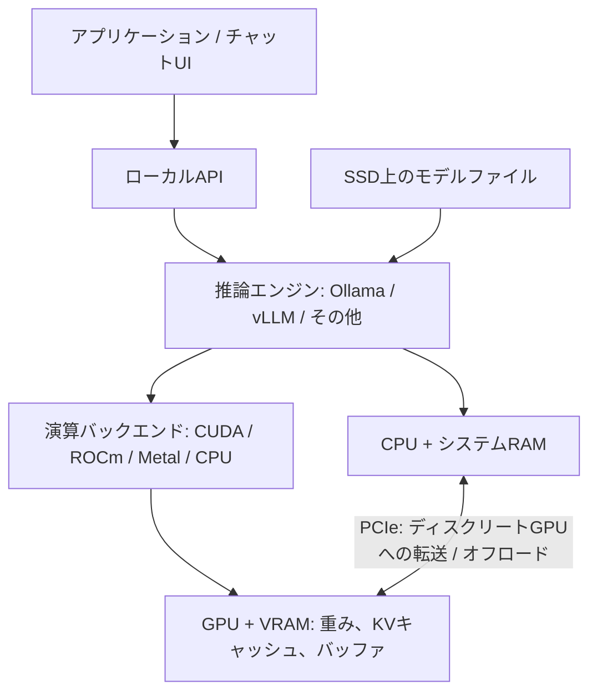

# ローカルLLM推論環境ガイド

[English](local_llm_environment.md)

- **目的:** 個人PC、ワークステーション、オンプレミスサーバーで推論を行うための、ハードウェア、ソフトウェア、オープンウェイトモデルを選べるようにします。
- **文書作成日:** 2026-11-05。**出典の確認時点:** この資料の調査で公式資料を確認した2026-11-04。
- 代表例を用いた選定ガイドです。製品の完全な一覧や、このリポジトリで実行したGPUベンチマークの報告ではありません。
- 製品仕様はメーカーの公称値です。メモリ計算と構成案は目安であり、モデル評価スコアは発表元を明記しています。
- 学習・追加学習では別のメモリ見積もりが必要です。推論の要件には、勾配、Optimizerの状態、学習時の活性値を含みません。

## 1. 選定の流れ

1. 日本語の会話、要約、コード生成、画像理解、文書検索など、用途を定める。
2. 候補モデルと許容できる量子化精度を選ぶ。
3. 必要なコンテキスト長・同時数で、重み、KVキャッシュ、実行バッファの容量を見積もる。
4. 処理内容に対して、メモリ帯域、演算性能、相互接続を評価する。
5. エンジンを選び、代表的な入力で品質、応答時間、スループットを測定する。

- 個人で初めて構築するなら、12–16GB GPU、8B–14Bの量子化モデル、Ollamaを候補にします。
- 24B–32Bのモデルには、24–32GBのVRAMを検討します。
- 共有APIにはvLLMやSGLangを検討し、同時リクエスト数に応じてKVキャッシュを確保します。
- これらは検討の出発点であり、最小要件や速度の保証ではありません。

## 2. システム全体像と用語



- PCIeの経路は、CPUとは別にディスクリートGPUを接続する構成を表します。Apple SiliconやDGX Sparkなどの統合メモリ構成は、メモリの接続構造が異なります。

| 用語 | 意味 | 選定への影響 |
| --- | --- | --- |
| パラメータ数 | 学習済み重みの数。8Bは約80億 | 重みの保存容量と演算量 |
| VRAM | GPUに搭載されたメモリ | GPU上のモデル、キャッシュ、バッファの容量 |
| システムRAM | CPU側のメモリ | 読み込み、CPU推論、オフロード |
| メモリ帯域 | プロセッサーとメモリ間で1秒間に転送できるデータ量 | 特に同時数が少ない生成処理で重要 |
| コンテキスト長 | 入力、履歴、生成出力に使えるトークン数 | キャッシュ容量と処理コスト |
| トークン | モデルごとに異なるテキスト単位。固定の文字数ではない | 日本語は対象モデルのTokenizerで測定する |
| KVキャッシュ | 先行トークンのAttentionのKeyとValueを保存したもの | 保存するコンテキストと同時シーケンス数に応じて増える |
| 量子化 | 重みなどのテンソルを少ないビット数で表現すること | メモリを減らせる。品質と速度は実装次第 |
| Dense | 各トークンの計算で大部分の重みを使う構造 | 総規模と演算量の関係が強い |
| Mixture of Experts（MoE） | トークンごとに選ばれた専門家ネットワークだけを使う構造 | 活性パラメータ数が少なくても、全重みの保存容量は大きい |

## 3. メモリ容量の見積もり

### 3.1 重みの保存容量

```text
Weight bytes = parameter count × bits per parameter / 8
Runtime memory = weights + KV cache + execution buffers + other overhead
```

| 公称規模 | BF16 / FP16: 16-bit | 8-bit | 理想的な4-bit |
| --- | ---: | ---: | ---: |
| 8B | 16GB | 8GB | 4GB |
| 14B | 28GB | 14GB | 7GB |
| 32B | 64GB | 32GB | 16GB |
| 70B | 140GB | 70GB | 35GB |
| 120B | 240GB | 120GB | 60GB |
| 671B | 1,342GB | 671GB | 335.5GB |

- 計算は10進GBです。1GiBは約1.074GBなので、ファイルや監視ツールが表示する単位を確認します。
- 理想的な4-bit容量には、スケール、メタデータ、高精度のテンソル、画像エンコーダー、KVキャッシュ、作業領域を含みません。
- 例えば、Ollamaの`qwen3:8b`のQ4_K_Mダウンロードは約5.2GBです。公称8Bの理想値4GBより大きく、実行時のメモリ使用量はさらに増えます。[Ollama Qwen3 8B][m01]
- 重みを量子化しても、KVキャッシュが自動的に量子化されるわけではありません。

### 3.2 KVキャッシュ

一般的なAttentionモデルでは、次の式が見積もりの参考になります。

```text
KV bytes ≈ 2 [keys and values]
           × layer count
           × KV head count
           × head dimension
           × bytes per element
           × stored tokens
           × concurrent sequences
```

- 例の前提は32層、KVヘッド8個、ヘッド次元128、1要素2byteのBF16保存です。
- この場合、1シーケンスの1トークン当たり131,072byte、つまり128KiBになります。

| 保存トークン数 | 1シーケンス分のKVキャッシュ |
| --- | ---: |
| 8,192 | 1GiB |
| 32,768 | 4GiB |
| 131,072 | 16GiB |

- これは説明用の計算であり、すべてのモデルに共通する仕様ではありません。
- Sliding-window Attention、ハイブリッド構造、KV圧縮、キャッシュ量子化、並列配置によって結果は変わります。
- 128Kコンテキスト対応のモデルでも、選んだGPUで128Kが収まる、快適に動くとは限りません。[Hugging Faceのキャッシュ方式][s01]

### 3.3 容量の推奨目安

- 前提は、おおむね4-bitの重み、1ユーザー、約8Kコンテキストです。
- 次の値は余裕を重視しています。実際のモデルファイル、キャッシュ実装、エンジンのメモリ割り当てを確認します。

| モデル規模 | VRAMの候補 | システムRAMの候補 | 主な開始用途 |
| --- | ---: | ---: | --- |
| 3B–8B | 8–12GB | 16–32GB | 個人の会話、簡単な要約 |
| 12B–14B | 12–16GB | 32–64GB | 文章処理、開発支援 |
| 24B–32B | 24–32GB | 64–128GB | 品質を重視した個人・業務検証 |
| 70B | 80–96GBを優先 | 128GB以上 | 大きなモデルを余裕を持って使う |
| 大型MoE | 必要に応じて複数の大容量GPU | 数百GBになる場合もある | フルモデルの提供 |

- 70BのQ4モデルは48GBで動く場合もありますが、重みが40GB前後以上になると、長文やバッファ用の余裕が限られます。
- MoEの全重みを常駐させる容量は、活性パラメータ数だけでなく、**総パラメータ数**で見積もります。
- 十分なRAMがあればCPUのみの推論も可能です。実用性はCPUの演算性能とメモリ帯域で決まります。
- オフロードで大きなモデルを実行できますが、CPU側の処理や転送が速度を制限する場合があります。

## 4. 性能と帯域

### 4.1 Prefill、Decode、同時利用

| 処理段階 | 内容 | 重要な要素 |
| --- | --- | --- |
| Prefill | 入力プロンプトを処理する | 演算性能、入力長、Attentionの実装 |
| Decode | 後続トークンを順番に生成する | 重みとKVの帯域、量子化カーネル、演算性能 |
| 同時リクエスト処理 | 複数のリクエストを処理する | VRAM、バッチ処理、演算器の利用率、スケジューリング |

- 同時数が少ないDecodeは、メモリ帯域の影響を受けやすい処理です。
- バッチ処理では重みを再利用しやすくなり、演算性能の重要度が増す場合があります。
- 長いコンテキストではAttentionとKVキャッシュのコストも増えます。

### 4.2 帯域の種類を分ける

| 帯域 | 接続箇所 | 主な関係 |
| --- | --- | --- |
| GDDR / HBM帯域 | GPUとそのローカルメモリ | 重みとKVへのアクセス |
| PCIe帯域 | CPU、GPU、その他のデバイス | 転送、オフロード、一部のGPU間経路 |
| NVLink帯域 | 対応GPU間、またはCPU–GPU間 | 対応システムでのモデル並列化やコヒーレントなアクセス |
| Ethernet / InfiniBand | サーバー間 | 複数ノードでの実行 |

- VRAM帯域が1TB/sのGPUでも、CPU RAMを同じ速度で読めるとは限りません。
- 800Gb/sのネットワークは、bitからbyteへの単純換算で100GB/sです。プロトコルのオーバーヘッドは含みません。
- 片方向、双方向、GPU当たり、合計の数値をそろえて比較します。

### 4.3 帯域だけで考える説明例

```text
Illustrative dense decode rate ≈ memory bandwidth [GB/s]
                                / weight bytes read per token [GB]
```

- 公称32Bの重みを理想的な4-bitで保存すると、16GBです。
  - RTX 4090: 1,008 / 16 ≈ 63 token/s。
  - RTX 5090: 1,792 / 16 ≈ 112 token/s。
- これは**実測速度でも、信頼できる速度予測でもありません**。量子化の付加情報、KV転送、演算、カーネル効率、通信を省いています。
- GPU仕様だけではアプリケーションのtoken/sは決まりません。
- FP4、FP8、BF16、INT8、疎性あり、Dense、単一GPU、複数GPUのピーク値を、同じ指標として比較しないでください。

## 5. GPUの具体例

- 以下のメモリ帯域と電力はメーカー仕様であり、LLMの実測結果ではありません。
- 電力はGPU単体の基準値または最大値で、システム全体の消費電力ではありません。
- 似た名称のデスクトップ用・ノートPC用GPU、OEMカード、エディション違いは仕様が異なる場合があります。

### 5.1 GeForce RTX・ワークステーション向けGPU

| GPU | VRAM | メモリ帯域 | GPU電力 | ローカル推論での考慮点 |
| --- | ---: | ---: | ---: | --- |
| [RTX 3060、12GB版][g01] | 12GB GDDR6 | 360GB/s | 170W | 8B量子化モデルを始める候補。8GB版とは区別する |
| [RTX 3090][g02] | 24GB GDDR6X | 936GB/s | 350W | 中古も含めた24GBの候補。NVLink搭載 |
| [RTX 4090][g03] | 24GB GDDR6X | 1,008GB/s | 450W | 24B–32Bの量子化推論候補。NVLinkなし |
| [RTX 5070 Ti][g04] | 16GB GDDR7 | 896GB/s | 300W | 8B–14Bの処理に向けた候補 |
| [RTX 5080][g05] | 16GB GDDR7 | 960GB/s | 360W | 帯域は大きいが、容量は16GB |
| [RTX 5090][g06] | 32GB GDDR7 | 1,792GB/s | 575W | 27B–32Bで余裕を増やせる。NVLinkなし |
| [RTX PRO 6000 Blackwell Workstation Edition][g07] | 96GB GDDR7 ECC | 1,792GB/s | 600W | 70Bなど、大きなメモリ容量が必要な場合の単一GPU候補 |

- 補足のボードメーカー仕様でも、[4090][g08]、[5090][g09]、[5070 Tiの帯域][g10]を確認できます。
- 5090の32GBでは、一般的な70B Q4モデルの全重みをVRAMに載せるのは通常困難です。
- 3090を2枚使っても、自動的に1枚の48GB GPUになるわけではありません。エンジンによるモデル分割とデバイス間通信が必要です。
- カード寸法、スロット間隔、PCIeレーン、電源容量、冷却、連続負荷時の動作を確認します。
- サーバーへの導入では、NVIDIAのGeForceデータセンター展開条項など、適用されるドライバー・ソフトウェア規約を確認します。[NVIDIAソフトウェアライセンス][s02]

### 5.2 データセンター向けGPU

| GPU / 形態 | GPU当たりのメモリ | GPU当たりのメモリ帯域 | 電力の例 | 特徴 |
| --- | ---: | ---: | ---: | --- |
| [NVIDIA L4 / PCIe][g11] | 24GB GDDR6 | 300GB/s | 72W | 低消費電力・ロープロファイルのサーバーカード |
| [NVIDIA L40S / PCIe][g12] | 48GB GDDR6 | 864GB/s | 350W | 容量48GB。NVLinkなし |
| [A100 80GB / PCIe][g13] | 80GB HBM2e | 1,935GB/s | 300W | 大容量HBM。MIG対応 |
| [A100 80GB / SXM][g13] | 80GB HBM2e | 2,039GB/s | 400W | NVLink 600GB/s |
| [H100 / SXM][g14] | 80GB HBM3 | 3.35TB/s | 最大700W | NVLink 900GB/s |
| [H100 NVL / PCIe][g14] | 94GB | 3.9TB/s | 350–400W | 2GPU構成では188GB |
| [H200 / SXM][g15] | 141GB HBM3e | 4.8TB/s | 最大700W | 大きなモデルや長いコンテキスト向け |
| [B200 / SXM][g16] | 180GB HBM3e | 最大8TB/s | 1,000W構成 | Blackwellサーバーアクセラレーター |
| [B300 / SXM][g17] | 288GBの構成* | 最大8TB/s* | 1,100Wの[構成][g22] | Blackwell Ultra |
| [AMD Instinct MI300X][g18] | 192GB HBM3 | 約5.3TB/s | 750W | 大容量ROCmアクセラレーター |
| [AMD Instinct MI355X][g19] | 288GB HBM3E | 8TB/s | 最大1,400W | 大規模推論向け。冷却はシステム構成による |

- *B300は公式資料間で仕様に差があります。実装用リファレンスは288GB / 最大8TB/s、[Blackwell Ultraデータシート][g20]はHGX B300について270GB / 7.7TB/sと記載しています。すべての構成で288GBを使えると想定せず、発注するSKUと利用可能メモリを確認します。*
- データセンター向け製品は、メモリ容量、HBM帯域、相互接続、信頼性、運用機能を重視します。この分類だけで、すべての処理が高速になるわけではありません。
- 例えばL4は、低消費電力の形態を重視しています。
- SXMモジュールには対応サーバー基盤が必要です。一般的なデスクトップ用PCIeカードではありません。
- パッシブ冷却のサーバーカードには、筐体で指定された風量が必要です。

## 6. DGXシステム

- DGXは単体GPUカードではなく、CPU、GPU、メモリ、ネットワーク、ソフトウェアを含むシステムの名称です。

| システム | GPU / メモリ構成 | 帯域の例 | 導入時の考慮点 |
| --- | --- | --- | --- |
| [DGX Spark、標準128GB版][d01] | GB10、CPU/GPU共有LPDDR5X 128GB | 共有メモリ: 273GB/s | 小型のArm開発機 |
| [DGX Station、GB300世代][d02] | 最大748GBのコヒーレントメモリ: GPU HBM 252GB + CPU RAM 496GB | GPU HBM: 最大7.1TB/s | デスクサイドの大容量開発機。Grace Arm CPU |
| [DGX H100][d03] | H100を8基、GPUメモリ合計640GB | HBM合計: 26.8TB/s | 8U、最大10.2kW |
| [DGX H200][d03] | H200を8基、合計1,128GB | HBM合計: 38.4TB/s | 8U、最大10.2kW |
| [DGX B200][d04] | B200を8基、合計1,440GB | HBM合計: 64TB/s | 10U、最大約14.3kW |
| [DGX B300][d05] | B300を8基。User Guideでは約2.3TB* | HBM合計: 最大64TB/s | 10U、物理仕様14.5kW |
| [GB200 NVL72、ラック規模の参考例][d06] | 72GPU + 36 Grace CPU、GPU HBM合計13.4TB | HBM合計: 576TB/s | 液冷のラック規模システム |

- *[DGX B300の製品ページ][d07]には約2.1TB / 14kWの記載もあります。この表はUser Guideに従っています。実際の構成を確認してください。*
- Stationの値は2026-10-30更新の開発ガイドに基づき、以前の発表値784GBは採用していません。
- Sparkの128GBは共有メモリであり、帯域はH100級のHBMと大きく異なります。
- [Sparkの製品ページ][d08]にはOEMの64GB版も記載されています。標準128GBシステムとは区別します。
- Stationの748GB全体がHBMではありません。CPU RAMとGPU HBMではアクセスコストが異なります。
- GPUメモリや帯域の合計値は、1GPUが全量へその速度で直接アクセスできることを意味しません。
- Sparkの1PFLOPはFP4・疎性ありのピーク値であり、BF16の比較値やLLMのtoken/s実測値ではありません。
- ラックシステムでは、電源、冷却、床荷重、騒音、保守を適切に計画する必要があります。

## 7. ホストのハードウェアとOS

| 項目 | 個人向けの開始候補 | サーバーでの考慮点 |
| --- | --- | --- |
| CPU | 推論の大部分をGPUで行うなら、現行8–16コア級が候補 | CPU推論、前処理、NUMA、PCIe構成 |
| RAM | 32–64GBから。大きなモデルには128GB以上も検討 | 読み込み、オフロード、同時プロセス |
| SSD | NVMe 1TB以上が扱いやすい | 複数モデル・精度版、キャッシュ、ログ、読み込み帯域 |
| GPU接続 | 物理的な収まり、電気的なレーン数、電源を確認 | GPUごとの実レーン数、P2P対応、通信経路 |
| 電源・冷却 | システム全体で設計 | 連続稼働、冗長性、ラック冷却 |
| OS | OllamaなどはWindows、macOS、Linuxに対応 | サーバーではエンジンが対応するLinuxディストリビューションを使う |

- LinuxではUbuntu 24.04 LTSが候補の一つです。選んだエンジンの対応OS・パッケージの組み合わせに従います。
- AMDでは、すべてのRadeonカードが対応すると想定せず、正確なGPU型番とROCm/OSの組み合わせを確認します。
- Apple Siliconも選択肢です。Mac Studio M3 Ultraの仕様には819GB/sのメモリ帯域が記載されています。GPUとOSは統合メモリを共有するため、搭載RAM全体をモデルに使えるわけではありません。現在注文できる構成を確認します。[Apple技術仕様][g21]
- AppleのNeural EngineのTOPSからLLM速度を推定しないでください。使われるハードウェアは選択した推論バックエンドで決まります。

## 8. 推論エンジン

### 8.1 主な選択肢

| ソフトウェア | 主な用途 | 重要な特徴 |
| --- | --- | --- |
| [Ollama][e01] | 個人で素早く導入する | モデル管理、CLI、ローカルAPI。CPUと対応NVIDIA/AMD/Metalバックエンド |
| [llama.cpp][e02] | 軽量推論、CPU/GPUへの配置 | 主にGGUF。CUDA、HIP、Metal、Vulkanなどのバックエンド |
| [vLLM][e03] | 共有API、スループット重視 | Continuous batching、Paged KV、複数GPU、対応する量子化 |
| [SGLang][e04] | 同時利用、プロンプト先頭部分の再利用 | Prefix caching、構造化出力、大型MoEの提供 |
| [TensorRT-LLM][e05] | NVIDIA向けの最適化 | モデル、GPU、精度ごとに最適化した実行 |
| [Transformers][e06] | Python組み込み、新モデルの評価 | 対応モデルが広く、サーバー向け最適化も利用できる |
| [MLX LM][e07] | Apple Silicon | 統合メモリを使った生成、量子化、追加学習 |
| [LM Studio][e08] | GUIでの検証 | ローカルチャット/API。GGUFと対応MLXモデル |

- 個人で試す: OllamaやLM Studioから始めます。
- GGUFやオフロードを細かく制御する: llama.cppを検討します。
- 共有API: vLLMやSGLangを検討します。
- NVIDIA固有の性能調整: TensorRT-LLMを検討します。
- Pythonでモデルを試作する: Transformersを検討します。
- Mac中心の推論: MLX LMを検討します。
- vLLMは通常Linuxで使います。WindowsではWSLなどの方法が必要です。Apple Siliconは別のプラグイン経由で対応します。モデル、量子化、GPU世代、バックエンドの互換性をまとめて確認します。[vLLM GPU導入資料][e09]

### 8.2 サーバー向け機能

| 機能 | 目的 |
| --- | --- |
| Continuous / in-flight batching | 完了したリクエストを新しいものと入れ替え、利用率を高める |
| Paged KV cache | キャッシュを小さなブロックで管理して無駄なメモリを減らす |
| Prefix caching | 同一のプロンプト先頭部分の計算結果を再利用する |
| Tensor parallelism（TP） | 層のテンソル計算を複数GPUへ分割する |
| Pipeline parallelism（PP） | モデルの層をGPUごとに分担する |
| Expert parallelism（EP） | MoEのexpertを複数GPUへ分散する |
| Data parallelism（DP） | モデルの複製を動かしてリクエストを分担する |

- モデルが1GPUに収まるなら、複製を使ってリクエスト数を増やす構成も有効です。
- 1モデルを複数GPUへ分割する場合、相互接続の帯域と構造が重要になります。[vLLMの並列化][e10]

### 8.3 NVIDIA環境のソフトウェア層

1. ホストに互換性のあるNVIDIAドライバーを導入し、`nvidia-smi`で認識を確認する。
2. 互換性のあるCUDA runtimeライブラリとカーネルを使う。wheelやコンテナに同梱されることも多い。
3. コンパイルが必要な場合にCUDA Toolkit全体を導入する。配布済みバイナリを使うすべての構成で、ホストへの導入が必須というわけではない。
4. エンジン、PyTorch、runtime、GPUアーキテクチャの互換性を維持し、専用環境か対応コンテナを使う。
5. DockerではNVIDIA Container ToolkitでGPUを公開する。ドライバーは引き続きホストが提供する。

- 新しいドライバーならすべての組み合わせが動くと想定せず、個別パッケージの要件とNVIDIAの互換性資料に従います。[CUDA互換性][s03]、[Container Toolkit導入][s04]

## 9. 量子化とファイル形式

| 名称 | 分類 | 主な用途・制約 |
| --- | --- | --- |
| Safetensors | ファイル形式 | Transformers/vLLMで一般的。形式だけでは精度は分からない |
| GGUF | ファイル形式 | llama.cppなどで使うモデルのメタデータとテンソル |
| Q4_K_M / Q5_K_M | GGUFの量子化種別 | メモリと品質のバランスが異なる |
| AWQ | 重みの量子化手法 | 主に低bit重み。対応カーネルが必要 |
| GPTQ | 学習後の重み量子化 | 他の4-bit方式と配置や実行経路が異なる |
| FP8 | 浮動小数点表現 | 重み、活性値、KVの量子化では効果が異なる |
| MXFP4 | ブロック単位のスケールを使う4-bit浮動小数点 | gpt-ossのexpert重みなどに使用 |
| NVFP4 | NVIDIAの4-bit浮動小数点 | 対応ハードウェアと実装が必要 |

- 同じビット数でも、ファイル互換性、品質、速度が同じとは限りません。
- 4-bitモデルが16-bitモデルより自動的に4倍速くなるわけではありません。
- 逆量子化、カーネル対応、バッチサイズ、プロンプト長によって結果は変わります。[GGUF][s05]、[vLLM量子化の互換性][s06]

## 10. オープンウェイトモデル

### 10.1 意味とライセンス

- オープンウェイトモデルは、ローカル実行用の学習済み重みを公開しています。
- 重みが公開されていても、利用が無制限であることや、学習データ・コードがすべて公開されていることを意味しません。
- 対象モデルの商用利用、改変、再配布、帰属表示、サービス提供の条件を確認します。
- エンジンとモデルのライセンスは別です。量子化しても元モデルの義務はなくなりません。

### 10.2 規模と重み容量の見積もり

- 代表モデルを挙げた表であり、完全なランキングではありません。
- BF16と理想的な4-bitの列は、記載した規模から求めた10進GBの計算値です。ダウンロード容量や実行時の必要VRAMではありません。
- マルチモーダルモデルは追加エンコーダーを持つ場合があります。Qwenは公称の言語モデル規模を使っています。
- コンテキスト上限はモデルの制約であり、推奨ハードウェアでの容量を保証するものではありません。

| モデル | 総規模 / 活性規模 | コンテキスト | 入力 | BF16 / 理想的な4-bit |
| --- | --- | --- | --- | ---: |
| [Qwen3-8B][m02] | 8.2B / Dense | ネイティブ32,768 | テキスト | 約16.4 / 4.1GB |
| [Qwen3.5-9B][m03] | 9B級 / Dense | ネイティブ262,144 | テキスト、画像、動画 | 約18 / 4.5GB |
| [Phi-4][m04] | 14B / Dense | 16K | テキスト | 約28 / 7GB |
| [Mistral Small 3.1 24B][m05] | 24B / Dense | 128K | テキスト、画像 | 約48 / 12GB |
| [Qwen3.6-27B][m06] | 27B級 / Dense | ネイティブ262,144 | テキスト、画像、動画 | 約54 / 13.5GB |
| [Qwen3.6-35B-A3B][m07] | 35B / 3B | ネイティブ262,144 | テキスト、画像、動画 | 約70 / 17.5GB |
| [Gemma 4 26B A4B][m08] | 25.2B / 3.8B | 256K | テキスト、画像 | 約50.4 / 12.6GB |
| [Gemma 4 31B][m08] | 30.7B / Dense | 256K | テキスト、画像 | 約61.4 / 15.4GB |
| [gpt-oss-20b][m09] | 21B / 3.6B | 128K | テキスト | 約42 / 10.5GB |
| [gpt-oss-120b][m09] | 117B / 5.1B | 128K | テキスト | 約234 / 58.5GB |
| [Llama 3.3 70B Instruct][m10] | 70B / Dense | 128K | テキスト | 約140 / 35GB |
| [DeepSeek-R1-0528][m11] | 671B / 37B | 128K級* | テキスト | 約1,342 / 335.5GB |
| [Llama 3.1 Swallow 8B Instruct v0.5][m12] | 8B級 / Dense | config値: 131,072 | 日本語 / 英語テキスト | 約16 / 4GB |

- *DeepSeek-R1-0528の[配布config][m16]は163,840です。拡張設定と公称の128K級コンテキストを区別します。*
- Swallowの131,072という値は[配布config][m17]に記載されています。
- gpt-ossはMXFP4のexpertを含む混合精度の重みを配布しています。OpenAIは20bを16GBメモリ、120bを80GB GPUで動かす構成を示していますが、最大コンテキストや高い同時数を保証するものではありません。[公式発表][m13]
- DeepSeek-R1-0528はFP8チェックポイントを配布しています。上表のBF16値は比較用の換算値です。
- [DeepSeek-R1-Distill-Qwen-32B][m14]は、別の小型Denseモデルです。671Bモデルを32B分の保存容量で動かすものではありません。

### 10.3 公開されている品質評価

- 回答の品質とハードウェア上の生成速度は分けて評価します。
- 以下の割合は、Qwen3.6-27Bのモデルカードの同一比較表から引用した発表元の値です。この資料では再測定しておらず、すべての項目について個別の評価ハーネス設定が明記されているわけではありません。

| モデル | MMLU-Pro | GPQA Diamond | LiveCodeBench v6 |
| --- | ---: | ---: | ---: |
| Qwen3.5-27B | 86.1 | 85.5 | 80.7 |
| Gemma 4 31B | 85.2 | 84.3 | 80.0 |
| Qwen3.6-35B-A3B | 85.2 | 86.0 | 80.4 |
| Qwen3.6-27B | 86.2 | 87.8 | 83.9 |

- MMLU-Proは幅広い知識と推論、GPQA Diamondは難しい科学問題、LiveCodeBenchはコード生成を評価します。
- 高いほど良い評価ですが、絶対順位や量子化後のモデル品質を保証する値ではありません。[Qwen比較表の出典][m06]

gpt-ossのモデルカードは、**high reasoning、ツールなし、pass@1**で次の結果を報告しています。

| モデル | AIME 2025 | GPQA Diamond |
| --- | ---: | ---: |
| gpt-oss-20b | 91.7% | 71.5% |
| gpt-oss-120b | 92.5% | 80.1% |

- 推論に使う計算量は品質と応答時間の両方を変えます。ツールありのスコアをこの結果と混ぜたり、異なる発表元の表を条件が統一されたモデル間実験と見なしたりしないでください。[gpt-ossモデルカードのTable 3][m15]

日本語の会話について、Swallowのカードは次の値を報告しています。

| モデル | Japanese MT-Bench |
| --- | ---: |
| Llama 3.1 8B Instruct | 0.519 |
| Qwen2.5 7B Instruct | 0.665 |
| Swallow 8B Instruct v0.5 | 0.719 |

- 条件は、審判`gpt-4o-2024-08-06`、0–1への正規化、5回平均です。
- 審判モデルによる会話スコアは、日本語の業務性能を普遍的に表すものではありません。[Swallow評価][m12]

### 10.4 モデル選定とライセンスの要点

| 系列 / 掲載モデル | 選定の観点 | 主なライセンス |
| --- | --- | --- |
| 掲載したQwen3 / 3.5 / 3.6 | 多言語、コード、推論、モデルごとの画像対応 | Apache 2.0 |
| Gemma 4 | Dense/MoEの選択肢、画像入力、推論モード | Apache 2.0 |
| gpt-oss | 推論、ツールを使うアプリケーション | Apache 2.0 |
| Mistral Small 3.1 | 24B級、画像、日本語を含む多言語 | Apache 2.0 |
| Phi-4 | 数学・論理の候補。日本語は別に評価 | MIT |
| DeepSeek-R1-0528 | 推論。フルモデルには大きな環境が必要 | MIT |
| Llama 3.3 | 広いエコシステム。公式対応8言語に日本語は含まれない | Llama Community License |
| Swallow v0.5 | 日本語を重視する候補 | カード本文はLlama 3.1 + Gemma Termsと記載 |

- Gemma 3とGemma 4ではライセンスが異なります。世代や派生モデルごとに確認します。
- Swallowのカードはメタデータと本文の記載が異なります。この資料はメタデータだけでなく、本文に従っています。
- LM Studioのアプリ規約はモデルのライセンスと別で、一部のサービス提供や再配布に制限があります。[LM Studio App Terms][s07]

## 11. 構成例

- 容量を重視した開始構成であり、実測性能の保証ではありません。
- 同時利用について明示する場合を除き、量子化モデルと約8Kの単一ユーザーコンテキストを想定しています。

| 目的 | GPU / モデルの例 | RAM / SSDの例 | エンジン候補 |
| --- | --- | --- | --- |
| 小さく始める | RTX 3060 12GB、8B Q4 | RAM 32GB、NVMe 1TB | Ollama |
| 個人で品質を評価する | RTX 4090 24GB、24B–32B Q4 | RAM 64GB、NVMe 2TB | Ollama / llama.cpp |
| 32Bで余裕を増やす | RTX 5090 32GB | RAM 64–128GB、NVMe 2TB | Ollama / vLLM |
| 70Bを1GPUに載せる | RTX PRO 6000 Blackwell 96GB | RAM 128GB、NVMe 2TB以上 | vLLM / SGLang |
| 社内共有API | 同時数に合わせた対応H200サーバー | 必要に応じてRAM 256GB以上 | vLLM / SGLang |
| 大型MoEの提供 | 適切なDGXなど、複数のHBM GPU | 重みと並列配置から見積もる | vLLM / SGLang / TensorRT-LLM |

## 12. 実行可能なセットアップ例

- 以下は適切な利用者所有マシンで実行する手順です。作成環境ではGPU推論を**実行していません**。
- バージョンに依存するコマンドは出典確認時点に基づきます。再現するときはリンク先の導入ガイドを確認します。
- モデルの取得とインストールにはネットワークが必要です。準備後は、対応するローカルモデルを外部の推論APIなしで実行できます。

### 12.1 Ollama

**前提条件**

- 十分なRAM/VRAMと対応GPUドライバーを持つLinux。Windows/macOSでは公式インストーラーを使えます。
- `curl`、`less`と、インストーラー・モデル用の十分なディスク容量。
- 公式インストーラーは実行前に内容を確認します。[OllamaのLinux導入][e11]

```bash
curl -fsSL https://ollama.com/install.sh -o /tmp/ollama_install.sh
less /tmp/ollama_install.sh
sh /tmp/ollama_install.sh

ollama pull qwen3:8b
ollama run qwen3:8b
```

- 期待結果: Ollamaがローカルモデルを取得し、対話を開始します。
- インストーラーがサービスを開始しなかった場合は、別ターミナルで`ollama serve`を実行します。使用中のポートで2つ目のサーバーを起動しないでください。
- バージョンごとの既定値に依存せず、コンテキスト長を明示します。

```bash
curl http://127.0.0.1:11434/api/chat \
  -H 'Content-Type: application/json' \
  -d '{
    "model": "qwen3:8b",
    "messages": [
      {"role": "user", "content": "日本語で自己紹介してください"}
    ],
    "stream": false,
    "options": {"num_ctx": 8192}
  }'

ollama ps
```

- 期待結果: APIがJSON応答を返します。`ollama ps`は読み込んだモデルと、`PROCESSOR`欄にCPU/GPUへの配置を表示します。
- 重みがすべてGPUに常駐していれば`100% GPU`が想定されます。それ以外の場合は分割状況とメモリ見積もりを確認します。
- Ollamaはクラウドモデルにも対応します。完全なローカル処理にはローカルモデルを選び、必要に応じてクラウド機能を無効にします。FAQはサーバー設定の`disable_ollama_cloud`を説明しています。[Ollama FAQ][e12]

### 12.2 vLLM

**前提条件**

- Linux、対応するNVIDIA GPU/ドライバー、`uv`、`curl`、十分なディスク容量。
- Qwen3-8BをBF16・8K・1シーケンスで動かすこの例では、対応する24GB級GPUが出発点です。他のプロセスやエンジンのバッファで利用可能な余裕は変わります。
- 専用環境にインストールします。[vLLM Quickstart][e13]、[GPU導入資料][e09]

```bash
mkdir -p local_llm_demo
cd local_llm_demo

uv venv --python 3.12 --seed
source .venv/bin/activate

uv pip install vllm --torch-backend=auto
vllm download-kernels

vllm serve Qwen/Qwen3-8B \
  --host 127.0.0.1 \
  --port 8000 \
  --dtype bfloat16 \
  --max-model-len 8192 \
  --max-num-seqs 1 \
  --gpu-memory-utilization 0.85
```

別のターミナルから呼び出します。

```bash
curl http://127.0.0.1:8000/v1/chat/completions \
  -H 'Content-Type: application/json' \
  -d '{
    "model": "Qwen/Qwen3-8B",
    "messages": [
      {"role": "user", "content": "日本語で挨拶してください"}
    ],
    "max_tokens": 128
  }'
```

- 期待結果: サーバーがモデルを読み込み、OpenAI互換のJSON応答を返します。出力上限が小さいと、推論過程や最終回答が途中で切れる場合があります。
- この例は同時数を1シーケンスに制限しています。モデル規模、コンテキスト、同時数を増やす前にメモリを再計算します。
- OpenAI互換エンドポイントはAPI形式を表し、推論はローカルのvLLMプロセスで行います。
- 再現可能な運用には、エンジン/PyTorchのバージョン、runtime、モデルrevision、量子化、利用する場合はコンテナdigestを記録して固定します。

## 13. 評価と運用

| 確認項目 | 記録内容 |
| --- | --- |
| タスクの品質 | 日本語の正確性、業務用語、指示遵守、事実性、コードのテスト |
| TTFT | 最初のトークンが返るまでの時間 |
| ユーザー当たりの速度 | 個別リクエストの出力token/s |
| 合計スループット | 定めた同時数での合計出力token/s |
| メモリ | 想定する最大入力・同時数でのVRAM/RAM |
| 安定性 | 連続負荷、温度、電力、エラー、メモリ不足時の動作 |

- 比較ではGPU型番・台数、モデルrevision、量子化、エンジン版、入力・出力長、同時数、ウォーム・コールド状態をそろえます。
- 短い回答やTokenizerの違いでtoken/s比較が誤解を招く場合があります。タスク完了と全体の応答時間も含めます。
- 社内APIでは認証、通信の保護、アクセス制御、リクエスト制限、ログの扱いを設定します。
- 重みがローカルにあるだけでは、データ処理もローカルで完結するとは限りません。クラウド機能、Web検索、外部ツール、監視、ログの送信先を確認します。

## 14. 検証状況

- **出典調査:** 公式製品ページ、モデルカード、エンジン資料を2026-11-04の調査で確認しました。この確認時点は、リンク先のすべてが今後も変わらないという主張ではありません。
- **計算例:** 重み容量と説明用のKV・帯域計算は、前提を明記した算術上の見積もりです。
- **作成時の文書確認:** 空白、GFM解析、ローカルリンク、出典URLの一致、見出し・表の構造、Mermaid以外のコードの一致、シェル構文の確認は通過しました。変更時には関連する確認を再実行します。
- **図:** Mermaidの構造をレビューしました。専用のMermaidレンダラーは実行していません。
- **未実行:** このリポジトリの作成環境では、GPU導入、モデル取得、推論例、スループット・応答時間ベンチマーク、電力測定、品質評価を行っていません。
- 公開ベンチマーク値やコマンドの期待結果を、この環境で観測した結果として報告してはいけません。

## 15. 参考資料

- GPU表はNVIDIA、AMD、公式ボード・サーバーメーカーを参照し、DGX表はNVIDIAの製品・実装ガイドを参照しています。
- モデル表は開発元のモデルカードと評価を参照し、エンジンの説明は公式資料を参照しています。
- 公式資料間で仕様が異なる場合は、対象項目の近くに注記しています。
- 購入・導入前には正確なSKU、ソフトウェア対応、モデルrevision、ライセンスを再確認します。

[g01]: https://www.pny.com/geforce-rtx-3060-12gb-uprising-df
[g02]: https://www.pny.com/geforce-rtx-3090-xlr8-gaming-epic-x-rgb-triple-fan-m?iscommercial=true
[g03]: https://www.nvidia.com/en-us/geforce/graphics-cards/40-series/rtx-4090/
[g04]: https://www.nvidia.com/en-us/geforce/graphics-cards/50-series/rtx-5070-family/
[g05]: https://www.nvidia.com/en-us/geforce/graphics-cards/50-series/rtx-5080/
[g06]: https://www.nvidia.com/en-us/geforce/graphics-cards/50-series/rtx-5090/
[g07]: https://www.nvidia.com/en-us/products/workstations/professional-desktop-gpus/rtx-pro-6000/
[g08]: https://www.pny.com/file%20library/company/support/product%20brochures/geforce%20graphics/english/consumer-geforce-linecard-06-21-23.pdf
[g09]: https://www.pny.com/geforce-rtx-5090-models?sku=VCG509032TFXPB1
[g10]: https://blogs.nvidia.com/blog/studio-ai-geforce-rtx-5070-ti-gpu-dlss/
[g11]: https://www.nvidia.com/en-us/data-center/l4/
[g12]: https://www.nvidia.com/en-us/data-center/l40s/
[g13]: https://www.nvidia.com/en-us/data-center/a100/
[g14]: https://www.nvidia.com/en-us/data-center/h100/
[g15]: https://www.nvidia.com/en-us/data-center/h200/
[g16]: https://lenovopress.lenovo.com/lp2226-thinksystem-nvidia-b200-180gb-1000w-gpu
[g17]: https://docs.nvidia.com/enterprise-reference-architectures/hgx-ai-factory/latest/components.html
[g18]: https://www.amd.com/en/products/accelerators/instinct/mi300/mi300x.html
[g19]: https://www.amd.com/en/products/accelerators/instinct/mi350/mi355x.html
[g20]: https://resources.nvidia.com/en-us-gpu-resources/blackwell-ultra-datasheet?xs=443995
[g21]: https://support.apple.com/ja-jp/122211
[g22]: https://www.supermicro.com/datasheet/Datasheet_Supermicro_NVIDIA_AI_Factories_HGX_B300.pdf
[d01]: https://docs.nvidia.com/dgx/dgx-spark/hardware.html
[d02]: https://docs.nvidia.com/dgx/dgx-station-development-guide/overview.html
[d03]: https://docs.nvidia.com/dgx/dgxh100-user-guide/introduction-to-dgxh100.html
[d04]: https://www.nvidia.com/en-us/data-center/dgx-b200/
[d05]: https://docs.nvidia.com/dgx/dgxb300-user-guide/introduction-to-dgxb300.html
[d06]: https://www.nvidia.com/en-us/data-center/gb200-nvl72/
[d07]: https://www.nvidia.com/en-us/data-center/dgx-b300/
[d08]: https://www.nvidia.com/en-us/products/workstations/dgx-spark/
[e01]: https://docs.ollama.com/gpu
[e02]: https://github.com/ggml-org/llama.cpp
[e03]: https://docs.vllm.ai/en/stable/
[e04]: https://docs.sglang.io/
[e05]: https://nvidia.github.io/TensorRT-LLM/overview
[e06]: https://huggingface.co/docs/transformers/
[e07]: https://github.com/ml-explore/mlx-lm
[e08]: https://lmstudio.ai/docs/app
[e09]: https://docs.vllm.ai/en/stable/getting_started/installation/gpu/
[e10]: https://docs.vllm.ai/en/stable/serving/parallelism_scaling/
[e11]: https://docs.ollama.com/linux
[e12]: https://docs.ollama.com/faq
[e13]: https://docs.vllm.ai/en/stable/getting_started/quickstart/
[m01]: https://ollama.com/library/qwen3:8b
[m02]: https://huggingface.co/Qwen/Qwen3-8B
[m03]: https://huggingface.co/Qwen/Qwen3.5-9B
[m04]: https://huggingface.co/microsoft/phi-4
[m05]: https://huggingface.co/mistralai/Mistral-Small-3.1-24B-Instruct-2503
[m06]: https://huggingface.co/Qwen/Qwen3.6-27B
[m07]: https://huggingface.co/Qwen/Qwen3.6-35B-A3B
[m08]: https://ai.google.dev/gemma/docs/core/model_card_4
[m09]: https://github.com/openai/gpt-oss
[m10]: https://huggingface.co/meta-llama/Llama-3.3-70B-Instruct
[m11]: https://huggingface.co/deepseek-ai/DeepSeek-R1-0528
[m12]: https://huggingface.co/tokyotech-llm/Llama-3.1-Swallow-8B-Instruct-v0.5
[m13]: https://openai.com/index/introducing-gpt-oss/
[m14]: https://huggingface.co/deepseek-ai/DeepSeek-R1-Distill-Qwen-32B
[m15]: https://deploymentsafety.openai.com/gpt-oss
[m16]: https://huggingface.co/deepseek-ai/DeepSeek-R1-0528/raw/main/config.json
[m17]: https://huggingface.co/tokyotech-llm/Llama-3.1-Swallow-8B-Instruct-v0.5/raw/main/config.json
[s01]: https://huggingface.co/docs/transformers/kv_cache
[s02]: https://www.nvidia.cn/en-us/drivers/nvidia-license/
[s03]: https://docs.nvidia.com/deploy/cuda-compatibility/minor-version-compatibility.html
[s04]: https://docs.nvidia.com/datacenter/cloud-native/container-toolkit/latest/install-guide.html
[s05]: https://huggingface.co/docs/hub/gguf
[s06]: https://docs.vllm.ai/en/stable/features/quantization/
[s07]: https://lmstudio.ai/app-terms
