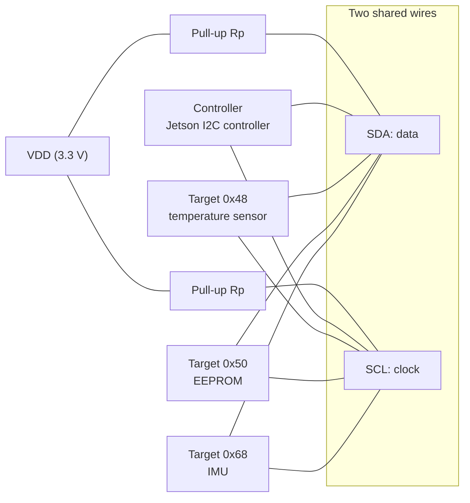
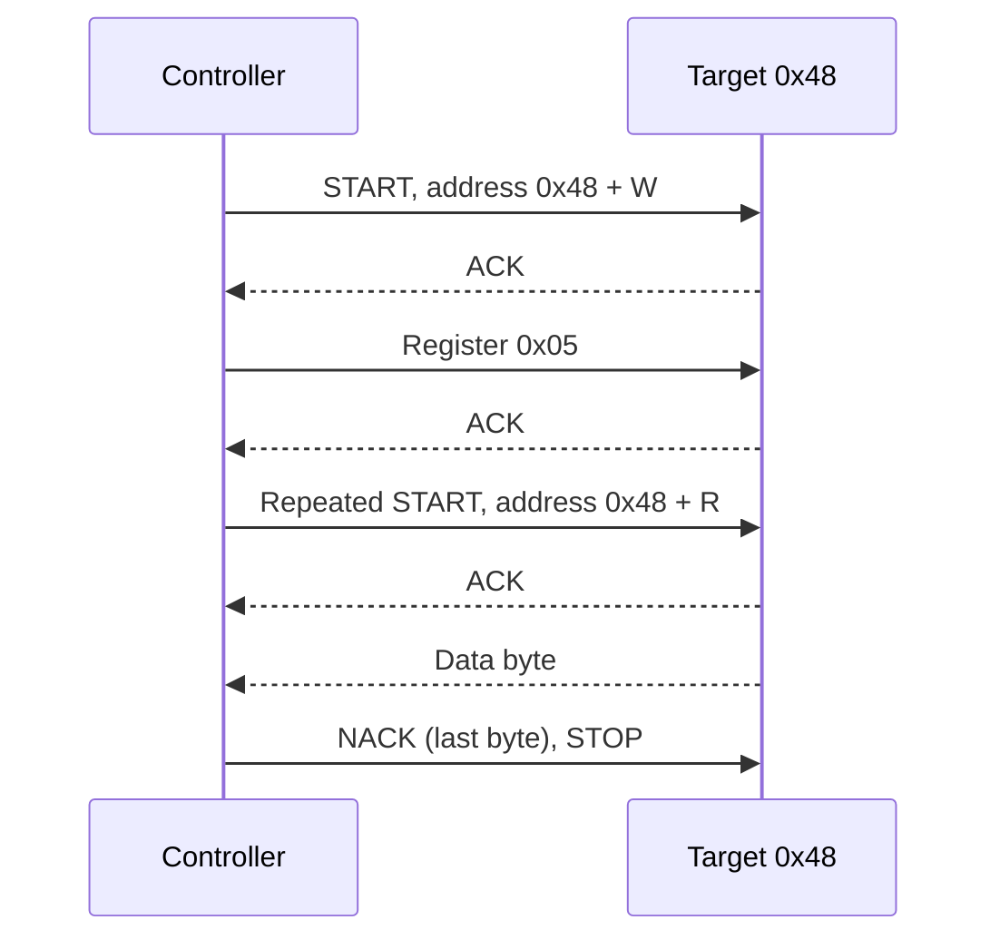

# I2C

[日本語](i2c_jp.md) · [Repository](../../README.md) · [Jetson AGX Orin peripherals](jetson_agx_orin_peripherals.md)

How the I2C bus works, what each pin does, and how to use and debug it on Linux, with Jetson AGX Orin as the example platform. The audience is embedded engineers who have used I2C sensors but want to understand the bus at the signal level.

Terms used below:

- **Controller / target:** the device that drives the clock and starts transfers, and the device that responds to an address. Older documents call them master and slave.
- **Open-drain:** an output that can only pull a line low. When no device pulls low, a pull-up resistor brings the line high.
- **ACK / NACK:** the ninth bit of every byte. The receiver pulls SDA low for ACK; leaving it high means NACK.

## Overall structure



Every device connects to the same two wires. Each line has one pull-up resistor to VDD, and every device can only pull the line low (open-drain). The controller starts each transfer by sending a target address; only the target with that address responds. A shared ground between all devices is also required but is not drawn.

Main characteristics:

- **Two wires, many devices:** one bus can carry many targets, limited by addresses and bus capacitance.
- **Synchronous and half-duplex:** the controller drives SCL; data moves in one direction at a time on SDA.
- **Addressed:** each target has a 7-bit address (10-bit addressing exists but is rare).
- **Slow to moderate speed:** typical rates are 100 kbit/s (Standard-mode) and 400 kbit/s (Fast-mode). Fast-mode Plus reaches 1 Mbit/s.
- **Use cases:** configuration and low-rate data: sensors, EEPROMs, PMICs, RTCs, camera sensor registers, display and HDMI DDC/EDID.

## Pins and their roles

| Pin | Name | Driven by | Role |
|---|---|---|---|
| SDA | Serial Data | Controller and targets (open-drain) | Carries address, data, and ACK bits. Changes only while SCL is low, except for START and STOP. |
| SCL | Serial Clock | Controller (targets may hold it low) | Clock. Data on SDA is sampled while SCL is high. A target can stretch the clock by holding SCL low. |
| GND | Ground | — | Shared reference. Without it, the logic levels have no meaning. |
| VDD (pull-up supply) | Pull-up voltage | Power supply | Defines the high level. All devices on a bus must tolerate this voltage. |

Some devices also have optional pins that are not part of the bus itself:

| Pin | Role |
|---|---|
| A0, A1, A2 (address select) | Set the low bits of the target address by strapping to GND or VDD, so several identical chips can share one bus. |
| INT / ALERT | Interrupt output from a target to a GPIO, so the controller does not have to poll. |
| WP (write protect) | On EEPROMs, blocks writes while held high. |
| RESET | Device reset input, usually driven by a GPIO. |

## How a transfer works

### START, STOP, and bits

```text
            START                                   STOP
SDA  ‾‾‾‾‾\______X=====X=====X ... X=====X_____/‾‾‾‾‾
SCL  ‾‾‾‾‾‾‾‾\__/‾‾\__/‾‾\__/ ... \__/‾‾\__/‾‾‾‾‾‾‾‾
              |    bit7  bit6        ACK    |
     SDA falls while SCL is high    SDA rises while SCL is high
```

- **START (S):** SDA goes from high to low while SCL is high.
- **STOP (P):** SDA goes from low to high while SCL is high.
- **Data bit:** SDA is set while SCL is low and must stay stable while SCL is high. A change of SDA while SCL is high is therefore always START or STOP, never data.
- **Repeated START (Sr):** a START without a STOP before it. The controller keeps the bus and changes direction, for example from writing a register address to reading data.
- Bytes are sent most significant bit first. Each byte is followed by an ACK or NACK bit from the receiver.

### Address byte

```text
| A6 A5 A4 A3 A2 A1 A0 | R/W | ACK |
  7-bit target address   0 = write, 1 = read
```

The first byte after START is the 7-bit address followed by the R/W bit. Datasheets sometimes list an 8-bit "address" that already includes the R/W bit (for example `0x90`/`0x91` for 7-bit `0x48`). Linux tools always use the 7-bit form.

### Register write and read

Most sensors expose registers. A register write and a register read look like this (`S` = START, `Sr` = repeated START, `P` = STOP, `A` = ACK, `N` = NACK; the target sends the ACK bits after controller bytes and the data marked `[data]`):

```text
Write 0x12 to register 0x05 of target 0x48:
S | 0x48+W | A | 0x05 (register) | A | 0x12 (data) | A | P

Read one byte from register 0x05 of target 0x48:
S | 0x48+W | A | 0x05 (register) | A | Sr | 0x48+R | A | [data] | N | P
                                                         └ sent by target
```



The controller ends a read with NACK to tell the target that no more bytes are needed, then sends STOP.

### Clock stretching and arbitration

- **Clock stretching:** a slow target may hold SCL low after a byte until it is ready. The controller waits because it sees SCL still low. Not every controller or bridge handles this well, so check the controller documentation when a target uses it.
- **Arbitration:** if two controllers start at once, each checks SDA while sending. A controller that sends 1 but reads 0 has lost and stops. Multi-controller buses are uncommon in embedded systems.

## Electrical design

- **Pull-up value:** a common starting point is 4.7 kΩ for 100 kHz and 2.2 kΩ for 400 kHz at 3.3 V. Smaller values give faster rising edges but more current and a higher low-level voltage.
- **Bus capacitance:** wiring and device pins add capacitance. The I2C specification limits it to 400 pF for Standard and Fast modes. Long wires or many devices slow the rising edge until bits fail.
- **Rise time matters, fall time rarely does:** the line falls quickly through a driver transistor but rises slowly through the resistor. On an oscilloscope, rounded rising edges indicate too much capacitance or too weak a pull-up.
- **Voltage levels:** every device must match the pull-up voltage. Use a level shifter (for example a MOSFET-based bidirectional shifter) between 1.8 V and 3.3 V devices.
- **Only one set of pull-ups:** breakout boards often include their own pull-ups. Several boards in parallel can reduce the effective resistance too much.

## Speed modes

| Mode | Maximum rate | Notes |
|---|---|---|
| Standard-mode (Sm) | 100 kbit/s | Supported by every device |
| Fast-mode (Fm) | 400 kbit/s | Most common for sensors |
| Fast-mode Plus (Fm+) | 1 Mbit/s | Needs stronger drivers |
| High-speed mode (Hs) | 3.4 Mbit/s | Needs special controller support; rare |
| Ultra Fast-mode (UFm) | 5 Mbit/s | Write-only, push-pull; rarely used |

Related buses: **SMBus** (system management, adds timeouts and defined commands) and **I3C** (MIPI's successor, push-pull, higher speed, in-band interrupts, backward compatible with many I2C targets).

## On Jetson AGX Orin

- The module has eight I2C controllers. Some are used on the module and carrier board (PMIC, EEPROMs, camera, display DDC). Others reach the 40-pin header.
- The 40-pin header follows the Raspberry Pi-compatible layout: **pin 3 = SDA, pin 5 = SCL** for one bus, and **pin 27 = SDA, pin 28 = SCL** for a second bus. Pins 1 and 17 are 3.3 V, and pins 6, 9, 14, 20, 25, 30, 34, 39 are ground. Confirm the mapping in the *Carrier Board Specification* for your board.
- The `tegra-i2c` driver handles the controllers. Each bus is `/dev/i2c-N`, and the bus number is not the same as the controller name in the datasheet. Find the bus for a header pin from `i2cdetect -l` and the carrier board documentation.
- The clock rate is set by the `clock-frequency` property of the I2C node in the device tree.

## Using I2C from Linux

The `i2c-dev` driver exposes each bus as a character device. Kernel drivers can also bind to targets through device tree nodes; then the driver owns that address and user space should not touch it.

```bash
i2cdetect -l
```

```bash
sudo i2cdetect -y -r 1
```

```bash
sudo i2cget -y 1 0x48 0x00
```

```bash
sudo i2cset -y 1 0x48 0x01 0x60
```

Expected results:

- `i2cdetect -l` lists buses such as `i2c-1  i2c  3160000.i2c  I2C adapter`.
- `i2cdetect -y -r 1` prints an address grid. `--` means no response, a hex value means a target answered, and `UU` means a kernel driver already uses that address.
- `i2cget` prints one byte such as `0x1a`; `i2cset` writes one byte. Bus `1`, address `0x48`, and the register values are examples for a TMP102-class temperature sensor; use the values from your device datasheet.

The commands were not run while writing this note because no Jetson device was available.

In C, open the bus, select the target, and read or write. `I2C_RDWR` combines several messages with a repeated START, which most register reads need:

```c
#include <fcntl.h>
#include <linux/i2c.h>
#include <linux/i2c-dev.h>
#include <stdint.h>
#include <stdio.h>
#include <sys/ioctl.h>
#include <unistd.h>

int main(void) {
    int fd = open("/dev/i2c-1", O_RDWR);
    if (fd < 0) { perror("open"); return 1; }

    uint8_t reg = 0x00, data[2];
    struct i2c_msg msgs[2] = {
        { .addr = 0x48, .flags = 0,        .len = 1, .buf = &reg },  /* write register address */
        { .addr = 0x48, .flags = I2C_M_RD, .len = 2, .buf = data },  /* repeated START, read 2 bytes */
    };
    struct i2c_rdwr_ioctl_data xfer = { .msgs = msgs, .nmsgs = 2 };

    if (ioctl(fd, I2C_RDWR, &xfer) < 0) { perror("I2C_RDWR"); close(fd); return 1; }
    printf("0x%02x 0x%02x\n", data[0], data[1]);
    close(fd);
    return 0;
}
```

Build with `gcc -o i2c_read i2c_read.c`. Running it without a device at `0x48` on bus 1 prints `I2C_RDWR: Remote I/O error` (the target sent NACK).

## Common problems

| Symptom | Likely cause |
|---|---|
| `i2cdetect` shows no devices | Missing pull-ups, no shared ground, wrong bus number, pins not in I2C mode, device not powered |
| Device appears at an unexpected address | Datasheet lists the 8-bit form, or address pins strapped differently |
| `Remote I/O error` (EREMOTEIO) | Target sent NACK: wrong address, device busy (EEPROM write cycle), or register not supported |
| `Connection timed out` | SDA or SCL held low; a target stuck in the middle of a byte |
| Works on the bench, fails with longer wires | Bus capacitance too high; lower the speed or the pull-up value |

A target that was reset in the middle of a read can hold SDA low forever. The recovery is to toggle SCL up to nine times until the target releases SDA, then send STOP. Many controller drivers, including Linux bus recovery, do this automatically.

Debug tools: a logic analyzer with an I2C decoder shows addresses, ACKs, and data. An oscilloscope shows rise times and voltage levels, which a logic analyzer cannot.

## References

These sources could not be opened from the authoring environment (network access was blocked), so the facts above come from established specifications and general knowledge; check details against the current documents.

- NXP Semiconductors, *UM10204 I2C-bus specification and user manual*: https://www.nxp.com/docs/en/user-guide/UM10204.pdf
- Linux kernel documentation, *I2C and SMBus subsystem* and *Implementing I2C device drivers in userspace*: https://docs.kernel.org/i2c/
- MIPI Alliance, *I3C*: https://www.mipi.org/specifications/i3c-sensor-specification
- NVIDIA, *Jetson AGX Orin Developer Kit Carrier Board Specification* (Jetson Download Center: https://developer.nvidia.com/embedded/downloads)
