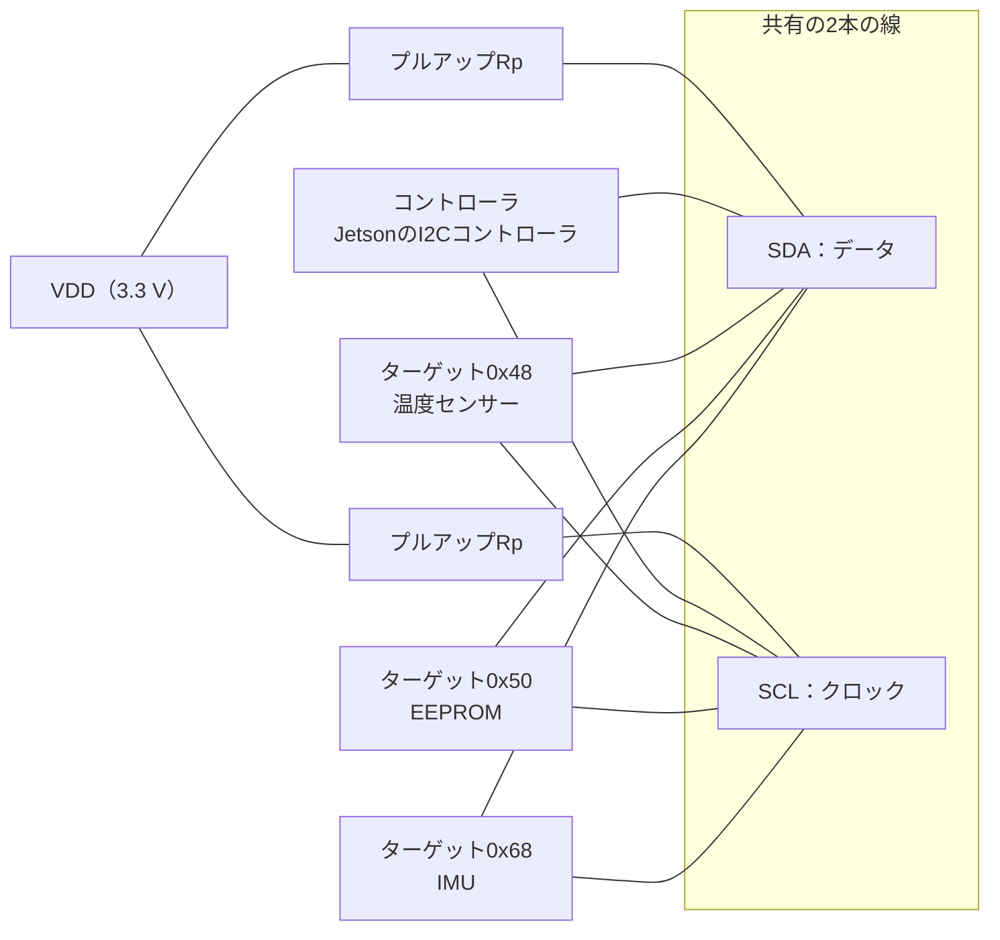
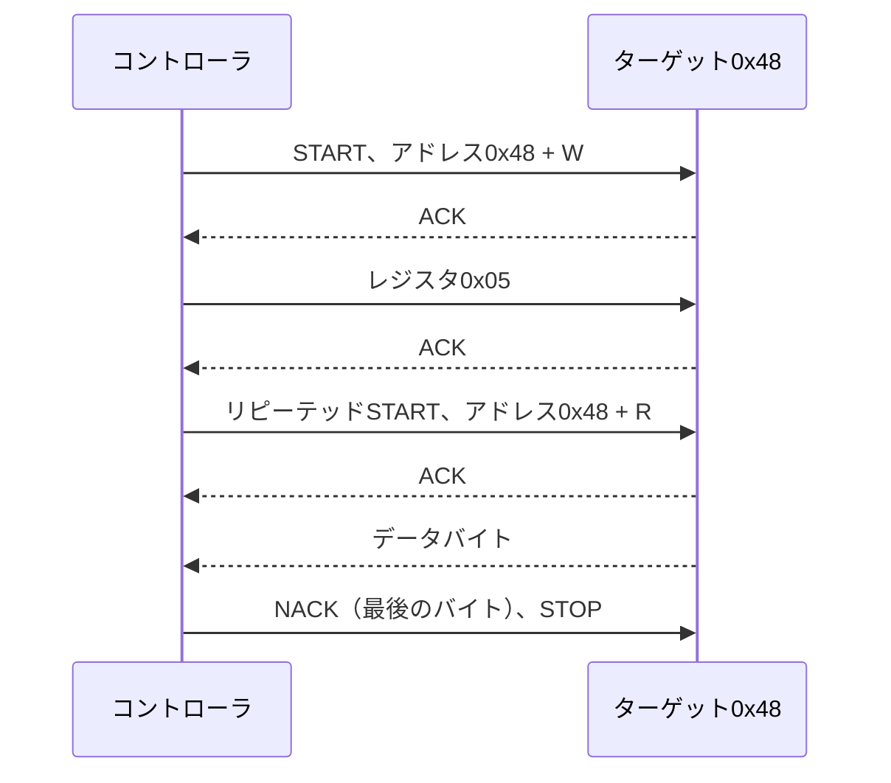

# I2C

[English](i2c.md) · [リポジトリ](../../README_jp.md) · [Jetson AGX Orinのペリフェラル](jetson_agx_orin_peripherals_jp.md)

I2Cバスの仕組み、各ピンの役割、Linuxでの使い方とデバッグ方法を、Jetson AGX Orinを例に説明します。I2Cのセンサーを使ったことがあり、信号レベルで仕組みを理解したい組み込みエンジニアを対象にしています。

この文書で使う用語：

- **コントローラ／ターゲット：** クロックを出して転送を始めるデバイスと、アドレスに応答するデバイスです。古い文書ではマスターとスレーブと呼びます。
- **オープンドレイン：** ラインをLowに引くことしかできない出力です。どのデバイスもLowに引いていないときは、プルアップ抵抗がラインをHighにします。
- **ACK／NACK：** 各バイトの9ビット目です。受信側がSDAをLowに引くとACK、HighのままにするとNACKです。

## 全体像



すべてのデバイスが同じ2本の線につながります。各ラインにはVDDへのプルアップ抵抗が1つあり、どのデバイスもラインをLowに引くことしかできません（オープンドレイン）。コントローラは転送のたびに最初にターゲットのアドレスを送り、そのアドレスを持つターゲットだけが応答します。全デバイス共通のグランドも必要ですが、図には描いていません。

主な特徴：

- **2本の線に多数のデバイス：** 1つのバスに多くのターゲットをつなげます。上限はアドレスとバスの容量で決まります。
- **同期式・半二重：** コントローラがSCLを駆動し、SDAのデータは一度に一方向だけに流れます。
- **アドレス指定：** 各ターゲットは7ビットのアドレスを持ちます（10ビットアドレスもありますが、まれです）。
- **低速から中速：** 一般的な速度は100 kbit/s（Standard-mode）と400 kbit/s（Fast-mode）です。Fast-mode Plusは1 Mbit/sです。
- **用途：** 設定と低レートのデータに使います。センサー、EEPROM、PMIC、RTC、カメラセンサーのレジスタ、ディスプレイやHDMIのDDC/EDIDなどです。

## ピンと役割

| ピン | 名前 | 駆動するもの | 役割 |
|---|---|---|---|
| SDA | Serial Data | コントローラとターゲット（オープンドレイン） | アドレス、データ、ACKのビットを運びます。STARTとSTOPを除き、SCLがLowの間だけ変化します。 |
| SCL | Serial Clock | コントローラ（ターゲットがLowに保持することもある） | クロックです。SCLがHighの間にSDAのデータを読み取ります。ターゲットはSCLをLowに保持してクロックを引き延ばせます。 |
| GND | グランド | — | 共通の基準です。これがないと、ロジックレベルに意味がありません。 |
| VDD（プルアップ電源） | プルアップ電圧 | 電源 | Highレベルを決めます。バス上のすべてのデバイスがこの電圧に耐える必要があります。 |

バスそのものではありませんが、多くのデバイスには次のような追加のピンがあります。

| ピン | 役割 |
|---|---|
| A0、A1、A2（アドレス選択） | GNDかVDDに接続してターゲットアドレスの下位ビットを決めます。同じチップを複数、1つのバスに載せられます。 |
| INT／ALERT | ターゲットからGPIOへの割り込み出力です。コントローラがポーリングしなくて済みます。 |
| WP（書き込み保護） | EEPROMで、Highの間は書き込みを禁止します。 |
| RESET | デバイスのリセット入力です。通常はGPIOで駆動します。 |

## 転送の仕組み

### START、STOP、ビット

```text
            START                                   STOP
SDA  ‾‾‾‾‾\______X=====X=====X ... X=====X_____/‾‾‾‾‾
SCL  ‾‾‾‾‾‾‾‾\__/‾‾\__/‾‾\__/ ... \__/‾‾\__/‾‾‾‾‾‾‾‾
              |    bit7  bit6        ACK    |
     SCLがHighの間にSDAが下がる      SCLがHighの間にSDAが上がる
```

- **START（S）：** SCLがHighの間に、SDAがHighからLowになります。
- **STOP（P）：** SCLがHighの間に、SDAがLowからHighになります。
- **データビット：** SDAはSCLがLowの間に設定し、SCLがHighの間は変えてはいけません。そのため、SCLがHighの間のSDAの変化は必ずSTARTかSTOPで、データではありません。
- **リピーテッドSTART（Sr）：** STOPを挟まないSTARTです。コントローラはバスを保持したまま方向を変えます。たとえば、レジスタアドレスの書き込みからデータの読み出しに切り替えるときに使います。
- バイトは最上位ビットから送ります。各バイトの後に、受信側がACKかNACKのビットを返します。

### アドレスバイト

```text
| A6 A5 A4 A3 A2 A1 A0 | R/W | ACK |
  7ビットのターゲットアドレス   0 = 書き込み、1 = 読み出し
```

STARTの次の最初のバイトは、7ビットのアドレスとR/Wビットです。データシートによっては、R/Wビットを含めた8ビットの「アドレス」が書かれています（たとえば7ビットの`0x48`が`0x90`/`0x91`）。Linuxのツールは常に7ビットの形を使います。

### レジスタの書き込みと読み出し

多くのセンサーはレジスタを持っています。レジスタの書き込みと読み出しは次のようになります（`S` = START、`Sr` = リピーテッドSTART、`P` = STOP、`A` = ACK、`N` = NACK。コントローラが送ったバイトの後のACKと、`[data]`のデータはターゲットが送ります）。

```text
ターゲット0x48のレジスタ0x05に0x12を書き込む：
S | 0x48+W | A | 0x05 (register) | A | 0x12 (data) | A | P

ターゲット0x48のレジスタ0x05から1バイト読み出す：
S | 0x48+W | A | 0x05 (register) | A | Sr | 0x48+R | A | [data] | N | P
                                                         └ ターゲットが送信
```



コントローラは、読み出しの最後にNACKを返してターゲットにこれ以上のバイトは不要だと伝え、STOPを送ります。

### クロックストレッチとアービトレーション

- **クロックストレッチ：** 処理の遅いターゲットは、バイトの後に準備ができるまでSCLをLowに保持できます。コントローラはSCLがLowのままなのを見て待ちます。これをうまく扱えないコントローラやブリッジもあるため、ターゲットがクロックストレッチを使う場合はコントローラの資料を確認してください。
- **アービトレーション：** 2つのコントローラが同時に送信を始めると、それぞれが送信しながらSDAを確認します。1を送ったのに0を読んだコントローラが負けて送信をやめます。組み込みシステムでは、複数コントローラのバスはあまり使いません。

## 電気的な設計

- **プルアップの値：** 3.3 Vで、100 kHzなら4.7 kΩ、400 kHzなら2.2 kΩが一般的な出発点です。値を小さくすると立ち上がりが速くなりますが、電流が増え、Lowレベルの電圧が上がります。
- **バス容量：** 配線とデバイスのピンが容量を加えます。I2Cの仕様では、Standard-modeとFast-modeで400 pFが上限です。配線が長かったりデバイスが多かったりすると立ち上がりが遅くなり、ビットを読み違えます。
- **問題になるのは立ち上がりで、立ち下がりはまれ：** ラインはトランジスタで素早く下がりますが、抵抗を通してゆっくり上がります。オシロスコープで立ち上がりが丸くなっていたら、容量が大きすぎるかプルアップが弱すぎます。
- **電圧レベル：** すべてのデバイスがプルアップの電圧に合っている必要があります。1.8 Vと3.3 Vのデバイスの間には、レベルシフタ（MOSFETを使った双方向のものなど）を入れます。
- **プルアップは1組だけ：** ブレークアウトボードには、たいていプルアップが載っています。複数のボードを並列につなぐと、合成抵抗が小さくなりすぎることがあります。

## 速度モード

| モード | 最大速度 | 備考 |
|---|---|---|
| Standard-mode（Sm） | 100 kbit/s | すべてのデバイスが対応 |
| Fast-mode（Fm） | 400 kbit/s | センサーで最も一般的 |
| Fast-mode Plus（Fm+） | 1 Mbit/s | 強いドライバが必要 |
| High-speed mode（Hs） | 3.4 Mbit/s | コントローラの特別な対応が必要。まれ |
| Ultra Fast-mode（UFm） | 5 Mbit/s | 書き込みのみ、プッシュプル。ほとんど使われない |

関連するバス：**SMBus**（システム管理用。タイムアウトと決まったコマンドを追加）と**I3C**（MIPIによる後継規格。プッシュプルで高速、インバンド割り込みを持ち、多くのI2Cターゲットと後方互換）。

## Jetson AGX Orinでは

- モジュールには8つのI2Cコントローラがあります。一部はモジュールとキャリアボード上で使われています（PMIC、EEPROM、カメラ、ディスプレイのDDC）。ほかは40ピンヘッダにつながります。
- 40ピンヘッダはRaspberry Pi互換の配置です。1つのバスが**3番ピン = SDA、5番ピン = SCL**、もう1つのバスが**27番ピン = SDA、28番ピン = SCL**です。1番と17番が3.3 V、6、9、14、20、25、30、34、39番がグランドです。使うボードの*Carrier Board Specification*で対応を確認してください。
- コントローラは`tegra-i2c`ドライバが扱います。各バスは`/dev/i2c-N`で、バス番号はデータシートのコントローラ名と一致しません。ヘッダのピンに対応するバスは、`i2cdetect -l`とキャリアボードの資料から確認します。
- クロックの速度は、デバイスツリーのI2Cノードの`clock-frequency`プロパティで設定します。

## LinuxからI2Cを使う

`i2c-dev`ドライバは、各バスをキャラクタデバイスとして公開します。カーネルドライバがデバイスツリーのノードを通じてターゲットに結び付くこともあります。その場合はドライバがそのアドレスを使っているので、ユーザー空間からは触らないでください。

```bash
i2cdetect -l
```

```bash
sudo i2cdetect -y -r 1
```

```bash
sudo i2cget -y 1 0x48 0x00
```

```bash
sudo i2cset -y 1 0x48 0x01 0x60
```

期待する結果：

- `i2cdetect -l`は`i2c-1  i2c  3160000.i2c  I2C adapter`のようにバスを一覧表示します。
- `i2cdetect -y -r 1`はアドレスの表を表示します。`--`は応答なし、16進数はターゲットが応答したこと、`UU`はカーネルドライバがそのアドレスを使用中であることを示します。
- `i2cget`は`0x1a`のように1バイトを表示し、`i2cset`は1バイトを書き込みます。バス`1`、アドレス`0x48`、レジスタの値はTMP102クラスの温度センサーを想定した例です。使うデバイスのデータシートの値を使ってください。

Jetsonの実機が手元になかったため、この文書の作成時にはコマンドを実行していません。

C言語では、バスを開き、ターゲットを選んで読み書きします。`I2C_RDWR`は複数のメッセージをリピーテッドSTARTでつなぎます。ほとんどのレジスタ読み出しにはこれが必要です。

```c
#include <fcntl.h>
#include <linux/i2c.h>
#include <linux/i2c-dev.h>
#include <stdint.h>
#include <stdio.h>
#include <sys/ioctl.h>
#include <unistd.h>

int main(void) {
    int fd = open("/dev/i2c-1", O_RDWR);
    if (fd < 0) { perror("open"); return 1; }

    uint8_t reg = 0x00, data[2];
    struct i2c_msg msgs[2] = {
        { .addr = 0x48, .flags = 0,        .len = 1, .buf = &reg },  /* write register address */
        { .addr = 0x48, .flags = I2C_M_RD, .len = 2, .buf = data },  /* repeated START, read 2 bytes */
    };
    struct i2c_rdwr_ioctl_data xfer = { .msgs = msgs, .nmsgs = 2 };

    if (ioctl(fd, I2C_RDWR, &xfer) < 0) { perror("I2C_RDWR"); close(fd); return 1; }
    printf("0x%02x 0x%02x\n", data[0], data[1]);
    close(fd);
    return 0;
}
```

`gcc -o i2c_read i2c_read.c`でビルドします。バス1のアドレス`0x48`にデバイスがない状態で実行すると、`I2C_RDWR: Remote I/O error`と表示されます（ターゲットがNACKを返したため）。

## よくあるトラブル

| 症状 | よくある原因 |
|---|---|
| `i2cdetect`でデバイスが見えない | プルアップがない、グランドが共通でない、バス番号の誤り、ピンがI2Cモードでない、デバイスに電源が入っていない |
| 想定外のアドレスに見える | データシートが8ビットの形で書いている、アドレスピンの接続が違う |
| `Remote I/O error`（EREMOTEIO） | ターゲットがNACKを返した：アドレスの誤り、デバイスが処理中（EEPROMの書き込みサイクル）、未対応のレジスタ |
| `Connection timed out` | SDAかSCLがLowのまま。バイトの途中で止まったターゲットがある |
| 机上では動くが、配線を長くすると失敗する | バス容量が大きすぎる。速度を下げるか、プルアップの値を小さくする |

読み出しの途中でリセットされたターゲットは、SDAをLowに保持したままになることがあります。復旧するには、ターゲットがSDAを離すまでSCLを最大9回トグルし、STOPを送ります。Linuxのバスリカバリーを含め、多くのコントローラドライバはこれを自動で行います。

デバッグツール：I2Cデコーダ付きのロジックアナライザで、アドレス、ACK、データを確認できます。立ち上がり時間や電圧レベルはロジックアナライザでは見えないので、オシロスコープを使います。

## 参考資料

作成環境からはこれらの資料を開けなかったため（ネットワークアクセスが制限されていた）、本文の情報は確立された仕様と一般的な知識に基づいています。詳細は最新の文書で確認してください。

- NXP Semiconductors, *UM10204 I2C-bus specification and user manual*: https://www.nxp.com/docs/en/user-guide/UM10204.pdf
- Linuxカーネルのドキュメント, *I2C and SMBus subsystem*と*Implementing I2C device drivers in userspace*: https://docs.kernel.org/i2c/
- MIPI Alliance, *I3C*: https://www.mipi.org/specifications/i3c-sensor-specification
- NVIDIA, *Jetson AGX Orin Developer Kit Carrier Board Specification*（Jetson Download Center: https://developer.nvidia.com/embedded/downloads）
