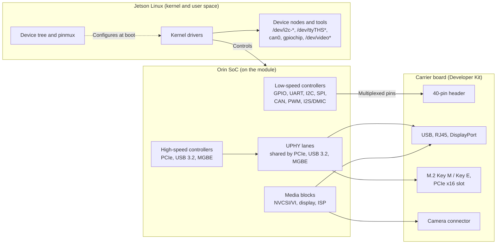

# Jetson AGX Orin Peripherals

[日本語](jetson_agx_orin_peripherals_jp.md) · [Repository](../../README.md)

A map of the peripherals on NVIDIA Jetson AGX Orin, for embedded engineers who know microcontroller peripherals and want to know where each interface lives, which Linux driver handles it, and how to reach it from user space. The examples assume the Jetson AGX Orin Developer Kit with JetPack 6 (Jetson Linux R36). Pin assignments and device numbers can change between carrier boards and releases, so treat the tables as a starting point and confirm them on your board.

Terms used below:

- **SoC (System on Chip):** the Orin chip itself: CPU, GPU, and peripheral controllers on one die.
- **Module:** the Jetson AGX Orin board that carries the SoC, LPDDR5 memory, eMMC, and power circuits. It has no user connectors; signals leave through a 699-pin board-to-board connector.
- **Carrier board:** the board the module plugs into. It turns module signals into connectors such as USB, RJ45, and the 40-pin header. The Developer Kit includes NVIDIA's reference carrier board; products usually use a custom one.
- **Pinmux:** the setting that decides which function (GPIO, UART, SPI, and so on) a multi-function pin uses.
- **UPHY:** the shared high-speed serial lanes used by PCIe, USB 3.2, and 10GbE (MGBE). Assigning a lane to one of them removes it from the others.
- **Device tree:** the hardware description the Linux kernel reads at boot to know which controllers exist and how they are configured.

## Overall structure



Read the diagram from left to right: controllers in the SoC → pins and lanes on the module connector → physical connectors on the carrier board. The dotted arrow is configuration rather than data flow. The kernel reads the device tree at boot, enables the matching drivers, and those drivers expose device nodes that applications open.

Compared with a microcontroller, there are three main differences:

- **You do not write registers directly.** Linux drivers own the controllers; applications use device nodes, sockets, or libraries. Changing the hardware setup means changing the device tree or pinmux, which usually takes effect after a reboot.
- **Pin functions are decided at boot.** On the Developer Kit, the `jetson-io` tool edits the 40-pin header pinmux with a device tree overlay. On a custom carrier board, you generate pinmux files from NVIDIA's Pinmux spreadsheet and flash them.
- **High-speed lanes are a shared budget.** PCIe, USB 3.2, and 10GbE draw on the same UPHY lanes, so a carrier board design selects one lane configuration.

## Interface summary

Module capabilities from the Jetson AGX Orin Series Technical Brief v1.2 and Data Sheet (DS-10662-001). Values can differ between module variants (AGX Orin 64GB, 32GB, Industrial) and document revisions; check the latest data sheet for the module you use.

| Group | Interface | Module capability (AGX Orin) |
|---|---|---|
| Low-speed I/O | UART | 4 |
| | SPI | 3 |
| | I2C | 8 |
| | I2S | 4, plus DMIC and DSPK |
| | CAN | 2 (CAN FD capable controllers) |
| | GPIO, PWM | Multiple, shared with other functions through pinmux |
| High-speed I/O | PCIe | 22 lanes Gen4 across UPHY and dedicated lanes; Root Port and Endpoint |
| | USB | 3x USB 3.2, 4x USB 2.0 |
| | Ethernet | 1x GbE and 10GbE (MGBE); v1.2 of the brief lists a single XFI interface |
| Media | MIPI CSI-2 camera | 16 lanes D-PHY 2.1 (up to 40 Gbps) or 16 trios C-PHY 2.0 (up to 164 Gbps) |
| | Display | DisplayPort / eDP / HDMI (no MIPI DSI) |
| Storage and boot | eMMC, SD, QSPI | eMMC 5.1 on the module, SD card through the carrier board, QSPI-NOR flash for boot firmware |

Earlier brief revisions (v1.0 and v1.1) listed four 10GbE (XFI) interfaces and UFS. Revision v1.2 reduced MGBE to one interface and removed UFS support. Old forum posts or articles can still show the earlier values.

Detailed notes on individual interfaces: [I2C](i2c.md), [SPI](spi.md), [UART](uart.md), [USB](usb.md), and [MIPI CSI-2](mipi_csi.md). Each explains the mechanism, the pins and their roles, and how to use the interface on Linux.

## Developer Kit connectors

The reference carrier board exposes most interfaces as follows. This list is a summary for orientation; the exact reference designators, pin tables, and port speeds are in the *Jetson AGX Orin Developer Kit User Guide* (Hardware Layout) and the *Carrier Board Specification*.

| Connector | What it carries |
|---|---|
| 40-pin expansion header (J30) | GPIO, UART, I2C, SPI, I2S, CAN, PWM, DMIC at 3.3 V logic |
| USB Type-A and Type-C ports | USB 3.2 host ports; one Type-C port is also used for flashing in recovery mode |
| RJ45 | Ethernet up to 10 Gbps |
| DisplayPort | Display output |
| M.2 Key M (J1) | NVMe SSD over PCIe x4 (2280 size, no SATA) |
| M.2 Key E | Wi-Fi/Bluetooth module (PCIe, USB, UART) |
| PCIe x16 slot (J6) | Electrically PCIe Gen4 x8 |
| Camera connector | 16-lane MIPI CSI-2 high-density connector for camera adapter boards |
| microSD slot | Removable storage |
| Micro-USB debug port | Serial console for boot logs, through a USB-UART bridge on the carrier board |
| Automation header (J42) | Recovery, reset, and power signals duplicated from the buttons |
| HD audio header (J511), fan header, RTC battery (J13) | Front-panel audio, PWM fan, and real-time clock backup |

## Components

Each subsection lists the SoC block, the Linux driver, how user space reaches it, and a small example. The commands are expected to work on a Developer Kit with JetPack 6; they were **not run** while writing this note because no Jetson device was available. Bus numbers and device names are examples, so list them first on your system.

### GPIO

- **Responsibility:** read and drive individual pins, and receive edge interrupts.
- **Implementation form:** SoC GPIO controllers (main and always-on domains), exposed by the kernel GPIO subsystem as `gpiochip` devices.
- **Execution environment:** the kernel driver controls the pins; your program runs in user space.
- **Input / output:** pin levels and edge events.
- **Loading / invocation:** the device tree describes the controllers; the pinmux must put the pin in GPIO mode; user space uses libgpiod or the Jetson.GPIO Python library.

```bash
gpiodetect
```

```bash
gpioinfo | less
```

Expected result: a list of `gpiochip` devices, then each line with its name and whether it is in use. Use `gpioset` and `gpioget` with a chip and line from that list. The legacy `/sys/class/gpio` interface is deprecated; NVIDIA's guide recommends `gpiod` or Jetson.GPIO for testing.

- The header is 3.3 V logic and cannot drive loads such as relays or motors directly. Use a buffer or driver circuit.

### UART

- **Responsibility:** asynchronous serial for GPS, modules, microcontrollers, and the debug console.
- **Implementation form:** SoC UART controllers. The `serial-tegra` driver creates `/dev/ttyTHS*` (high-speed, DMA-capable). The combined debug console uses the Tegra Combined UART (`/dev/ttyTCU0`).
- **Execution environment:** kernel driver; user programs open the TTY.
- **Input / output:** byte streams at the configured baud rate.
- **Loading / invocation:** enabled by the device tree; applications use `termios`, `pyserial`, `minicom`, or `picocom`.

```bash
ls -l /dev/ttyTHS* /dev/ttyTCU*
```

```bash
sudo picocom -b 115200 /dev/ttyTHS1
```

Expected result: the first command lists the available UART device nodes. Which `ttyTHS` index maps to the 40-pin header differs between boards, so confirm it with the carrier board documentation. A loopback test (connect TX to RX) is a quick check: typed characters echo back.

- Do not open a UART that the system uses as a console. Check `cat /proc/cmdline` for `console=` entries.
- On the Developer Kit, the micro-USB debug port connects the console to a host PC. Use it to watch boot logs and recover from a broken network setup.

### I2C

- **Responsibility:** control bus for sensors, EEPROMs, PMICs, and camera sensors.
- **Implementation form:** SoC I2C controllers handled by the `tegra-i2c` driver; each bus appears as `/dev/i2c-N`.
- **Execution environment:** kernel driver; user space uses `i2c-tools` or the `i2c-dev` ioctl interface.
- **Input / output:** addressed register reads and writes.
- **Loading / invocation:** buses are enabled in the device tree. Kernel drivers for known devices (for example camera sensors) bind through device tree nodes; unknown devices can be accessed from user space.

```bash
i2cdetect -l
```

```bash
sudo i2cdetect -y -r 1
```

Expected result: the first command lists buses with their controller addresses; the second prints an address grid with `--` for empty addresses, hex values for responding devices, and `UU` for addresses already claimed by a kernel driver. Bus `1` is only an example: pick the bus wired to the header from the `i2cdetect -l` output and the carrier board documentation.

- Never write to addresses marked `UU` or to unknown devices on system buses; a PMIC or EEPROM write can make the board unbootable.

### SPI

- **Responsibility:** fast synchronous transfers for ADCs, displays, flash, and FPGA links.
- **Implementation form:** SoC SPI controllers handled by the Tegra SPI driver. The generic `spidev` driver exposes `/dev/spidevB.C` (bus B, chip select C) to user space.
- **Execution environment:** kernel driver; user space issues transfers through `ioctl`.
- **Input / output:** full-duplex byte transfers with configurable mode, word size, and clock.
- **Loading / invocation:** enable the SPI function on the header with `jetson-io`, make sure the `spidev` module is loaded, then use `spidev_test` or a library such as `py-spidev`.

```bash
sudo modprobe spidev
```

```bash
ls /dev/spidev*
```

Expected result: at least one `spidev` node after the header pins are configured for SPI. To test, short MOSI to MISO and run `spidev_test` (from the kernel `tools/spi` sources): the received bytes match the transmitted bytes.

### CAN

- **Responsibility:** robust multi-node bus for vehicles, robots, and industrial devices.
- **Implementation form:** two Bosch M_TTCAN-based controllers (`mttcan@c310000` and `mttcan@c320000`) handled by the `mttcan` driver. They appear as SocketCAN network interfaces `can0` and `can1`.
- **Execution environment:** kernel driver and network stack; applications use SocketCAN sockets or `can-utils`.
- **Input / output:** CAN and CAN FD frames.
- **Loading / invocation:** set the pinmux (with `jetson-io` on the Developer Kit), load the modules, configure the bit rate with `ip link`, then open the interface.

On the Developer Kit 40-pin header (J30), NVIDIA's CAN guide lists CAN0_DIN on pin 29, CAN0_DOUT on pin 31, CAN1_DIN on pin 37, and CAN1_DOUT on pin 33. These are logic-level TX/RX signals, not CANH/CANL, so each bus needs an external CAN transceiver (for example an SN65HVD230-class 3.3 V part) and 120 Ω termination at both ends of the bus.

```bash
sudo modprobe can && sudo modprobe can_raw && sudo modprobe mttcan
```

```bash
sudo ip link set can0 type can bitrate 500000 && sudo ip link set can0 up
```

```bash
candump can0
```

Expected result: `ip -details link show can0` reports the bit rate and state `ERROR-ACTIVE` once another node is acknowledging frames, and `candump` prints received frames. `cansend can0 123#DEADBEEF` from `can-utils` sends a frame. A bus with no other node produces error frames and can go to `BUS-OFF`.

- The internal loopback mode (`ip link set can0 type can bitrate 500000 loopback on`) tests the driver only; it does not exercise the header pins or the transceiver.

### PWM

- **Responsibility:** generate duty-cycle signals for fans, LEDs, and servos.
- **Implementation form:** SoC PWM controllers exposed through the kernel PWM subsystem in `/sys/class/pwm/pwmchipN`. The Developer Kit fan uses the `pwm-fan` driver.
- **Execution environment:** kernel driver; user space writes sysfs attributes or uses Jetson.GPIO's PWM API.
- **Input / output:** period and duty cycle in nanoseconds.
- **Loading / invocation:** enable the PWM function on a header pin with `jetson-io`, then export a channel.

```bash
ls /sys/class/pwm/
```

Expected result: one or more `pwmchipN` directories. Write the channel number to `export`, then set `period`, `duty_cycle`, and `enable` in the new `pwmN` directory. NVIDIA's bring-up guide notes that some header functions are routed for PWM by default and others need board rework, so check which pin carries a usable PWM output on your board.

### Audio (I2S, DMIC, DSPK)

- **Responsibility:** digital audio input and output to codecs, microphones, and amplifiers.
- **Implementation form:** the Audio Processing Engine (APE) with its Audio Hub (AHUB) routes audio between DMA channels (ADMAIF), I2S, DMIC, DSPK, and processing blocks. Linux exposes it as an ALSA sound card (ASoC).
- **Execution environment:** APE hardware and kernel ASoC drivers; applications use ALSA (`aplay`, `arecord`, `amixer`).
- **Input / output:** PCM audio streams.
- **Loading / invocation:** the device tree describes the sound card and codec. Before playback, connect the ADMAIF channel to the I2S interface with ALSA mixer controls.

```bash
aplay -l
```

```bash
amixer -c APE controls | head
```

Expected result: a list of sound cards including the APE card, then its mixer controls such as routing selectors for I2S and ADMAIF. HDMI/DP audio is a separate card.

### USB

- **Responsibility:** connect peripherals in host mode or make Jetson act as a USB device.
- **Implementation form:** an xHCI host controller (`xhci-tegra`) and a device-mode controller (`tegra-xudc`). USB 3.2 ports use UPHY lanes; USB 2.0 lanes are separate.
- **Execution environment:** kernel USB stack; device mode uses the Linux USB gadget framework (for example USB Ethernet or serial).
- **Input / output:** USB transfers to class drivers such as storage, UVC cameras, and serial adapters.
- **Loading / invocation:** host ports work automatically. Device mode is used for flashing (recovery mode) and for gadget functions configured by `nv-l4t-usb-device-mode` scripts.

```bash
lsusb -t
```

Expected result: a tree of USB buses with their speed (`480M`, `5000M`, `10000M`) and attached devices.

### PCIe

- **Responsibility:** high-bandwidth links to NVMe, network cards, FPGAs, and accelerators.
- **Implementation form:** several Synopsys DesignWare-based PCIe controllers driven by `pcie-tegra194`. Some controllers can run in Endpoint mode, so Jetson can appear as a PCIe device to another host.
- **Execution environment:** kernel PCI subsystem; drivers for each attached card.
- **Input / output:** memory-mapped transactions and DMA.
- **Loading / invocation:** the UPHY lane configuration (set in the board configuration as ODMDATA) and the device tree decide which controllers and widths are available. The kernel enumerates devices at boot.

```bash
lspci -tv
```

```bash
sudo lspci -vv | grep -E "LnkCap|LnkSta"
```

Expected result: a tree of root ports and devices, then link capability and status. `LnkSta: Speed 16GT/s, Width x4` means Gen4 x4 is running at full rate; a lower speed or width points to signal integrity, card, or configuration issues.

### Ethernet

- **Responsibility:** wired networking.
- **Implementation form:** an EQOS controller for 1GbE and an MGBE controller for 10GbE, both handled by the `nvethernet` driver. MGBE uses UPHY lanes and an external PHY.
- **Execution environment:** kernel network stack.
- **Input / output:** Ethernet frames, including PTP time stamps.
- **Loading / invocation:** enabled in the device tree; configured with standard tools such as NetworkManager, `ip`, and `ethtool`.

```bash
ip -br link
```

```bash
sudo ethtool eth0
```

Expected result: the interface list, then the negotiated speed (for example `Speed: 10000Mb/s`). Interface names vary; use the name from the first command.

### MIPI CSI-2 camera

- **Responsibility:** receive image sensor data.
- **Implementation form:** NVCSI receives CSI-2 packets, VI writes frames to memory, and the ISP processes Bayer data. Sensor drivers are kernel modules that configure the sensor through I2C.
- **Execution environment:** camera hardware, the camera real-time processor (RTCPU) firmware, kernel V4L2 drivers, and the user-space libargus library for ISP processing.
- **Input / output:** CSI-2 lanes in; frames as `/dev/videoN` (raw) or through libargus and GStreamer `nvarguscamerasrc` (ISP-processed).
- **Loading / invocation:** a device tree (or `jetson-io` overlay for supported camera modules) describes the sensor, lane count, and modes, and links the sensor to NVCSI and VI.

```bash
v4l2-ctl --list-devices
```

```bash
v4l2-ctl -d /dev/video0 --list-formats-ext
```

Expected result: one video device per camera, then its pixel formats and resolutions. For custom sensors, the main device tree mode properties to check are `num_lanes`, `pix_clk_hz`, `line_length`, `discontinuous_clk`, and `cil_settletime`.

- On the Developer Kit, cameras connect through the high-density camera connector and an adapter board. Many camera vendors also offer GMSL serializer/deserializer kits for longer cables.

### Display

- **Responsibility:** video output to monitors and panels.
- **Implementation form:** the Orin display controller with multi-mode DisplayPort, eDP, and HDMI outputs. Orin does not provide MIPI DSI; use a DP-to-DSI or eDP bridge chip when a DSI panel is required.
- **Execution environment:** NVIDIA display driver (DRM/KMS) and the desktop or application.
- **Input / output:** frame buffers in; DP/HDMI signals out.
- **Loading / invocation:** the display driver probes connected monitors through DisplayPort or HDMI EDID.

```bash
xrandr --query
```

Expected result: the connected output and the available modes (in a graphical session).

### Storage and boot flash

- **Responsibility:** hold the boot firmware, root file system, and user data.
- **Implementation form:** QSPI-NOR flash on the module stores the boot firmware (UEFI in JetPack 6). The eMMC holds the root file system by default. microSD (SDMMC) and NVMe (M.2 Key M) are optional storage.
- **Execution environment:** boot ROM and bootloaders, then the Linux block layer.
- **Input / output:** block devices such as `/dev/mmcblk0` and `/dev/nvme0n1`.
- **Loading / invocation:** the flashing tools write QSPI and the boot device from a Linux host PC while Jetson is in recovery mode.

```bash
lsblk
```

Expected result: the eMMC, microSD, and NVMe devices with their partitions and mount points.

## Configuring pins with jetson-io

`jetson-io` is a Python tool on the Developer Kit that changes the 40-pin header pinmux. It writes a device tree overlay, updates the boot configuration, and the change applies after a reboot.

```bash
sudo /opt/nvidia/jetson-io/jetson-io.py
```

```bash
sudo /opt/nvidia/jetson-io/config-by-pin.py -p 29
```

Expected result: the first command opens a text menu where you enable functions such as SPI, PWM, or CAN on the header. The second prints the current function of pin 29 without the menu. `config-by-function.py` lists and sets functions by name instead of by pin.

For a custom carrier board, `jetson-io` is not enough. Fill in NVIDIA's Pinmux spreadsheet for your design, generate the pinmux and GPIO device tree files, add them to the board configuration, and flash. The *Jetson AGX Orin Platform Adaptation and Bring-Up* guide describes this process, including UPHY lane selection.

## References

These are the primary sources this note is based on. While writing, the NVIDIA pages could not be opened directly from the authoring environment; facts were taken from search summaries of these pages. Check details against the current versions.

- NVIDIA, *Jetson AGX Orin Series Technical Brief* v1.2: https://www.nvidia.com/content/dam/en-zz/Solutions/gtcf21/jetson-orin/nvidia-jetson-agx-orin-technical-brief.pdf
- NVIDIA, *Jetson AGX Orin Series Data Sheet* DS-10662-001 (Jetson Download Center: https://developer.nvidia.com/embedded/downloads)
- NVIDIA, *Jetson AGX Orin Developer Kit User Guide — Hardware Layout*: https://docs.nvidia.com/jetson/agx-orin-devkit/user-guide/latest/hardware_layout.html
- NVIDIA, *Jetson AGX Orin Developer Kit Carrier Board Specification* (Jetson Download Center)
- NVIDIA, *Jetson Linux Developer Guide* R36.4.4:
  - Configuring the Jetson Expansion Headers: https://docs.nvidia.com/jetson/archives/r36.4.4/DeveloperGuide/HR/ConfiguringTheJetsonExpansionHeaders.html
  - Controller Area Network (CAN): https://docs.nvidia.com/jetson/archives/r36.4.4/DeveloperGuide/HR/ControllerAreaNetworkCan.html
  - Jetson AGX Orin Platform Adaptation and Bring-Up: https://docs.nvidia.com/jetson/archives/r36.4.4/DeveloperGuide/HR/JetsonModuleAdaptationAndBringUp/JetsonAgxOrinSeries.html
  - Jetson Orin Series (SoC overview): https://docs.nvidia.com/jetson/archives/r36.4.4/DeveloperGuide/SO/JetsonOrinSeries.html
- Linux kernel documentation, *GPIO*, *SPI userspace API (spidev)*, *SocketCAN*: https://docs.kernel.org/
