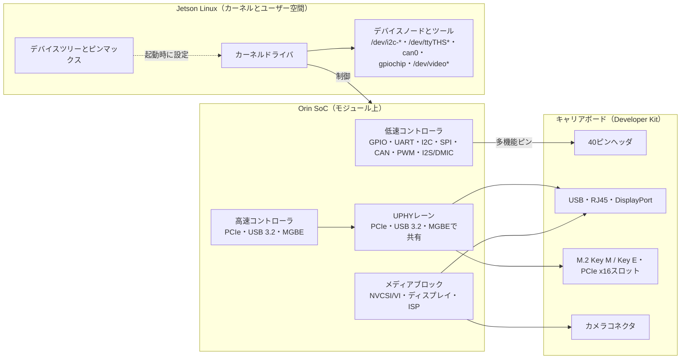

# Jetson AGX Orinのペリフェラル

[English](jetson_agx_orin_peripherals.md) · [リポジトリ](../../README_jp.md)

NVIDIA Jetson AGX Orinのペリフェラルを整理します。マイコンのペリフェラルを知っている組み込みエンジニアを対象に、各インターフェースがどこにあり、どのLinuxドライバが扱い、ユーザー空間からどう使うかをまとめます。例はJetson AGX Orin Developer KitとJetPack 6（Jetson Linux R36）を前提にしています。ピン割り当てやデバイス番号はキャリアボードやリリースによって変わることがあるため、表は出発点として使い、実際のボードで確認してください。

この文書で使う用語：

- **SoC（System on Chip）：** Orinチップ本体です。CPU、GPU、ペリフェラルのコントローラを1つのダイに載せています。
- **モジュール：** SoC、LPDDR5メモリ、eMMC、電源回路を載せたJetson AGX Orinの基板です。ユーザー向けのコネクタは持たず、信号は699ピンの基板対基板コネクタから出ます。
- **キャリアボード：** モジュールを差し込む基板です。モジュールの信号をUSB、RJ45、40ピンヘッダなどのコネクタに変換します。Developer KitにはNVIDIAのリファレンスキャリアボードが含まれます。製品では独自のキャリアボードを使うのが一般的です。
- **ピンマックス（Pinmux）：** 多機能ピンをどの機能（GPIO、UART、SPIなど）で使うかを決める設定です。
- **UPHY：** PCIe、USB 3.2、10GbE（MGBE）が共有する高速シリアルレーンです。レーンを1つの用途に割り当てると、ほかの用途には使えません。
- **デバイスツリー：** Linuxカーネルが起動時に読み込むハードウェアの記述です。どのコントローラがあり、どう設定するかをカーネルに伝えます。

## 全体像



図は左から右へ読みます。SoC内のコントローラ → モジュールのコネクタ上のピンとレーン → キャリアボードの物理コネクタ、という流れです。点線の矢印はデータの流れではなく設定を表します。カーネルが起動時にデバイスツリーを読み込んで対応するドライバを有効にし、ドライバが公開するデバイスノードをアプリケーションが開きます。

マイコンとの主な違いは3つです。

- **レジスタを直接書きません。** コントローラはLinuxのドライバが管理し、アプリケーションはデバイスノード、ソケット、ライブラリを使います。ハードウェアの設定を変えるにはデバイスツリーやピンマックスを変更します。通常は再起動後に反映されます。
- **ピンの機能は起動時に決まります。** Developer Kitでは、`jetson-io`ツールがデバイスツリーオーバーレイで40ピンヘッダのピンマックスを変更します。独自のキャリアボードでは、NVIDIAのPinmuxスプレッドシートからピンマックスのファイルを生成して書き込みます。
- **高速レーンは共有の資源です。** PCIe、USB 3.2、10GbEは同じUPHYレーンを使うため、キャリアボードの設計時にレーン構成を1つ選びます。

## インターフェースの一覧

モジュールの機能はJetson AGX Orin Series Technical Brief v1.2とData Sheet（DS-10662-001）に基づきます。値はモジュールの種類（AGX Orin 64GB、32GB、Industrial）や文書の版によって異なることがあります。使用するモジュールの最新データシートで確認してください。

| 分類 | インターフェース | モジュールの機能（AGX Orin） |
|---|---|---|
| 低速I/O | UART | 4 |
| | SPI | 3 |
| | I2C | 8 |
| | I2S | 4（ほかにDMICとDSPK） |
| | CAN | 2（CAN FD対応のコントローラ） |
| | GPIO・PWM | 複数。ピンマックスでほかの機能と共有 |
| 高速I/O | PCIe | UPHYと専用レーンを合わせてGen4で22レーン。Root PortとEndpointに対応 |
| | USB | USB 3.2が3ポート、USB 2.0が4ポート |
| | Ethernet | GbEが1つと10GbE（MGBE）。Technical Briefのv1.2ではXFIインターフェースを1つと記載 |
| メディア | MIPI CSI-2カメラ | D-PHY 2.1で16レーン（最大40 Gbps）またはC-PHY 2.0で16トリオ（最大164 Gbps） |
| | ディスプレイ | DisplayPort・eDP・HDMI（MIPI DSIはなし） |
| ストレージと起動 | eMMC・SD・QSPI | モジュール上のeMMC 5.1、キャリアボード経由のSDカード、起動ファームウェア用のQSPI-NORフラッシュ |

Technical Briefの以前の版（v1.0とv1.1）では、10GbE（XFI）インターフェースを4つとし、UFSも記載していました。v1.2でMGBEは1つに減り、UFSのサポートは削除されました。古いフォーラムの投稿や記事には、以前の値が残っていることがあります。

個々のインターフェースの詳しいノート：[I2C](i2c_jp.md)、[SPI](spi_jp.md)、[UART](uart_jp.md)、[USB](usb_jp.md)、[MIPI CSI-2](mipi_csi_jp.md)。それぞれ仕組み、ピンと役割、Linuxでの使い方を説明しています。

## Developer Kitのコネクタ

リファレンスキャリアボードでは、主なインターフェースが次のように出ています。この一覧は概要をつかむためのものです。正確な部品番号、ピン表、ポートの速度は*Jetson AGX Orin Developer Kit User Guide*（Hardware Layout）と*Carrier Board Specification*を参照してください。

| コネクタ | 内容 |
|---|---|
| 40ピン拡張ヘッダ（J30） | GPIO、UART、I2C、SPI、I2S、CAN、PWM、DMIC（3.3 Vロジック） |
| USB Type-AとType-Cのポート | USB 3.2ホストポート。Type-Cの1つはリカバリーモードでの書き込みにも使う |
| RJ45 | 最大10 GbpsのEthernet |
| DisplayPort | ディスプレイ出力 |
| M.2 Key M（J1） | PCIe x4のNVMe SSD（2280サイズ、SATA非対応） |
| M.2 Key E | Wi-Fi/Bluetoothモジュール（PCIe・USB・UART） |
| PCIe x16スロット（J6） | 電気的にはPCIe Gen4 x8 |
| カメラコネクタ | カメラ用アダプタボードをつなぐ16レーンMIPI CSI-2の高密度コネクタ |
| microSDスロット | 取り外し可能なストレージ |
| Micro-USBデバッグポート | 起動ログを見るシリアルコンソール（キャリアボード上のUSB-UARTブリッジ経由） |
| オートメーションヘッダ（J42） | ボタンと同じリカバリー、リセット、電源の信号 |
| HDオーディオヘッダ（J511）、ファンヘッダ、RTCバッテリー（J13） | フロントパネルのオーディオ、PWMファン、リアルタイムクロックのバックアップ |

## 各コンポーネント

各項目では、SoCのブロック、Linuxドライバ、ユーザー空間からの使い方、簡単な例をまとめます。コマンドはJetPack 6のDeveloper Kitで動く想定ですが、Jetsonの実機が手元になかったため、この文書の作成時には**実行していません**。バス番号やデバイス名は例なので、まず自分の環境で一覧を確認してください。

### GPIO

- **役割：** 個々のピンを読み書きし、エッジ割り込みを受け取ります。
- **実体：** SoCのGPIOコントローラ（メインと常時給電のドメイン）です。カーネルのGPIOサブシステムが`gpiochip`デバイスとして公開します。
- **実行環境：** ピンはカーネルドライバが制御し、プログラムはユーザー空間で動きます。
- **入力／出力：** ピンのレベルとエッジイベント。
- **読み込み／呼び出し：** デバイスツリーがコントローラを記述し、ピンマックスでピンをGPIOモードにします。ユーザー空間からはlibgpiodかPythonのJetson.GPIOライブラリを使います。

```bash
gpiodetect
```

```bash
gpioinfo | less
```

期待する結果：`gpiochip`デバイスの一覧が表示され、次に各ラインの名前と使用中かどうかが表示されます。この一覧のチップとラインを指定して`gpioset`と`gpioget`を使います。従来の`/sys/class/gpio`は非推奨です。NVIDIAのガイドも、テストには`gpiod`かJetson.GPIOを勧めています。

- ヘッダは3.3 Vロジックで、リレーやモーターなどの負荷を直接駆動できません。バッファやドライバ回路を使ってください。

### UART

- **役割：** GPS、各種モジュール、マイコン、デバッグコンソール向けの非同期シリアル通信です。
- **実体：** SoCのUARTコントローラです。`serial-tegra`ドライバが`/dev/ttyTHS*`（高速、DMA対応）を作ります。統合デバッグコンソールはTegra Combined UART（`/dev/ttyTCU0`）を使います。
- **実行環境：** カーネルドライバ。ユーザープログラムがTTYを開きます。
- **入力／出力：** 設定したボーレートでのバイト列。
- **読み込み／呼び出し：** デバイスツリーで有効にします。アプリケーションは`termios`、`pyserial`、`minicom`、`picocom`を使います。

```bash
ls -l /dev/ttyTHS* /dev/ttyTCU*
```

```bash
sudo picocom -b 115200 /dev/ttyTHS1
```

期待する結果：1つ目のコマンドで使えるUARTのデバイスノードが表示されます。40ピンヘッダにつながる`ttyTHS`の番号はボードによって異なるため、キャリアボードの資料で確認してください。手早く確認するにはループバックテスト（TXとRXを接続）を使います。入力した文字がそのまま返ってきます。

- システムがコンソールとして使っているUARTは開かないでください。`cat /proc/cmdline`の`console=`で確認できます。
- Developer Kitでは、Micro-USBデバッグポートでコンソールをホストPCにつなぎます。起動ログの確認や、ネットワーク設定を壊したときの復旧に使います。

### I2C

- **役割：** センサー、EEPROM、PMIC、カメラセンサー向けの制御用バスです。
- **実体：** `tegra-i2c`ドライバが扱うSoCのI2Cコントローラです。各バスは`/dev/i2c-N`として現れます。
- **実行環境：** カーネルドライバ。ユーザー空間からは`i2c-tools`か`i2c-dev`のioctlインターフェースを使います。
- **入力／出力：** アドレスを指定したレジスタの読み書き。
- **読み込み／呼び出し：** デバイスツリーでバスを有効にします。既知のデバイス（カメラセンサーなど）のカーネルドライバはデバイスツリーのノードを通じて結び付きます。それ以外のデバイスにはユーザー空間からアクセスできます。

```bash
i2cdetect -l
```

```bash
sudo i2cdetect -y -r 1
```

期待する結果：1つ目のコマンドでバスとコントローラのアドレスの一覧が表示されます。2つ目でアドレスの表が表示されます。空きアドレスは`--`、応答したデバイスは16進数、カーネルドライバが使用中のアドレスは`UU`です。バス`1`は例にすぎません。`i2cdetect -l`の出力とキャリアボードの資料から、ヘッダにつながるバスを選んでください。

- `UU`のアドレスや、システムバス上の不明なデバイスには書き込まないでください。PMICやEEPROMに書き込むと、ボードが起動しなくなることがあります。

### SPI

- **役割：** ADC、ディスプレイ、フラッシュ、FPGAとの接続に使う高速な同期通信です。
- **実体：** TegraのSPIドライバが扱うSoCのSPIコントローラです。汎用の`spidev`ドライバが`/dev/spidevB.C`（バスB、チップセレクトC）をユーザー空間に公開します。
- **実行環境：** カーネルドライバ。ユーザー空間から`ioctl`で転送します。
- **入力／出力：** モード、ワードサイズ、クロックを設定できる全二重のバイト転送。
- **読み込み／呼び出し：** `jetson-io`でヘッダのSPI機能を有効にし、`spidev`モジュールが読み込まれていることを確認してから、`spidev_test`や`py-spidev`などのライブラリを使います。

```bash
sudo modprobe spidev
```

```bash
ls /dev/spidev*
```

期待する結果：ヘッダのピンをSPIに設定した後、`spidev`ノードが1つ以上表示されます。テストするにはMOSIとMISOを短絡し、`spidev_test`（カーネルの`tools/spi`のソース）を実行します。受信したバイトが送信したバイトと一致します。

### CAN

- **役割：** 車両、ロボット、産業機器向けの、ノイズに強いマルチノードのバスです。
- **実体：** Bosch M_TTCANをもとにした2つのコントローラ（`mttcan@c310000`と`mttcan@c320000`）で、`mttcan`ドライバが扱います。SocketCANのネットワークインターフェース`can0`と`can1`として現れます。
- **実行環境：** カーネルドライバとネットワークスタック。アプリケーションはSocketCANのソケットか`can-utils`を使います。
- **入力／出力：** CANとCAN FDのフレーム。
- **読み込み／呼び出し：** ピンマックスを設定し（Developer Kitでは`jetson-io`を使用）、モジュールを読み込み、`ip link`でビットレートを設定してからインターフェースを開きます。

NVIDIAのCANガイドでは、Developer Kitの40ピンヘッダ（J30）のCAN0_DINが29番ピン、CAN0_DOUTが31番ピン、CAN1_DINが37番ピン、CAN1_DOUTが33番ピンです。これらはロジックレベルのTX/RX信号で、CANH/CANLではありません。バスごとに外付けのCANトランシーバ（たとえば3.3 VのSN65HVD230クラス）と、バスの両端に120 Ωの終端抵抗が必要です。

```bash
sudo modprobe can && sudo modprobe can_raw && sudo modprobe mttcan
```

```bash
sudo ip link set can0 type can bitrate 500000 && sudo ip link set can0 up
```

```bash
candump can0
```

期待する結果：ほかのノードがフレームにACKを返すようになると、`ip -details link show can0`がビットレートと`ERROR-ACTIVE`状態を表示し、`candump`が受信したフレームを表示します。`can-utils`の`cansend can0 123#DEADBEEF`でフレームを送信できます。ほかのノードがいないバスではエラーフレームが発生し、`BUS-OFF`になることがあります。

- 内部ループバックモード（`ip link set can0 type can bitrate 500000 loopback on`）で確認できるのはドライバだけです。ヘッダのピンやトランシーバは通りません。

### PWM

- **役割：** ファン、LED、サーボ向けのデューティ比の信号を生成します。
- **実体：** SoCのPWMコントローラです。カーネルのPWMサブシステムが`/sys/class/pwm/pwmchipN`として公開します。Developer Kitのファンは`pwm-fan`ドライバを使います。
- **実行環境：** カーネルドライバ。ユーザー空間からsysfsの属性に書き込むか、Jetson.GPIOのPWM APIを使います。
- **入力／出力：** ナノ秒単位の周期とデューティ。
- **読み込み／呼び出し：** `jetson-io`でヘッダのピンのPWM機能を有効にしてから、チャネルをエクスポートします。

```bash
ls /sys/class/pwm/
```

期待する結果：`pwmchipN`ディレクトリが1つ以上表示されます。`export`にチャネル番号を書き込み、新しくできた`pwmN`ディレクトリの`period`、`duty_cycle`、`enable`を設定します。NVIDIAのbring-upガイドには、ヘッダの機能のうち標準でPWMに配線されているものと、基板の改造が必要なものがあると書かれています。使えるPWM出力がどのピンにあるか、自分のボードで確認してください。

### オーディオ（I2S、DMIC、DSPK）

- **役割：** コーデック、マイク、アンプとのデジタルオーディオの入出力です。
- **実体：** Audio Processing Engine（APE）とそのAudio Hub（AHUB）が、DMAチャネル（ADMAIF）、I2S、DMIC、DSPK、処理ブロックの間でオーディオを転送します。LinuxではALSAのサウンドカード（ASoC）として現れます。
- **実行環境：** APEのハードウェアとカーネルのASoCドライバ。アプリケーションはALSA（`aplay`、`arecord`、`amixer`）を使います。
- **入力／出力：** PCMオーディオのストリーム。
- **読み込み／呼び出し：** デバイスツリーがサウンドカードとコーデックを記述します。再生の前に、ALSAのミキサーコントロールでADMAIFチャネルとI2Sインターフェースをつなぎます。

```bash
aplay -l
```

```bash
amixer -c APE controls | head
```

期待する結果：APEカードを含むサウンドカードの一覧が表示され、次にI2SやADMAIFの経路を選ぶコントロールなどが表示されます。HDMI/DPのオーディオは別のカードです。

### USB

- **役割：** ホストモードで周辺機器をつなぐか、JetsonをUSBデバイスとして動かします。
- **実体：** xHCIホストコントローラ（`xhci-tegra`）とデバイスモードのコントローラ（`tegra-xudc`）です。USB 3.2のポートはUPHYレーンを使い、USB 2.0のレーンは別です。
- **実行環境：** カーネルのUSBスタック。デバイスモードではLinuxのUSB gadgetフレームワーク（USB Ethernetやシリアルなど）を使います。
- **入力／出力：** ストレージ、UVCカメラ、シリアルアダプタなどのクラスドライバとのUSB転送。
- **読み込み／呼び出し：** ホストポートは自動で動きます。デバイスモードは書き込み（リカバリーモード）と、`nv-l4t-usb-device-mode`スクリプトで設定するgadget機能で使います。

```bash
lsusb -t
```

期待する結果：USBバスのツリーが、速度（`480M`、`5000M`、`10000M`）と接続中のデバイスとともに表示されます。

### PCIe

- **役割：** NVMe、ネットワークカード、FPGA、アクセラレータとの広帯域な接続です。
- **実体：** `pcie-tegra194`が扱う、Synopsys DesignWareベースの複数のPCIeコントローラです。一部のコントローラはEndpointモードで動き、Jetsonをほかのホストから見たPCIeデバイスにできます。
- **実行環境：** カーネルのPCIサブシステムと、接続した各カードのドライバ。
- **入力／出力：** メモリマップドのトランザクションとDMA。
- **読み込み／呼び出し：** UPHYのレーン構成（ボード設定のODMDATAで指定）とデバイスツリーで、使えるコントローラとレーン幅が決まります。カーネルが起動時にデバイスを列挙します。

```bash
lspci -tv
```

```bash
sudo lspci -vv | grep -E "LnkCap|LnkSta"
```

期待する結果：ルートポートとデバイスのツリーが表示され、次にリンクの能力と状態が表示されます。`LnkSta: Speed 16GT/s, Width x4`はGen4 x4が最大速度で動いていることを示します。速度やレーン幅が低い場合は、信号品質、カード、設定のいずれかに問題があります。

### Ethernet

- **役割：** 有線ネットワークです。
- **実体：** 1GbE用のEQOSコントローラと10GbE用のMGBEコントローラで、どちらも`nvethernet`ドライバが扱います。MGBEはUPHYレーンと外付けのPHYを使います。
- **実行環境：** カーネルのネットワークスタック。
- **入力／出力：** Ethernetフレーム（PTPのタイムスタンプを含む）。
- **読み込み／呼び出し：** デバイスツリーで有効にし、NetworkManager、`ip`、`ethtool`などの標準ツールで設定します。

```bash
ip -br link
```

```bash
sudo ethtool eth0
```

期待する結果：インターフェースの一覧が表示され、次にネゴシエーションされた速度（例：`Speed: 10000Mb/s`）が表示されます。インターフェース名は環境によって異なるため、1つ目のコマンドで表示された名前を使ってください。

### MIPI CSI-2カメラ

- **役割：** イメージセンサーのデータを受信します。
- **実体：** NVCSIがCSI-2のパケットを受け取り、VIがフレームをメモリに書き込み、ISPがBayerデータを処理します。センサードライバはI2Cでセンサーを設定するカーネルモジュールです。
- **実行環境：** カメラ用のハードウェア、カメラ用リアルタイムプロセッサ（RTCPU）のファームウェア、カーネルのV4L2ドライバ、ISP処理用のユーザー空間ライブラリlibargus。
- **入力／出力：** 入力はCSI-2のレーンです。出力は`/dev/videoN`（RAW）、またはlibargusとGStreamerの`nvarguscamerasrc`を通したフレーム（ISP処理済み）です。
- **読み込み／呼び出し：** デバイスツリー（サポート済みのカメラモジュールでは`jetson-io`のオーバーレイ）がセンサー、レーン数、モードを記述し、センサーとNVCSI、VIを結び付けます。

```bash
v4l2-ctl --list-devices
```

```bash
v4l2-ctl -d /dev/video0 --list-formats-ext
```

期待する結果：カメラごとに1つのビデオデバイスが表示され、次にそのピクセルフォーマットと解像度が表示されます。独自のセンサーでは、デバイスツリーのモードの`num_lanes`、`pix_clk_hz`、`line_length`、`discontinuous_clk`、`cil_settletime`を主に確認します。

- Developer Kitでは、カメラは高密度カメラコネクタとアダプタボードを介してつなぎます。長いケーブルが必要な場合は、多くのカメラベンダーがGMSLのシリアライザ／デシリアライザのキットを提供しています。

### ディスプレイ

- **役割：** モニターやパネルへの映像出力です。
- **実体：** マルチモードのDisplayPort、eDP、HDMI出力を持つOrinのディスプレイコントローラです。OrinはMIPI DSIを持たないため、DSIパネルが必要な場合はDP-DSIやeDPのブリッジチップを使います。
- **実行環境：** NVIDIAのディスプレイドライバ（DRM/KMS）と、デスクトップまたはアプリケーション。
- **入力／出力：** 入力はフレームバッファ、出力はDP/HDMIの信号です。
- **読み込み／呼び出し：** ディスプレイドライバが、DisplayPortやHDMIのEDIDを通じて接続されたモニターを検出します。

```bash
xrandr --query
```

期待する結果：（グラフィカルセッションで）接続中の出力と使える解像度が表示されます。

### ストレージと起動用フラッシュ

- **役割：** 起動ファームウェア、ルートファイルシステム、ユーザーデータを保存します。
- **実体：** モジュール上のQSPI-NORフラッシュに起動ファームウェア（JetPack 6ではUEFI）があります。ルートファイルシステムは標準ではeMMCにあります。microSD（SDMMC）とNVMe（M.2 Key M）は追加のストレージです。
- **実行環境：** ブートROMとブートローダ、その後はLinuxのブロックレイヤ。
- **入力／出力：** `/dev/mmcblk0`や`/dev/nvme0n1`などのブロックデバイス。
- **読み込み／呼び出し：** Jetsonをリカバリーモードにして、LinuxのホストPCから書き込みツールでQSPIと起動デバイスに書き込みます。

```bash
lsblk
```

期待する結果：eMMC、microSD、NVMeのデバイスが、パーティションとマウントポイントとともに表示されます。

## jetson-ioでピンを設定する

`jetson-io`は、Developer Kitの40ピンヘッダのピンマックスを変更するPythonツールです。デバイスツリーオーバーレイを書き出して起動設定を更新し、再起動後に変更が反映されます。

```bash
sudo /opt/nvidia/jetson-io/jetson-io.py
```

```bash
sudo /opt/nvidia/jetson-io/config-by-pin.py -p 29
```

期待する結果：1つ目のコマンドでテキストのメニューが開き、ヘッダのSPI、PWM、CANなどの機能を有効にできます。2つ目のコマンドは、メニューを使わずに29番ピンの現在の機能を表示します。`config-by-function.py`はピン番号ではなく機能名で一覧表示と設定を行います。

独自のキャリアボードでは`jetson-io`だけでは足りません。設計に合わせてNVIDIAのPinmuxスプレッドシートを記入し、ピンマックスとGPIOのデバイスツリーファイルを生成してボード設定に加え、書き込みます。手順はUPHYレーンの選択も含めて*Jetson AGX Orin Platform Adaptation and Bring-Up*ガイドに書かれています。

## 参考資料

この文書の主な一次資料です。作成時にはNVIDIAのページを作成環境から直接開けなかったため、これらのページの検索結果の要約から情報を得ました。詳細は最新版で確認してください。

- NVIDIA, *Jetson AGX Orin Series Technical Brief* v1.2: https://www.nvidia.com/content/dam/en-zz/Solutions/gtcf21/jetson-orin/nvidia-jetson-agx-orin-technical-brief.pdf
- NVIDIA, *Jetson AGX Orin Series Data Sheet* DS-10662-001（Jetson Download Center: https://developer.nvidia.com/embedded/downloads）
- NVIDIA, *Jetson AGX Orin Developer Kit User Guide — Hardware Layout*: https://docs.nvidia.com/jetson/agx-orin-devkit/user-guide/latest/hardware_layout.html
- NVIDIA, *Jetson AGX Orin Developer Kit Carrier Board Specification*（Jetson Download Center）
- NVIDIA, *Jetson Linux Developer Guide* R36.4.4:
  - Configuring the Jetson Expansion Headers: https://docs.nvidia.com/jetson/archives/r36.4.4/DeveloperGuide/HR/ConfiguringTheJetsonExpansionHeaders.html
  - Controller Area Network (CAN): https://docs.nvidia.com/jetson/archives/r36.4.4/DeveloperGuide/HR/ControllerAreaNetworkCan.html
  - Jetson AGX Orin Platform Adaptation and Bring-Up: https://docs.nvidia.com/jetson/archives/r36.4.4/DeveloperGuide/HR/JetsonModuleAdaptationAndBringUp/JetsonAgxOrinSeries.html
  - Jetson Orin Series（SoCの概要）: https://docs.nvidia.com/jetson/archives/r36.4.4/DeveloperGuide/SO/JetsonOrinSeries.html
- Linuxカーネルのドキュメント, *GPIO*, *SPI userspace API (spidev)*, *SocketCAN*: https://docs.kernel.org/
