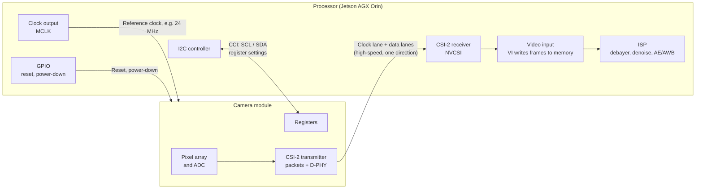
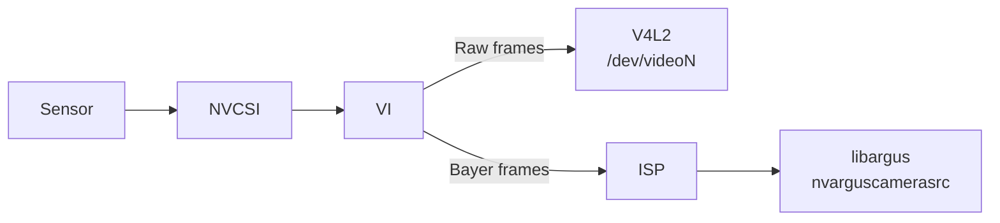

# MIPI CSI-2

[日本語](mipi_csi_jp.md) · [Repository](../../README.md) · [Jetson AGX Orin peripherals](jetson_agx_orin_peripherals.md)

How MIPI CSI-2 carries image data from a camera sensor to a processor, what each pin on a CSI-2 camera connector does, how the D-PHY and C-PHY physical layers and the CSI-2 packet layer work, and how CSI-2 cameras are brought up on Jetson AGX Orin.

Terms used below:

- **MIPI Alliance:** the industry group that publishes the CSI-2, DSI, D-PHY, C-PHY, and I3C specifications. The full specifications are available to members.
- **CSI-2 (Camera Serial Interface 2):** the protocol layer: how pixels become packets and how frames and lines are marked.
- **D-PHY and C-PHY:** the physical layers CSI-2 runs on. D-PHY uses a clock lane and differential data lanes; C-PHY uses three-wire "trios" with an embedded clock.
- **Lane:** one serial data path. D-PHY data lanes are differential pairs; a camera uses 1, 2, or 4 lanes (some use 8 with newer versions).
- **CCI (Camera Control Interface):** the I2C-compatible bus used to configure the sensor's registers. Image data and control travel on different wires.
- **Sensor mode:** one combination of resolution, frame rate, bit depth, and lane rate that the sensor supports.

## Overall structure



Image data flows only one way, from the camera to the processor, over the CSI-2 lanes. Everything else goes the other way on separate wires: the processor configures the sensor over I2C (CCI), provides a reference clock (MCLK), and controls reset and power-down with GPIOs. Inside the processor, the CSI-2 receiver unpacks the packets, the video input block writes frames to memory, and the ISP turns raw Bayer data into a usable image.

Main characteristics:

- **Unidirectional, high bandwidth:** each D-PHY lane runs up to several Gbit/s; four lanes carry 4K video at high frame rates.
- **Low power and few pins:** differential low-swing signaling and a low-power mode between bursts.
- **Short reach:** designed for traces and flex cables of a few tens of centimeters inside a product. Longer distances use serializer links (GMSL, FPD-Link) or MIPI A-PHY.
- **Protocol separate from PHY:** the same CSI-2 packets run over D-PHY or C-PHY.

## Pins and their roles

Signals on a typical CSI-2 camera module connector (exact pinout depends on the module and connector):

| Signal | Direction | Role |
|---|---|---|
| CLK_P / CLK_N | Camera → SoC | D-PHY clock lane (differential). The receiver uses it to sample the data lanes. |
| D0_P / D0_N | Camera → SoC | Data lane 0 (differential). Also the lane used for any reverse-direction low-power signaling, which cameras rarely use. |
| D1_P / D1_N, D2_P / D2_N, D3_P / D3_N | Camera → SoC | Additional data lanes. A 2-lane camera has D0 and D1; a 4-lane camera has D0 to D3. |
| SCL / SDA | Both (I2C) | CCI bus for sensor registers: mode, exposure, gain, test patterns. Needs pull-ups. |
| MCLK (EXTCLK, INCK, XCLK) | SoC → camera | Reference clock for the sensor's internal PLL, commonly 24 MHz, 27 MHz, or 37.125 MHz. Some modules have their own oscillator. |
| RESET / XCLR | SoC → camera | Hardware reset, usually active low. |
| PWDN / ENABLE | SoC → camera | Power-down or enable for the sensor or the module's regulators. |
| FSYNC / XVS / TRIG | Either | Frame synchronization or trigger input/output to align several cameras or an external event. |
| Power rails | Supply → camera | Typically an analog supply (AVDD, for example 2.8 V), I/O supply (DOVDD, 1.8 V), and core supply (DVDD, about 1.1 to 1.2 V). Many modules generate them from 3.3 V on board. |
| GND | — | Ground, often several pins between the differential pairs for shielding. |

For C-PHY, each lane is a **trio** of three wires (A, B, C) instead of a pair, and there is no separate clock lane.

## How it works

### Layers

```text
┌──────────────────────────────────────────┐
│ Application: pixels, frames, sensor modes │
├──────────────────────────────────────────┤
│ Pixel to byte packing (RAW10, YUV422, …)  │  CSI-2
├──────────────────────────────────────────┤
│ Low-level protocol: packets, VC, DT, ECC, │
│ CRC, frame/line markers                    │
├──────────────────────────────────────────┤
│ Lane management: distribute bytes to lanes │
├──────────────────────────────────────────┤
│ PHY: D-PHY or C-PHY                        │  PHY
└──────────────────────────────────────────┘
```

The transmitter goes top to bottom and the receiver goes bottom to top. With several lanes, lane management sends byte 0 on lane 0, byte 1 on lane 1, and so on; the receiver merges them back in order.

### D-PHY: two modes on the same wires

Each D-PHY lane switches between two electrical modes:

| Mode | Signaling | Typical voltage | Use |
|---|---|---|---|
| High-speed (HS) | Differential, low swing | About 200 mV swing around 200 mV common mode | Bursts of packet data at the full lane rate |
| Low-power (LP) | Single-ended on each wire | 0 V and 1.2 V | Idle (LP-11), start and end of bursts, control |

```text
              LP-11   LP-01  LP-00   HS-0 (zeros) sync byte   packet data ...   trail   LP-11
Dp  1.2 V ‾‾‾‾‾‾‾‾‾‾\_____________ ~~~~~~~~~~~~~~~~~~~~~~~~~~~~~~~~~~~~~~~~~~~~~~~~/‾‾‾‾‾‾
Dn  1.2 V ‾‾‾‾‾‾‾‾‾‾‾‾‾‾‾‾\_______ ~~~~~~~~~~~~~~~~~~~~~~~~~~~~~~~~~~~~~~~~~~~~~~~~/‾‾‾‾‾‾
                 |<- Start of Transmission (SoT) ->|                  |<- EoT ->|
```

- **Start of Transmission (SoT):** the lane leaves idle (LP-11) through LP-01 and LP-00, enables the HS termination, sends HS zeros, and then a sync byte (`0xB8`). The receiver must wait a **settle time** before it trusts the HS signal. The receiver's settle setting (`cil_settletime` on Jetson) must match the transmitter's timing.
- **End of Transmission (EoT):** the transmitter sends a trail pattern and returns to LP-11.
- **Clock lane:** in **continuous clock** mode it stays in HS all the time. In **non-continuous** (discontinuous) mode it also returns to LP between bursts to save power. The receiver must be configured for the mode the sensor uses.
- **Rates:** D-PHY 1.2 supports up to 2.5 Gbit/s per lane and D-PHY 2.1 up to 4.5 Gbit/s per lane. The clock lane runs at half the data rate because data is sampled on both clock edges (DDR).

### C-PHY in brief

- Three wires per trio carry one of six states per symbol; each symbol carries about 2.28 bits.
- The clock is embedded in the symbol transitions, so there is no clock lane.
- C-PHY 2.0 reaches about 6 Gsym/s per trio. With the same pin count, it offers more bandwidth than D-PHY, at the cost of more complex receivers.

### CSI-2 packets

Every line of image data is a **long packet**; frame and line boundaries are **short packets**.

```text
Short packet (4 bytes):
| Data ID | Data field (16 bits, e.g. frame number) | ECC |

Long packet:
| Data ID | Word Count (16 bits) | ECC | Payload (Word Count bytes) | CRC (16 bits) |
  └ Data ID = Virtual Channel (2 bits) + Data Type (6 bits)
```

A frame on the wire looks like this:

```text
FS (Frame Start, VC0)
  [embedded data line(s), optional, DT 0x12]
  long packet: line 1 pixels (DT 0x2B = RAW10)
  long packet: line 2 pixels
  ...
  long packet: line N pixels
FE (Frame End, VC0)
```

- **Virtual channel (VC):** a stream number. Several streams (for example, from different sensors behind one deserializer, or HDR exposures from one sensor) can share the same lanes. CSI-2 v1.x has 2 bits (4 channels); v2.0 and later extend this to 16 channels on D-PHY and 32 on C-PHY.
- **Data type (DT):** what the payload contains. Common values:

| Data type | Code |
|---|---|
| Frame Start / Frame End | `0x00` / `0x01` |
| Line Start / Line End (optional) | `0x02` / `0x03` |
| Embedded 8-bit non-image data | `0x12` |
| YUV422 8-bit | `0x1E` |
| RGB888 | `0x24` |
| RAW8 / RAW10 / RAW12 / RAW14 | `0x2A` / `0x2B` / `0x2C` / `0x2D` |

- **ECC:** protects the packet header; it corrects one-bit errors and detects two-bit errors.
- **CRC:** a 16-bit checksum of the payload. Payload errors are detected but not corrected.
- **Word count:** the payload length in bytes, so the receiver knows where the packet ends.
- Between lines and frames the lanes go to LP mode (**horizontal and vertical blanking**).

### Pixel packing: RAW10 example

RAW10 packs four 10-bit pixels into five bytes:

```text
Byte 0: P0[9:2]
Byte 1: P1[9:2]
Byte 2: P2[9:2]
Byte 3: P3[9:2]
Byte 4: P3[1:0] P2[1:0] P1[1:0] P0[1:0]
```

So a 1920-pixel RAW10 line is a 2400-byte long packet. Raw Bayer data is not yet an image: every pixel has only one color (in a pattern such as RGGB), and the ISP or software must debayer it.

### Bandwidth calculation

Choose the lane count and lane rate so that the data rate, plus blanking overhead, fits:

```text
1920 × 1080 pixels × 30 frames/s × 10 bits (RAW10) ≈ 622 Mbit/s of pixel data
Add about 20 to 30 percent for blanking and packet overhead ≈ 800 Mbit/s
→ 2 lanes at about 400 to 500 Mbit/s each, or 1 lane at about 800 Mbit/s or more

3840 × 2160 × 60 × 10 bits ≈ 4.98 Gbit/s of pixel data
→ 4 lanes at about 1.5 Gbit/s or more each
```

The sensor's register settings fix its lane rate for each mode. The receiver configuration must match that mode; it cannot choose the rate on its own.

## Electrical design

- **Impedance and length matching:** route each pair as 100 Ω differential with tight intra-pair matching. Keep lanes of one camera length-matched to each other and to the clock lane.
- **Short, continuous paths:** avoid stubs and vias where possible. Flex cables and connectors are part of the channel; long or cheap cables cause CRC errors at high lane rates.
- **Power sequencing:** sensors usually require rails in a specific order and MCLK before reset is released. The sequence is in the sensor datasheet and is implemented in the driver's power-on function.
- **Lane swap and polarity inversion:** some SoCs can remap lanes or invert P/N in configuration to ease board routing. Jetson supports `lane_polarity` settings for this.

## On Jetson AGX Orin

- The module supports **16 CSI-2 lanes**: D-PHY 2.1 (up to 40 Gbit/s total) or C-PHY 2.0 (up to 164 Gbit/s total), for up to 6 cameras or 16 streams with virtual channels.
- The capture path is **NVCSI** (CSI-2 receiver) → **VI** (video input, writes frames to memory) → optional **ISP** through libargus. A camera real-time processor (RTCPU) runs firmware that manages capture.
- Lanes are grouped into ports (CSI bricks). A 2-lane camera uses one port; a 4-lane camera combines two adjacent ports. The device tree selects the port with `port-index` and the lane count with `bus-width` / `num_lanes`.
- The Developer Kit exposes CSI through a 16-lane high-density camera connector; cameras attach through adapter boards from NVIDIA partners.

### Two capture paths



- **V4L2 path:** frames go directly to memory as received (RAW or YUV). Best for bring-up and for sensors with built-in ISP (YUV output).
- **libargus path:** NVIDIA's camera API runs the ISP for Bayer sensors and provides auto exposure, white balance, and noise reduction. GStreamer uses it through `nvarguscamerasrc`. It requires a tuning file for the sensor.

### Device tree properties to match

A sensor driver's device tree node describes each mode. The most important properties:

| Property | Meaning | Where to get the value |
|---|---|---|
| `num_lanes` | Number of data lanes | Sensor mode registers |
| `pix_clk_hz` | Pixel rate used to compute timing, roughly lane rate × lanes ÷ bits per pixel | Sensor PLL settings; for example 4 lanes × 1.5 Gbit/s ÷ 10 bits = 600 MHz |
| `active_w`, `active_h` | Output resolution | Sensor mode |
| `line_length` | Total pixels per line including horizontal blanking | Sensor register (HTS / line length) |
| `pixel_t` / `csi_pixel_bit_depth`, `mode_type`, `pixel_phase` | Data format, bit depth, Bayer order (for example `rggb`) | Sensor datasheet |
| `discontinuous_clk` | `yes` if the clock lane goes to LP between bursts | Sensor clock mode register |
| `cil_settletime` | D-PHY settle time; `0` lets the driver calculate it | Usually `0`, tune only when SoT errors occur |
| `lane_polarity` | Inverted P/N on lanes | Board schematic |

### Bring-up and checks

```bash
v4l2-ctl --list-devices
```

```bash
v4l2-ctl -d /dev/video0 --list-formats-ext
```

```bash
v4l2-ctl -d /dev/video0 --set-fmt-video=width=1920,height=1080,pixelformat=RG10 --stream-mmap --stream-count=30
```

Expected results: one `/dev/videoN` per camera, the formats and resolutions from the device tree modes, and a capture that prints `<` characters for each frame and ends without a timeout. The pixel format `RG10` (10-bit RGGB Bayer) and the size are examples; use the values listed by the second command.

The commands were not run while writing this note because no Jetson device was available.

## Common problems

| Symptom | Likely cause |
|---|---|
| No `/dev/video*` | Sensor driver did not probe: I2C address wrong, power or MCLK missing, reset still asserted (check `dmesg`) |
| Capture times out (`uncorr_err` or no frames) | Sensor not streaming, wrong lane count, wrong port, or continuous/non-continuous clock mismatch |
| CRC or ECC errors in the trace | Signal integrity: cable, connector, length, lane rate too high |
| SoT or sync errors | Settle time mismatch; try another `cil_settletime` value |
| Image has wrong size or is shifted | `active_w`, `active_h`, `line_length`, or data type mismatch |
| Colors are wrong (green or magenta tint) | Wrong Bayer order (`pixel_phase`) |
| Some frames drop | Bandwidth or lane rate at the limit, or clock settings (`pix_clk_hz`) too low |

To see what the receiver reports, enable the camera trace events (rtcpu, vi, nvcsi) under `/sys/kernel/debug/tracing` as described in NVIDIA's camera debugging documentation.

A good bring-up order is: power and MCLK → I2C reads the sensor ID → sensor test pattern (color bars) over V4L2 → real image over V4L2 → ISP path with libargus. A test pattern isolates CSI-2 transport problems from optics and exposure settings.

## References

These sources could not be opened from the authoring environment (network access was blocked), so the facts above come from established specifications and general knowledge; check details against the current documents.

- MIPI Alliance, *Camera Serial Interface 2 (MIPI CSI-2)*: https://www.mipi.org/specifications/csi-2
- MIPI Alliance, *MIPI D-PHY* and *MIPI C-PHY*: https://www.mipi.org/specifications/d-phy and https://www.mipi.org/specifications/c-phy
- NVIDIA, *Jetson AGX Orin Series Technical Brief* v1.2: https://www.nvidia.com/content/dam/en-zz/Solutions/gtcf21/jetson-orin/nvidia-jetson-agx-orin-technical-brief.pdf
- NVIDIA, *Jetson Linux Developer Guide*, Camera Development and Sensor Software Driver Programming: https://docs.nvidia.com/jetson/archives/r36.4.4/DeveloperGuide/SD/CameraDevelopment.html
- Linux kernel documentation, *Video4Linux (V4L2) pixel formats*: https://docs.kernel.org/userspace-api/media/v4l/pixfmt.html
