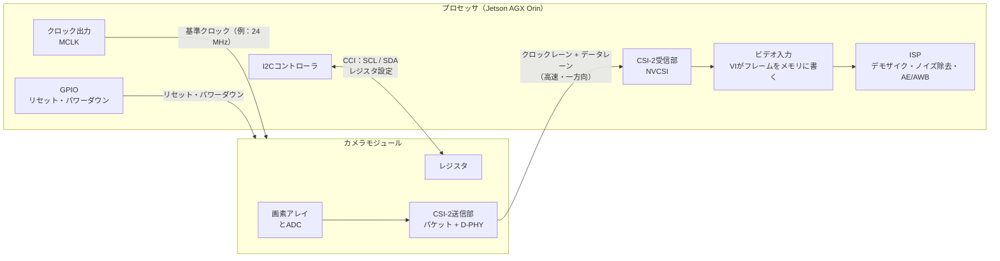
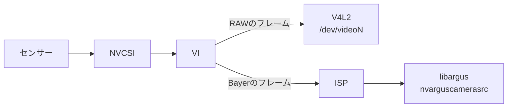

# MIPI CSI-2

[English](mipi_csi.md) · [リポジトリ](../../README_jp.md) · [Jetson AGX Orinのペリフェラル](jetson_agx_orin_peripherals_jp.md)

MIPI CSI-2がカメラセンサーからプロセッサへ画像データを運ぶ仕組み、CSI-2カメラのコネクタの各ピンの役割、D-PHYとC-PHYの物理層とCSI-2のパケット層の仕組み、Jetson AGX OrinでCSI-2カメラを立ち上げる方法を説明します。

この文書で使う用語：

- **MIPI Alliance：** CSI-2、DSI、D-PHY、C-PHY、I3Cの仕様を発行している業界団体です。仕様書の全文は会員が入手できます。
- **CSI-2（Camera Serial Interface 2）：** プロトコル層です。画素をパケットにする方法と、フレームやラインの区切りの示し方を決めています。
- **D-PHYとC-PHY：** CSI-2が使う物理層です。D-PHYはクロックレーンと差動のデータレーンを使い、C-PHYはクロックを埋め込んだ3線の「トリオ」を使います。
- **レーン：** 1本のシリアルデータの経路です。D-PHYのデータレーンは差動ペアで、カメラは1、2、4レーンを使います（新しい版では8レーンのものもあります）。
- **CCI（Camera Control Interface）：** センサーのレジスタを設定するためのI2C互換のバスです。画像データと制御は別の線を通ります。
- **センサーモード：** センサーが対応する解像度、フレームレート、ビット深度、レーン速度の組み合わせの1つです。

## 全体像



画像データは、CSI-2のレーンを通ってカメラからプロセッサへ一方向にだけ流れます。それ以外は別の線を逆向きに流れます。プロセッサはI2C（CCI）でセンサーを設定し、基準クロック（MCLK）を供給し、GPIOでリセットとパワーダウンを制御します。プロセッサの中では、CSI-2受信部がパケットをほどき、ビデオ入力ブロックがフレームをメモリに書き込み、ISPがRAWのBayerデータを使える画像にします。

主な特徴：

- **一方向で広帯域：** D-PHYの各レーンは最大で数Gbit/sです。4レーンで4Kの映像を高いフレームレートで運べます。
- **低消費電力でピンが少ない：** 小振幅の差動信号と、バーストの合間の低消費電力モードを使います。
- **短距離：** 製品内部の数十cmの配線やフレキシブルケーブルを想定しています。長い距離にはシリアライザのリンク（GMSL、FPD-Link）やMIPI A-PHYを使います。
- **プロトコルとPHYが分かれている：** 同じCSI-2のパケットがD-PHYでもC-PHYでも動きます。

## ピンと役割

一般的なCSI-2カメラモジュールのコネクタの信号です（正確なピン配置はモジュールとコネクタによります）。

| 信号 | 向き | 役割 |
|---|---|---|
| CLK_P／CLK_N | カメラ → SoC | D-PHYのクロックレーン（差動）です。受信側はこれを使ってデータレーンを読み取ります。 |
| D0_P／D0_N | カメラ → SoC | データレーン0（差動）です。逆方向の低消費電力の通信にもこのレーンを使いますが、カメラではめったに使いません。 |
| D1_P／D1_N、D2_P／D2_N、D3_P／D3_N | カメラ → SoC | 追加のデータレーンです。2レーンのカメラはD0とD1を、4レーンのカメラはD0〜D3を持ちます。 |
| SCL／SDA | 双方向（I2C） | センサーのレジスタ用のCCIバスです。モード、露光、ゲイン、テストパターンを設定します。プルアップが必要です。 |
| MCLK（EXTCLK、INCK、XCLK） | SoC → カメラ | センサー内部のPLLの基準クロックです。24 MHz、27 MHz、37.125 MHzがよく使われます。自前の発振器を持つモジュールもあります。 |
| RESET／XCLR | SoC → カメラ | ハードウェアリセットで、通常はアクティブLowです。 |
| PWDN／ENABLE | SoC → カメラ | センサーやモジュールのレギュレータのパワーダウンまたは有効化です。 |
| FSYNC／XVS／TRIG | どちらも | 複数のカメラや外部のイベントに合わせるための、フレーム同期またはトリガーの入出力です。 |
| 電源 | 電源 → カメラ | 一般的には、アナログ電源（AVDD、例：2.8 V）、I/O電源（DOVDD、1.8 V）、コア電源（DVDD、約1.1〜1.2 V）です。多くのモジュールは3.3 Vから基板上で生成します。 |
| GND | — | グランドです。シールドのため、差動ペアの間に複数配置されることが多いです。 |

C-PHYでは、各レーンがペアではなく3本の線（A、B、C）の**トリオ**になり、クロックレーンはありません。

## 仕組み

### 階層

```text
┌──────────────────────────────────────────┐
│ アプリケーション：画素、フレーム、センサーモード │
├──────────────────────────────────────────┤
│ 画素からバイトへのパッキング（RAW10、YUV422 …）│  CSI-2
├──────────────────────────────────────────┤
│ 低レベルプロトコル：パケット、VC、DT、ECC、   │
│ CRC、フレームとラインの区切り                 │
├──────────────────────────────────────────┤
│ レーン管理：バイトをレーンに振り分ける         │
├──────────────────────────────────────────┤
│ PHY：D-PHYまたはC-PHY                      │  PHY
└──────────────────────────────────────────┘
```

送信側は上から下へ、受信側は下から上へ処理します。複数のレーンがある場合、レーン管理はバイト0をレーン0、バイト1をレーン1というように送り、受信側が元の順に戻します。

### D-PHY：同じ線で2つのモード

D-PHYの各レーンは、2つの電気的なモードを切り替えます。

| モード | 信号方式 | 一般的な電圧 | 用途 |
|---|---|---|---|
| 高速（HS） | 差動、小振幅 | 同相電圧約200 mVを中心に約200 mVの振幅 | パケットデータのバーストを最大のレーン速度で送る |
| 低消費電力（LP） | 各線がシングルエンド | 0 Vと1.2 V | アイドル（LP-11）、バーストの開始と終了、制御 |

```text
              LP-11   LP-01  LP-00   HS-0 (zeros) sync byte   packet data ...   trail   LP-11
Dp  1.2 V ‾‾‾‾‾‾‾‾‾‾\_____________ ~~~~~~~~~~~~~~~~~~~~~~~~~~~~~~~~~~~~~~~~~~~~~~~~/‾‾‾‾‾‾
Dn  1.2 V ‾‾‾‾‾‾‾‾‾‾‾‾‾‾‾‾\_______ ~~~~~~~~~~~~~~~~~~~~~~~~~~~~~~~~~~~~~~~~~~~~~~~~/‾‾‾‾‾‾
                 |<- Start of Transmission (SoT) ->|                  |<- EoT ->|
```

- **Start of Transmission（SoT）：** レーンはアイドル（LP-11）からLP-01、LP-00を経てHSの終端を有効にし、HSの0を送ってから同期バイト（`0xB8`）を送ります。受信側は、HSの信号を信頼する前に**セトリング時間**だけ待つ必要があります。受信側のセトリングの設定（Jetsonでは`cil_settletime`）は、送信側のタイミングに合っている必要があります。
- **End of Transmission（EoT）：** 送信側はトレイルのパターンを送り、LP-11に戻ります。
- **クロックレーン：** **連続クロック**モードでは常にHSのままです。**非連続**（discontinuous）モードでは、消費電力を下げるためにバーストの合間にLPに戻ります。受信側は、センサーが使うモードに合わせて設定する必要があります。
- **速度：** D-PHY 1.2はレーンあたり最大2.5 Gbit/s、D-PHY 2.1はレーンあたり最大4.5 Gbit/sです。クロックの両エッジでデータを読み取る（DDR）ため、クロックレーンはデータ速度の半分の周波数で動きます。

### C-PHYの概要

- トリオの3本の線で、シンボルごとに6つの状態の1つを送ります。1シンボルは約2.28ビットを運びます。
- クロックはシンボルの遷移に埋め込まれているので、クロックレーンはありません。
- C-PHY 2.0はトリオあたり約6 Gsym/sに達します。同じピン数でD-PHYより広い帯域を出せますが、受信回路は複雑になります。

### CSI-2のパケット

画像データの各ラインは**ロングパケット**で、フレームとラインの区切りは**ショートパケット**です。

```text
Short packet (4 bytes):
| Data ID | Data field (16 bits, e.g. frame number) | ECC |

Long packet:
| Data ID | Word Count (16 bits) | ECC | Payload (Word Count bytes) | CRC (16 bits) |
  └ Data ID = Virtual Channel (2 bits) + Data Type (6 bits)
```

線上の1フレームは次のようになります。

```text
FS (Frame Start, VC0)
  [embedded data line(s), optional, DT 0x12]
  long packet: line 1 pixels (DT 0x2B = RAW10)
  long packet: line 2 pixels
  ...
  long packet: line N pixels
FE (Frame End, VC0)
```

- **バーチャルチャネル（VC）：** ストリームの番号です。複数のストリーム（たとえば、1つのデシリアライザの先にある別々のセンサーや、1つのセンサーのHDRの各露光）が同じレーンを共有できます。CSI-2 v1.xでは2ビット（4チャネル）、v2.0以降ではD-PHYで16チャネル、C-PHYで32チャネルに拡張されています。
- **データタイプ（DT）：** ペイロードの中身です。よく使う値：

| データタイプ | コード |
|---|---|
| Frame Start／Frame End | `0x00`／`0x01` |
| Line Start／Line End（任意） | `0x02`／`0x03` |
| 埋め込みの8ビット非画像データ | `0x12` |
| YUV422 8ビット | `0x1E` |
| RGB888 | `0x24` |
| RAW8／RAW10／RAW12／RAW14 | `0x2A`／`0x2B`／`0x2C`／`0x2D` |

- **ECC：** パケットのヘッダを保護します。1ビットの誤りを訂正し、2ビットの誤りを検出します。
- **CRC：** ペイロードの16ビットのチェックサムです。ペイロードの誤りは検出できますが、訂正はできません。
- **ワードカウント：** ペイロードのバイト数で、受信側がパケットの終わりを知るために使います。
- ラインとフレームの間では、レーンはLPモードになります（**水平・垂直ブランキング**）。

### 画素のパッキング：RAW10の例

RAW10は、10ビットの画素4つを5バイトに詰めます。

```text
Byte 0: P0[9:2]
Byte 1: P1[9:2]
Byte 2: P2[9:2]
Byte 3: P3[9:2]
Byte 4: P3[1:0] P2[1:0] P1[1:0] P0[1:0]
```

そのため、1920画素のRAW10のラインは2400バイトのロングパケットになります。RAWのBayerデータはまだ画像ではありません。各画素は1色の情報しか持たないため（RGGBなどの並び）、ISPかソフトウェアでデモザイク（debayer）する必要があります。

### 帯域の計算

データ速度にブランキングの分を加えても収まるように、レーン数とレーン速度を選びます。

```text
1920 × 1080 pixels × 30 frames/s × 10 bits (RAW10) ≈ 622 Mbit/s of pixel data
Add about 20 to 30 percent for blanking and packet overhead ≈ 800 Mbit/s
→ 2 lanes at about 400 to 500 Mbit/s each, or 1 lane at about 800 Mbit/s or more

3840 × 2160 × 60 × 10 bits ≈ 4.98 Gbit/s of pixel data
→ 4 lanes at about 1.5 Gbit/s or more each
```

センサーのレーン速度は、モードごとにセンサーのレジスタ設定で決まります。受信側の設定はそのモードに合わせる必要があり、受信側が勝手に速度を選ぶことはできません。

## 電気的な設計

- **インピーダンスと長さ合わせ：** 各ペアは100 Ωの差動として配線し、ペア内の長さをきっちり合わせます。1台のカメラのレーン同士と、クロックレーンとの長さもそろえます。
- **短く連続した経路：** できるだけスタブやビアを避けます。フレキシブルケーブルとコネクタも伝送路の一部です。長いケーブルや安価なケーブルは、高いレーン速度でCRCエラーの原因になります。
- **電源シーケンス：** センサーは通常、決まった順番で電源を入れ、リセットを解除する前にMCLKを供給する必要があります。シーケンスはセンサーのデータシートに書かれており、ドライバの電源投入の関数で実装します。
- **レーンの入れ替えと極性反転：** 基板の配線を楽にするため、レーンの割り当てを変えたりP/Nを反転したりする設定を持つSoCもあります。Jetsonでは`lane_polarity`の設定で対応できます。

## Jetson AGX Orinでは

- モジュールは**16本のCSI-2レーン**に対応します：D-PHY 2.1（合計最大40 Gbit/s）またはC-PHY 2.0（合計最大164 Gbit/s）で、最大6台のカメラ、バーチャルチャネルを使えば16ストリームです。
- キャプチャの経路は、**NVCSI**（CSI-2受信部）→ **VI**（ビデオ入力、フレームをメモリに書き込む）→ 必要に応じてlibargus経由の**ISP**です。カメラ用リアルタイムプロセッサ（RTCPU）のファームウェアがキャプチャを管理します。
- レーンはポート（CSIブリック）単位でまとまっています。2レーンのカメラは1つのポートを使い、4レーンのカメラは隣り合う2つのポートを組み合わせます。デバイスツリーでは、`port-index`でポートを、`bus-width`／`num_lanes`でレーン数を選びます。
- Developer KitはCSIを16レーンの高密度カメラコネクタで提供しています。カメラはNVIDIAのパートナー製のアダプタボードを介してつなぎます。

### 2つのキャプチャ経路



- **V4L2の経路：** 受け取ったフレームをそのまま（RAWまたはYUV）メモリに書き込みます。立ち上げ時や、ISPを内蔵したセンサー（YUV出力）に向いています。
- **libargusの経路：** NVIDIAのカメラAPIが、BayerセンサーのためにISPを動かし、自動露出、ホワイトバランス、ノイズ除去を提供します。GStreamerでは`nvarguscamerasrc`から使います。センサーのチューニングファイルが必要です。

### 合わせるべきデバイスツリーのプロパティ

センサードライバのデバイスツリーのノードには、各モードを記述します。特に重要なプロパティは次のとおりです。

| プロパティ | 意味 | 値の調べ方 |
|---|---|---|
| `num_lanes` | データレーンの数 | センサーモードのレジスタ |
| `pix_clk_hz` | タイミングの計算に使う画素レート。おおよそ「レーン速度 × レーン数 ÷ 画素あたりのビット数」 | センサーのPLL設定。例：4レーン × 1.5 Gbit/s ÷ 10ビット = 600 MHz |
| `active_w`、`active_h` | 出力の解像度 | センサーモード |
| `line_length` | 水平ブランキングを含む1ラインの総画素数 | センサーのレジスタ（HTS／line length） |
| `pixel_t`／`csi_pixel_bit_depth`、`mode_type`、`pixel_phase` | データ形式、ビット深度、Bayerの並び（例：`rggb`） | センサーのデータシート |
| `discontinuous_clk` | クロックレーンがバーストの合間にLPへ戻るなら`yes` | センサーのクロックモードのレジスタ |
| `cil_settletime` | D-PHYのセトリング時間。`0`ならドライバが計算する | 通常は`0`。SoTエラーが出たときだけ調整する |
| `lane_polarity` | レーンのP/Nの反転 | 基板の回路図 |

### 立ち上げと確認

```bash
v4l2-ctl --list-devices
```

```bash
v4l2-ctl -d /dev/video0 --list-formats-ext
```

```bash
v4l2-ctl -d /dev/video0 --set-fmt-video=width=1920,height=1080,pixelformat=RG10 --stream-mmap --stream-count=30
```

期待する結果：カメラごとに`/dev/videoN`が1つ表示され、デバイスツリーのモードにある形式と解像度が表示されます。キャプチャはフレームごとに`<`の文字を表示し、タイムアウトせずに終わります。ピクセルフォーマット`RG10`（10ビットのRGGB Bayer）とサイズは例なので、2つ目のコマンドで表示された値を使ってください。

Jetsonの実機が手元になかったため、この文書の作成時にはコマンドを実行していません。

## よくあるトラブル

| 症状 | よくある原因 |
|---|---|
| `/dev/video*`がない | センサードライバのプローブに失敗している：I2Cアドレスの誤り、電源やMCLKがない、リセットが解除されていない（`dmesg`を確認） |
| キャプチャがタイムアウトする（`uncorr_err`、またはフレームが来ない） | センサーがストリームを出していない、レーン数の誤り、ポートの誤り、連続／非連続クロックの不一致 |
| トレースにCRCやECCのエラーが出る | 信号品質：ケーブル、コネクタ、長さ、レーン速度が高すぎる |
| SoTや同期のエラー | セトリング時間の不一致。`cil_settletime`の値を変えてみる |
| 画像のサイズが違う、ずれている | `active_w`、`active_h`、`line_length`、データタイプの不一致 |
| 色がおかしい（緑やマゼンタがかる） | Bayerの並び（`pixel_phase`）の誤り |
| ときどきフレームが落ちる | 帯域やレーン速度が限界に近い、クロックの設定（`pix_clk_hz`）が低すぎる |

受信側が何を報告しているかを見るには、NVIDIAのカメラのデバッグ手順に従って、`/sys/kernel/debug/tracing`でカメラのトレースイベント（rtcpu、vi、nvcsi）を有効にします。

立ち上げは次の順番で進めるとよいでしょう：電源とMCLK → I2CでセンサーIDを読む → V4L2でセンサーのテストパターン（カラーバー）を取る → V4L2で実際の画像を取る → libargusでISPの経路を使う。テストパターンを使うと、CSI-2の伝送の問題を、光学系や露出設定の問題と切り分けられます。

## 参考資料

作成環境からはこれらの資料を開けなかったため（ネットワークアクセスが制限されていた）、本文の情報は確立された仕様と一般的な知識に基づいています。詳細は最新の文書で確認してください。

- MIPI Alliance, *Camera Serial Interface 2 (MIPI CSI-2)*: https://www.mipi.org/specifications/csi-2
- MIPI Alliance, *MIPI D-PHY*と*MIPI C-PHY*: https://www.mipi.org/specifications/d-phy と https://www.mipi.org/specifications/c-phy
- NVIDIA, *Jetson AGX Orin Series Technical Brief* v1.2: https://www.nvidia.com/content/dam/en-zz/Solutions/gtcf21/jetson-orin/nvidia-jetson-agx-orin-technical-brief.pdf
- NVIDIA, *Jetson Linux Developer Guide*, Camera DevelopmentとSensor Software Driver Programming: https://docs.nvidia.com/jetson/archives/r36.4.4/DeveloperGuide/SD/CameraDevelopment.html
- Linuxカーネルのドキュメント, *Video4Linux (V4L2) pixel formats*: https://docs.kernel.org/userspace-api/media/v4l/pixfmt.html
