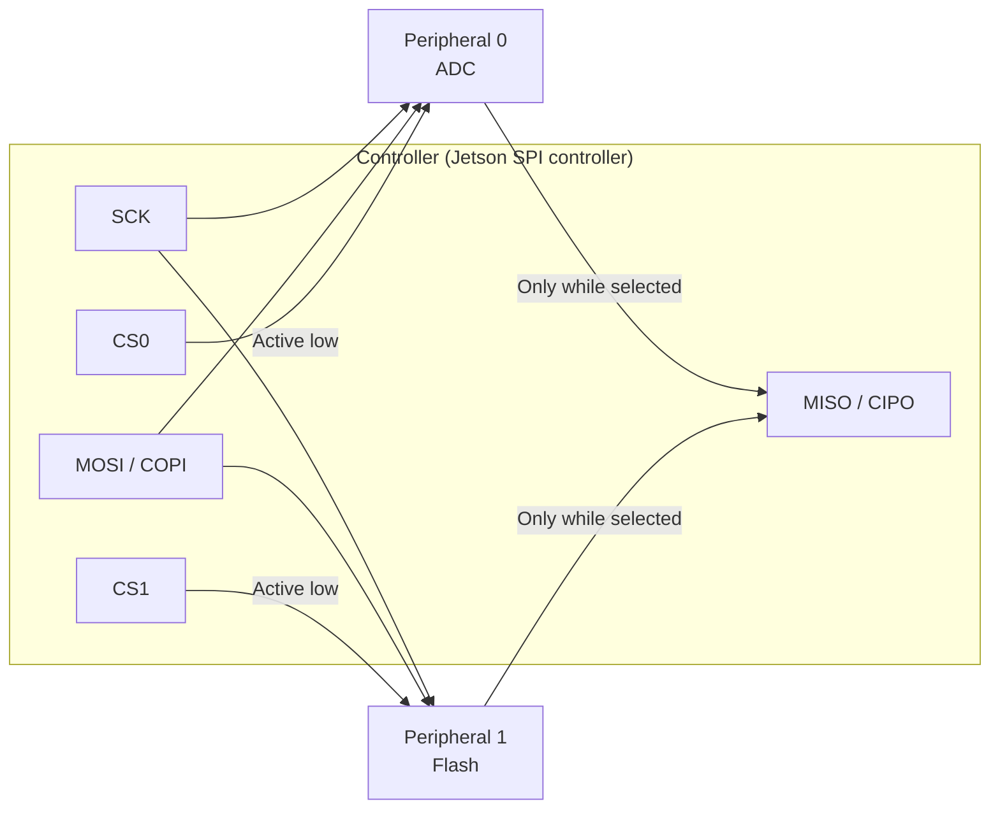
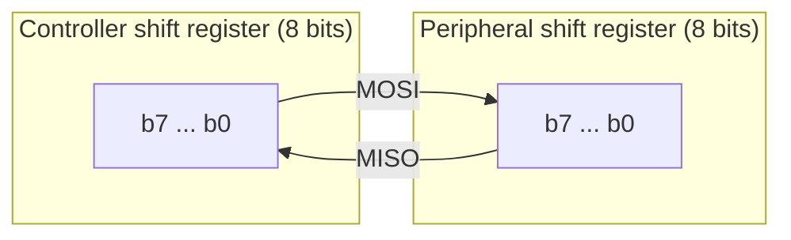

# SPI

[日本語](spi_jp.md) · [Repository](../../README.md) · [Jetson AGX Orin peripherals](jetson_agx_orin_peripherals.md)

How the SPI bus works, what each pin does, how the four clock modes differ, and how to use and debug SPI on Linux, with Jetson AGX Orin as the example platform. The audience is embedded engineers who want to understand SPI at the signal level.

Terms used below:

- **Controller / peripheral:** the device that generates the clock and selects a device, and the device that responds. Older documents call them master and slave.
- **Full-duplex:** data moves in both directions at the same time.
- **Push-pull:** an output that actively drives both high and low, unlike open-drain I2C. This allows much higher speeds.
- **CPOL / CPHA:** clock polarity (idle level of the clock) and clock phase (which edge samples data). Together they define the SPI mode.

## Overall structure



Clock, MOSI, and MISO are shared by all peripherals. Each peripheral has its own chip select (CS) line. The controller pulls one CS low to select a peripheral; only that peripheral drives MISO, and the others leave it in high impedance. Arrows show signal direction. A shared ground is also required but is not drawn.

Main characteristics:

- **Four wires plus one CS per device:** no addresses; selection is by hardware lines.
- **Synchronous, full-duplex:** each clock cycle shifts one bit out on MOSI and one bit in on MISO.
- **Fast:** tens of MHz are common because lines are push-pull and point-to-point. The limit is set by the controller, the peripheral, and the wiring.
- **No standard protocol layer:** SPI defines only how bits move. Command bytes, register maps, and framing come from each device datasheet.
- **Use cases:** ADC/DAC, NOR flash, displays, SD cards in SPI mode, Ethernet and CAN controllers, FPGAs, and microcontroller links.

## Pins and their roles

| Pin | Other names | Direction | Role |
|---|---|---|---|
| SCK | SCLK, CLK | Controller → peripheral | Clock. Only the controller generates it, and only during a transfer. |
| MOSI | COPI, SDO (controller side), SDI (peripheral side), DIN | Controller → peripheral | Data from the controller. |
| MISO | CIPO, SDI (controller side), SDO (peripheral side), DOUT | Peripheral → controller | Data from the selected peripheral. Unselected peripherals keep it in high impedance. |
| CS | SS, nCS, CE, CSn | Controller → peripheral | Chip select, usually active low. Marks the start and end of a transaction; many devices reset their command parser on the CS rising edge. |
| GND | — | — | Shared reference. |

Optional pins found on many SPI devices:

| Pin | Role |
|---|---|
| INT / DRDY / IRQ | Peripheral signals "data ready" or an event to a GPIO input. |
| RESET | Device reset, driven by a GPIO. |
| D/C (data/command) | On small displays, selects whether the byte is a command or pixel data. |
| WP, HOLD | On flash memory, write protect and pause a transfer. In quad mode these become data lines IO2 and IO3. |

Pin names are confusing because SDI and SDO are named from the device's own point of view: the controller's SDO connects to the peripheral's SDI. COPI/CIPO (controller out/peripheral in) are the newer, unambiguous names.

## How a transfer works

### Shift registers



SPI is two shift registers connected in a ring. On every clock cycle, the controller shifts one bit out of its register to the peripheral, and the peripheral shifts one bit out to the controller. After eight clocks the two registers have exchanged their contents. This has two consequences:

- **Every write is also a read.** To read, the controller must still send bytes (often `0x00` or `0xFF` as dummy bytes).
- **The response usually comes one byte late.** The peripheral cannot answer a command in the same byte it receives it, so the controller sends the command, then dummy bytes while the reply arrives.

### A typical register read

```text
CS    ‾‾‾\________________________________________/‾‾‾
SCK   ____/‾\_/‾\_ ... _/‾\_/‾\_/‾\_ ... _/‾\________
MOSI  ====X cmd: 0x80 | reg ... X dummy 0x00 ...    X====
MISO  ====X (ignored)  ...      X data byte ...     X====
          |<--- byte 1 ----->|<---- byte 2 ---->|
```

Many sensors use the top bit of the first byte for read (1) or write (0), and the rest for the register address. The controller keeps CS low for the whole transaction. Ending CS too early (between the command and the dummy bytes) aborts the command on most devices.

### The four SPI modes

| Mode | CPOL | CPHA | Clock idle level | Data sampled on | Data changes on |
|---|---|---|---|---|---|
| 0 | 0 | 0 | Low | Rising edge | Falling edge |
| 1 | 0 | 1 | Low | Falling edge | Rising edge |
| 2 | 1 | 0 | High | Falling edge | Rising edge |
| 3 | 1 | 1 | High | Rising edge | Falling edge |

```text
Mode 0 (CPOL=0, CPHA=0): sample on the first edge (rising)
CS    ‾‾\_____________________________
SCK   ____/‾‾\__/‾‾\__/‾‾\__ ...
DATA  ==X  b7  X  b6  X  b5  X ...
          ^      ^      ^     sample points

Mode 3 (CPOL=1, CPHA=1): clock idles high, sample on the second edge (rising)
CS    ‾‾\_____________________________
SCK   ‾‾‾‾\__/‾‾\__/‾‾\__/‾‾ ...
DATA  ====X  b7  X  b6  X  b5 ...
             ^      ^      ^  sample points
```

- **CPOL** chooses the idle level of SCK.
- **CPHA = 0:** the first clock edge samples data, so the peripheral must put bit 7 on MISO as soon as CS falls.
- **CPHA = 1:** the first edge shifts data out and the second edge samples it.
- Modes 0 and 3 are by far the most common, and many devices support both. The datasheet timing diagram shows which mode to use. A wrong mode often produces data shifted by one bit, which is a useful clue.

### Other parameters to match

- **Bit order:** almost always MSB first; some devices use LSB first.
- **Word size:** usually 8 bits; some ADCs and displays use 12, 16, or other sizes.
- **Maximum clock:** from the peripheral datasheet. Long wires or level shifters reduce the usable rate.
- **CS timing:** some devices need a minimum delay between CS falling and the first clock, or between transactions.
- **CS polarity:** almost always active low.

### Wider variants

- **Dual SPI and Quad SPI (QSPI):** two or four data lines for higher throughput, mainly for flash memory. Commands switch the lines between input and output, so the bus becomes half-duplex. Jetson AGX Orin boots from QSPI-NOR flash on the module.
- **3-wire SPI:** a single bidirectional data line instead of MOSI and MISO.
- **Daisy chain:** devices connected in series share one CS; data shifts through all of them.

## Electrical design

- **Signal integrity:** at tens of MHz, long jumper wires ring and cause bit errors. Keep wires short, add a series resistor (for example 22 to 33 Ω) near the SCK driver, and keep a ground wire next to the signals.
- **Voltage levels:** the Jetson 40-pin header is 3.3 V. A 5 V peripheral needs a level shifter, and slow shifters limit the clock rate.
- **CS pull-ups:** a pull-up on CS keeps the peripheral deselected while the controller boots and its pins are not yet configured.
- **MISO sharing:** a peripheral that does not release MISO when deselected breaks the bus for every other device. Test each device alone first.

## On Jetson AGX Orin

- The module has three SPI controllers; one is normally exposed on the 40-pin header. The Developer Kit routes SPI pins to the header, but they must be enabled with `jetson-io` before use.
- The header follows the Raspberry Pi-compatible layout: **pin 19 = MOSI, pin 21 = MISO, pin 23 = SCK, pin 24 = CS0, pin 26 = CS1**. Confirm the mapping in the *Carrier Board Specification* for your board.
- The Tegra SPI driver handles the controller. The generic `spidev` driver creates `/dev/spidevB.C`, where B is the bus number and C is the chip select.
- For a peripheral with a kernel driver (for example a CAN controller or display), add a child node to the SPI controller in the device tree instead of using `spidev`.

## Using SPI from Linux

```bash
sudo /opt/nvidia/jetson-io/jetson-io.py
```

```bash
sudo modprobe spidev
```

```bash
ls -l /dev/spidev*
```

Expected result: after enabling SPI on the header and rebooting, `/dev/spidev0.0` and `/dev/spidev0.1` (or similar numbers) appear.

Loopback test: connect MOSI (pin 19) to MISO (pin 21) and run `spidev_test`, which is built from the kernel source tree (`tools/spi/spidev_test.c`):

```bash
sudo ./spidev_test -D /dev/spidev0.0 -s 1000000 -v -p "HELLO"
```

Expected result: the TX and RX lines show the same bytes. If RX is all `00` or `FF`, the pins are not configured for SPI, the wire is missing, or the wrong bus is open.

The commands were not run while writing this note because no Jetson device was available.

In C, a full-duplex transfer is one `ioctl`:

```c
#include <fcntl.h>
#include <linux/spi/spidev.h>
#include <stdint.h>
#include <stdio.h>
#include <sys/ioctl.h>
#include <unistd.h>

int main(void) {
    int fd = open("/dev/spidev0.0", O_RDWR);
    if (fd < 0) { perror("open"); return 1; }

    uint8_t mode = SPI_MODE_0, bits = 8;
    uint32_t speed = 1000000;
    ioctl(fd, SPI_IOC_WR_MODE, &mode);
    ioctl(fd, SPI_IOC_WR_BITS_PER_WORD, &bits);
    ioctl(fd, SPI_IOC_WR_MAX_SPEED_HZ, &speed);

    uint8_t tx[2] = { 0x80 | 0x0F, 0x00 };  /* read register 0x0F, then one dummy byte */
    uint8_t rx[2] = { 0 };
    struct spi_ioc_transfer tr = {
        .tx_buf = (unsigned long)tx,
        .rx_buf = (unsigned long)rx,
        .len = sizeof tx,
        .speed_hz = speed,
        .bits_per_word = bits,
    };
    if (ioctl(fd, SPI_IOC_MESSAGE(1), &tr) < 0) { perror("SPI_IOC_MESSAGE"); close(fd); return 1; }
    printf("register 0x0F = 0x%02x\n", rx[1]);  /* the reply arrives in the second byte */
    close(fd);
    return 0;
}
```

The register `0x0F` with the read bit `0x80` is the WHO_AM_I register used by many STMicroelectronics motion sensors; other devices use different commands. CS stays low for the whole `spi_ioc_transfer`. Pass several transfers to `SPI_IOC_MESSAGE(n)` to keep CS low across them, or set `cs_change` to release it in between.

## Common problems

| Symptom | Likely cause |
|---|---|
| RX is always `0x00` or `0xFF` | MISO not connected, peripheral not powered, pins not in SPI mode, wrong CS |
| Data is shifted by one bit | Wrong SPI mode (CPOL/CPHA) |
| First byte correct, others wrong | Peripheral needs CS held low across bytes, or needs delays between bytes |
| Works slowly, fails at higher speed | Long wires, slow level shifter, or above the peripheral's maximum clock |
| One device works alone but not together | Another peripheral drives MISO while deselected |

Debug tools: a logic analyzer with an SPI decoder needs all four lines and the correct mode setting. At high speeds, use an oscilloscope to check ringing and edge timing.

## References

These sources could not be opened from the authoring environment (network access was blocked), so the facts above come from established documentation and general knowledge; check details against the current documents.

- Linux kernel documentation, *SPI userspace API (spidev)* and *Overview of Linux kernel SPI support*: https://docs.kernel.org/spi/
- Linux kernel source, `tools/spi/spidev_test.c`: https://git.kernel.org/pub/scm/linux/kernel/git/torvalds/linux.git/tree/tools/spi
- Motorola / NXP, *SPI Block Guide* (the original SPI description), available through NXP documentation
- NVIDIA, *Jetson Linux Developer Guide*, Configuring the Jetson Expansion Headers: https://docs.nvidia.com/jetson/archives/r36.4.4/DeveloperGuide/HR/ConfiguringTheJetsonExpansionHeaders.html
