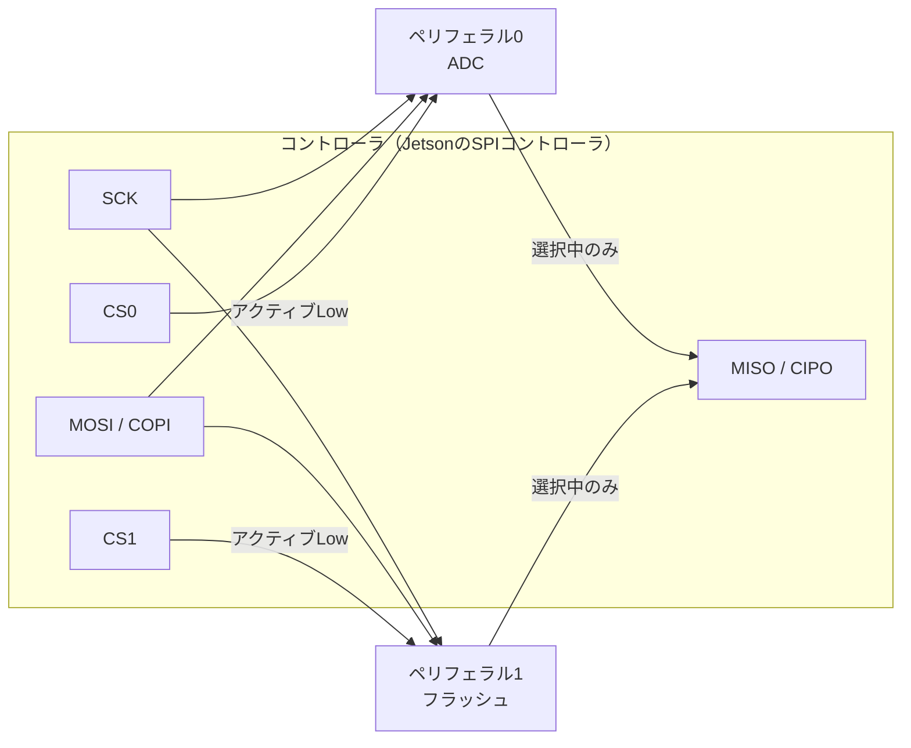
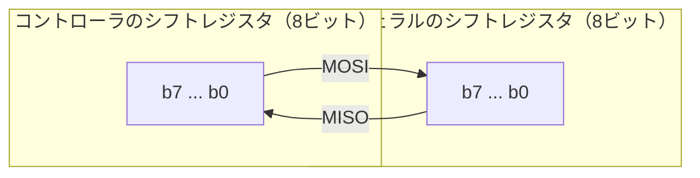

# SPI

[English](spi.md) · [リポジトリ](../../README_jp.md) · [Jetson AGX Orinのペリフェラル](jetson_agx_orin_peripherals_jp.md)

SPIバスの仕組み、各ピンの役割、4つのクロックモードの違い、Linuxでの使い方とデバッグ方法を、Jetson AGX Orinを例に説明します。SPIを信号レベルで理解したい組み込みエンジニアを対象にしています。

この文書で使う用語：

- **コントローラ／ペリフェラル：** クロックを生成してデバイスを選択するデバイスと、それに応答するデバイスです。古い文書ではマスターとスレーブと呼びます。
- **全二重：** データが同時に両方向へ流れることです。
- **プッシュプル：** オープンドレインのI2Cと違い、HighとLowの両方を能動的に駆動する出力です。これにより、ずっと高速に動かせます。
- **CPOL／CPHA：** クロックの極性（クロックのアイドル時のレベル）と位相（どちらのエッジでデータを読み取るか）です。この2つでSPIのモードが決まります。

## 全体像



クロック、MOSI、MISOはすべてのペリフェラルで共有します。各ペリフェラルには専用のチップセレクト（CS）線があります。コントローラがCSの1本をLowにしてペリフェラルを選ぶと、そのペリフェラルだけがMISOを駆動し、ほかはハイインピーダンスのままにします。矢印は信号の向きです。共通のグランドも必要ですが、図には描いていません。

主な特徴：

- **4本の線とデバイスごとのCS：** アドレスはなく、ハードウェアの線で選択します。
- **同期式・全二重：** クロック1サイクルごとに、MOSIで1ビットを送り出し、MISOで1ビットを受け取ります。
- **高速：** ラインがプッシュプルで1対1の接続のため、数十MHzもよく使われます。上限はコントローラ、ペリフェラル、配線で決まります。
- **標準のプロトコル層がない：** SPIが定めるのはビットの送り方だけです。コマンドのバイト、レジスタマップ、フレーム構成は各デバイスのデータシートで決まります。
- **用途：** ADC/DAC、NORフラッシュ、ディスプレイ、SPIモードのSDカード、EthernetやCANのコントローラ、FPGA、マイコンとの接続などです。

## ピンと役割

| ピン | 別名 | 向き | 役割 |
|---|---|---|---|
| SCK | SCLK、CLK | コントローラ → ペリフェラル | クロックです。コントローラだけが、転送中にだけ生成します。 |
| MOSI | COPI、SDO（コントローラ側）、SDI（ペリフェラル側）、DIN | コントローラ → ペリフェラル | コントローラからのデータです。 |
| MISO | CIPO、SDI（コントローラ側）、SDO（ペリフェラル側）、DOUT | ペリフェラル → コントローラ | 選択されたペリフェラルからのデータです。選択されていないペリフェラルはハイインピーダンスにします。 |
| CS | SS、nCS、CE、CSn | コントローラ → ペリフェラル | チップセレクトで、通常はアクティブLowです。トランザクションの始まりと終わりを示します。多くのデバイスはCSの立ち上がりでコマンドの解析をリセットします。 |
| GND | — | — | 共通の基準です。 |

多くのSPIデバイスにある追加のピン：

| ピン | 役割 |
|---|---|
| INT／DRDY／IRQ | ペリフェラルが「データ準備完了」やイベントをGPIO入力に知らせます。 |
| RESET | デバイスのリセットで、GPIOで駆動します。 |
| D/C（データ／コマンド） | 小型ディスプレイで、バイトがコマンドか画素データかを選びます。 |
| WP、HOLD | フラッシュメモリの書き込み保護と、転送の一時停止です。Quadモードではデータ線IO2とIO3になります。 |

SDIとSDOはデバイス自身から見た名前なので、ピン名は紛らわしくなります。コントローラのSDOはペリフェラルのSDIにつなぎます。COPI/CIPO（Controller Out Peripheral In／Controller In Peripheral Out）は、あいまいさのない新しい名前です。

## 転送の仕組み

### シフトレジスタ



SPIは、2つのシフトレジスタを輪のようにつないだものです。クロック1サイクルごとに、コントローラは自分のレジスタから1ビットをペリフェラルへ送り出し、ペリフェラルも1ビットをコントローラへ送り出します。8クロック後には、2つのレジスタの中身が入れ替わっています。ここから2つのことが言えます。

- **書き込みは必ず読み出しでもあります。** 読み出すときも、コントローラはバイトを送る必要があります（ダミーバイトとして`0x00`や`0xFF`がよく使われます）。
- **応答は通常1バイト遅れて届きます。** ペリフェラルはコマンドを受け取ったバイトの中では返事ができません。そのため、コントローラはコマンドを送ったあと、返事を受け取る間ダミーバイトを送ります。

### 典型的なレジスタ読み出し

```text
CS    ‾‾‾\________________________________________/‾‾‾
SCK   ____/‾\_/‾\_ ... _/‾\_/‾\_/‾\_ ... _/‾\________
MOSI  ====X cmd: 0x80 | reg ... X dummy 0x00 ...    X====
MISO  ====X (ignored)  ...      X data byte ...     X====
          |<--- byte 1 ----->|<---- byte 2 ---->|
```

多くのセンサーは、最初のバイトの最上位ビットで読み出し（1）か書き込み（0）かを示し、残りのビットでレジスタアドレスを示します。コントローラはトランザクション全体の間CSをLowに保ちます。CSを早く戻す（コマンドとダミーバイトの間で戻す）と、ほとんどのデバイスでコマンドが中断されます。

### SPIの4つのモード

| モード | CPOL | CPHA | クロックのアイドルレベル | データを読み取るエッジ | データを変えるエッジ |
|---|---|---|---|---|---|
| 0 | 0 | 0 | Low | 立ち上がり | 立ち下がり |
| 1 | 0 | 1 | Low | 立ち下がり | 立ち上がり |
| 2 | 1 | 0 | High | 立ち下がり | 立ち上がり |
| 3 | 1 | 1 | High | 立ち上がり | 立ち下がり |

```text
Mode 0 (CPOL=0, CPHA=0): 最初のエッジ（立ち上がり）で読み取る
CS    ‾‾\_____________________________
SCK   ____/‾‾\__/‾‾\__/‾‾\__ ...
DATA  ==X  b7  X  b6  X  b5  X ...
          ^      ^      ^     読み取り点

Mode 3 (CPOL=1, CPHA=1): クロックはHighでアイドル、2番目のエッジ（立ち上がり）で読み取る
CS    ‾‾\_____________________________
SCK   ‾‾‾‾\__/‾‾\__/‾‾\__/‾‾ ...
DATA  ====X  b7  X  b6  X  b5 ...
             ^      ^      ^  読み取り点
```

- **CPOL**はSCKのアイドルレベルを決めます。
- **CPHA = 0：** 最初のクロックエッジでデータを読み取ります。そのため、ペリフェラルはCSが下がったらすぐにビット7をMISOに出す必要があります。
- **CPHA = 1：** 最初のエッジでデータを送り出し、2番目のエッジで読み取ります。
- モード0とモード3が圧倒的によく使われ、両方に対応するデバイスも多くあります。どのモードを使うかはデータシートのタイミング図でわかります。モードを間違えると、データが1ビットずれることがよくあります。これは原因を探す手がかりになります。

### ほかに合わせる設定

- **ビット順：** ほとんどがMSBファーストです。LSBファーストのデバイスもあります。
- **ワードサイズ：** 通常は8ビットです。ADCやディスプレイには12ビット、16ビットなどを使うものもあります。
- **最大クロック：** ペリフェラルのデータシートで決まります。配線が長かったりレベルシフタを入れたりすると、使える速度が下がります。
- **CSのタイミング：** CSが下がってから最初のクロックまで、またはトランザクションの間に、最小の待ち時間が必要なデバイスがあります。
- **CSの極性：** ほとんどがアクティブLowです。

### 線を増やした方式

- **Dual SPIとQuad SPI（QSPI）：** 2本または4本のデータ線でスループットを上げます。主にフラッシュメモリで使います。コマンドで線の入出力を切り替えるため、バスは半二重になります。Jetson AGX Orinは、モジュール上のQSPI-NORフラッシュから起動します。
- **3線式SPI：** MOSIとMISOの代わりに、双方向のデータ線を1本使います。
- **デイジーチェーン：** デバイスを直列につなぎ、1本のCSを共有します。データはすべてのデバイスを順に通ります。

## 電気的な設計

- **信号品質：** 数十MHzでは、長いジャンパー線でリンギングが起きてビットを読み違えます。配線を短くし、SCKのドライバの近くに直列抵抗（たとえば22〜33 Ω）を入れ、信号の隣にグランド線を通します。
- **電圧レベル：** Jetsonの40ピンヘッダは3.3 Vです。5 Vのペリフェラルにはレベルシフタが必要で、遅いレベルシフタはクロックの上限を下げます。
- **CSのプルアップ：** CSにプルアップを入れると、コントローラが起動中でピンの設定がまだのときにも、ペリフェラルを非選択のままにできます。
- **MISOの共有：** 非選択のときにMISOを離さないペリフェラルがあると、ほかのすべてのデバイスが使えなくなります。まずは各デバイスを単独で試してください。

## Jetson AGX Orinでは

- モジュールには3つのSPIコントローラがあり、通常はそのうち1つが40ピンヘッダに出ています。Developer KitはSPIのピンをヘッダに配線していますが、使う前に`jetson-io`で有効にする必要があります。
- ヘッダはRaspberry Pi互換の配置です：**19番ピン = MOSI、21番ピン = MISO、23番ピン = SCK、24番ピン = CS0、26番ピン = CS1**。使うボードの*Carrier Board Specification*で対応を確認してください。
- コントローラはTegraのSPIドライバが扱います。汎用の`spidev`ドライバが`/dev/spidevB.C`を作ります。Bはバス番号、Cはチップセレクトです。
- カーネルドライバがあるペリフェラル（CANコントローラやディスプレイなど）は、`spidev`を使わず、デバイスツリーでSPIコントローラに子ノードを追加します。

## LinuxからSPIを使う

```bash
sudo /opt/nvidia/jetson-io/jetson-io.py
```

```bash
sudo modprobe spidev
```

```bash
ls -l /dev/spidev*
```

期待する結果：ヘッダのSPIを有効にして再起動すると、`/dev/spidev0.0`と`/dev/spidev0.1`（または近い番号）が現れます。

ループバックテスト：MOSI（19番ピン）とMISO（21番ピン）をつなぎ、`spidev_test`を実行します。`spidev_test`はカーネルのソースツリー（`tools/spi/spidev_test.c`）からビルドします。

```bash
sudo ./spidev_test -D /dev/spidev0.0 -s 1000000 -v -p "HELLO"
```

期待する結果：TXとRXの行に同じバイトが表示されます。RXがすべて`00`か`FF`なら、ピンがSPIに設定されていない、配線がない、または違うバスを開いています。

Jetsonの実機が手元になかったため、この文書の作成時にはコマンドを実行していません。

C言語では、全二重の転送を1回の`ioctl`で行います。

```c
#include <fcntl.h>
#include <linux/spi/spidev.h>
#include <stdint.h>
#include <stdio.h>
#include <sys/ioctl.h>
#include <unistd.h>

int main(void) {
    int fd = open("/dev/spidev0.0", O_RDWR);
    if (fd < 0) { perror("open"); return 1; }

    uint8_t mode = SPI_MODE_0, bits = 8;
    uint32_t speed = 1000000;
    ioctl(fd, SPI_IOC_WR_MODE, &mode);
    ioctl(fd, SPI_IOC_WR_BITS_PER_WORD, &bits);
    ioctl(fd, SPI_IOC_WR_MAX_SPEED_HZ, &speed);

    uint8_t tx[2] = { 0x80 | 0x0F, 0x00 };  /* read register 0x0F, then one dummy byte */
    uint8_t rx[2] = { 0 };
    struct spi_ioc_transfer tr = {
        .tx_buf = (unsigned long)tx,
        .rx_buf = (unsigned long)rx,
        .len = sizeof tx,
        .speed_hz = speed,
        .bits_per_word = bits,
    };
    if (ioctl(fd, SPI_IOC_MESSAGE(1), &tr) < 0) { perror("SPI_IOC_MESSAGE"); close(fd); return 1; }
    printf("register 0x0F = 0x%02x\n", rx[1]);  /* the reply arrives in the second byte */
    close(fd);
    return 0;
}
```

読み出しビット`0x80`を付けたレジスタ`0x0F`は、STMicroelectronicsの多くのモーションセンサーのWHO_AM_Iレジスタです。ほかのデバイスでは別のコマンドを使います。1つの`spi_ioc_transfer`の間、CSはLowのままです。`SPI_IOC_MESSAGE(n)`に複数の転送を渡すと、それらの間もCSをLowに保てます。間でCSを戻したい場合は`cs_change`を設定します。

## よくあるトラブル

| 症状 | よくある原因 |
|---|---|
| RXが常に`0x00`か`0xFF` | MISOが未接続、ペリフェラルに電源が入っていない、ピンがSPIモードでない、CSの誤り |
| データが1ビットずれる | SPIモード（CPOL/CPHA）の誤り |
| 最初のバイトは正しく、残りが誤る | ペリフェラルがバイト間でCSをLowに保つ必要がある、またはバイト間の待ち時間が必要 |
| 低速では動くが、高速では失敗する | 配線が長い、レベルシフタが遅い、ペリフェラルの最大クロックを超えている |
| 単独では動くが、一緒につなぐと動かない | 別のペリフェラルが非選択中にMISOを駆動している |

デバッグツール：SPIデコーダ付きのロジックアナライザでは、4本すべての線と正しいモードの設定が必要です。高速では、オシロスコープでリンギングとエッジのタイミングを確認します。

## 参考資料

作成環境からはこれらの資料を開けなかったため（ネットワークアクセスが制限されていた）、本文の情報は確立された文書と一般的な知識に基づいています。詳細は最新の文書で確認してください。

- Linuxカーネルのドキュメント, *SPI userspace API (spidev)*と*Overview of Linux kernel SPI support*: https://docs.kernel.org/spi/
- Linuxカーネルのソース, `tools/spi/spidev_test.c`: https://git.kernel.org/pub/scm/linux/kernel/git/torvalds/linux.git/tree/tools/spi
- Motorola / NXP, *SPI Block Guide*（SPIの最初の解説。NXPのドキュメントから入手可能）
- NVIDIA, *Jetson Linux Developer Guide*, Configuring the Jetson Expansion Headers: https://docs.nvidia.com/jetson/archives/r36.4.4/DeveloperGuide/HR/ConfiguringTheJetsonExpansionHeaders.html
