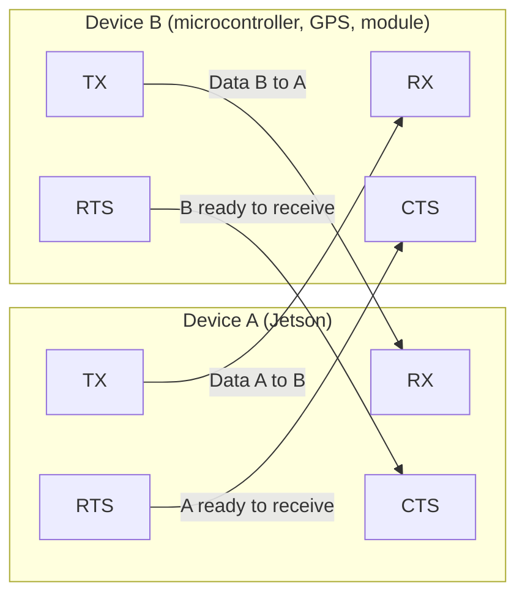

# UART

[日本語](uart_jp.md) · [Repository](../../README.md) · [Jetson AGX Orin peripherals](jetson_agx_orin_peripherals.md)

How a UART sends and receives serial data, what each pin does, how flow control and physical layers such as RS-232 and RS-485 relate to it, and how to use and debug serial ports on Linux, with Jetson AGX Orin as the example platform.

Terms used below:

- **UART (Universal Asynchronous Receiver-Transmitter):** the hardware block that converts bytes to a serial bit stream and back. "Asynchronous" means there is no shared clock wire; both sides agree on the bit rate in advance.
- **Baud rate:** symbols per second. For a UART each symbol is one bit, so 115200 baud means 115200 bit/s on the wire, including start and stop bits.
- **Frame:** one character on the wire: a start bit, data bits, an optional parity bit, and stop bits.
- **TTL-level serial:** UART signals at the logic voltage of the chip (for example 3.3 V), as opposed to RS-232 or RS-485 line levels.

## Overall structure



A UART link connects two devices point to point. **TX of one side goes to RX of the other**, in both directions, so each side can send at any time (full-duplex). RTS and CTS are optional flow control lines and are crossed the same way. Both devices must share ground (not drawn), use the same voltage level, and be configured with the same baud rate and frame format.

Main characteristics:

- **Two data wires, no clock:** timing comes from each side's own clock, so both must be accurate.
- **Point to point:** one transmitter per wire. Multi-drop buses need a physical layer such as RS-485.
- **Simple and universal:** debug consoles, bootloaders, GPS receivers, cellular and Bluetooth modules, and communication with microcontrollers.
- **Moderate speed:** 9600 to 115200 baud is common; many UARTs support several Mbit/s over short distances.

## Pins and their roles

| Pin | Direction (on this device) | Role |
|---|---|---|
| TX / TXD | Output | Sends data. Idles high (logic 1, "mark"). |
| RX / RXD | Input | Receives data. Connect to the other side's TX. |
| GND | — | Shared reference. Required; serial without a shared ground produces random characters or nothing. |
| RTS (Request To Send) | Output | In hardware flow control, low (asserted) means "I can receive more data." |
| CTS (Clear To Send) | Input | The transmitter sends only while CTS is asserted. Connect to the other side's RTS. |

RS-232 serial ports define more modem control lines. They are rarely used in embedded designs but appear on USB-serial adapters:

| Pin | Role |
|---|---|
| DTR (Data Terminal Ready) | Host is present. Some boards (for example Arduino-class boards) use it to reset the microcontroller. |
| DSR (Data Set Ready) | The other side is present. |
| DCD (Data Carrier Detect) | Modem connection established. |
| RI (Ring Indicator) | Incoming call on a modem. |

## How a frame works

### Frame format

```text
idle  start  D0  D1  D2  D3  D4  D5  D6  D7  stop  idle
‾‾‾‾‾\_____X===X===X===X===X===X===X===X===/‾‾‾‾‾‾‾‾‾‾‾‾
       0    LSB first ...              MSB   1

Example: 'A' = 0x41 = 0100 0001 in 8N1
‾‾‾‾‾\___/‾‾‾\___________/‾‾‾\___/‾‾‾‾‾‾‾‾‾
      S   1   0   0   0   0   0   1   0   P
          D0  D1  D2  D3  D4  D5  D6  D7
```

- **Idle:** the line stays high.
- **Start bit:** one bit time of low. Its falling edge tells the receiver that a frame begins.
- **Data bits:** usually 8, sent **least significant bit first**.
- **Parity (optional):** an extra bit that makes the number of 1s even (E) or odd (O). It detects single-bit errors but does not correct them.
- **Stop bit(s):** one (or two) bit times of high. The receiver checks it; a low level here is a **framing error**.
- The common setting **8N1** means 8 data bits, no parity, 1 stop bit: 10 bit times per byte. At 115200 baud the maximum payload is 11520 bytes/s.

### How the receiver samples

```text
RX     ‾‾‾‾\_______________X=========X====
            |<- 1 bit time ->|
            ^ falling edge detected
                   ^ sample in the middle of the start bit (confirm it is still low)
                                 ^ sample in the middle of D0, then every bit time
```

The receiver waits for the falling edge of the start bit, then samples each bit near its middle. Typical UARTs run an internal clock at 16 times the baud rate (16x oversampling) to find the middle accurately and to reject short glitches.

Because there is no shared clock, timing errors add up across the frame. By the last bit the sample point must still be inside that bit, so the **combined baud rate error of both sides should stay below about 2 to 3 percent** for 8N1. A UART clock that cannot divide exactly to the requested rate, or an uncalibrated RC oscillator on a microcontroller, is a common cause of garbage characters at high rates.

### Errors and special conditions

| Condition | Meaning |
|---|---|
| Framing error | The stop bit was low. Usually a baud rate mismatch or noise. |
| Parity error | The parity bit does not match the data. |
| Overrun | A new byte arrived before software or DMA read the previous one. Data is lost. |
| Break | The line is held low longer than a full frame. Used as a signal (for example to enter a bootloader or the SysRq function on a Linux console). |

### Flow control

- **None:** fine when the receiver is always fast enough, for example a console at 115200 baud.
- **Hardware (RTS/CTS):** the receiver deasserts RTS when its buffer is nearly full; the transmitter stops while it sees CTS deasserted. Recommended for high baud rates and continuous data such as Bluetooth modules.
- **Software (XON/XOFF):** the receiver sends the control characters `0x13` (XOFF) to pause and `0x11` (XON) to resume. Works only for text, because binary data can contain those byte values.

## Physical layers

The UART defines the frame. The voltage on the wire is defined by the physical layer:

| Layer | Levels | Wires | Distance | Topology |
|---|---|---|---|---|
| TTL / CMOS | 0 V and VDD (3.3 V or 1.8 V), idle high | TX, RX, GND | Tens of cm | Point to point |
| RS-232 | About +3 to +15 V for 0, −3 to −15 V for 1 (inverted), idle negative | TX, RX, GND (+ control lines) | About 15 m | Point to point |
| RS-422 | Differential pair per direction | 2 pairs + GND | Up to about 1200 m | One transmitter, several receivers |
| RS-485 | Differential pair, half-duplex | 1 pair + GND | Up to about 1200 m | Multi-drop, many devices |

- **Never connect RS-232 directly to a 3.3 V UART pin.** The negative and high positive voltages can damage the SoC. Use a transceiver such as a MAX3232-class part.
- **RS-485** needs a transceiver whose driver is enabled only while transmitting. The UART's RTS line, or a GPIO, controls the driver enable; Linux supports this through its RS-485 mode (`TIOCSRS485`).
- **USB-serial adapters** (FTDI, CP210x, CH340 class) give a PC a TTL-level UART. Check that the adapter is set to 3.3 V before connecting it to Jetson.

## On Jetson AGX Orin

- The module has several UART controllers. The `serial-tegra` driver exposes them as `/dev/ttyTHS*` ("Tegra High Speed"), with DMA for high baud rates.
- The **debug console** uses the Tegra Combined UART (TCU), `/dev/ttyTCU0`, which merges logs from several processors. On the Developer Kit it is available on a host PC through the **micro-USB debug port**, which has a USB-UART bridge on the carrier board. Use it to watch bootloader and kernel logs and to log in without a network.
- The 40-pin header follows the Raspberry Pi-compatible layout: **pin 8 = TX, pin 10 = RX, pin 11 = RTS, pin 36 = CTS**. Which `ttyTHS` index this is depends on the board and release, so confirm it in the *Carrier Board Specification* or by a loopback test.
- The header uses 3.3 V logic.
- On Ubuntu-based images, the `nvgetty` service may run a login console on a UART. Disable it if you need the port for your own device:

```bash
systemctl status nvgetty
```

## Using UART from Linux

```bash
ls -l /dev/ttyTHS* /dev/ttyTCU*
```

```bash
cat /proc/cmdline
```

```bash
sudo stty -F /dev/ttyTHS1 115200 cs8 -parenb -cstopb raw -echo
```

```bash
sudo picocom -b 115200 /dev/ttyTHS1
```

Expected results:

- The first command lists the UART device nodes and their group (usually `dialout`). Add your user to that group with `sudo usermod -aG dialout $USER` to avoid `sudo`.
- `/proc/cmdline` shows `console=` entries. Do not use a port that appears there.
- `stty` configures 115200 8N1 raw mode; `stty -F /dev/ttyTHS1 -a` prints the current settings.
- In `picocom`, with TX (pin 8) connected to RX (pin 10), typed characters echo back. Exit with `Ctrl-a` then `Ctrl-x`. `/dev/ttyTHS1` is an example name.

The commands were not run while writing this note because no Jetson device was available.

In C, configure the port with `termios`. Raw mode matters: by default a TTY processes line endings and special characters, which corrupts binary data.

```c
#include <fcntl.h>
#include <stdio.h>
#include <termios.h>
#include <unistd.h>

int main(void) {
    int fd = open("/dev/ttyTHS1", O_RDWR | O_NOCTTY);
    if (fd < 0) { perror("open"); return 1; }

    struct termios tio;
    tcgetattr(fd, &tio);
    cfmakeraw(&tio);                 /* no echo, no line editing, 8 data bits */
    cfsetispeed(&tio, B115200);
    cfsetospeed(&tio, B115200);
    tio.c_cflag |= CLOCAL | CREAD;   /* ignore modem lines, enable receiver */
    tio.c_cflag &= ~(PARENB | CSTOPB | CRTSCTS);  /* no parity, 1 stop bit, no flow control */
    tio.c_cc[VMIN] = 0;              /* read() returns after VTIME even with no data */
    tio.c_cc[VTIME] = 10;            /* timeout of 1.0 s */
    tcsetattr(fd, TCSANOW, &tio);

    const char msg[] = "hello\r\n";
    write(fd, msg, sizeof msg - 1);

    char buf[64];
    ssize_t n = read(fd, buf, sizeof buf);
    printf("received %zd bytes\n", n);
    close(fd);
    return 0;
}
```

With a TX-RX loopback wire, it prints `received 7 bytes`; with no wire, it prints `received 0 bytes` after one second.

## Common problems

| Symptom | Likely cause |
|---|---|
| Nothing received | TX connected to TX instead of RX, no shared ground, wrong device node, pins not in UART mode |
| Random characters | Baud rate or frame format mismatch, wrong voltage level, RS-232 connected without a transceiver |
| Good at low baud, bad at high baud | Clock error too large on one side, long wires, missing flow control |
| Data lost in bursts | Overrun: enable hardware flow control or read faster |
| Port is busy or output mixes with logs | A console or `getty` is using the port |
| Binary data altered (`0x0D` becomes `0x0A`) | TTY not in raw mode |

Debug tools: a logic analyzer with an asynchronous serial decoder (set the same baud rate and frame), or a second USB-serial adapter that listens on one line. An oscilloscope shows the bit time, which reveals the real baud rate: 115200 baud is a bit time of about 8.68 µs.

## References

These sources could not be opened from the authoring environment (network access was blocked), so the facts above come from established documentation and general knowledge; check details against the current documents.

- Linux man pages, *termios(3)* and *stty(1)*: https://man7.org/linux/man-pages/man3/termios.3.html
- Linux kernel documentation, *RS485 Serial Communications*: https://docs.kernel.org/driver-api/serial/serial-rs485.html
- Texas Instruments, *Interface Circuits for TIA/EIA-485 (RS-485)* application report (SLLA036)
- NVIDIA, *Jetson AGX Orin Developer Kit User Guide* and *Carrier Board Specification* (Jetson Download Center: https://developer.nvidia.com/embedded/downloads)
