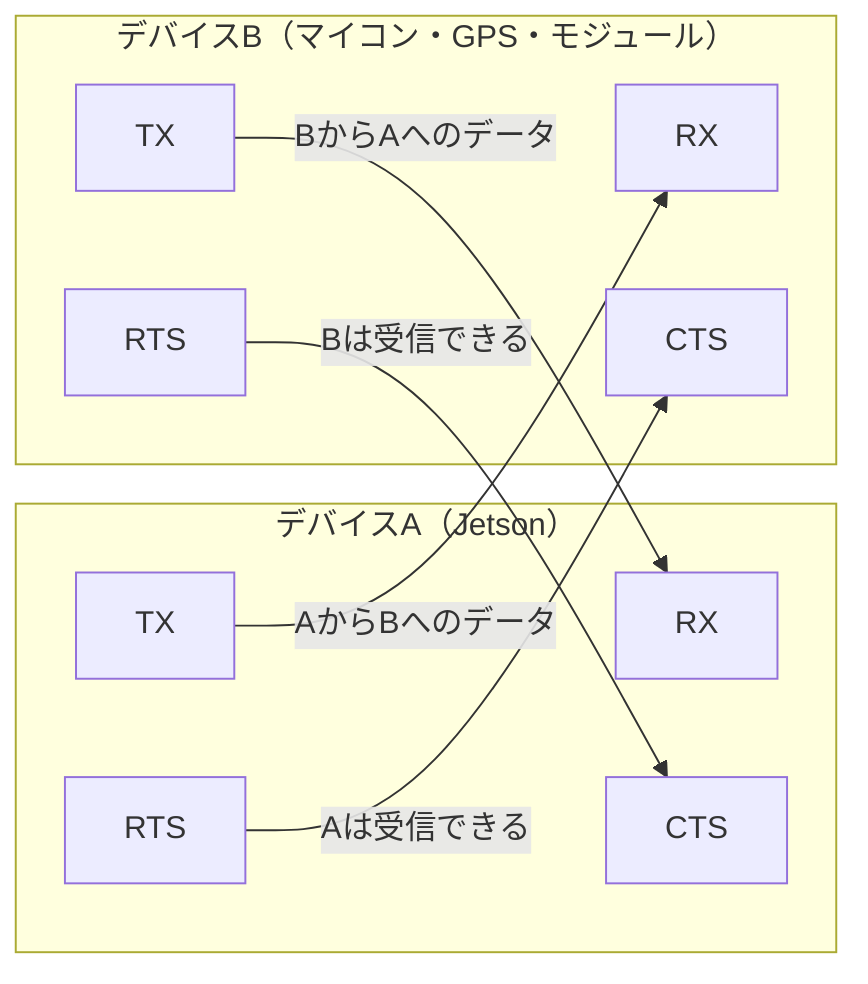

# UART

[English](uart.md) · [リポジトリ](../../README_jp.md) · [Jetson AGX Orinのペリフェラル](jetson_agx_orin_peripherals_jp.md)

UARTがシリアルデータを送受信する仕組み、各ピンの役割、フロー制御やRS-232・RS-485などの物理層との関係、Linuxでのシリアルポートの使い方とデバッグ方法を、Jetson AGX Orinを例に説明します。

この文書で使う用語：

- **UART（Universal Asynchronous Receiver-Transmitter）：** バイトをシリアルのビット列に変換し、また元に戻すハードウェアのブロックです。「非同期」とは、共通のクロック線がないことを意味します。両側があらかじめビットレートを合わせておきます。
- **ボーレート：** 1秒あたりのシンボル数です。UARTでは1シンボルが1ビットなので、115200ボーは線上で115200 bit/sです（スタートビットとストップビットを含む）。
- **フレーム：** 線上の1文字で、スタートビット、データビット、必要に応じてパリティビット、ストップビットからなります。
- **TTLレベルのシリアル：** RS-232やRS-485の線路の電圧ではなく、チップのロジック電圧（たとえば3.3 V）で送るUARTの信号です。

## 全体像



UARTは2つのデバイスを1対1でつなぎます。**一方のTXをもう一方のRXに**、両方向ともつなぐので、どちらの側もいつでも送信できます（全二重）。RTSとCTSは追加のフロー制御線で、同じように交差させてつなぎます。両デバイスはグランドを共有し（図には描いていません）、電圧レベルを合わせ、同じボーレートとフレーム形式に設定する必要があります。

主な特徴：

- **データ線2本、クロックなし：** タイミングは各側の自分のクロックで決まるため、両方とも正確である必要があります。
- **1対1：** 1本の線に送信側は1つです。マルチドロップのバスには、RS-485などの物理層が必要です。
- **シンプルで普及している：** デバッグコンソール、ブートローダ、GPS受信機、携帯通信やBluetoothのモジュール、マイコンとの通信に使います。
- **中程度の速度：** 9600〜115200ボーが一般的です。短い距離なら、数Mbit/sに対応するUARTも多くあります。

## ピンと役割

| ピン | 向き（このデバイスから見て） | 役割 |
|---|---|---|
| TX／TXD | 出力 | データを送ります。アイドル時はHigh（ロジック1、「マーク」）です。 |
| RX／RXD | 入力 | データを受け取ります。相手側のTXにつなぎます。 |
| GND | — | 共通の基準です。必須で、グランドを共有しないシリアル通信は、でたらめな文字が出るか何も出ません。 |
| RTS（Request To Send） | 出力 | ハードウェアフロー制御で、Low（アサート）は「まだ受信できる」を意味します。 |
| CTS（Clear To Send） | 入力 | 送信側はCTSがアサートされている間だけ送信します。相手側のRTSにつなぎます。 |

RS-232のシリアルポートには、ほかにもモデム制御線があります。組み込みの設計ではあまり使いませんが、USBシリアルアダプタには出ています。

| ピン | 役割 |
|---|---|
| DTR（Data Terminal Ready） | ホストが存在することを示します。マイコンのリセットに使うボードもあります（Arduinoクラスのボードなど）。 |
| DSR（Data Set Ready） | 相手側が存在することを示します。 |
| DCD（Data Carrier Detect） | モデムの接続が確立したことを示します。 |
| RI（Ring Indicator） | モデムへの着信を示します。 |

## フレームの仕組み

### フレーム形式

```text
idle  start  D0  D1  D2  D3  D4  D5  D6  D7  stop  idle
‾‾‾‾‾\_____X===X===X===X===X===X===X===X===/‾‾‾‾‾‾‾‾‾‾‾‾
       0    LSB first ...              MSB   1

Example: 'A' = 0x41 = 0100 0001 in 8N1
‾‾‾‾‾\___/‾‾‾\___________/‾‾‾\___/‾‾‾‾‾‾‾‾‾
      S   1   0   0   0   0   0   1   0   P
          D0  D1  D2  D3  D4  D5  D6  D7
```

- **アイドル：** ラインはHighのままです。
- **スタートビット：** 1ビット時間のLowです。その立ち下がりで、受信側はフレームの始まりを知ります。
- **データビット：** 通常は8ビットで、**最下位ビットから**送ります。
- **パリティ（任意）：** 1の数を偶数（E）または奇数（O）にする追加のビットです。1ビットの誤りを検出できますが、訂正はできません。
- **ストップビット：** 1（または2）ビット時間のHighです。受信側がこれを確認し、ここがLowなら**フレーミングエラー**です。
- よく使う設定の**8N1**は、データ8ビット、パリティなし、ストップビット1です。1バイトあたり10ビット時間なので、115200ボーでのデータの最大量は11520バイト/秒です。

### 受信側のサンプリング

```text
RX     ‾‾‾‾\_______________X=========X====
            |<- 1 bit time ->|
            ^ 立ち下がりを検出
                   ^ スタートビットの中央でサンプル（まだLowか確認）
                                 ^ D0の中央でサンプル、以降1ビット時間ごと
```

受信側はスタートビットの立ち下がりを待ち、その後は各ビットの中央付近でサンプリングします。一般的なUARTは、ボーレートの16倍の内部クロック（16倍オーバーサンプリング）で動き、中央を正確に見つけ、短いノイズを除去します。

共通のクロックがないため、タイミングの誤差はフレームの中で積み重なります。最後のビットでもサンプル点がそのビットの範囲内にある必要があるので、8N1では**両側を合わせたボーレートの誤差を約2〜3%以下**に抑えます。要求された速度にちょうど分周できないUARTのクロックや、マイコンの未校正のRC発振器は、高速で文字化けが起きる典型的な原因です。

### エラーと特殊な状態

| 状態 | 意味 |
|---|---|
| フレーミングエラー | ストップビットがLowだった。たいていはボーレートの不一致かノイズ。 |
| パリティエラー | パリティビットがデータと合わない。 |
| オーバーラン | ソフトウェアやDMAが前のバイトを読む前に、次のバイトが届いた。データが失われる。 |
| ブレーク | 1フレームより長くラインがLowに保たれた。合図として使う（ブートローダに入る、LinuxコンソールのSysRq機能など）。 |

### フロー制御

- **なし：** 受信側が常に十分速ければ問題ありません。たとえば115200ボーのコンソールです。
- **ハードウェア（RTS/CTS）：** 受信側はバッファがいっぱいに近づくとRTSをネゲートし、送信側はCTSがネゲートされている間は送信を止めます。高いボーレートや、Bluetoothモジュールのような連続したデータには、こちらを勧めます。
- **ソフトウェア（XON/XOFF）：** 受信側が制御文字`0x13`（XOFF）を送って一時停止させ、`0x11`（XON）で再開させます。バイナリデータにはこの値が含まれることがあるため、テキストにしか使えません。

## 物理層

UARTが決めるのはフレームです。線上の電圧は物理層が決めます。

| 物理層 | レベル | 線 | 距離 | 構成 |
|---|---|---|---|---|
| TTL／CMOS | 0 VとVDD（3.3 Vまたは1.8 V）、アイドルはHigh | TX、RX、GND | 数十cm | 1対1 |
| RS-232 | 0が約+3〜+15 V、1が−3〜−15 V（反転）、アイドルは負電圧 | TX、RX、GND（＋制御線） | 約15 m | 1対1 |
| RS-422 | 方向ごとに差動ペア | 2ペア＋GND | 最大約1200 m | 送信側1つ、受信側複数 |
| RS-485 | 差動ペア、半二重 | 1ペア＋GND | 最大約1200 m | マルチドロップ、多数のデバイス |

- **RS-232を3.3 VのUARTピンに直接つながないでください。** 負電圧や高い正電圧でSoCが壊れることがあります。MAX3232クラスなどのトランシーバを使います。
- **RS-485**では、送信中だけドライバを有効にするトランシーバが必要です。ドライバの有効化はUARTのRTSかGPIOで制御します。LinuxはRS-485モード（`TIOCSRS485`）でこれに対応しています。
- **USBシリアルアダプタ**（FTDI、CP210x、CH340クラス）は、PCにTTLレベルのUARTを提供します。Jetsonにつなぐ前に、アダプタが3.3 Vに設定されていることを確認してください。

## Jetson AGX Orinでは

- モジュールには複数のUARTコントローラがあります。`serial-tegra`ドライバが`/dev/ttyTHS*`（「Tegra High Speed」）として公開し、高いボーレートではDMAを使います。
- **デバッグコンソール**はTegra Combined UART（TCU）の`/dev/ttyTCU0`を使い、複数のプロセッサのログをまとめて出します。Developer Kitでは、キャリアボード上のUSB-UARTブリッジを介して、**Micro-USBデバッグポート**からホストPCで使えます。ブートローダやカーネルのログを見たり、ネットワークなしでログインしたりするのに使います。
- 40ピンヘッダはRaspberry Pi互換の配置です：**8番ピン = TX、10番ピン = RX、11番ピン = RTS、36番ピン = CTS**。これが何番の`ttyTHS`になるかはボードやリリースによって異なるため、*Carrier Board Specification*かループバックテストで確認してください。
- ヘッダは3.3 Vロジックです。
- Ubuntuベースのイメージでは、`nvgetty`サービスがUART上でログインコンソールを動かしていることがあります。自分のデバイスにそのポートを使う場合は無効にします。

```bash
systemctl status nvgetty
```

## LinuxからUARTを使う

```bash
ls -l /dev/ttyTHS* /dev/ttyTCU*
```

```bash
cat /proc/cmdline
```

```bash
sudo stty -F /dev/ttyTHS1 115200 cs8 -parenb -cstopb raw -echo
```

```bash
sudo picocom -b 115200 /dev/ttyTHS1
```

期待する結果：

- 1つ目のコマンドは、UARTのデバイスノードとそのグループ（通常は`dialout`）を表示します。`sudo usermod -aG dialout $USER`で自分のユーザーをこのグループに加えると、`sudo`が不要になります。
- `/proc/cmdline`には`console=`の項目が表示されます。ここに出ているポートは使わないでください。
- `stty`は115200 8N1のrawモードに設定します。`stty -F /dev/ttyTHS1 -a`で現在の設定を表示できます。
- `picocom`では、TX（8番ピン）とRX（10番ピン）をつないでいれば、入力した文字がそのまま返ってきます。`Ctrl-a`の後に`Ctrl-x`で終了します。`/dev/ttyTHS1`は例です。

Jetsonの実機が手元になかったため、この文書の作成時にはコマンドを実行していません。

C言語では`termios`でポートを設定します。rawモードが重要です。TTYは標準で改行や特殊文字を処理するため、そのままではバイナリデータが壊れます。

```c
#include <fcntl.h>
#include <stdio.h>
#include <termios.h>
#include <unistd.h>

int main(void) {
    int fd = open("/dev/ttyTHS1", O_RDWR | O_NOCTTY);
    if (fd < 0) { perror("open"); return 1; }

    struct termios tio;
    tcgetattr(fd, &tio);
    cfmakeraw(&tio);                 /* no echo, no line editing, 8 data bits */
    cfsetispeed(&tio, B115200);
    cfsetospeed(&tio, B115200);
    tio.c_cflag |= CLOCAL | CREAD;   /* ignore modem lines, enable receiver */
    tio.c_cflag &= ~(PARENB | CSTOPB | CRTSCTS);  /* no parity, 1 stop bit, no flow control */
    tio.c_cc[VMIN] = 0;              /* read() returns after VTIME even with no data */
    tio.c_cc[VTIME] = 10;            /* timeout of 1.0 s */
    tcsetattr(fd, TCSANOW, &tio);

    const char msg[] = "hello\r\n";
    write(fd, msg, sizeof msg - 1);

    char buf[64];
    ssize_t n = read(fd, buf, sizeof buf);
    printf("received %zd bytes\n", n);
    close(fd);
    return 0;
}
```

TXとRXをループバック線でつなぐと`received 7 bytes`と表示され、線がなければ1秒後に`received 0 bytes`と表示されます。

## よくあるトラブル

| 症状 | よくある原因 |
|---|---|
| 何も受信しない | TXをRXではなくTXにつないでいる、グランドが共通でない、デバイスノードの誤り、ピンがUARTモードでない |
| でたらめな文字が出る | ボーレートやフレーム形式の不一致、電圧レベルの誤り、トランシーバなしでRS-232をつないでいる |
| 低いボーレートでは正常、高いと異常 | 片側のクロック誤差が大きすぎる、配線が長い、フロー制御がない |
| データがまとめて失われる | オーバーラン：ハードウェアフロー制御を有効にするか、もっと速く読む |
| ポートが使用中、または出力にログが混ざる | コンソールや`getty`がそのポートを使っている |
| バイナリデータが変わる（`0x0D`が`0x0A`になる） | TTYがrawモードになっていない |

デバッグツール：非同期シリアルのデコーダ付きロジックアナライザ（同じボーレートとフレーム形式に設定）や、片方の線を聞くだけの2台目のUSBシリアルアダプタを使います。オシロスコープではビット時間がわかるため、実際のボーレートを確認できます。115200ボーのビット時間は約8.68 µsです。

## 参考資料

作成環境からはこれらの資料を開けなかったため（ネットワークアクセスが制限されていた）、本文の情報は確立された文書と一般的な知識に基づいています。詳細は最新の文書で確認してください。

- Linuxのmanページ, *termios(3)*と*stty(1)*: https://man7.org/linux/man-pages/man3/termios.3.html
- Linuxカーネルのドキュメント, *RS485 Serial Communications*: https://docs.kernel.org/driver-api/serial/serial-rs485.html
- Texas Instruments, *Interface Circuits for TIA/EIA-485 (RS-485)*（アプリケーションレポートSLLA036）
- NVIDIA, *Jetson AGX Orin Developer Kit User Guide*と*Carrier Board Specification*（Jetson Download Center: https://developer.nvidia.com/embedded/downloads）
