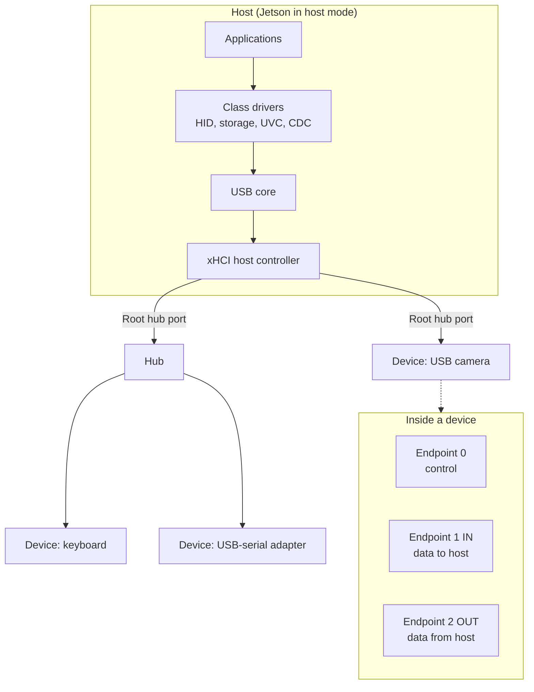
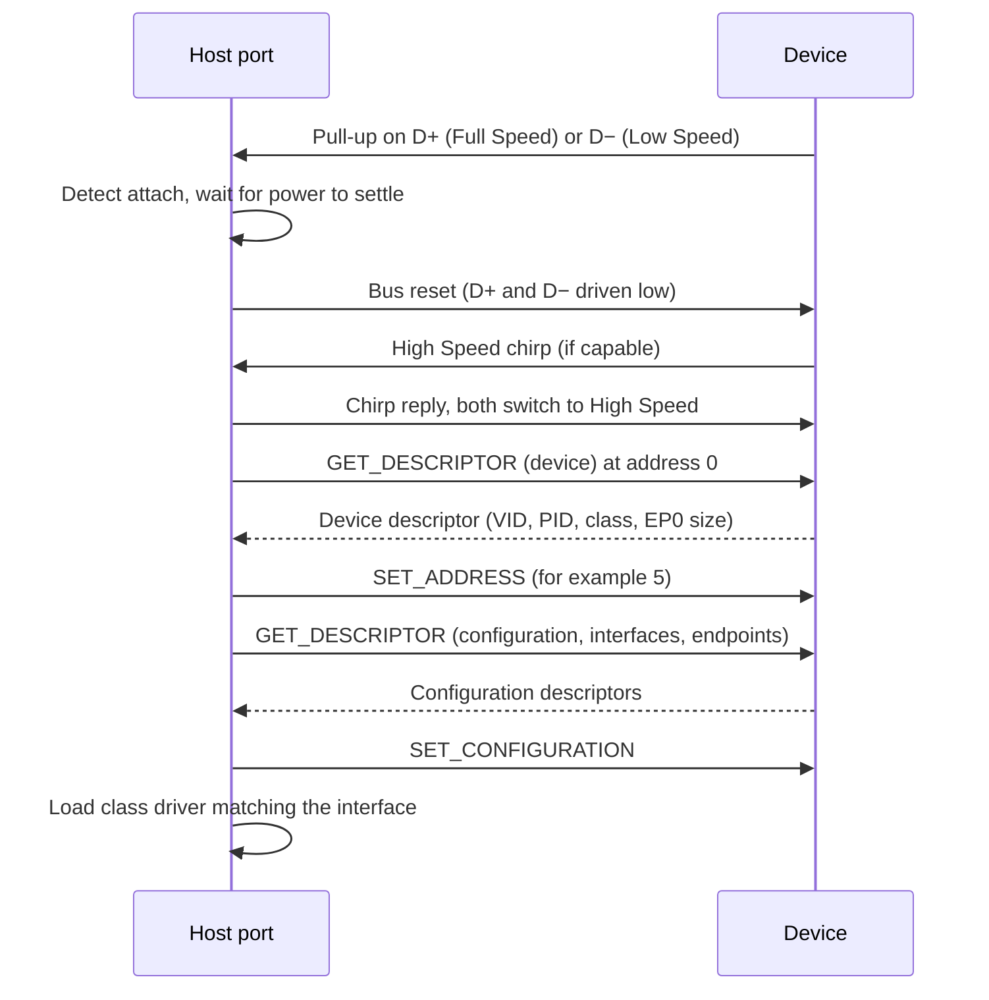

# USB

[日本語](usb_jp.md) · [Repository](../../README.md) · [Jetson AGX Orin peripherals](jetson_agx_orin_peripherals.md)

How USB connects hosts and devices, what each pin on USB 2.0, USB 3.x, and USB Type-C connectors does, how a device is detected and enumerated, and how to use and debug USB on Linux, with Jetson AGX Orin as the example platform.

Terms used below:

- **Host:** the side that controls the bus and schedules every transfer (a PC, or Jetson in host mode).
- **Device (function):** the side that responds (a keyboard, camera, or Jetson in device mode). A device never speaks unless the host asks.
- **Hub:** a device that adds ports. USB forms a tiered star: host → hubs → devices.
- **Endpoint:** a numbered data buffer inside a device. Each transfer targets one endpoint in one direction.
- **Descriptor:** a data structure the device sends to describe itself: its IDs, configurations, interfaces, and endpoints.
- **Class:** a standard device type (HID, mass storage, CDC, UVC, audio) that a generic host driver can handle without a vendor driver.
- **xHCI:** the standard host controller interface for USB 3.x (and lower speeds); Linux uses one driver model for all xHCI controllers.

## Overall structure



The host controller owns the bus. Software on the host talks to devices through the USB core and class drivers; the controller turns those requests into packets on the wire. Hubs repeat traffic to their ports. Inside each device, endpoint 0 is always present for control requests, and other endpoints carry data. The dotted arrow shows what one device contains.

Main characteristics:

- **Host-scheduled:** devices answer only when polled, so there are no collisions.
- **Hot-plug and self-describing:** the host detects a new device, reads its descriptors, assigns an address, and loads a matching driver.
- **Power on the cable:** VBUS supplies 5 V; USB Power Delivery can negotiate higher voltages over Type-C.
- **Wide speed range:** from 1.5 Mbit/s keyboards to 10 Gbit/s and faster storage.

## Speeds

| Name | Signaling rate | Introduced in | Wires used |
|---|---|---|---|
| Low Speed | 1.5 Mbit/s | USB 1.0 | D+ / D− |
| Full Speed | 12 Mbit/s | USB 1.0 | D+ / D− |
| High Speed | 480 Mbit/s | USB 2.0 | D+ / D− |
| SuperSpeed (USB 3.2 Gen 1, "USB 5Gbps") | 5 Gbit/s | USB 3.0 | Separate TX and RX pairs |
| SuperSpeed+ (USB 3.2 Gen 2, "USB 10Gbps") | 10 Gbit/s | USB 3.1 | Separate TX and RX pairs |
| USB 3.2 Gen 2x2 ("USB 20Gbps") | 20 Gbit/s | USB 3.2 | Two lanes on Type-C |
| USB4 | 40 Gbit/s and 80 Gbit/s (USB4 v2) | USB4 | Type-C only |

A USB 3.x connector keeps the USB 2.0 pair in parallel. A USB 3 port therefore has **two independent buses**: the USB 2.0 bus and the SuperSpeed bus. A device uses one of them depending on its capability and the cable. In Linux they appear as two separate root hubs.

## Pins and their roles

### USB 2.0 (Type-A, Type-B, Micro-B)

| Pin | Name | Role |
|---|---|---|
| 1 | VBUS | +5 V supplied by the host or hub. A device can be bus-powered from it or only use it to detect that a host is present. |
| 2 | D− | Data, negative side of the differential pair. |
| 3 | D+ | Data, positive side of the differential pair. |
| 4 (5 on Micro) | GND | Ground and power return. |
| 4 on Micro-AB | ID | USB On-The-Go role: grounded in the cable means "be host", floating means "be device". |
| Shell | Shield | Connected to chassis ground, often through an RC network. |

D+ and D− form one differential pair (90 Ω differential impedance). It is **half-duplex**: data flows in one direction at a time.

### USB 3.x (Type-A and Type-B SuperSpeed)

Adds five pins beside the USB 2.0 pins:

| Name | Role |
|---|---|
| SSTX+ / SSTX− | SuperSpeed transmit pair (host TX connects to device RX). |
| SSRX+ / SSRX− | SuperSpeed receive pair. |
| GND_DRAIN | Signal ground for the SuperSpeed pairs. |

SuperSpeed is **full-duplex**: one pair per direction, each with AC coupling capacitors on the transmit side.

### USB Type-C

The Type-C receptacle has 24 pins in two rows (A1–A12 and B1–B12) arranged so that the plug can be inserted either way up.

```text
       A1   A2    A3    A4    A5   A6  A7  A8    A9    A10   A11   A12
      GND  TX1+  TX1−  VBUS  CC1   D+  D−  SBU1  VBUS  RX2−  RX2+  GND
      GND  RX1+  RX1−  VBUS  SBU2  D−  D+  CC2   VBUS  TX2−  TX2+  GND
       B12  B11   B10   B9    B8   B7  B6  B5    B4    B3    B2    B1
```

| Pins | Role |
|---|---|
| VBUS (A4, A9, B4, B9) | Power. 5 V by default; up to 20 V (48 V with Extended Power Range) after a Power Delivery negotiation. **Off until a sink is detected**, unlike Type-A. |
| GND (A1, A12, B1, B12) | Ground and power return. |
| D+ / D− (A6, A7, B6, B7) | The USB 2.0 pair. Both rows are connected together on the receptacle so either plug orientation works. |
| TX1, RX1, TX2, RX2 | Two high-speed lanes. USB 3.x Gen 1 and Gen 2 use one lane, chosen by the plug orientation; Gen 2x2 and USB4 use both. DisplayPort Alternate Mode can use them for video. |
| CC1, CC2 (Configuration Channel) | Detect attachment, plug orientation, roles, and current; carry USB Power Delivery messages. |
| SBU1, SBU2 (Sideband Use) | Used by alternate modes (for example the DisplayPort AUX channel) and USB4. |
| VCONN | In the plug, one CC pin becomes VCONN to power the electronics inside an active or e-marked cable. |

**How CC works:** a power source (host) puts a pull-up Rp on its CC pins; a sink (device) puts a 5.1 kΩ pull-down Rd on its CC pins. When a cable connects them, only one CC wire links the two sides, so:

1. The source sees a voltage on one CC pin and knows a sink is attached and **which way the plug is turned**.
2. Only then does the source turn on VBUS.
3. The value of Rp advertises the available current: Default USB power, 1.5 A, or 3.0 A at 5 V. The sink measures the CC voltage to know how much it may draw.
4. For more power or role swaps, both sides exchange USB Power Delivery messages over CC.

A device with a Type-C receptacle but no Rd resistors is not detected by a Type-C charger or host, so it never receives power: a common design mistake.

## How a device connects

### Detection



- The host has 15 kΩ pull-downs on D+ and D−. A Full Speed device adds a 1.5 kΩ pull-up on D+, and a Low Speed device on D−. The host sees the line go high and knows a device is attached and at what speed.
- A High Speed capable device announces itself during reset with a "chirp" handshake, then removes its pull-up.
- SuperSpeed devices are detected separately by receiver termination on the SuperSpeed pair, followed by link training.
- **Enumeration** is the process of reading descriptors, assigning an address (1 to 127), and selecting a configuration. After that, the host loads drivers.

### Descriptors

```text
Device descriptor           VID 0x0955, PID ..., USB version, class
└── Configuration 1         power use, number of interfaces
    ├── Interface 0         class (for example CDC Communications)
    │   └── Endpoint 0x81   IN, interrupt
    └── Interface 1         class (for example CDC Data)
        ├── Endpoint 0x82   IN, bulk
        └── Endpoint 0x02   OUT, bulk
```

- **VID / PID:** vendor ID and product ID. Linux matches drivers by these or by the class codes of each interface.
- **Interface:** one function of the device. A device with several interfaces (a webcam with a microphone) is a composite device, and each interface can have its own driver.
- **Endpoint address:** bit 7 is the direction (1 = IN, device to host), and the low bits are the number.

### Transfer types

| Type | Guarantee | Typical use |
|---|---|---|
| Control | Delivered with retries; small; on endpoint 0 | Enumeration, configuration, vendor commands |
| Bulk | Delivered with retries; no timing guarantee; uses spare bandwidth | Storage, serial adapters, printers, network adapters |
| Interrupt | Polled at a fixed interval with bounded latency | Keyboards, mice, HID sensors |
| Isochronous | Reserved bandwidth and timing; no retries | Audio and video streams (UVC cameras, USB audio) |

The host schedules traffic in 1 ms frames (Full Speed) or 125 µs microframes (High Speed and above). **"IN" and "OUT" are always named from the host's point of view.**

### Common device classes

| Class | Linux driver | Device example |
|---|---|---|
| HID | `usbhid` | Keyboard, mouse, game controller |
| Mass Storage (MSC / UAS) | `usb-storage`, `uas` | USB flash drive, SSD enclosure |
| CDC-ACM | `cdc_acm` (`/dev/ttyACM*`) | Microcontroller virtual serial port |
| Vendor serial | `ftdi_sio`, `cp210x`, `ch341` (`/dev/ttyUSB*`) | USB-serial adapter |
| CDC-ECM / NCM / RNDIS | `cdc_ether`, `cdc_ncm`, `rndis_host` | USB network gadget |
| UVC | `uvcvideo` (`/dev/video*`) | Webcam |
| Audio (UAC) | `snd-usb-audio` | USB microphone, DAC |

## Electrical design

- **Differential impedance:** route D+/D− as a 90 Ω differential pair and SuperSpeed pairs at 85 to 90 Ω, with matched lengths and no stubs.
- **ESD protection:** connectors are exposed to people. Use low-capacitance ESD diodes; normal TVS diodes add too much capacitance for High Speed and SuperSpeed.
- **VBUS:** a host must limit current on VBUS (current-limit switch) and tolerate short circuits. A device should not drive VBUS back into a host.
- **Power budget:** a USB 2.0 port provides at least 500 mA and a USB 3.x port 900 mA at 5 V after configuration. USB Battery Charging 1.2 ports and Type-C current advertisement allow 1.5 A or 3 A. Power Delivery negotiates up to 100 W (240 W with Extended Power Range).

## On Jetson AGX Orin

- The module provides **three USB 3.2 ports and four USB 2.0 ports**. USB 3.2 ports use UPHY lanes, which are shared with PCIe and 10GbE, so the carrier board design decides how many are available.
- **Host mode:** an xHCI controller handled by the Tegra xHCI driver (source file `xhci-tegra.c`, driver name `tegra-xusb`). The Developer Kit has USB Type-A and Type-C host ports.
- **Device mode:** a device controller handled by `tegra-xudc`. One Type-C port on the Developer Kit works in device mode. It is used for:
  - **Flashing:** in recovery mode the boot ROM appears to a Linux host PC as a USB device (NVIDIA vendor ID `0955`), and the flashing tools send the boot images through it.
  - **USB gadget functions in normal boot:** the default image configures a composite gadget with a network interface and a serial console, so a host PC can reach Jetson at `192.168.55.1` and through `/dev/ttyACM*`. The scripts are under `/opt/nvidia/l4t-usb-device-mode/`.
- The Type-C ports use a Type-C/PD controller on the carrier board to handle CC, orientation, and roles.

## Using USB from Linux

```bash
lsusb
```

```bash
lsusb -t
```

```bash
sudo dmesg --follow
```

Expected results:

- `lsusb` lists each device with bus, address, and `VID:PID`, for example `Bus 001 Device 003: ID 0403:6001 Future Technology Devices International, Ltd FT232 Serial (UART) IC`.
- `lsusb -t` shows the tree with speed per port: `12M` (Full Speed), `480M` (High Speed), `5000M` (Gen 1), `10000M` (Gen 2), and the driver bound to each interface. A SuperSpeed device that shows `480M` is on the USB 2.0 bus: check the cable, hub, or port.
- `dmesg --follow` prints messages while you plug in a device, such as `new high-speed USB device number 3 using tegra-xusb` and the driver that bound to it.

```bash
sudo lsusb -v -d 0403:6001 | less
```

Expected result: all descriptors of that device: configurations, interfaces, class codes, and endpoints with their transfer types and maximum packet sizes. `0403:6001` is an example; use an ID from `lsusb`.

To capture USB traffic, load `usbmon` and use Wireshark on the `usbmonN` interface for the bus:

```bash
sudo modprobe usbmon
```

The commands were not run while writing this note because no Jetson device was available.

## Common problems

| Symptom | Likely cause |
|---|---|
| No `dmesg` message at plug-in | No power on VBUS (Type-C device without Rd), broken data wires, charge-only cable |
| `device descriptor read/64, error -71` | Signal integrity or power problem during enumeration: long or poor cable, unpowered hub, current limit |
| Device runs at `480M` instead of `5000M` | USB 2.0 cable or hub, dirty connector, or SuperSpeed lanes not enabled on the port (UPHY configuration) |
| Device disconnects under load | Bus-powered device draws more current than the port supplies; use a powered hub |
| `/dev/ttyUSB0` and `/dev/ttyACM0` swap names | Names follow plug order; use `/dev/serial/by-id/` or a udev rule |
| Webcam drops frames | Isochronous bandwidth exhausted on a shared bus; move devices to different root ports |

## References

These sources could not be opened from the authoring environment (network access was blocked), so the facts above come from established specifications and general knowledge; check details against the current documents.

- USB Implementers Forum, *Universal Serial Bus 2.0 Specification*, *USB 3.2 Specification*, *USB Type-C Cable and Connector Specification*, and *USB Power Delivery Specification*: https://www.usb.org/documents
- Linux kernel documentation, *USB support* and *Linux USB gadget configured through configfs*: https://docs.kernel.org/usb/
- Jan Axelson, *USB Complete*, 5th edition, Lakeview Research
- NVIDIA, *Jetson Linux Developer Guide* (Flashing Support; USB device mode) and *Jetson AGX Orin Developer Kit User Guide*: https://docs.nvidia.com/jetson/
