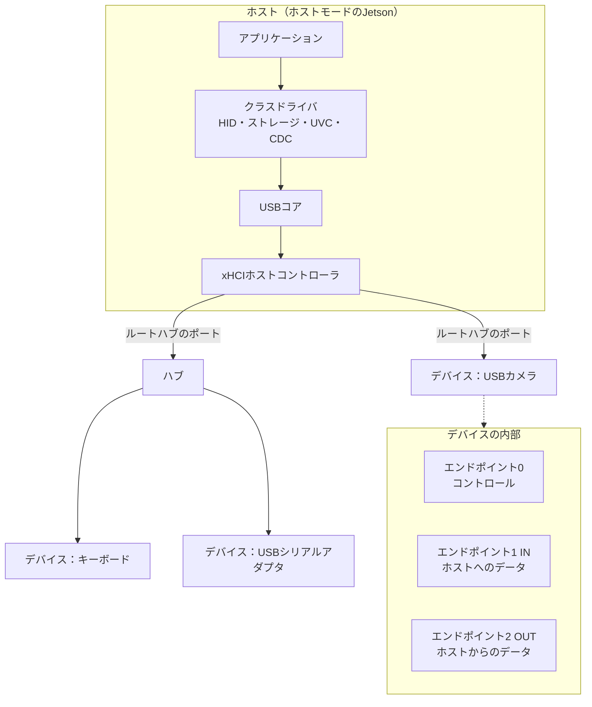
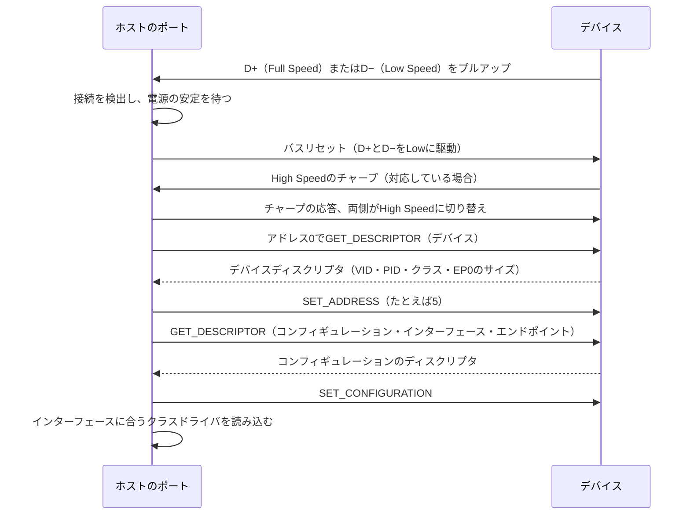

# USB

[English](usb.md) · [リポジトリ](../../README_jp.md) · [Jetson AGX Orinのペリフェラル](jetson_agx_orin_peripherals_jp.md)

USBがホストとデバイスをつなぐ仕組み、USB 2.0、USB 3.x、USB Type-Cのコネクタの各ピンの役割、デバイスが検出・列挙される流れ、LinuxでのUSBの使い方とデバッグ方法を、Jetson AGX Orinを例に説明します。

この文書で使う用語：

- **ホスト：** バスを管理し、すべての転送を予定する側です（PC、またはホストモードのJetson）。
- **デバイス（ファンクション）：** 応答する側です（キーボード、カメラ、またはデバイスモードのJetson）。デバイスはホストに求められない限り送信しません。
- **ハブ：** ポートを増やすデバイスです。USBは階層型のスター構成になります：ホスト → ハブ → デバイス。
- **エンドポイント：** デバイス内部の番号付きのデータバッファです。各転送は、1つのエンドポイントの1つの方向を対象にします。
- **ディスクリプタ：** デバイスが自分を説明するために送るデータ構造です。ID、コンフィギュレーション、インターフェース、エンドポイントを記述します。
- **クラス：** 標準のデバイスの種類（HID、マスストレージ、CDC、UVC、オーディオ）です。ベンダーのドライバなしで、ホストの汎用ドライバが扱えます。
- **xHCI：** USB 3.x（と低速のUSB）の標準のホストコントローラインターフェースです。Linuxは、すべてのxHCIコントローラを同じドライバモデルで扱います。

## 全体像



ホストコントローラがバスを管理します。ホストのソフトウェアは、USBコアとクラスドライバを通じてデバイスとやり取りし、コントローラがその要求を線上のパケットに変換します。ハブは通信を自分のポートへ中継します。各デバイスの内部には、コントロール要求用のエンドポイント0が必ずあり、ほかのエンドポイントがデータを運びます。点線の矢印は、1つのデバイスの中身を示しています。

主な特徴：

- **ホストが予定を組む：** デバイスはポーリングされたときだけ応答するので、衝突が起きません。
- **ホットプラグと自己記述：** ホストは新しいデバイスを検出し、ディスクリプタを読み、アドレスを割り当て、対応するドライバを読み込みます。
- **ケーブルで給電：** VBUSが5 Vを供給します。Type-CではUSB Power Deliveryで、より高い電圧を取り決められます。
- **広い速度範囲：** 1.5 Mbit/sのキーボードから、10 Gbit/s以上のストレージまで対応します。

## 速度

| 名称 | 信号速度 | 導入された規格 | 使う線 |
|---|---|---|---|
| Low Speed | 1.5 Mbit/s | USB 1.0 | D+／D− |
| Full Speed | 12 Mbit/s | USB 1.0 | D+／D− |
| High Speed | 480 Mbit/s | USB 2.0 | D+／D− |
| SuperSpeed（USB 3.2 Gen 1、「USB 5Gbps」） | 5 Gbit/s | USB 3.0 | 送信と受信の別々のペア |
| SuperSpeed+（USB 3.2 Gen 2、「USB 10Gbps」） | 10 Gbit/s | USB 3.1 | 送信と受信の別々のペア |
| USB 3.2 Gen 2x2（「USB 20Gbps」） | 20 Gbit/s | USB 3.2 | Type-Cの2レーン |
| USB4 | 40 Gbit/sと80 Gbit/s（USB4 v2） | USB4 | Type-Cのみ |

USB 3.xのコネクタには、USB 2.0のペアも並んで残っています。そのため、USB 3のポートには**独立した2つのバス**があります。USB 2.0のバスとSuperSpeedのバスです。デバイスは、自分の能力とケーブルに応じてどちらかを使います。Linuxでは、別々の2つのルートハブとして現れます。

## ピンと役割

### USB 2.0（Type-A、Type-B、Micro-B）

| ピン | 名前 | 役割 |
|---|---|---|
| 1 | VBUS | ホストやハブが供給する+5 Vです。デバイスはここから電源を取る（バスパワー）か、ホストの存在を検出するためだけに使います。 |
| 2 | D− | データの差動ペアの負側です。 |
| 3 | D+ | データの差動ペアの正側です。 |
| 4（Microでは5） | GND | グランドと電源の帰路です。 |
| Micro-ABの4 | ID | USB On-The-Goの役割を決めます。ケーブルでグランドに落ちていれば「ホストになる」、浮いていれば「デバイスになる」です。 |
| シェル | シールド | シャーシのグランドにつなぎます。RC回路を介することが多いです。 |

D+とD−は1組の差動ペア（差動インピーダンス90 Ω）です。**半二重**で、データは一度に一方向にしか流れません。

### USB 3.x（SuperSpeedのType-AとType-B）

USB 2.0のピンの横に、5本のピンが加わります。

| 名前 | 役割 |
|---|---|
| SSTX+／SSTX− | SuperSpeedの送信ペアです（ホストのTXをデバイスのRXにつなぐ）。 |
| SSRX+／SSRX− | SuperSpeedの受信ペアです。 |
| GND_DRAIN | SuperSpeedのペア用の信号グランドです。 |

SuperSpeedは**全二重**です。方向ごとに1ペアがあり、送信側にはACカップリングのコンデンサが入ります。

### USB Type-C

Type-Cのレセプタクルには、2列（A1〜A12とB1〜B12）に24本のピンがあり、プラグを上下どちら向きにも挿せるように配置されています。

```text
       A1   A2    A3    A4    A5   A6  A7  A8    A9    A10   A11   A12
      GND  TX1+  TX1−  VBUS  CC1   D+  D−  SBU1  VBUS  RX2−  RX2+  GND
      GND  RX1+  RX1−  VBUS  SBU2  D−  D+  CC2   VBUS  TX2−  TX2+  GND
       B12  B11   B10   B9    B8   B7  B6  B5    B4    B3    B2    B1
```

| ピン | 役割 |
|---|---|
| VBUS（A4、A9、B4、B9） | 電源です。標準は5 Vで、Power Deliveryで取り決めると最大20 V（Extended Power Rangeでは48 V）になります。Type-Aと違い、**シンクを検出するまで出力されません**。 |
| GND（A1、A12、B1、B12） | グランドと電源の帰路です。 |
| D+／D−（A6、A7、B6、B7） | USB 2.0のペアです。プラグの向きによらず動くよう、レセプタクルで両列がつながっています。 |
| TX1、RX1、TX2、RX2 | 2つの高速レーンです。USB 3.xのGen 1とGen 2はプラグの向きで選んだ1レーンを使い、Gen 2x2とUSB4は両方を使います。DisplayPort Alternate Modeでは映像に使えます。 |
| CC1、CC2（Configuration Channel） | 接続、プラグの向き、役割、電流を検出し、USB Power Deliveryのメッセージを運びます。 |
| SBU1、SBU2（Sideband Use） | Alternate Mode（たとえばDisplayPortのAUXチャネル）とUSB4で使います。 |
| VCONN | プラグの中で、片方のCCピンがVCONNになり、アクティブケーブルやe-markerケーブルの内部の回路に給電します。 |

**CCの仕組み：** 電源側（ホスト）はCCピンにプルアップRpを、シンク側（デバイス）はCCピンに5.1 kΩのプルダウンRdを付けます。ケーブルでつなぐと、両側を結ぶCC線は1本だけなので、次のようになります。

1. 電源側は片方のCCピンに電圧が出ているのを見て、シンクが接続されたことと**プラグがどちら向きか**を知ります。
2. そのときに初めて、電源側がVBUSを出力します。
3. Rpの値で使える電流を知らせます：5 Vで、USBの標準電力、1.5 A、3.0 Aのいずれかです。シンクはCCの電圧を測って、どれだけ流してよいかを知ります。
4. より大きな電力や役割の交換が必要な場合は、両側がCC上でUSB Power Deliveryのメッセージをやり取りします。

Type-Cのレセプタクルを持っていてもRd抵抗がないデバイスは、Type-Cの充電器やホストに検出されず、電源が来ません。よくある設計ミスです。

## デバイスが接続されるまで

### 検出



- ホストはD+とD−に15 kΩのプルダウンを持っています。Full SpeedのデバイスはD+に、Low SpeedのデバイスはD−に1.5 kΩのプルアップを付けます。ホストはラインがHighになるのを見て、デバイスの接続とその速度を知ります。
- High Speed対応のデバイスは、リセット中に「チャープ」というやり取りで自分の能力を知らせ、その後プルアップを外します。
- SuperSpeedのデバイスは、SuperSpeedのペアの受信終端で別に検出され、その後リンクトレーニングが行われます。
- **列挙（エニュメレーション）**とは、ディスクリプタを読み、アドレス（1〜127）を割り当て、コンフィギュレーションを選ぶ一連の流れです。その後、ホストがドライバを読み込みます。

### ディスクリプタ

```text
Device descriptor           VID 0x0955, PID ..., USB version, class
└── Configuration 1         power use, number of interfaces
    ├── Interface 0         class (for example CDC Communications)
    │   └── Endpoint 0x81   IN, interrupt
    └── Interface 1         class (for example CDC Data)
        ├── Endpoint 0x82   IN, bulk
        └── Endpoint 0x02   OUT, bulk
```

- **VID／PID：** ベンダーIDとプロダクトIDです。Linuxは、これらか各インターフェースのクラスコードでドライバを選びます。
- **インターフェース：** デバイスの1つの機能です。複数のインターフェースを持つデバイス（マイク付きのWebカメラなど）は複合デバイスで、インターフェースごとに別のドライバを使えます。
- **エンドポイントアドレス：** ビット7が方向（1 = IN、デバイスからホスト）で、下位ビットが番号です。

### 転送の種類

| 種類 | 保証 | 主な用途 |
|---|---|---|
| コントロール | 再送ありで届く。小さい。エンドポイント0を使う | 列挙、設定、ベンダー固有のコマンド |
| バルク | 再送ありで届く。タイミングの保証はなく、空いた帯域を使う | ストレージ、シリアルアダプタ、プリンタ、ネットワークアダプタ |
| インタラプト | 決まった間隔でポーリングされ、遅延の上限がある | キーボード、マウス、HIDのセンサー |
| アイソクロナス | 帯域とタイミングを予約する。再送なし | 音声と映像のストリーム（UVCカメラ、USBオーディオ） |

ホストは、1 msのフレーム（Full Speed）か125 µsのマイクロフレーム（High Speed以上）単位で通信を予定します。**「IN」と「OUT」は常にホストから見た名前です。**

### よく使うデバイスクラス

| クラス | Linuxのドライバ | デバイスの例 |
|---|---|---|
| HID | `usbhid` | キーボード、マウス、ゲームコントローラ |
| マスストレージ（MSC／UAS） | `usb-storage`、`uas` | USBメモリ、SSDケース |
| CDC-ACM | `cdc_acm`（`/dev/ttyACM*`） | マイコンの仮想シリアルポート |
| ベンダー固有のシリアル | `ftdi_sio`、`cp210x`、`ch341`（`/dev/ttyUSB*`） | USBシリアルアダプタ |
| CDC-ECM／NCM／RNDIS | `cdc_ether`、`cdc_ncm`、`rndis_host` | USBネットワークガジェット |
| UVC | `uvcvideo`（`/dev/video*`） | Webカメラ |
| オーディオ（UAC） | `snd-usb-audio` | USBマイク、DAC |

## 電気的な設計

- **差動インピーダンス：** D+/D−は90 Ωの差動ペアとして、SuperSpeedのペアは85〜90 Ωで配線し、長さをそろえ、スタブを作らないようにします。
- **ESD保護：** コネクタは人が触れる場所にあります。低容量のESDダイオードを使ってください。普通のTVSダイオードは、High SpeedやSuperSpeedには容量が大きすぎます。
- **VBUS：** ホストはVBUSの電流を制限し（電流制限スイッチ）、短絡に耐える必要があります。デバイスはVBUSをホスト側へ逆流させてはいけません。
- **電力の予算：** コンフィギュレーション後、USB 2.0のポートは5 Vで500 mA以上、USB 3.xのポートは900 mAを供給します。USB Battery Charging 1.2のポートやType-Cの電流通知では、1.5 Aか3 Aを使えます。Power Deliveryでは最大100 W（Extended Power Rangeでは240 W）を取り決められます。

## Jetson AGX Orinでは

- モジュールは**USB 3.2を3ポート、USB 2.0を4ポート**提供します。USB 3.2のポートはUPHYレーンを使い、UPHYレーンはPCIeや10GbEと共有のため、使える数はキャリアボードの設計で決まります。
- **ホストモード：** TegraのxHCIドライバ（ソースファイル`xhci-tegra.c`、ドライバ名`tegra-xusb`）が扱うxHCIコントローラです。Developer Kitには、USB Type-AとType-Cのホストポートがあります。
- **デバイスモード：** `tegra-xudc`が扱うデバイスコントローラです。Developer KitのType-Cポートの1つがデバイスモードで動き、次の用途に使います。
  - **書き込み（フラッシュ）：** リカバリーモードでは、ブートROMがLinuxのホストPCからUSBデバイス（NVIDIAのベンダーID`0955`）として見え、書き込みツールがそこから起動イメージを送ります。
  - **通常起動時のUSBガジェット機能：** 標準のイメージは、ネットワークインターフェースとシリアルコンソールを持つ複合ガジェットを設定します。ホストPCから`192.168.55.1`や`/dev/ttyACM*`でJetsonに接続できます。スクリプトは`/opt/nvidia/l4t-usb-device-mode/`にあります。
- Type-Cのポートは、キャリアボード上のType-C/PDコントローラでCC、向き、役割を処理します。

## LinuxからUSBを使う

```bash
lsusb
```

```bash
lsusb -t
```

```bash
sudo dmesg --follow
```

期待する結果：

- `lsusb`は、各デバイスをバス、アドレス、`VID:PID`とともに表示します。たとえば`Bus 001 Device 003: ID 0403:6001 Future Technology Devices International, Ltd FT232 Serial (UART) IC`です。
- `lsusb -t`は、ポートごとの速度を含むツリーを表示します。`12M`（Full Speed）、`480M`（High Speed）、`5000M`（Gen 1）、`10000M`（Gen 2）と、各インターフェースに結び付いたドライバです。SuperSpeedのデバイスが`480M`と表示されたら、USB 2.0のバスにつながっています。ケーブル、ハブ、ポートを確認してください。
- `dmesg --follow`は、デバイスを挿したときに`new high-speed USB device number 3 using tegra-xusb`のようなメッセージと、結び付いたドライバを表示します。

```bash
sudo lsusb -v -d 0403:6001 | less
```

期待する結果：そのデバイスのすべてのディスクリプタが表示されます。コンフィギュレーション、インターフェース、クラスコード、エンドポイントとその転送の種類、最大パケットサイズです。`0403:6001`は例なので、`lsusb`で表示されたIDを使ってください。

USBの通信をキャプチャするには、`usbmon`を読み込み、Wiresharkでそのバスの`usbmonN`インターフェースを使います。

```bash
sudo modprobe usbmon
```

Jetsonの実機が手元になかったため、この文書の作成時にはコマンドを実行していません。

## よくあるトラブル

| 症状 | よくある原因 |
|---|---|
| 挿しても`dmesg`に何も出ない | VBUSに電源がない（RdのないType-Cデバイス）、データ線の断線、充電専用ケーブル |
| `device descriptor read/64, error -71` | 列挙中の信号品質か電源の問題：長いまたは品質の悪いケーブル、セルフパワーでないハブ、電流制限 |
| `5000M`ではなく`480M`で動く | USB 2.0のケーブルやハブ、コネクタの汚れ、ポートのSuperSpeedレーンが無効（UPHYの構成） |
| 負荷をかけると切断される | バスパワーのデバイスがポートの供給以上の電流を使っている。セルフパワーのハブを使う |
| `/dev/ttyUSB0`と`/dev/ttyACM0`の名前が入れ替わる | 名前は挿した順で決まる。`/dev/serial/by-id/`かudevルールを使う |
| Webカメラのフレームが落ちる | 共有バスでアイソクロナスの帯域が足りない。デバイスを別のルートポートに分ける |

## 参考資料

作成環境からはこれらの資料を開けなかったため（ネットワークアクセスが制限されていた）、本文の情報は確立された仕様と一般的な知識に基づいています。詳細は最新の文書で確認してください。

- USB Implementers Forum, *Universal Serial Bus 2.0 Specification*、*USB 3.2 Specification*、*USB Type-C Cable and Connector Specification*、*USB Power Delivery Specification*: https://www.usb.org/documents
- Linuxカーネルのドキュメント, *USB support*と*Linux USB gadget configured through configfs*: https://docs.kernel.org/usb/
- Jan Axelson, *USB Complete*, 5th edition, Lakeview Research
- NVIDIA, *Jetson Linux Developer Guide*（Flashing Support、USBデバイスモード）と*Jetson AGX Orin Developer Kit User Guide*: https://docs.nvidia.com/jetson/
